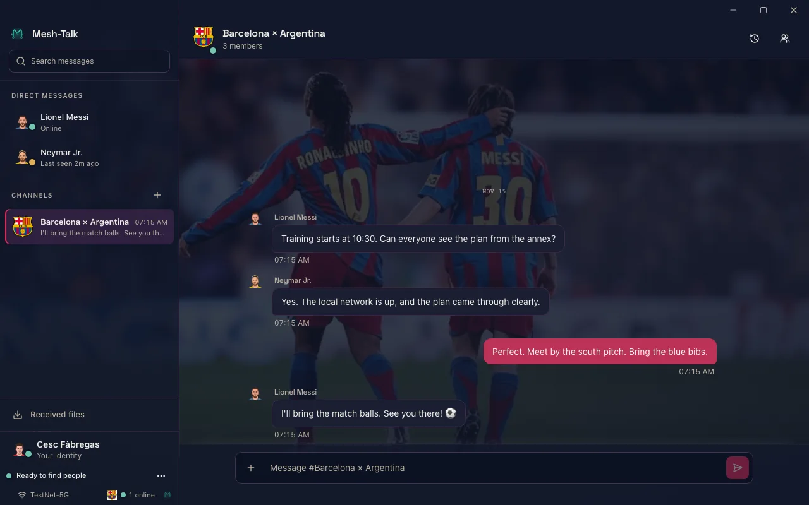

# Mesh-Talk

[](https://github.com/OctopusGarage/mesh-talk/actions/workflows/ci.yml)
[](https://github.com/OctopusGarage/mesh-talk/releases)
[](LICENSE)

**Private desktop conversations, starting on your local network.** Mesh-Talk lets peers find
each other and exchange end-to-end-encrypted messages without a cloud account or a
vendor-operated server. It runs on macOS, Windows, and Linux. Devices can also communicate
across existing routed networks when their owners configure that path.

[Download a release](https://github.com/OctopusGarage/mesh-talk/releases) ·
[Read the documentation](docs/README.md) ·
[View the project site](https://octopusgarage.github.io/mesh-talk/)

<p align="center">
  
</p>
<p align="center"><sub>Desktop interface with deterministic demo identities and messages.</sub></p>

## How it works

Each device has a local identity. Nearby devices discover signed announcements on the LAN,
establish an authenticated Noise-encrypted connection, and sync conversation events. Direct
messages use a Double Ratchet; channels use sender-key ratchets. You can compare a contact's
safety number to verify their identity.

| Situation                   | Path                                                                                                                                                      | What to know                                                                                                                                       |
| --------------------------- | --------------------------------------------------------------------------------------------------------------------------------------------------------- | -------------------------------------------------------------------------------------------------------------------------------------------------- |
| Peers share a LAN           | Automatic local discovery and direct connection                                                                                                           | Works on an isolated LAN; firewall rules and multicast support still matter.                                                                       |
| Peers are on different LANs | Optional [routed discovery](docs/routed-network-discovery.md) over an existing network, or an opt-in [post-office federation](docs/network-topologies.md) | Equal relays exchange signed presence and encrypted mailboxes over reachable, pinned paths; Mesh-Talk does not configure a VPN or join IP subnets. |
| A recipient is offline      | A peer-operated post office stores recipient-encrypted events for later delivery                                                                          | Mailboxes have capacity limits and a maximum age of 30 days; the relay sees [routing metadata](docs/post-office-metadata-privacy.md).              |

The [network architecture baseline](docs/network-design-reference.md) explains the
communication model, module responsibilities, settings and illustrated scenarios.
The [protocol architecture](docs/ARCHITECTURE.md) details crypto and sync; feature-specific
acceptance evidence distinguishes implemented paths from platform/topology assumptions.

## What you can do

- **Converse:** one-to-one DMs and group channels, with reactions, replies, mentions,
  search, presence, and local history.
- **Share and recover:** encrypted chunked file transfer, linked devices, and manual
  [encrypted backups](docs/backup-recovery.md) with a separate recovery key.
- **Control exposure:** contact verification, [privacy presets and invisible mode](docs/privacy-controls.md),
  local retention controls, and message recall.
- **Make it yours:** desktop themes, avatars, stickers, and installable
  [customization packs](docs/CUSTOMIZATION_PACKS.md).

The desktop app is built with Tauri and React. Its UI-free Rust core also runs as the
`mesh-talk-node` CLI, including in post-office mode.

## Get started

Download the archive for your OS and architecture from [Releases](https://github.com/OctopusGarage/mesh-talk/releases).
The default edition includes optional visual packs; the lite edition omits bundled packs
and animated sticker assets. Both can install packs later. Release archives include checksums,
and the release page explains signature and provenance verification.

Desktop installers lack Apple Developer ID and commercial Windows code signing, so those
platforms may ask for a one-time first-launch confirmation. Follow the platform steps in
the [installation and update guide](docs/updates.md). Once installed, create a local account
and open **Connection → Diagnostics** if a nearby peer does not appear. The
[troubleshooting guide](specifications/troubleshooting_guide.md) covers network and platform issues.

### Build from source

Install stable Rust, Node.js 22+, and the [Tauri prerequisites](specifications/deployment_guide.md)
for your platform, then:

```bash
git clone https://github.com/OctopusGarage/mesh-talk.git
cd mesh-talk
make dev
make tauri-dev
```

For a headless node, relay flags, and production builds, use the
[deployment guide](specifications/deployment_guide.md). Each node needs its own keystore.

## Project structure

| Area                                                      | Responsibility                                                                           |
| --------------------------------------------------------- | ---------------------------------------------------------------------------------------- |
| [`crates/mesh-talk-core/`](crates/mesh-talk-core/)        | UI-free protocol, identity, transport, discovery, encrypted event log, and headless CLI. |
| [`src-tauri/`](src-tauri/)                                | Desktop shell and IPC boundary.                                                          |
| [`frontend/`](frontend/)                                  | React desktop interface.                                                                 |
| [`site/`](site/)                                          | GitHub Pages project site.                                                               |
| [`docs/`](docs/) and [`specifications/`](specifications/) | Architecture, feature guides, deployment, conventions, and evaluation evidence.          |

For documentation by task, start at the [documentation map](docs/README.md). Contributors
should read [CONTRIBUTING.md](CONTRIBUTING.md) and the
[documentation guidelines](docs/DOCUMENTATION_GUIDELINES.md). During development, run only
affected tests; use the [testing feedback loop](docs/testing-feedback-loop.md) for commands
and full-gate triggers.

## Security and community

Message content is end-to-end encrypted, while network peers and post offices can observe
some connection or routing metadata. Read the [security posture](docs/ARCHITECTURE.md#8-security-posture-summary)
and [relay privacy guide](docs/post-office-metadata-privacy.md) for the precise boundaries.
Report vulnerabilities privately through [SECURITY.md](SECURITY.md), not a public issue.

Contributions are welcome under the [code of conduct](CODE_OF_CONDUCT.md). Mesh-Talk is
released under the [MIT License](LICENSE).
