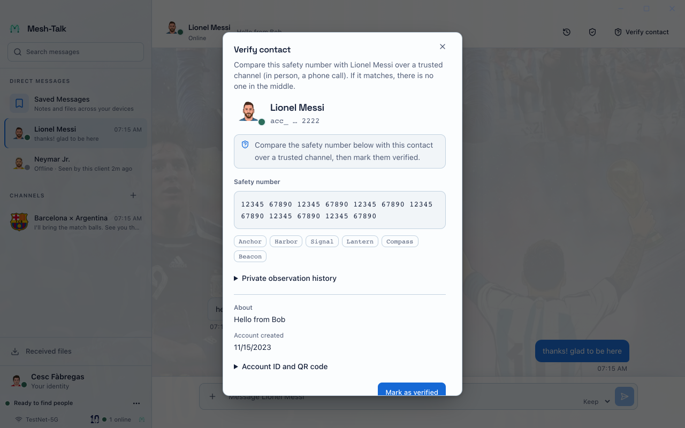
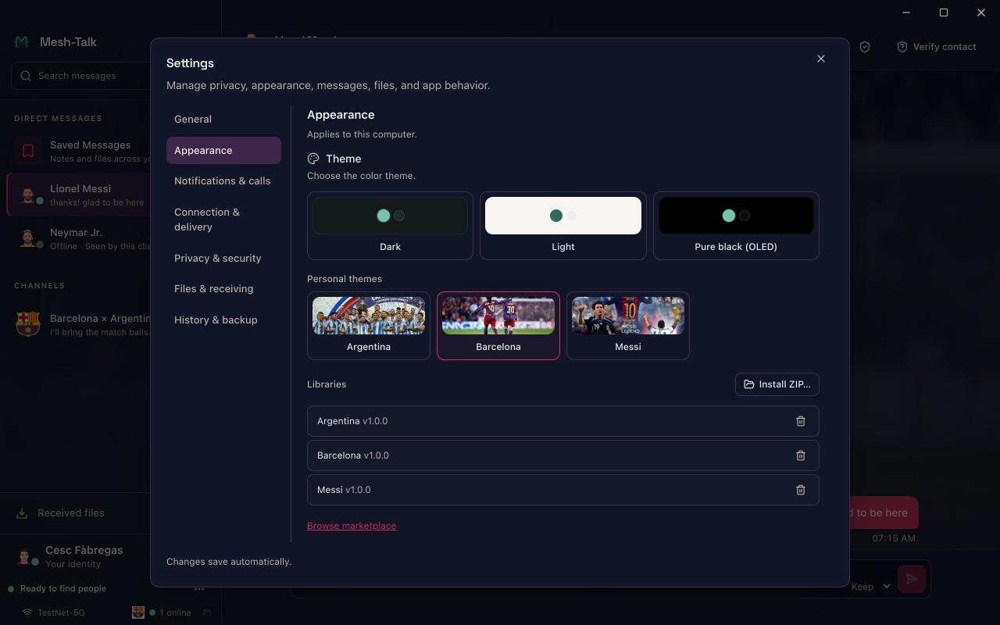
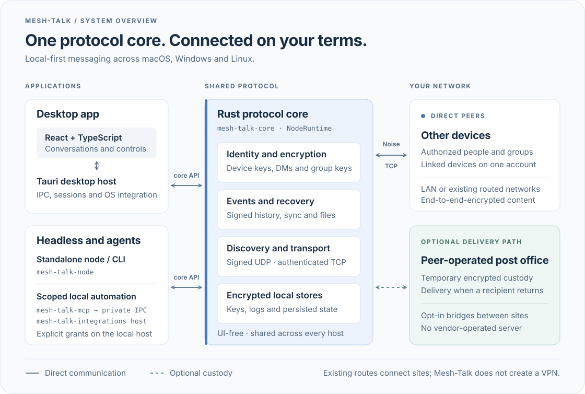

# Mesh-Talk

[](https://github.com/OctopusGarage/mesh-talk/actions/workflows/ci.yml)
[](https://github.com/OctopusGarage/mesh-talk/actions/workflows/e2e-ui.yml)
[](https://github.com/OctopusGarage/mesh-talk/actions/workflows/e2e-backend.yml)
[](https://github.com/OctopusGarage/mesh-talk/actions/workflows/sanitizers.yml)
[](https://github.com/OctopusGarage/mesh-talk/actions/workflows/fuzz.yml)
[](https://github.com/OctopusGarage/mesh-talk/actions/workflows/mutants.yml)

[](https://github.com/OctopusGarage/mesh-talk/actions/workflows/gitleaks.yml)
[](https://github.com/OctopusGarage/mesh-talk/actions/workflows/scorecard.yml)
[](https://scorecard.dev/viewer/?uri=github.com/OctopusGarage/mesh-talk)
[](https://codecov.io/gh/OctopusGarage/mesh-talk)

[](LICENSE)
[](https://www.rust-lang.org/)
[](https://tauri.app/)
[](https://react.dev/)
[](#build-from-source)
[](https://deepwiki.com/OctopusGarage/mesh-talk)
[](https://github.com/OctopusGarage/mesh-talk/releases)

**Encrypted conversations across the networks you control.** Mesh-Talk is a
local-first, decentralized desktop messenger for macOS, Windows and Linux. Discover peers on a LAN
and exchange end-to-end-encrypted messages and files without a cloud account,
internet connection or central messaging server. Connect other LANs and sites
through existing routed networks or optional, trusted peer-operated post offices.

Conversation events synchronize across reachable, authorized peers. When a device
reconnects, another group member can help it recover retained messages and eligible
file contents—even when the original sender is unavailable. Recovery depends on
permissions, connectivity and retained data; it is not an unlimited distributed archive.

[Download](https://github.com/OctopusGarage/mesh-talk/releases) ·
[Project site](https://octopusgarage.github.io/mesh-talk/) ·
[User guide](docs/help/README.md) · [Technical documentation](docs/README.md)

<p align="center">
  
</p>
<p align="center"><sub>Desktop interface shown with deterministic demo identities and messages.</sub></p>

Read the [user guide](docs/help/README.md) for task-based instructions, or open
**Help** in the app for offline search. [AI documentation and MCP](tools/help/README.md)
let your own assistant query the same public manual.

## Communication without a central dependency

- **Start on the LAN.** Signed discovery finds nearby devices. Authenticated,
  encrypted peer connections work without a vendor-operated service.
- **Connect LANs and sites.** Use reachable routed paths, or opt into trusted
  post-office bridges and federation. Mesh-Talk does not create a VPN or merge subnets.
- **Deliver while a recipient is offline.** An available post office can temporarily
  hold recipient-encrypted events, subject to capacity and a maximum age of 30 days.
- **Catch up through group members.** Authorized members with sharing enabled can
  supply missing retained messages and eligible file chunks. The sender need not
  remain online; the supplying member must be reachable and still hold the data.
- **Continue after reconnection.** Peers reconcile missing events and approved file
  transfers can resume from available content. A message or file card, complete file
  contents and recipient confirmation remain distinct outcomes.
- **Synchronize your own devices.** Link certified devices to one account and choose
  which history, file cards and attachment contents synchronize. This needs a reachable
  eligible device and retained source data; a relay does not replace direct account sync.

The desktop app also offers replies, reactions, mentions, search, identity verification,
privacy controls, local history, encrypted manual backups and optional visual packs.
[Experimental calls](docs/help/topics/calls.md) require their own live signaling and
media paths. [Bots and local agents](docs/bot-integrations.md) use explicitly scoped
local permissions. These features share the same communication and trust boundaries.

<table>
  <tr>
    <td></td>
    <td></td>
  </tr>
  <tr>
    <td align="center"><sub>Verify a contact's identity</sub></td>
    <td align="center"><sub>Make the desktop app your own</sub></td>
  </tr>
</table>

## Architecture at a glance

The desktop app, headless node and scoped local agents share one UI-free Rust
protocol core. Devices communicate directly; peer-operated post offices provide
an optional delivery path when recipients are offline.

[](docs/architecture-overview.svg)

See the [architecture reference](docs/ARCHITECTURE.md) for module ownership,
protocol mechanisms and trust boundaries.

## How messages travel

1. **Discover.** Devices announce signed identities over UDP multicast on the LAN. A
   manually supplied address or an existing routed network can introduce a distant peer.
2. **Connect.** Peers authenticate an encrypted Noise connection. Direct messages use a
   Double Ratchet; group channels use per-sender key ratchets.
3. **Sync and recover.** Devices reconcile bounded, signed, content-addressed conversation
   events. A reconnecting group member can catch up through another authorized member
   with retained history and sharing enabled. Eligible retained file contents have
   separate receiving and availability conditions.
4. **Deliver later.** If the recipient is offline, an available post office can hold
   recipient-encrypted events until they return. An opt-in bridge can introduce peers
   across sites, using existing network routes.

| Connection        | What happens                                              | Practical limit                                                  |
| ----------------- | --------------------------------------------------------- | ---------------------------------------------------------------- |
| Same LAN          | Automatic discovery and a direct connection               | Multicast and firewall rules must allow the peers to meet.       |
| Different LANs    | Existing routed discovery or an opt-in post-office bridge | Mesh-Talk does not create a VPN or join IP subnets.              |
| Recipient offline | A post office stores encrypted events for later delivery  | Mailboxes are capacity-limited and expire after at most 30 days. |

The post office cannot read message content, but it can observe routing metadata. It is
an optional delivery path; equal trusted relays can exchange signed presence and encrypted
mailboxes over reachable paths. The
[network topology guide](docs/network-topologies.md) explains which paths support
messages, files, and calls. The [architecture reference](docs/ARCHITECTURE.md) describes
the protocol and its trust boundaries in detail. The
[network architecture baseline](docs/network-design-reference.md) brings together the
communication model, module responsibilities, settings and illustrated scenarios.

## Security and privacy

Each device has its own Ed25519 signing identity and X25519 key agreement identity.
Transport is authenticated with Noise; direct messages use the Double Ratchet, while
channels rotate sender-key epochs as membership changes. Local stores are encrypted at
rest. Compare safety numbers with contacts when identity assurance matters.

Encryption does not hide every connection or routing detail. Expiring messages are a
local retention control: recipients can copy content or modify their clients, and older
clients do not enforce the expiry frame. For the exact limits, see the
[security posture](docs/ARCHITECTURE.md#8-security-posture-summary) and
[post-office metadata guide](docs/post-office-metadata-privacy.md).

## Install and start talking

1. Download the archive for your OS and CPU from
   [GitHub Releases](https://github.com/OctopusGarage/mesh-talk/releases). The app starts
   without optional visual packs or animated sticker assets. Install packs later
   from the marketplace or a local ZIP.
2. Unzip the archive and install the app using the platform package below.
3. Create a local account on each person's device. On the same LAN, peers should appear
   through automatic discovery. Verify a contact's safety number before relying on that
   identity. If a peer does not appear, open **Connection → Diagnostics**.

| Platform | Install                                                            |
| -------- | ------------------------------------------------------------------ |
| macOS    | Open the DMG and drag Mesh-Talk to Applications.                   |
| Windows  | Run the EXE installer, or use the MSI for managed installation.    |
| Linux    | Install the DEB or RPM for your distribution, or run the AppImage. |

Release archives include checksums, signatures, and build provenance instructions on the
release page. Current macOS and Windows installers do not carry commercial OS signing,
so first launch may need the platform's usual downloaded-app confirmation. The app's
**About → Check for updates** action checks only when requested; it downloads a verified
archive but leaves installation to you. Stable is the default update channel; opt into Nightly
in About to try recent main-branch builds without waiting for an official release. See the [install and update guide](docs/updates.md)
for platform steps and the [troubleshooting guide](specifications/troubleshooting_guide.md)
for connection issues.

### Build from source

Install stable Rust, Node.js 22+, and the [Tauri prerequisites](specifications/deployment_guide.md)
for your platform, then:

```bash
git clone https://github.com/OctopusGarage/mesh-talk.git
cd mesh-talk
make dev
make tauri-dev
```

`make tauri-build` packages the desktop app. The UI-free Rust core also runs as a
headless node, with a separate keystore for each instance:

```bash
cargo run -p mesh-talk-core --bin mesh-talk-node -- \
  --keystore ./alice.keystore --password-file ./alice.password --name Alice
```

Protect the password file; on Unix, use mode `0600`. For post-office flags, service
deployment, and release builds, follow the
[deployment guide](specifications/deployment_guide.md).

Source builds identify themselves as the next target's `-dev` build. Product versions have
one Cargo owner; manual release preparation, immutable Nightlies and reviewed next-target updates
follow the [version and release lifecycle](docs/updates.md#version-ownership-and-lifecycle).

Bots and local AI agents can send through scoped credentials. See the
[bot integration guide](docs/bot-integrations.md) for desktop and headless setup.

## Develop and contribute

| Directory                        | What lives there                                                                    |
| -------------------------------- | ----------------------------------------------------------------------------------- |
| `crates/mesh-talk-core/`         | Identity, transport, discovery, event sync, messaging, files, post office, and CLI. |
| `crates/mesh-talk-integrations/` | Scoped local messaging service and dedicated bot/admin CLI.                         |
| `crates/mesh-talk-mcp/`          | Local MCP adapter for agent messaging tools.                                        |
| `src-tauri/`                     | Desktop shell, session state, and IPC commands.                                     |
| `frontend/`                      | React interface and Playwright UI tests.                                            |
| `docs/` and `specifications/`    | Architecture, operation guides, test evidence, and conventions.                     |

The core is independent of the desktop UI. Start with an affected test during development,
then run the relevant end-to-end layer and the full gate before a PR:

```bash
make test                        # Rust workspace tests
make e2e                         # Multi-process backend scenarios
(cd frontend && npm run e2e)     # Playwright desktop UI scenarios
./scripts/check-health.sh        # CI-equivalent health gate
```

Read [CONTRIBUTING.md](CONTRIBUTING.md) for the contribution workflow. The
[documentation map](docs/README.md) points to deeper feature and operations guides;
the [testing feedback loop](docs/testing-feedback-loop.md) helps select focused tests.

## Community

Report vulnerabilities privately through [SECURITY.md](SECURITY.md). Contributions follow
the [code of conduct](CODE_OF_CONDUCT.md). Mesh-Talk is released under the
[MIT License](LICENSE).
