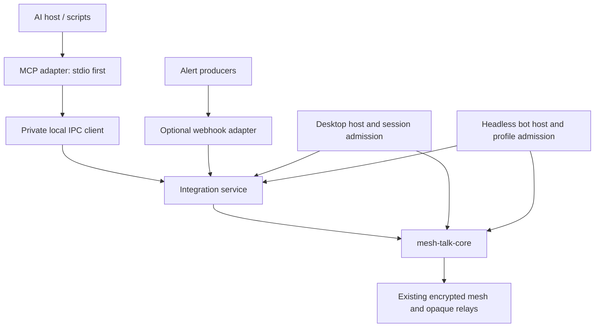

# Bots and MCP: investigation and proposed architecture

Status: initial text/reply, local IPC, desktop/headless hosting and MCP slice implemented; later stages remain proposed. See the [usage guide](bot-integrations.md) for current behavior and limits. Investigated on 2026-10-19 Asia/Tokyo
(2026-10-18 UTC), against repository base `762525d`. The requested deployment scope
is **both desktop-local agents and always-on headless bots**.

This document owns the feature proposal. [Source research](bot-mcp-source-research.md)
records the external evidence and retrieval limits. Existing behavior remains
defined by [Architecture](ARCHITECTURE.md), the [network baseline](network-design-reference.md)
and [module ownership](module-boundaries.md).

## 1. Recommendation

Build a small, transport-independent **integration service** over the existing
protocol core. Give persistent bots their own cryptographic account and device
identity. Expose the same authorized operations through MCP, a local command
adapter, and an optional incoming webhook adapter. Keep AI execution outside the
messenger. Desktop and headless hosts supply runtime ownership and admission;
the core continues to own identity verification, membership, encryption, log
acceptance, synchronization and delivery.

Support two explicitly different ways of speaking:

- **Bot identity:** a separate participant, invited into each group, displayed as
  a bot by supporting clients. Appropriate for alerts, team assistants and agents
  that should retain a stable identity independent of a person.
- **Delegated user identity:** a local client may send through a narrowly granted
  capability of the signed-in user. Appropriate for an agent sending a completion
  notification to that user's existing conversation. The wire author remains
  the user's device; the local audit identifies the integration. Remote automation
  attribution requires a later authenticated protocol extension.

MCP is an interface to this service, not a new message transport or an authority
source. Both modes must use the existing encrypted messaging paths. A webhook
sender or MCP client never receives account keys or arbitrary access to `Node`.

The first release should send text/replies, resolve only granted destinations,
return a durable acceptance identifier, and support revocable credentials and
bounded retry-safe requests. Add interactive bot subscriptions next. Rich cards,
remote MCP, network-wide bot roles, and a plugin marketplace are separate stages.

## 2. Goals, scenarios and explicit boundaries

| Scenario                                 | Principal and host              | Required capability                           | Expected outcome                                                 |
| ---------------------------------------- | ------------------------------- | --------------------------------------------- | ---------------------------------------------------------------- |
| Local agent reports that a task finished | Delegated user, desktop         | Send to one preselected DM/group              | One accepted message; agent need not read history                |
| Build monitor posts an alert             | Bot, headless service           | Incoming notification to one installed group  | Stable bot author; bounded retries and deduplication             |
| Group asks an AI assistant a question    | Bot, headless service           | Explicit trigger, minimal context, reply      | Agent receives approved context and responds under bot identity  |
| Private assistant conversation           | Bot, headless or desktop-hosted | DM receive/reply grant and contact permission | Account-addressed DM, separate from group installations          |
| Local script/cron job                    | Bot or delegated user           | Same send contract through CLI/private IPC    | No dependency on an MCP host or a language model                 |
| Desktop closes                           | Desktop delegation              | None until host resumes                       | Explicit unavailable result; no hidden process opens its profile |
| Team bot runs while desktops close       | Bot, dedicated headless profile | Independent participant runtime               | Can receive and enqueue using existing reachable paths           |
| Bot removed from a group                 | Bot device membership           | Owner-signed removal                          | Future messages/keys follow current membership rules             |

Non-goals for the first release: running untrusted plugins in Tauri; sharing a
human account secret with an AI agent; replacing mesh transport with HTTP/MCP;
putting plaintext into post offices; guaranteeing delivery across disconnected
networks; copying Lark's enterprise tenant infrastructure; automatically linking
to external AI providers; exposing all chat history as model context.

“Local messages” means sending from the locally running Mesh-Talk participant.
The destination may be local or reachable through the existing routed/relay
paths. MCP neither establishes those paths nor bypasses privacy policy. Saved
messages to oneself would be a separate conversation capability, not an assumed
existing API.

## 3. Current implementation and extension seams

The repository has no bot, webhook or MCP integration implementation in the
surveyed production paths. The following are observed code facts, rather than
proposed abstractions:

| Existing owner                                                                                                                                               | What it provides                                                                                                                     | Implication                                                                                                                |
| ------------------------------------------------------------------------------------------------------------------------------------------------------------ | ------------------------------------------------------------------------------------------------------------------------------------ | -------------------------------------------------------------------------------------------------------------------------- |
| [`identity/account.rs`](../crates/mesh-talk-core/src/identity/account.rs), [`identity/device.rs`](../crates/mesh-talk-core/src/identity/device.rs)           | Account keys, device keys and account-signed device certificates                                                                     | A bot can use ordinary authenticated identities without a new crypto system                                                |
| [`eventlog/event.rs`](../crates/mesh-talk-core/src/eventlog/event.rs)                                                                                        | Device-signed content-addressed events; positional append-only event-kind indices                                                    | A caller-supplied bot name cannot change authorship; avoid adding a `BotMessage` event kind                                |
| [`node/dm.rs`](../crates/mesh-talk-core/src/node/dm.rs)                                                                                                      | `enqueue_to_account_if` returns an `EventId`, authorizes around privacy and final WAL acceptance, then delivery can flush separately | Best initial seam for durable, authorized DM sends                                                                         |
| [`node/delivery_store.rs`](../crates/mesh-talk-core/src/node/delivery_store.rs)                                                                              | Encrypted transaction journal, ratchet preparation, immutable destinations and exact delivery state                                  | Extend this acceptance boundary for persistent request deduplication rather than adding a disconnected cache               |
| [`node/channels.rs`](../crates/mesh-talk-core/src/node/channels.rs)                                                                                          | Invitations, explicit acceptance, owner-controlled membership, sender-key sealing, log append and distribution                       | Bots can be ordinary accepted group members; current public sends return `()` and need a guarded acceptance API            |
| [`channel/model.rs`](../crates/mesh-talk-core/src/channel/model.rs), [`node/channel.rs`](../crates/mesh-talk-core/src/node/channel.rs)                       | Device-keyed membership and epoch-based sender chains; causal replay of controls                                                     | Bot account membership must be projected to actual enrolled devices; permission UI cannot substitute for signed membership |
| [`node/participant_runtime.rs`](../crates/mesh-talk-core/src/node/participant_runtime.rs), [`node/runtime.rs`](../crates/mesh-talk-core/src/node/runtime.rs) | Common participant producers and explicit stop/join lifecycle                                                                        | Reuse this runtime in a bot host instead of writing discovery, sync or relay workers again                                 |
| [`src-tauri/src/runtime_admission.rs`](../src-tauri/src/runtime_admission.rs)                                                                                | Session lease, app-lock checks and authorization at commit boundaries                                                                | Desktop delegation needs equivalent authority at final commit, including account-switch races                              |
| [`src-tauri/src/chat_commands/channels.rs`](../src-tauri/src/chat_commands/channels.rs)                                                                      | Current group send snapshots a node handle and awaits core work                                                                      | Do not expose this legacy route unchanged to external automation                                                           |
| [`node/message.rs`](../crates/mesh-talk-core/src/node/message.rs)                                                                                            | `MTB1` text/replies; versioned `MTB2` sticker payloads; unknown frames can render as raw text                                        | New metadata/cards need compatibility design, not fields inserted into positional bincode                                  |
| [`node/profile.rs`](../crates/mesh-talk-core/src/node/profile.rs)                                                                                            | Account-signed avatar profile with a frozen frame                                                                                    | Reuse verification concepts, but do not append bot fields to the existing frame                                            |
| [`node/node.rs`](../crates/mesh-talk-core/src/node/node.rs), [`node/channel.rs`](../crates/mesh-talk-core/src/node/channel.rs)                               | DM callbacks lack stable event IDs; channel callbacks include IDs                                                                    | Interactive integrations need a new stable, replayable event projection                                                    |
| [`frontend/src/lib/mentions.tsx`](../frontend/src/lib/mentions.tsx)                                                                                          | Display-name-based textual mention highlighting                                                                                      | This is not a cryptographically bound bot trigger; structured mention targeting is future wire work                        |
| [`bin/mesh-talk-node.rs`](../crates/mesh-talk-core/src/bin/mesh-talk-node.rs)                                                                                | Headless participant and human REPL; a data-directory lock guards CLI writers                                                        | Reuse participant setup, but do not scrape REPL output or open an already-owned profile                                    |

The DM and channel paths are deliberately different. Account DMs create
per-device copies and a logical delivery identity; channels append one signed
group event and use bounded seeding/recovery. A common integration receipt must
preserve that distinction. It cannot manufacture per-member confirmations for
groups from the DM API.

### Focused architecture diagnosis

Scope: the integration seams above, not an exhaustive repository audit or a
repository health score. Team ownership information was not available, so no
Conway's Law conclusion is inferred.

| Risk                           | Symptom → source → consequence → remedy                                                                                                                                                                                                                                                     |
| ------------------------------ | ------------------------------------------------------------------------------------------------------------------------------------------------------------------------------------------------------------------------------------------------------------------------------------------- |
| Change propagation             | DM and channel public sends have different acceptance contracts → Fowler, divergent change → adapters would invent conflicting retry/status rules → introduce a narrow common send facade backed by distinct core paths                                                                     |
| Dependency disorder            | Desktop admission lives in Tauri and legacy commands can return raw node snapshots → Martin, dependency inversion; Feathers, seams → copying commands into MCP would either pull Tauri into a service or omit session authority → inject a host admission interface, with core commit hooks |
| Domain distortion              | Existing author is a device; names and text mentions are presentation → Evans, ubiquitous language → a cosmetic `is_bot` or name match can be mistaken for identity/authorization → separate bot account, installation, client credential and authenticated origin                          |
| Cognitive load                 | Interactive reliability requires following callbacks, received stores and replay separately → Ousterhout, deep modules → each adapter might build an incomplete subscription system → one bounded event-feed owner with opaque cursors and a durable projection                             |
| Accidental complexity to avoid | A general app platform is not necessary for sending notifications → Brooks, second-system effect → plugin sandboxes and tenant machinery delay the actual feature → two adapters and a small application module first                                                                       |

## 4. What to borrow from Feishu/Lark

Lark distinguishes **custom webhook bots** from **application bots**. The former
are group-bound incoming notifications; the latter use an application identity,
permissions and message/event APIs for broader interaction. This product split
is useful even though Mesh-Talk has a different trust and hosting model.
See the official [Feishu bot overview](https://open.feishu.cn/document/client-docs/bot-v3/bot-overview)
and [custom bot guide](https://open.feishu.cn/document/client-docs/bot-v3/add-custom-bot).

| Dimension             | Lark model                                                   | Proposed Mesh-Talk equivalent                                                     |
| --------------------- | ------------------------------------------------------------ | --------------------------------------------------------------------------------- |
| Quick notifications   | Group-specific webhook URL                                   | Installation-specific incoming credential pinned to one bot and one group         |
| Interactive assistant | App bot with API permissions and receive events              | Bot participant plus separately granted context/event access                      |
| Group authorization   | Bot availability and membership plus API permission checks   | Actual signed device membership plus installation and client grants               |
| Authentication        | Webhook secret/security options or application access tokens | Private IPC plus revocable scoped credentials; HTTP credentials only when enabled |
| Event transport       | HTTP callbacks or persistent SDK connection                  | Local replayable event feed; later outbound agent connection if required          |
| Hosting               | Lark-operated API and event infrastructure                   | User-operated desktop or headless participant; explicit availability limits       |
| Rich interactions     | Cards and callbacks                                          | Later versioned cards/actions with verified action authorization                  |

The official webhook guide documents keyword, IP and signature options and
single-tenant/single-bot limits of 100 requests/minute and 5/second, with a 20 KB
payload limit. These are Lark limits, not sensible automatic defaults for a
peer mesh. Lark's documented timestamp/secret signature recipe is also not a
general request-body MAC; a native Mesh-Talk signing scheme should bind the
method, path, body digest, timestamp and nonce. Keywords are content filters,
not an identity proof. [Official custom bot guide](https://open.feishu.cn/document/client-docs/bot-v3/add-custom-bot).

For app bots, the official SDK demonstrates application credentials, message
creation and receive-event subscriptions. Long
connections are useful because they avoid requiring inbound public callbacks;
their exact availability and language/SDK constraints should be rechecked for a
chosen Lark integration. This proposal borrows the capability separation, not
Lark's exact token lifetime, quota or retry settings. [Message API](https://open.feishu.cn/document/server-docs/im-v1/message/create),
[receive event](https://open.feishu.cn/document/server-docs/im-v1/message/events/receive),
[official SDK and long-connection guide](https://github.com/larksuite/node-sdk#long-connection).
The current API-reference pages returned unreadable JavaScript shells during
research; exact current application quotas and deduplication windows remain
unverified. SDK examples establish feasibility, not a complete permission matrix.

An actual Lark bridge is a separate adapter, not part of native bot support.
It would need loop prevention, mapping of external users/groups, attachment and
retention policy, and explicit consent to export plaintext to Lark. Native bots
must work without a Lark account or vendor service.

## 5. Alternatives considered

| Approach                                                          | Strength                                                                      | Limitation                                                                                   | Decision                          |
| ----------------------------------------------------------------- | ----------------------------------------------------------------------------- | -------------------------------------------------------------------------------------------- | --------------------------------- |
| Expose existing Tauri send commands through local HTTP/MCP        | Fast prototype, uses existing user session                                    | Implicit human impersonation, uneven admission, desktop dependency, no durable deduplication | Reject as the public architecture |
| Add a separate bot protocol, central API server and message store | Familiar enterprise app-platform model                                        | Duplicates identity, routing, persistence and delivery; changes product trust model          | Reject                            |
| Integration service over existing participant identities          | Reuses encrypted core, supports both hosts, consistent policy across adapters | Requires careful core acceptance extensions and explicit bot provisioning                    | Recommend                         |

A headless-only bot implementation could ship sooner than desktop delegation,
but would not cover the requested local-agent workflow. Design the service seam
once, then validate the two host implementations separately.

## 6. Module design and dependency direction

All paths below are proposed. Start the application boundary as one small Rust
crate, `crates/mesh-talk-integrations`. Add a separate adapter crate only when its
SDK/network dependencies are introduced. Avoid a crate for every internal type.



Arrows show use/dependency. MCP and webhook logic must not enter the protocol
core. Desktop supplies an adapter to its admission machinery; the integration
crate does not import Tauri, React or frontend stores.

| Module                                  | Owns                                                            | Public surface / dependency                                                                                   |
| --------------------------------------- | --------------------------------------------------------------- | ------------------------------------------------------------------------------------------------------------- |
| `integrations/service.rs`               | Use-case orchestration and consistent errors                    | `send_message`, `get_send_result`, granted conversation queries; depends on policy and narrow host/core ports |
| `integrations/policy.rs`                | Credentials, exact scopes, revisions, expiration, quotas        | `authorize(context, action, target)`; no transport parsing                                                    |
| `integrations/model.rs`                 | Typed principals, destinations, requests and receipts           | Small stable DTOs, independent of MCP schemas                                                                 |
| `integrations/journal.rs`               | Integration operation/audit lifecycle and bounds                | Encrypted records; acceptance mapping remains atomically owned by core                                        |
| `integrations/events.rs` (second stage) | Filtered event projection, cursors and acknowledgments          | Durable replay/pagination; callbacks are only wakeups                                                         |
| Core `node/` acceptance extensions      | Deduplication with event/ratchet commits, guarded group enqueue | Protocol correctness; no OAuth, webhook, model or UI concepts                                                 |
| Core bot descriptor codec (later)       | Signed identity classification and version validation           | Account-bound descriptor, separate from frozen avatar payload                                                 |
| Desktop host adapter                    | Installed profile lease, lock and shutdown authority            | Implements admission without holding async locks across network work                                          |
| Headless host                           | Bot profiles, process locks, supervision and unlock             | One profile writer; reuses participant runtime                                                                |
| `mesh-talk-mcp` binary/adapter          | MCP schemas, transport and protocol-version behavior            | Converts validated calls into private service requests                                                        |
| Optional webhook adapter                | Bounded HTTP parsing and producer authentication                | Fixed installation target; no client-controlled author/group override                                         |

Conceptual interfaces are deliberately narrow: a runtime provider resolves an
authorized principal to its owned participant, an admission guard encloses each
commit, and a message port performs typed enqueue/query operations. Do not
expose `Arc<Node>` as a capability to untrusted clients. Keep read/event ports
separate from sending so a notification credential does not obtain context.

## 7. Domain model and authorization

| Concept               | Meaning and invariant                                                                                                                        |
| --------------------- | -------------------------------------------------------------------------------------------------------------------------------------------- |
| `BotId`               | Stable crypto account ID of the bot; not an installation ID or API key                                                                       |
| `BotDevice`           | Certified bot device actually present in group membership; owns normal keys/stores                                                           |
| `BotDescriptor`       | Proposed account-signed classification/name/operator claim; binds to account and revision; self-description does not certify trustworthiness |
| `InstallationId`      | Explicit bot-to-conversation configuration, device enrollment and enabled state                                                              |
| `IntegrationClientId` | An external script/agent credential holder; several clients may use the same bot under different grants                                      |
| `GrantId`             | Revocable authority for one client, principal, exact destinations, actions and expiry                                                        |
| `Actor`               | Server-derived bot or delegated user identity; never accepted from untrusted input                                                           |
| `ConversationRef`     | Tagged account-DM or channel ID; full IDs, with no fuzzy mutation resolution                                                                 |
| `OperationId`         | Persistent integration send request handle; distinct from a protocol event ID                                                                |
| `MessageRef`          | Tagged logical account-DM identity or group event ID plus conversation                                                                       |

Effective authorization is the **intersection** of: authenticated client grant;
installation state; host session/profile admission; existing contact/privacy
rules; current signed group membership and acceptance; resource policy. No
adapter may widen this intersection.

Example grant: “client Build Monitor may send text as bot Release Watch to group
`channel:<full-id>`, until revoked, with no history or event access.” A delegated
grant also binds the exact account/profile and runtime generation. Grants are
created through explicit local settings/admin commands, not by an agent asking
the send tool for broader access. UI names assist selection; full IDs authorize.

Suggested action vocabulary: `conversation.describe`, `message.send`,
`message.status`, and later `message.read`, `event.read`, `attachment.send`,
`message.recall_own`. Administrative creation, membership edits and grant edits
remain outside the agent tool catalog initially. Grants carry destination sets
independently of action names; a read grant is never implied by send.

### Bot installation and lifecycle

1. A local admin provisions a separate bot profile, unlock source and display
   identity. For the first version use one bot device per profile; independent
   bots use independent OS processes/data directories.
2. The group owner verifies the bot fingerprint and signs its invitation. Bot
   enrollment accepts only a preconfigured approved group; auto-accepting any
   invitation would silently broaden the bot's access.
3. The bot accepts via the ordinary signed acceptance path. Installation becomes
   active only after local replay establishes valid accepted membership.
4. An admin issues a least-privilege producer/agent credential bound to that
   installation. A copied request cannot choose a different sender or group.
5. Disablement/revocation prevents new acceptance and event reads immediately at
   the owning service's guarded commit boundary. Requests accepted earlier may
   continue existing delivery. Pausing an integration is not recalling a message.
6. Network removal uses owner-signed removal for every bot device and normal
   epoch changes. Revoke credentials as well. If the owner is offline, a local
   gateway can disable its clients but cannot impersonate the owner's removal.

Independent peer verification proves key ownership and membership, not whether
the endpoint really executes AI or whether a person operates it. A signature on
`BotDescriptor` proves “this account declared this bot identity.” An operator's
endorsement can add local trust, but there is no central verified-bot authority.

Initially installation restrictions are enforced by the trusted hosting service.
They do not make a compromised bot signing key cryptographically group-scoped.
Network-wide bot roles or administrator-enforced send permissions require a
future versioned, signed channel policy checked by every receiving peer. An old
peer would not enforce a newly invented bot ACL; do not advertise one as an MVP
security guarantee.

### The group encryption boundary

An ordinary accepted bot device can receive other members' sender distributions.
A send-only webhook/MCP grant limits the **external producer**, while the gateway
still has member-level decryption capability. An event filter that releases only
mentions limits exposure to the external agent, not the gateway's key access.

For alerts, prefer a dedicated notification group or a trusted gateway account
with no exposed read API. A cryptographically receive-incapable bot would need
a different, receiver-enforced restricted-publisher design and key-distribution
rules. That is a later protocol/security project, not a boolean on membership.
Joining/removal also cannot erase previously copied plaintext or undo any older
key material retained by an endpoint. Existing sender-key compromise limitations
remain as documented in [Architecture](ARCHITECTURE.md).

## 8. Reliable sending contract

Proposed service request, shown without transport credentials:

```json
{
  "destination": { "kind": "channel", "id": "<full-channel-id>" },
  "content": { "kind": "text", "text": "Build 482 failed: integration checks" },
  "reply_to": null,
  "idempotency_key": "build:482:integration-failed",
  "expires_at_ms": null
}
```

The client does not supply an arbitrary author. Its credential selects the
principal and allowable destinations. An incoming webhook installation supplies
its destination server-side; its request need only contain content and a retry
key. Reply targets must belong to the same granted conversation and not be an arbitrary cross-conversation data reference. The initial implementation checks retained targets within the latest 500 records per relevant sidecar; this establishes destination association without granting content access or promising a fully visible, unrecalled target.

Proposed accepted receipt:

```json
{
  "operation_id": "<opaque-operation-id>",
  "message": { "kind": "channel_event", "id": "<event-id>" },
  "acceptance": "accepted",
  "delivery": "pending_or_unknown",
  "duplicate": false
}
```

Return acceptance after durable local commit, without waiting for TCP/relay
delivery. Query results distinguish `not_accepted`, `accepted`, `expired`, and
known delivery evidence. Account DMs may expose exact recipient confirmation;
groups expose local acceptance and available custody observations. A group
“delivered to everyone” result is unavailable until such evidence actually
exists. Do not merge relay custody, read status and acceptance into one success
flag. Unknown/unlearned DM accounts fail explicitly; durable enqueue does not
create routes or destination keys from an arbitrary string.

### Crash-safe idempotency is core work

Scope retry keys to `(profile, principal, client, operation-type, key)`, with a
digest of the normalized destination, body, reply and expiry. Same key and digest
returns the original receipt; same key with a changed digest returns
`IDEMPOTENCY_CONFLICT`. Concurrent identical requests serialize to one acceptance.
Changing credentials for the same client must not reset its namespace.

A separate “request completed” record written after `send_*` is insufficient:
the process can crash after appending an event but before recording its ID, and
the retry would duplicate the message. The durable request-to-message mapping
must share the core acceptance transaction, or a core-recoverable operation
marker must make that mapping reconstructible before a retry can enqueue.

For DMs, extend the existing delivery journal with a new versioned transaction
representation; preserve old records and ratchet replay. For groups, introduce
a prepared channel enqueue transaction containing request mapping, final signed
event, advanced sender state and necessary recovery metadata. Prepare against a
stable membership epoch, then recheck it and the grant/session revision at final
commit. A changed epoch requires rebuilding from a valid state before acceptance.
Recover the journal and ratchet/sender state before admitting new requests.
Key-distribution/control side effects also require host admission; do not protect
only the final text append while publishing unauthorized keys beforehand.

Separate acceptance from distribution in a guarded group API returning `EventId`.
Never rebuild ciphertext or advance a ratchet just to retry network delivery.
The core should accept an opaque caller request scope, not know MCP/webhook
terminology. New journal records must not reorder existing bincode variants or
append fields to a frozen positional layout.

Bound the retry ledger by an explicit service contract. Proposed initial retry
window: seven days after acceptance, with a per-profile capacity ceiling and
backpressure before accepting records that cannot be retained. Expiry of the
original message does not remove its retry mapping early. After the advertised
window, key reuse may create a new message; clients must not blindly retry old
operations. Keep message plaintext out of this ledger.

Cancellation before acceptance can abandon the request. Cancellation or a client
timeout after acceptance cannot retract an event; retry with the same key or
query the operation. No “exactly once delivery” claim: the contract is one local
acceptance per valid retry key within the retained window, followed by the
existing deduplicated delivery/recovery model.

### Error model

Return stable typed codes plus safe human detail: `UNAUTHENTICATED`,
`GRANT_REVOKED`, `SCOPE_DENIED`, `HOST_LOCKED`, `HOST_UNAVAILABLE`,
`PROFILE_CHANGED`, `DESTINATION_UNAVAILABLE`, `INVITE_PENDING`,
`MEMBERSHIP_CHANGED`, `CHANNEL_CLOSED`, `INVALID_REPLY`, `PAYLOAD_TOO_LARGE`,
`IDEMPOTENCY_CONFLICT`, `RATE_LIMITED`, `CAPACITY_EXCEEDED`, `STORAGE_FAILURE`.
Do not distinguish nonexistent and unauthorized destinations to unauthorized
callers. Include retryability and `retry_after_ms` where useful; never suggest
retrying a permission failure automatically.

## 9. Desktop and headless hosting

### Desktop-local agent

The app owns its open stores and runtime. A small MCP stdio process connects to
an app-owned private Unix-domain socket on Unix or named pipe on Windows. The
socket is an internal service protocol, not a third MCP transport. It carries
versioned requests, credentials and correlation IDs; its ACL/peer checks and a
revocable grant bind access to the intended user/profile. stdout is reserved for
MCP frames; logs go to stderr.

Attaching must never silently change the active account, unlock the application,
create a profile or read keystores. If the app is closed/locked, return the
appropriate error. Profile switching invalidates outstanding generation-bound
requests. The final authorization guard checks session lease, runtime ownership,
app lock and grant revision together with acceptance. A later unlock cannot
resurrect a revoked request automatically.

Desktop shutdown first closes admission and private listeners, then stops event
readers and joins admitted work through existing runtime retirement. Accepted
network work follows the documented persistence semantics; no detached callback
keeps writing to retired stores. Keep the existing UI adapter intact where
unrelated; converge group send admission as part of the acceptance change.

### Always-on bot

A headless host owns a dedicated bot account/device, encrypted data directory,
profile lock and participant runtime. Agent/MCP processes attach to that host
through the same private service contract. They do not each start a new node.
One OS process per bot profile is the simplest isolation boundary for the first
version; a supervisor can manage several processes. Avoid implementing an
in-process multitenant key vault until actual scale requires it.

Read unlock secrets from a private file, OS secret service or service manager
mechanism, not argv or request arguments. Keep the bot account independent of a
human account. Reuse `PreparedParticipant`/`ParticipantRuntime`; a post office
remains opaque infrastructure and cannot act as the plaintext bot host under
its relay role.

Use direct LAN discovery and existing routed/bridge paths as configured. Always
on does not imply globally reachable. A cloud webhook producer cannot call a
private laptop without an explicit deployment path. For that case run the bot
gateway on a reachable user-operated host, or later add an outbound authenticated
queue connector with a separately documented plaintext/trust boundary.

Do not use two active instances with the same device identity or profile directory
as an HA strategy. Failover must transfer exclusive ownership safely or enroll
a distinct certified device, update memberships and deduplicate jobs at the
service boundary. Device-scoped group authority and owner availability constrain
automatic failover.

## 10. MCP service design

**Feasible and recommended.** Mesh-Talk is the MCP server of messaging tools;
the AI application is the MCP client/host. Mesh-Talk does not need to become a
general MCP client or embed a model in order to let an agent send messages.

The official current revision is `2026-07-28`: requests are self-contained and
capability negotiation is per request. Older `2025-11-25` clients use the older
lifecycle. Keep MCP protocol adaptation in the SDK/adapter, with an explicit
supported-version matrix and tests; never use an MCP connection/session ID as
a Mesh-Talk grant. [Current specification](https://modelcontextprotocol.io/specification/2026-07-28),
[official release explanation](https://blog.modelcontextprotocol.io/posts/2026-07-28/).

### Initial tool catalog

| Tool                           | Scope                   | Behavior                                                                                       |
| ------------------------------ | ----------------------- | ---------------------------------------------------------------------------------------------- |
| `mesh_talk_get_context`        | Basic grant metadata    | Returns effective principal, host availability, retry window and supported content; no secrets |
| `mesh_talk_list_conversations` | `conversation.describe` | Lists only destinations named by the grant, with full typed IDs and display names              |
| `mesh_talk_send_message`       | `message.send`          | Sends to an exact permitted target, requires a retry key, returns acceptance receipt           |
| `mesh_talk_get_send_result`    | `message.status`        | Queries an operation owned by the same authorized client; rechecks current permission          |

If a fixed-destination grant does not permit directory listing, the context
response may disclose that single configured destination as part of the grant;
it must not reveal the rest of the roster. Do not add a generic `invoke_command`,
`execute_sql`, `open_file`, or arbitrary `send_as` escape hatch.

Later add `mesh_talk_read_messages` and `mesh_talk_poll_events` only for explicit
read scopes. Keep provisioning/admin tools separate. Tool annotations identify
send as a mutating external side effect, not read-only. An idempotency annotation
is valid only once persistent deduplication is implemented and the bounded
window is documented. Annotations guide the model; server authorization remains
mandatory. Supply input/output schemas, structured receipts and compatible text
summaries. [Official tools specification](https://modelcontextprotocol.io/specification/2026-07-28/server/tools).

Use the official Rust SDK if its supported versions and maintained release fit
the implementation environment; verify and pin at implementation time rather
than hand-writing MCP lifecycle and HTTP security. The [official Rust SDK](https://github.com/modelcontextprotocol/rust-sdk)
documents stdio and Streamable HTTP support. A small SDK adoption spike should
verify current and legacy clients before committing to a dependency version.

### Transport and authentication stages

1. **stdio first:** the AI host starts the adapter; an explicit private grant
   reaches the service through protected IPC. stdio process launch by itself is
   not permission to use every profile or conversation. Configuration should
   refer to a private grant file/credential reference, not copy long-lived keys
   into prompts, repositories or command-line arguments.
2. **Optional local HTTP:** only when a client cannot use stdio. Bind loopback,
   validate Host/Origin and authenticate every request. Loopback alone does not
   protect against another local user or a hostile browser page. A private
   bearer endpoint is not automatically an interoperable MCP authorization
   implementation; validate the client's expectations before offering it.
3. **Remote Streamable HTTP:** explicit feature, TLS, MCP-compatible OAuth
   authorization/resource discovery, audience validation, exact scopes and
   approved remote deployment. Do not pass an MCP bearer token to Lark or any
   other downstream provider. Keep domain grants independent of transport
   session state and cached tool catalogs. [MCP authorization](https://modelcontextprotocol.io/specification/2026-07-28/basic/authorization),
   [transport specification](https://modelcontextprotocol.io/specification/2026-07-28/basic/transports).

For modern requests, credentials/grants are evaluated on each call. Legacy
protocol state is an adapter compatibility concern; it must not extend grant
lifetime. Schema examples above are application payloads, not complete MCP
JSON-RPC envelopes.

### Useful workflows

A coding agent can read its configured destination, post “tests complete” and
record the returned operation/message ID. A cron script can call the same
service through a CLI without MCP. An interactive assistant can poll its
explicitly granted event feed and reply using a retry key derived from the
trigger event plus handler revision. None of these require exposing full chat
history or model-provider credentials to the messaging service.

MCP tools do not schedule an otherwise idle AI application to wake up. An
always-on group assistant needs an independently supervised agent worker or an
explicit host-supported subscription/wake mechanism. Do not confuse a send
tool with a complete autonomous bot runtime.

## 11. Interactive event and AI boundary

Runtime callbacks are transient notifications, not a durable event queue. A new
feed must use stable message identity and be recoverable from committed records.
Extend the DM projection to carry a stable logical message reference; deduplicate
account fanout copies before publication. Group events already supply stable
IDs, but out-of-order DAG insertion means a cursor cannot simply be “last
Lamport timestamp seen.”

The feed owner should maintain a monotonically sequenced local projection of
newly eligible committed events, with an outbox/reconciliation strategy that
closes crashes between message commit and feed indexing. Page it with opaque
cursors bound to profile, grant, filter revision and retention. Revalidate current
membership/read grants at retrieval; do not release buffered plaintext after a
revocation or group removal. An invalid/expired cursor returns a resync-required
error. It must not silently start at the latest item and lose messages.

Default trigger policy: explicit bot DM or an explicitly enabled group command,
not every group message. A textual `@name` is a convenience matcher with collision
limits; before identity-sensitive mention triggers, introduce structured account
references and capability-aware encoding. Until then use an installation-specific
command prefix and sender allowlist, and label it a text command.

Provide bounded context only when granted: trigger-only, replies in the same
conversation, or an explicit recent-window permission. A reply reference does not
grant history access. Filter recalled/expired/deleted content according to the
current history policy; remove any retained plaintext copies when their owner
policy requires it. Forwarding to a remote model is a separate consent choice,
because encryption terminates at the bot endpoint and does not protect the data
after the agent receives it.

Use at-least-once event delivery with acknowledgment after the handler's durable
result, and retry-safe replies. Ignore the bot's own events by default; ignore
other bot events unless explicitly enabled. Apply per-conversation concurrency,
cooldowns, hop/trigger budgets and a finite context window. Authenticated origin
metadata can improve future loop prevention, but a client-supplied `origin=human`
must never grant authority. Prompt text cannot change destinations or scopes.

## 12. Webhook adapter

An optional incoming HTTP endpoint provides the convenient Lark-like producer
experience. Resolve opaque installation ID to bot, group and credential before
submission; never accept arbitrary destination/author overrides. Use TLS for
remote deployments, a high-entropy secret and rotation, constant-time validation,
strict body/read/concurrency limits, and per-client/profile quotas before costly
work. Return acceptance receipts and typed errors through documented HTTP status
mapping; a `200` from an upstream proxy is not delivery confirmation.

For clients capable of signing, use a versioned HMAC over method, canonical path,
timestamp, nonce and body digest, with a short clock window and bounded replay
cache. Lost-response retries use the same application retry key but a fresh
nonce/timestamp. Treat replay resistance and message idempotency as separate
mechanisms. For producers supporting only a secret URL, disclose the bearer
capability semantics; keep URLs out of logs and offer optional IP restrictions.

Do not describe this as wire-compatible with Feishu. A future Feishu-shaped
payload adapter can normalize a supported subset into the same send command,
but must not create a second message engine or imply acceptance of Lark's exact
security contract.

## 13. Compatibility and message presentation

The initial text/reply path can use existing message wire formats and ordinary
bot identities. Supporting clients can pin a local bot classification from
provisioning; older clients will see an ordinary participant/name. A `[Bot]` name
prefix is only a compatibility hint, never a verified badge.

Portable bot badges require an independently versioned, account-signed descriptor
and verified device/account binding. Define how it is discovered, bounded,
persisted and replayed before adding it. Do not assume a self-declared descriptor
prevents automation from using an unclassified account. Bind operator endorsements
to exact keys and never equate a display name with a human or trusted service.

Remote delegated-send attribution requires signed metadata bound to the message
and authenticating account, with an explicit meaning such as “account declares
client X initiated this send.” Local audit alone cannot justify a remote badge.
That metadata cannot be inserted into `Event`/`ChannelMeta`/avatar records without
a compatible migration. Existing unknown `MTB2` versions can display framing
bytes as text; a new envelope needs feature negotiation or a deliberate legacy
text fallback. Changing payload framing changes the event ID, so a group event
must not be rewritten per recipient to downgrade it.

Future cards should have a constrained schema and text fallback, not arbitrary
HTML/JavaScript. Button actions need signed message/action bindings, expiry,
actor verification and replay protection; rendering a card must never authorize
a command. Files should use existing transfer/consent policy; agent file upload
should use approved attachment handles, not arbitrary filesystem paths or URL
fetches. Progress updates, edits, reactions, scheduling and connector bridges
should add focused actions to the service rather than transport-specific verbs.

## 14. Security, resource and operations contract

| Risk                                          | Required control / honest limit                                                                                  |
| --------------------------------------------- | ---------------------------------------------------------------------------------------------------------------- |
| Agent chooses wrong similarly named group     | Mutations require full tagged IDs selected from the grant; no name-prefix sends                                  |
| Stale request survives logout/revocation      | Grant/session/profile revision rechecked under final commit admission                                            |
| Compromised producer token                    | One principal, exact destinations/actions, expiration, rotation, local kill switch; no bot private key export    |
| Compromised bot host/key                      | Remove all enrolled devices and rotate membership epochs; token revocation alone cannot revoke signing authority |
| Prompt injection in chat or tool descriptions | Treat content as untrusted data; authorization/context/export limits enforced outside the model                  |
| Browser reaches local server                  | Prefer private IPC; HTTP requires Origin/Host checks and authenticated requests                                  |
| Alert storm competes with human traffic       | Bounded queues, quotas and fair scheduling; reuse existing core connection budgets                               |
| Disk full during send                         | Do not return accepted before durable journal commit; fail/recover without duplicate event or ratchet reuse      |
| Bot offline or group route absent             | Preserve accepted work subject to retention; report pending/unknown; no false guaranteed delivery                |
| Context appears in logs/metrics               | Content-free operational logs by default; encrypted bounded audit and explicit diagnostic export                 |
| Agent crashes after handling event            | Durable event acknowledgment plus deduplicated reply key; bounded redelivery                                     |
| Old client lacks bot metadata/ACLs            | Ordinary identity behavior only; no invented enforcement guarantee                                               |

Proposed starting budgets, subject to measured validation: 8 KiB UTF-8 text per
integration message, additionally constrained by the core's final encoded event
and transport budget; one send/second sustained per installation with burst five;
100 pending requests per client; 1,000 pending per profile; seven-day retry-key
retention with a 100,000-record ceiling; 100 items/event page; 10 MiB or seven
days of feed metadata, whichever fills first, returning explicit cursor expiry.
These are design defaults, not current enforced limits or performance claims.
Reserve capacity fairly for human UI traffic and bound aggregate active bots at
the host; multiple processes do not remove machine-level resource limits.

Audit records contain client, grant revision, actor, destination, operation,
message reference, timestamp, decision/error and retry outcome. Do not record
tokens, webhook URLs, message bodies or raw context by default. Protect at rest,
cap audit retention and integrate deletion/backup policy explicitly. Local grants
and live tokens must not be synced to sibling devices or silently reactivated
by a backup restore. Restoration requires fresh runtime/device/grant enrollment.

Metrics: acceptance latency, policy failures, queue depth, deduplicated retries,
disk/journal errors, event lag, host restarts and exact known delivery outcomes.
Keep labels low-cardinality and avoid raw conversation/account names in external
telemetry. Health endpoints report host readiness separately from mesh reachability.

## 15. Incremental delivery and acceptance criteria

This is a staged design roadmap, not an approved implementation plan.

| Stage                            | Deliverable                                                                                  | Acceptance gate                                                                                                                |
| -------------------------------- | -------------------------------------------------------------------------------------------- | ------------------------------------------------------------------------------------------------------------------------------ |
| 0. Core acceptance seam          | Guarded enqueue returning stable receipts for account DMs and channels; atomic retry mapping | Crash/restart and concurrent retry tests prove no duplicate acceptance or sender-key reuse; legacy bytes remain readable       |
| 1. Shared service and both hosts | Scoped grants, private IPC, desktop delegation and dedicated headless bot profile            | Exact-target send works in both modes; revoked/locked/switched sessions fail at commit; independent profile ownership verified |
| 2. Agent and alert adapters      | stdio MCP tools and optional webhook ingress using the same service                          | Current/legacy MCP client matrix, loss/retry tests and malformed ingress tests; no raw command escape hatch                    |
| 3. Interactive bots              | Durable filtered feed, explicit triggers, read grants and supervised worker example          | Restart/redelivery, out-of-order events, recall/expiry/revocation filtering and loop prevention validated                      |
| 4. Portable presentation         | Signed bot descriptors and later authenticated automation metadata                           | Old/new decoder matrix and identity-spoofing cases; no misleading badge on legacy/self-asserted input                          |
| 5. Optional expansion            | Rich actions, files, remote OAuth MCP or bridges                                             | Separate threat model, protocol compatibility and feature-specific acceptance                                                  |

Stage 1 bot messages use normal identities and text, so alerts need not wait for
portable badges or cards. Stage 2 includes a local completion-notification example
and a headless group-alert example. Stage 3 adds a true receive/respond assistant;
a send-only MCP tool by itself is not described as an interactive bot.

### Required validation matrix for implementation

- Core loopback: human ↔ bot DM; bot → accepted group; pending/uninvited/removed
  bot rejects; epoch transition and offline catch-up retain existing boundaries.
- Durability: kill before commit, after commit/before response, during ratchet
  persistence, during group sender-state application and during feed indexing;
  restart and retry; disk-full injection; key/digest conflict; simultaneous retries.
- Desktop: profile switch, lock, logout and shutdown at each asynchronous pause;
  no old generation commits; accepted sends are not misreported as canceled.
- Authorization: send-only cannot read; unknown/unauthorized targets have safe
  errors; revoked grant cannot query sensitive past results; no name spoofing;
  credentials do not grant profile creation, contact initiation beyond policy,
  membership editing or file access.
- Cross-platform IPC: Unix permissions/peer checks and Windows pipe ACLs; another
  user cannot attach; one writer per profile; stdout contains MCP only.
- Protocol adapters: MCP current `2026-07-28` plus explicitly supported older
  lifecycle, schema/tool errors, current-grant checks despite catalog caching;
  HTTP Origin/Host/auth and body limits if HTTP is shipped.
- Interactive: duplicate account-device copies, late DAG ancestors, stable
  logical IDs, bounded pages, cursor expiry, revocation during page retrieval,
  bot-to-bot loops, malicious commands and AI-provider export boundaries.
- Compatibility: stored journal migration, existing wire fixtures, old/new text
  and descriptor behavior, backup/restore does not reactivate credentials.
- Topology: LAN, existing routed path, eligible relay, no route, offline bot and
  offline group member; preserve custody versus recipient-confirmation language.

During implementation run focused affected Rust/frontend tests. Before PR use
the repository's required `make test`, selector-based cross-platform preflight
and PR wrapper; run full health before requesting review. This investigation
changes documentation only and does not constitute runtime validation.

## 16. Settled proposal and remaining decisions

Recommended defaults are explicit: separate bot account; delegated user mode
only by grant; both host modes; one writer/profile; stdio/private IPC first;
no default history access; current core crypto/delivery; application-level
installation restrictions; text/replies before cards; atomic retry mapping before
claiming retry safety.

Implementation review should settle the exact shared admission interface and
versioned group transaction format first. A small SDK/client compatibility spike
then validates the adapter dependency. Later product decisions concern remote
ingress exposure, AI-provider consent, portable descriptor discovery and whether
groups need receiver-enforced bot roles. These do not block presenting this
architecture, and none are silently treated as existing capabilities.
