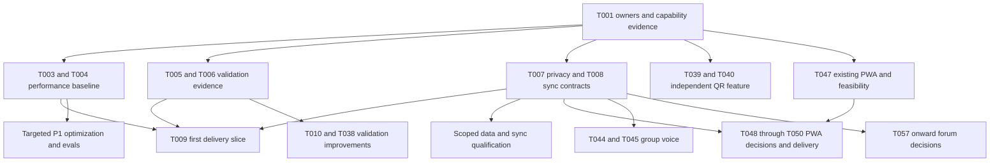

# Development roadmap and requirements

This is the maintained entry point for the thirty collected requirements, their
consolidation, delivery priorities, dependencies and agent task claims. Read this
before choosing work; then read the linked authoritative contracts. It owns future
work and decision state, not a second implementation-status report or a copy of
protocol rules. [Current capabilities](../specifications/TODO.md) remain separate.

## Current authorization and planning boundary

Requirements collection is complete. The user accepted consolidation into 23 work
topics, requested a prioritized dependency-aware TODO and authorized merging these
planning documents into `main` before product development. Future agents may
claim ready tasks in independent branches; this document does not claim that any
feature has been built, any benchmark has run, or any suspected defect is proven.
Roadmap priority is a recommended delivery policy, subject to evidence and explicit
product decisions recorded below. Significant technical choices stay open.

Start with existing-IM correctness, resource efficiency and fast reliable feedback.
Permit small independent improvements in parallel once their own contracts are
ready. Forum, marketplace, public SDK and radical UI replacement are not blanket
prerequisites for core fixes. No calendar dates or effort estimates are fabricated
before code/environment assessment. Phase progression is by evidence, not time.

## Navigation

- [Priority and classification](#priority-and-classification)
- [Delivery phases](#delivery-phases)
- [Work-topic register](#work-topic-register)
- [Task backlog](#task-backlog)
- [Dependency rules](#dependency-rules)
- [Agent claims and parallel branches](#agent-claims-and-parallel-branches)
- [Requirements-to-release document flow](#requirements-to-release-document-flow)
- [Open decision register](#open-decision-register)
- [Original requirement traceability](#original-requirement-traceability)
- [Source references](#source-references)

## Priority and classification

| Priority | Meaning                                               | Selection rule                                                                                                                                                   |
| -------- | ----------------------------------------------------- | ---------------------------------------------------------------------------------------------------------------------------------------------------------------- |
| P0       | Establish trustworthy evidence and critical contracts | First bounded inventory, runtime/validation baselines, privacy and sync authority models; urgent verified security/data-loss defects take immediate precedence.  |
| P1       | Improve and protect the current messenger             | Evidence-backed performance/reliability fixes, practical protection, reusable contracts, monitoring, documentation and validation effectiveness.                 |
| P2       | Bounded capability expansion or decision research     | QR, browser review, group voice, mobile PWA and client adapters after their own readiness gates; UI/peer research is not a commitment to migrate/add features.   |
| P3       | Conditional longer-term roadmap                       | Forum/feed, incentives/endorsements, external SDK, marketplace, video and any justified UI migration; each requires a concrete product/technical decision first. |

Categories are orthogonal to priority: **Optimization** changes cost/latency at a
preserved contract; **Feature** adds observable capability; **Quality/Security**
protects named invariants; **Architecture/Governance** clarifies ownership and
interfaces; **Research/Decision** produces evidence or an explicit choice. No
suspected issue is labeled a confirmed bug. An investigation may close with
retain/no-change and recorded evidence. That is a valid outcome, not permission to
manufacture a refactor to satisfy a checkbox.

Every task has a priority and hard input dependencies. Within one priority, task
ID is a default discussion/dispatch tie-break, never an excuse to block independent
ready work. Lower-priority work can run concurrently only when it does not consume
the constrained owner/review/native-test capacity needed for higher-priority work.
An actual urgent security, data-loss or hard-freeze finding overrides this queue.

## Delivery phases

| Phase                                 | Scope / entry                                                                                                 | Exit and handoff                                                                                                                                                                                                                                                                |
| ------------------------------------- | ------------------------------------------------------------------------------------------------------------- | ------------------------------------------------------------------------------------------------------------------------------------------------------------------------------------------------------------------------------------------------------------------------------- |
| M0: planning baseline                 | Merge this navigable roadmap through existing PR gates; do not start product changes in its documentation PR. | One canonical roadmap, source mapping, tasks, claim rules and unresolved decisions available on main. This does not certify product readiness.                                                                                                                                  |
| M1: evidence and first-slice decision | T001-T009; focused document/call-path and measurement work, not a broad rewrite.                              | Repeatable runtime and validation baselines, current capability/owner map, privacy/sync authority observations and an explicitly chosen bounded delivery slice. Missing environments become owned evidence gaps.                                                                |
| M2: existing IM hardening             | Ready P1 work; T047 mobile feasibility can run as a bounded research lane.                                    | Selected fixes show comparable before/after results and independent failure/recovery assertions; applicable budgets and CI/native gates hold on the current source. Remaining untested topology/platform cases are named. Do not wait for every speculative P1 change to exist. |
| M3: bounded extensions                | Ready P2 slices with product decisions and relevant contracts.                                                | QR/review/voice/PWA/client entries each have their own definition of done and can ship independently; no feature waits for an unrelated complete stack migration or public SDK.                                                                                                 |
| M4: platform/community exploration    | P3 decisions and experiments promoted only with a real scenario, evidence and capacity.                       | Go/no-go decisions or small independently verified releases; rejected/deferred choices retain reasons/revisit conditions. No automatic commitment to every idea.                                                                                                                |

No phase permits weakening crypto, authority, durability or required checks to hit
performance goals. [Performance requirements](performance-requirements.md) already
own initial project targets and startup/idle/active/return-to-idle measurement.
Use and refine that owner with evidence rather than introduce conflicting numbers.
Existing source docs reference calls, saved content, peer verification and privacy
controls; T001 must establish actual implementation and acceptance before treating
similar requests as missing features.

## Work-topic register

WORK identifiers name consolidated topics; REQ identifiers preserve the collected
source. T identifiers below are claimable planning/delivery units. Their separation
prevents confusing a source idea, a research outcome and an implementation task.

| Topic   | Scope                                         | Classification                  | Priority                          | Source                    | Tasks                                                |
| ------- | --------------------------------------------- | ------------------------------- | --------------------------------- | ------------------------- | ---------------------------------------------------- |
| WORK-01 | Monitoring and diagnosis                      | Optimization + feature          | P0 baseline / P1 panel            | REQ-001, REQ-016          | T004, T026, T027                                     |
| WORK-02 | Performance budgets and regression protection | Quality + optimization          | P0/P1                             | REQ-011, REQ-016          | T003, T028, T029, T071                               |
| WORK-03 | Events and shared scheduling                  | Optimization + architecture     | P1                                | REQ-005                   | T011, T012, T029                                     |
| WORK-04 | I/O, history and data/resource lifecycles     | Optimization + correctness      | P0/P1                             | REQ-006, REQ-017          | T004, T013, T014, T015, T016, T017, T018, T019, T074 |
| WORK-05 | Domain, ownership and component explanations  | Governance                      | P0/P1                             | REQ-004, REQ-009          | T001, T009, T037                                     |
| WORK-06 | Internal foundations and sync contracts       | Correctness + architecture      | P0/P1                             | REQ-008, REQ-015, REQ-018 | T008, T020, T021, T022, T023, T024, T025, T072, T073 |
| WORK-07 | Validation coverage, latency and stability    | Quality + optimization          | P0/P1                             | REQ-003, REQ-030          | T005, T006, T010, T038, T071                         |
| WORK-08 | Stack and storage suitability                 | Research / decision             | P1                                | REQ-007                   | T034                                                 |
| WORK-09 | Desktop UI/native-experience options          | Research; conditional roadmap   | P2 research / P3 change           | REQ-012                   | T035, T036                                           |
| WORK-10 | Download and installed size                   | Optimization                    | P1                                | REQ-014                   | T033                                                 |
| WORK-11 | Privacy and exposure limits                   | Security                        | P0 model / P1 changes             | REQ-013                   | T007, T030                                           |
| WORK-12 | Anti-harassment and endorsements              | Feature + security; research    | P1 controls / P3 endorsements     | REQ-025                   | T031, T032, T066                                     |
| WORK-13 | Optional-resource contribution incentives     | Exploratory roadmap             | P3                                | REQ-028                   | T067, T068                                           |
| WORK-14 | Browser content review                        | Feature                         | P2                                | REQ-002                   | T041, T042, T043                                     |
| WORK-15 | Manual image QR recognition                   | Feature                         | P2                                | REQ-010                   | T039, T040                                           |
| WORK-16 | Group voice and later video                   | Feature; later roadmap          | P2 voice / P3 extensions          | REQ-023                   | T044, T045, T046                                     |
| WORK-17 | Decentralized forum and forwarding            | Exploratory roadmap             | P3                                | REQ-019, REQ-024          | T057, T058, T059, T060, T061, T062, T063             |
| WORK-18 | Private personal feed/profile                 | Exploratory roadmap             | P3                                | REQ-026                   | T064, T065                                           |
| WORK-19 | Mobile PWA                                    | Research + feature              | P1 feasibility / P2 delivery      | REQ-027                   | T047, T048, T049, T050                               |
| WORK-20 | Rust-first external SDK                       | Platform roadmap                | P3                                | REQ-020                   | T054, T055, T056                                     |
| WORK-21 | Official core/client ecosystem                | Architecture + feature; roadmap | P2 contracts/adapters / P3 market | REQ-021                   | T051, T052, T053                                     |
| WORK-22 | Decision rationale and AI lookup              | Governance                      | P0/P1                             | REQ-022                   | T002, T070                                           |
| WORK-23 | Peer-tool feature discovery                   | Research input                  | P2 bounded research               | REQ-029                   | T069                                                 |

## Task backlog

All tasks start **unclaimed** and **not started**. Claim readiness is calculated
from completed inputs, accepted product decisions and available evidence; priority
alone does not authorize implementation. A checkbox closes only with the stated
outcome, linked PR/evidence and owning-guide updates, or an explicit supported
no-change/defer decision. No work is checked off because this plan was merged.

The hard-input column means the named output must exist, not that its author must
rewrite code. Conditional implementation tasks require a finding and approved
scope; otherwise record retained behavior or deferred work. Exact source edits,
commands/fixtures and small implementation steps are written by the claimant
after owner/caller inspection, before editing. This is a complete program backlog,
not speculative line-by-line code instructions for uninvestigated subsystems.

| Done | Task                                                                 | Priority / type   | Topic            | Hard inputs                  | Outcome and acceptance                                                                                                                                                                                                                                                                  |
| ---- | -------------------------------------------------------------------- | ----------------- | ---------------- | ---------------------------- | --------------------------------------------------------------------------------------------------------------------------------------------------------------------------------------------------------------------------------------------------------------------------------------- |
| [ ]  | **T001 Verify capability and responsibility inventory**              | P0 / Research     | WORK-05          | None                         | Map actual code, callers, guides and existing tests; label implemented, partial, missing and unknown. Do not infer a missing capability from this backlog.                                                                                                                              |
| [ ]  | **T002 Establish decision lookup and task ownership**                | P0 / Governance   | WORK-22          | T001                         | Reuse topic guides and important ADRs; record reason/status/revisit conditions and a single claim owner per task. Do not invent historical rationale.                                                                                                                                   |
| [ ]  | **T003 Bind performance scenarios to existing budget owner**         | P0 / Decision     | WORK-02          | T001                         | Use performance-requirements.md targets and measurement definitions; identify platform gaps, release builds, process family and baseline provenance without inventing a second budget table.                                                                                            |
| [ ]  | **T004 Measure startup, idle, active and return-to-idle cost**       | P0 / Research     | WORK-01, WORK-04 | T003                         | Attribute CPU, memory, disk operations/bytes, network and wakeups using repeatable representative workloads; separate app from build-tool cost and cold/warm behavior.                                                                                                                  |
| [ ]  | **T005 Measure validation latency and failures**                     | P0 / Research     | WORK-07          | T001                         | Use existing report owners for local/PR attempts; separate setup, compilation, execution and dependency wait; classify failures with logs, not eventual green results.                                                                                                                  |
| [ ]  | **T006 Map verification coverage and evidence gaps**                 | P0 / Research     | WORK-07          | T001                         | Evaluate the supplied static/dynamic/formal/fuzz/property/mutation/security/native/eval methods against real risks; give an owner and reason for covered, partial, deferred or inapplicable methods.                                                                                    |
| [ ]  | **T007 Establish privacy threat and exposure model**                 | P0 / Research     | WORK-11          | T001                         | Document sensitive assets, observers, peer/relay visibility and account/IP meanings; distinguish verified protections, gaps and uncertainty. No absolute anonymity claim.                                                                                                               |
| [ ]  | **T008 Verify sync, authority and data-lifecycle contracts**         | P0 / Research     | WORK-06          | T001                         | Trace personal/group sync, announcement/member authority, retained state, deletion floors, recovery and compatibility; identify evidence gaps without selecting Raft or a global rewrite.                                                                                               |
| [ ]  | **T009 Select the first evidence-backed delivery slice**             | P0 / Decision     | WORK-05, WORK-02 | T004, T005, T006, T007, T008 | Publish a small ranked finding list with measured cost/risk, invariant, owner, scope, acceptance and stop conditions; absent evidence means investigate or retain, not automatic refactoring.                                                                                           |
| [ ]  | **T010 Improve the proven validation bottlenecks**                   | P1 / Optimization | WORK-07          | T005, T006                   | Implement only justified selector, cache, isolation or fixture changes; compare source-bound before/after latency and failures while preserving mandatory checks and detection evidence.                                                                                                |
| [ ]  | **T011 Inventory event and scheduling semantics**                    | P1 / Decision     | WORK-03          | T001, T004                   | Record real triggers/producers/consumers, initial-state ordering, recovery purposes, cancellation and work ownership; choose reuse seams for demonstrated needs.                                                                                                                        |
| [ ]  | **T012 Replace justified polling and share scheduling**              | P1 / Optimization | WORK-03          | T011                         | Conditional on a proven gap: reuse reliable events and necessary timers; validate lost/duplicate events, logout/shutdown cancellation, resource bounds and idle recovery.                                                                                                               |
| [ ]  | **T013 Reduce redundant reads, writes and fetches**                  | P1 / Optimization | WORK-04          | T004, T008                   | Conditional on measured redundancy: meaningful revisions/cursors and unchanged-write suppression; prove durable acceptance, crash/reconnect and stale-version behavior are preserved.                                                                                                   |
| [ ]  | **T014 Bound startup and history loading**                           | P1 / Optimization | WORK-04          | T004, T008                   | Agree required initialization and recent/older-history behavior; demonstrate usable startup and bounded reads/decrypt work as history grows, without skipping recovery or authorization.                                                                                                |
| [ ]  | **T015 Bound memory growth and reclaim owned resources**             | P1 / Optimization | WORK-04          | T004                         | Identify actual retained owners; repeat navigation/media and return-to-idle scenarios; show a bounded working-set plateau and cleanup, without calling every retained OS page a leak.                                                                                                   |
| [ ]  | **T016 Specify retention, capacity and cleanup choices**             | P1 / Decision     | WORK-04          | T008                         | Separate chats, files, logs, indexes and custody; define user consent, quotas, alerts, recoverability and limits. No unconfirmed automatic deletion.                                                                                                                                    |
| [ ]  | **T017 Qualify history-sync range and catch-up**                     | P1 / Optimization | WORK-04          | T008, T016                   | Implement only agreed range/policy gaps; test linked/new/offline devices, required authority metadata and missing-history recovery without assuming full history is always transferred.                                                                                                 |
| [ ]  | **T018 Protect deletion intent against returning data**              | P1 / Quality      | WORK-04          | T008, T016                   | Define local/account/recall scopes; validate reconnect, stale peer, restart and restore behavior. Fix only verified failures with focused regressions.                                                                                                                                  |
| [ ]  | **T019 Bound deletion-marker accumulation safely**                   | P1 / Optimization | WORK-04          | T018                         | Conditional on measured growth and safe reclamation proof; compare compaction/checkpoints or retention alternatives against old/offline/new peers. Retain markers if no safe reduction is established.                                                                                  |
| [ ]  | **T020 Qualify personal multi-device synchronization**               | P1 / Quality      | WORK-06          | T008                         | Exercise partial/duplicate/reordered replay, enrollment/revocation, offline catch-up and interruption; improve verified gaps and record per-scenario cost/compatibility limits.                                                                                                         |
| [ ]  | **T021 Qualify group message propagation and recovery**              | P1 / Quality      | WORK-06          | T008                         | Exercise bounded fanout, legitimate retained-history recovery, membership change and unavailable sources; measure convergence/cost without bypassing existing authority.                                                                                                                |
| [ ]  | **T022 Resolve announcement state and edit semantics**               | P1 / Decision     | WORK-06          | T008                         | Keep pending versus effective explicit; decide offline/concurrent edits, confirmation, current projection/history and later verification cases from evidence.                                                                                                                           |
| [ ]  | **T023 Resolve member and permission state semantics**               | P1 / Decision     | WORK-06          | T008                         | Separately decide who can authorize which transition, confirmation and revocation rules; do not borrow a latest-value rule from announcements without proof.                                                                                                                            |
| [ ]  | **T024 Improve reusable internal foundation interfaces**             | P1 / Architecture | WORK-06          | T001, T008                   | Conditional on demonstrated coupling/duplication: keep business rules owned, specify errors/lifetimes, preserve wire/storage/crypto compatibility and validate real consumers. A retained existing interface is a valid outcome.                                                        |
| [ ]  | **T025 Close selected synchronization evidence gaps**                | P1 / Quality      | WORK-06          | T020, T021, T072, T073       | Run the selected loopback/native/multi-node failure and scale scenarios for accepted contracts; report unsupported physical/topology cases rather than claim all networks verified.                                                                                                     |
| [ ]  | **T026 Define reusable monitoring sources and controls**             | P1 / Decision     | WORK-01          | T004                         | Specify CPU/memory/I/O/network, connection count and per-peer latency semantics/freshness; reuse existing observations, measure incremental cost and agree optional acquisition defaults.                                                                                               |
| [ ]  | **T027 Deliver detailed monitoring and compact native entry**        | P1 / Feature      | WORK-01          | T026                         | One source pipeline for panel/menu-bar views; optional extra work stops when disabled; test stale/missing metrics and open/closed/idle overhead. User warning policy still needs an explicit decision.                                                                                  |
| [ ]  | **T028 Integrate reproducible performance regression evals**         | P1 / Quality      | WORK-02          | T003, T004, T006             | Reuse existing validation owners; source/environment-bound baselines, stable scenarios, meaningful regressions and actionable reports; distinguish required native evidence from cheap PR checks.                                                                                       |
| [ ]  | **T029 Maintain AI performance and reuse requirements**              | P1 / Governance   | WORK-02, WORK-03 | T011, T028                   | Extend performance/reliability owners with triggers, lifecycle, bounded/incremental work and exceptions; link regression selectors. Guidance supplements executable evidence, not a duplicate rulebook.                                                                                 |
| [ ]  | **T030 Strengthen only evidenced privacy or crypto gaps**            | P1 / Security     | WORK-11          | T007                         | Choose protections with explicit trade-offs and residual exposure; validate unauthorized, stale/revoked, replay and compatibility paths. Verified urgent vulnerabilities override this normal queue.                                                                                    |
| [ ]  | **T031 Define account/device and stranger-contact policy**           | P1 / Decision     | WORK-12          | T007, T008                   | Decide block scope, requests/quarantine versus trusted-only options, group effects and linked-device behavior. Endorsement counts do not grant contact rights.                                                                                                                          |
| [ ]  | **T032 Implement or qualify practical anti-harassment controls**     | P1 / Feature      | WORK-12          | T031                         | Reuse existing policy owners, deny unwanted actions at the correct layer, test unlink/revoke/unblock and bounded spam behavior; do not merely hide unauthorized traffic in the UI.                                                                                                      |
| [ ]  | **T033 Explain and reduce comparable package growth**                | P1 / Optimization | WORK-10          | T001                         | Compare same OS/architecture/format versions; report compressed/installed sizes and contents. Apply only validated build/resource changes with signing/install/update and runtime trade-offs; no forced 10M target.                                                                     |
| [ ]  | **T034 Review stack and storage suitability**                        | P1 / Research     | WORK-08          | T001, T004                   | Verify actual persistence owners, including SQLite use if any; compare official desktop-IM evidence and representative workloads. Record retain/tune/experiment/replace with migration cost, not popularity.                                                                            |
| [ ]  | **T035 Compare desktop UI routes against equivalent workloads**      | P2 / Research     | WORK-09          | T004, T034                   | Review GPUI/Kit, Slint, Iced, Rune and current Tauri with verified platform/license/maturity evidence, Chinese IME/accessibility/native parity and full process-family resources; Web optional.                                                                                         |
| [ ]  | **T036 Prototype or migrate UI only after a justified decision**     | P3 / Architecture | WORK-09          | T035                         | Conditional on measured benefit and accepted parity/maintenance/rollback plan. Tauri optimization or no migration can close this decision; never commit to three parallel production UIs by default.                                                                                    |
| [ ]  | **T037 Maintain domain and component guides at their owners**        | P1 / Governance   | WORK-05          | T001, T008                   | Update glossary, responsibility map and technical index; cover search/logging with actual mechanisms, failure/recovery and resource contracts. Link unknowns and justified changes separately.                                                                                          |
| [ ]  | **T038 Fill high-value test capability gaps incrementally**          | P1 / Quality      | WORK-07          | T006, T010                   | Select targeted property/fuzz/mutation/model/security/native or recovery work with real invariants; demonstrate meaningful fault detection and recurring cost. Not every listed tool becomes a gate.                                                                                    |
| [ ]  | **T039 Finalize QR card types and recognition results**              | P2 / Decision     | WORK-15          | T001                         | Use manual image-menu/large-preview entry; agree supported contact/URL/plain-text and multiple/invalid-code behavior, existing owners and explicit user actions.                                                                                                                        |
| [ ]  | **T040 Implement or qualify manual chat-image QR recognition**       | P2 / Feature      | WORK-15          | T039                         | Decode on user request only, show content before navigation/contact action; preserve permission checks, bound decode work and verify repeat/stale-result/error cases.                                                                                                                   |
| [ ]  | **T041 Define browser content-review contract**                      | P2 / Decision     | WORK-14          | T001, T007                   | Select content formats, link/link+code access, separate permissions, commenter identity/granularity, revision/expiry/revocation and host-offline behavior; editing remains later.                                                                                                       |
| [ ]  | **T042 Deliver scoped browser viewing and link controls**            | P2 / Feature      | WORK-14          | T041                         | Reuse appropriate host/identity owners; no-install clients can view only published scope; validate code changes/revocation, malicious paths/assets and interrupted sessions.                                                                                                            |
| [ ]  | **T043 Deliver comments and revision-aware review**                  | P2 / Feature      | WORK-14          | T042                         | Implement selected comment placement/identity/persistence and updates; test changed versions, duplicate submission and permission revocation with bounded resource behavior.                                                                                                            |
| [ ]  | **T044 Specify the existing-group voice-meeting slice**              | P2 / Decision     | WORK-16          | T007, T008                   | Choose participant scale, initiator/host-exit behavior, membership admission and audio controls; audit existing calls and prove exact signaling/media dependencies rather than require a whole sync rewrite.                                                                            |
| [ ]  | **T045 Deliver or qualify real-time group voice**                    | P2 / Feature      | WORK-16          | T044                         | Voluntary join; authorize membership, capture cleanup, permission denial/reconnect/sleep/leave; measure native audio quality, latency and CPU/network under the agreed participant scale.                                                                                               |
| [ ]  | **T046 Evaluate video and independent meeting rooms**                | P3 / Feature      | WORK-16          | T045                         | Separate later product decisions and native performance/security evidence; no recording, screen sharing or browser guests implied by voice approval.                                                                                                                                    |
| [ ]  | **T047 Inspect existing mobile-PWA work and browser feasibility**    | P1 / Research     | WORK-19          | T001                         | Verify feature/mobile-pwa head/PR/owner without overwriting work; map implemented/gaps, iOS/Android secure-context/HTTPS/local-network/mDNS/storage/background constraints and LAN/remote options from primary evidence.                                                                |
| [ ]  | **T048 Specify PWA identity, keys and authorized-node pairing**      | P2 / Decision     | WORK-19          | T007, T008, T047             | Decide device identity, QR grant, key storage/recovery/revocation, offline promises and hosting/transport; distinguish discovery from trusted binding and avoid assumed JS rewrite.                                                                                                     |
| [ ]  | **T049 Validate one-node mobile encrypted chat**                     | P2 / Feature      | WORK-19          | T048                         | Continue suitable existing work; real supported mobile browsers, correct plaintext/key boundaries, lock/revoke/data-loss and resource evidence; choose no-go if browser guarantees cannot meet the contract.                                                                            |
| [ ]  | **T050 Add authorized multi-node failover and offline recovery**     | P2 / Feature      | WORK-19          | T049                         | Deduplicate sends/custody, use only explicitly authorized reachable nodes, recover foreground queues/history after interruption; document unsupported background delivery instead of promising it.                                                                                      |
| [ ]  | **T051 Define official core and interchangeable-client contract**    | P2 / Decision     | WORK-21          | T001, T008                   | Choose service/embedded SDK form and single/multiple-client lifecycle from actual needs; stable scoped operations/events/errors, authoritative state and no duplicate runtimes or policy copies.                                                                                        |
| [ ]  | **T052 Demonstrate a default and alternative interaction adapter**   | P2 / Feature      | WORK-21          | T051                         | Use existing CLI/MCP where suitable; verify permission/identity/lock/logout/conformance and resource cost against the same core before generalizing community interfaces.                                                                                                               |
| [ ]  | **T053 Decide and build a bounded community catalog or marketplace** | P3 / Feature      | WORK-21          | T052                         | Separate listing from installation/update/execution; resolve compatibility, publisher trust, review and revocation. Commercial/payment features are not assumed.                                                                                                                        |
| [ ]  | **T054 Design a Rust-first SDK around a real external consumer**     | P3 / Decision     | WORK-20          | T001, T008                   | Identify actual project/use case, minimal non-UI contracts, storage/runtime/key ownership and API/wire/storage compatibility; retain existing core if extraction adds no justified value.                                                                                               |
| [ ]  | **T055 Extract and qualify the chosen external SDK surface**         | P3 / Feature      | WORK-20          | T054                         | Consumer integration example, bounded lifecycle/cancellation, secure failure/reconnect/compatibility and representative latency/throughput/resource tests; no duplicated core policy.                                                                                                   |
| [ ]  | **T056 Consider bindings only for demonstrated external demand**     | P3 / Feature      | WORK-20          | T055                         | Record language/runtime consumer and boundary obligations before a separate binding plan; otherwise keep deferred with a revisit trigger.                                                                                                                                               |
| [ ]  | **T057 Define decentralized forum audience and propagation model**   | P3 / Decision     | WORK-17          | T007, T008                   | Resolve standalone/in-app, author/community permissions, local versus device-carried exchange, availability and consent. No automatic publish-on-Wi-Fi or new forum engine assumed.                                                                                                     |
| [ ]  | **T058 Validate a minimal local forum scenario**                     | P3 / Feature      | WORK-17          | T057                         | Authorized publish/discover/read/reply with stable identity, bounded incremental transfer and explicit retained-copy limits; reuse only suitable sync primitives with real failure evidence.                                                                                            |
| [ ]  | **T059 Define and deliver permitted post/comment forwarding**        | P3 / Feature      | WORK-17          | T058                         | Choose reference/snapshot/live semantics, provenance and destination permissions; preserve parent context, edit/deletion handling and duplicate control.                                                                                                                                |
| [ ]  | **T060 Resolve three-day expiry, pinning and comment selection**     | P3 / Decision     | WORK-17          | T057                         | Keep default three-day disappearance unless manually pinned; define origin clock, local hide/evict/delete, pinned scope, display/fetch/storage and hot/new/own union before choosing ranking/cleanup algorithms.                                                                        |
| [ ]  | **T061 Qualify bounded forum retention and selection**               | P3 / Feature      | WORK-17          | T058, T059, T060             | Implement accepted TTL/pin/ranking rules, incremental maintenance and missing-parent behavior; verify old/offline/forwarded copies, no hidden expiry reset and no unauthorized global-delete promise.                                                                                   |
| [ ]  | **T062 Explore consented cross-location forum propagation**          | P3 / Feature      | WORK-17          | T059, T061                   | Explicit audience/forwarding authorization, retained copies and bounded exchange after node movement; no implicit trust from Wi-Fi presence.                                                                                                                                            |
| [ ]  | **T063 Assess optional external copies or publication**              | P3 / Research     | WORK-17          | T057                         | Separate Google Drive personal backup, same-user sync and public publishing; explicit destination/data consent, security and decentralized independence. Cloud API support remains unverified.                                                                                          |
| [ ]  | **T064 Define personal-feed and independent profile visibility**     | P3 / Decision     | WORK-18          | T007, T008                   | Per-post publisher-selected contacts, no public default; decide profile options, later audience change/replies/forwarding and access revocation. Do not inherit forum TTL.                                                                                                              |
| [ ]  | **T065 Deliver the chosen private personal sharing slice**           | P3 / Feature      | WORK-18          | T064                         | Enforce audience at data/authority boundary, not UI only; validate linked devices, removed recipients, offline retained copies and bounded timeline/media loading.                                                                                                                      |
| [ ]  | **T066 Evaluate privacy-aware trusted-contact endorsements**         | P3 / Research     | WORK-12          | T031                         | Define attestation scope, local/published visibility, revoke/expiry, fabricated/collusive identities and non-transitive trust. Counts are not automatic permission or identity proof.                                                                                                   |
| [ ]  | **T067 Define optional-resource contribution incentives**            | P3 / Decision     | WORK-13          | T007, T008, T031             | Protect basic chat; select useful contribution/evidence and bounded benefits for forum/files/cache only; assess fairness, collusion/replay and accounting/privacy/resource overhead.                                                                                                    |
| [ ]  | **T068 Run a bounded incentive experiment before adoption**          | P3 / Feature      | WORK-13          | T067                         | Demonstrate genuine useful-work credit, no authorization bypass or starvation and measured costs under adversarial cases; reject/defer if benefit is not established.                                                                                                                   |
| [ ]  | **T069 Research peer tools for specific feature opportunities**      | P2 / Research     | WORK-23          | T001                         | Verify supplied official leads/platform/security claims, user problem and resource/maintenance fit; do not adopt quoted rankings or add Bluetooth/LoRa features automatically.                                                                                                          |
| [ ]  | **T070 Backfill supported rationale and AI navigation**              | P1 / Governance   | WORK-22          | T002, T037                   | Record only evidence-supported reasons/status/revisit conditions beside owning guides/important ADRs; AI finds relevant decisions before changing rules; unknown past reasons stay unknown.                                                                                             |
| [ ]  | **T071 Maintain phase acceptance and release rehearsals**            | P1 / Quality      | WORK-02, WORK-07 | T009                         | For each selected slice bind current-source correctness/performance/native evidence and remaining limits; rehearse install/update/recovery when affected; follow existing Nightly/Stable publication gates.                                                                             |
| [ ]  | **T072 Apply the accepted announcement contract**                    | P1 / Quality      | WORK-06          | T022                         | Conditional on T022 finding a gap: implement the selected update/history/confirmation behavior, preserve permissions and compatibility, and independently test offline/concurrent/reordered changes. If current behavior satisfies the contract, record retained behavior and evidence. |
| [ ]  | **T073 Apply the accepted membership authority contract**            | P1 / Security     | WORK-06          | T023                         | Conditional on T023 finding a gap: implement authorized admission/removal/role transitions and effective-state rules; validate stale, concurrent, replayed and revoked writes without treating UI membership as authority.                                                              |
| [ ]  | **T074 Apply the accepted retention and capacity policy**            | P1 / Feature      | WORK-04          | T016                         | Conditional on a verified policy/UX gap: implement the chosen per-data-category limits, capacity reminders and consented cleanup; test interrupted cleanup, saved data and recovery boundaries. Do not apply forum TTL to chat history.                                                 |

## Dependency rules

**Hard dependency:** required authority/evidence/interface output, named in the
backlog. **Conditional dependency:** activated only if the chosen design needs a
specific change; record it in the task before implementation. **Shared evidence:**
reuse another task's compatible facts without waiting for an entire topic/rewrite.
A dependency on a decision can complete with retain-current-behavior, not only new
code. If that removes the rationale for a child, explicitly close/defer the child;
do not pretend its feature was implemented.

Representative paths (the task table is authoritative):

Avoid false global blockers:

- Runtime profiling T004 does not wait for the monitoring UI T027; use suitable
  existing observations or bounded diagnostic collection first.
- QR T039/T040 needs its actual contact/image contract, not a database/UI migration.
- PWA starts by inspecting existing work T047. It does not require external SDK
  publication, direct browser mDNS or a JavaScript rewrite as an assumption.
- Group meetings and forum forwarding require the specific group identity,
  admission and propagation contracts found by T008. If T044/T057 discovers a
  missing contract, name the precise T020-T025 output; do not block them on a
  blanket rewrite. Real-time media is not ordinary retained chat history.
- Internal reuse T024, external-project SDK T054/T055 and interchangeable Mesh Talk
  clients T051/T052 have distinct consumers. None requires building a marketplace
  or cross-language bindings first.
- Forum expiry/ranking T060 is not personal-feed retention or global deletion.
- Privacy exposure fixes are not contingent on contribution scoring; normal chat
  is not deprioritized by optional-resource incentives.

## Agent claims and parallel branches

Read [repository rules](../AGENTS.md), [project context](../PROJECT.md), this task's
source rows and [module ownership](module-boundaries.md). For source discovery use
CodeGraph first when indexed. The active coordinator owns task selection and
integration; one implementer owns each task at a time. Agents do not silently
reassign others' tasks or treat a branch name as proof of ownership.

### Claim and state protocol

1. Re-read current `main`, task and shared-interface decisions. Confirm required
   inputs are linked and adequate, not just checked boxes. If a PR already owns the
   change, attach/continue it through the supported session workflow rather than
   create a duplicate. Preserve unrelated work.
2. Atomically agree the claim through the active coordinator/tracker before
   editing. The coordinator records one compact row below (or a linked issue/PR
   as the single live owner). A stale copy of this document is not a lock.
3. Claim includes task, agent/session, base SHA, owned paths, branch, shared
   interface assumptions, acceptance/evidence owner and current next action.
   Record exact source paths only after inspection. No overlapping mutations
   without the interface/integration owner explicitly coordinating the split.
4. Create one task branch in the session namespace from the accepted base; use
   its registered isolated worktree where needed. A stack uses its real parent
   branch and verified head, with a stated merge order. Do not keep all work on
   one long-lived feature branch or add another worktree without ownership notes.
5. Keep the PR limited to the task and any inseparable contract/selector/docs.
   Update progress and blocker/review/CI state. Push fixes for the same task to
   the same PR, resolve addressed review threads and revalidate current source.
6. Integrator rechecks required current-head CI and reviews, then squash-merges
   under [merge policy](../specifications/git_standards.md). Rebase/merge dependent
   work deliberately; no force-push without authorization. Capture delivered
   acceptance or named limits, release the claim and clean only task-owned
   branches/worktrees under repository preservation rules.

States: `Unclaimed -> Claimed -> Investigating -> Ready for design/implementation
-> Implementing -> In review -> Validated -> Merged`. Use `Needs decision` or
`Needs evidence` with owner/next action when blocked, and `Deferred`/`Retained`
with reason/revisit conditions for no-go results. A merged research PR completes
its evidence task, not a downstream implementation or a release guarantee.

| Task     | Claimant / session | Branch / base | Owned paths / shared interfaces | State / next action                             | Issue / PR / evidence |
| -------- | ------------------ | ------------- | ------------------------------- | ----------------------------------------------- | --------------------- |
| None yet | Unassigned         | Not created   | Not assigned                    | Planning document only; no product task claimed | No product PR         |

Suggested lanes, subject to actual path/resource review:

| Lane                      | Initial eligible work                                | Conflict boundary                                                                                                                                |
| ------------------------- | ---------------------------------------------------- | ------------------------------------------------------------------------------------------------------------------------------------------------ |
| Coordinator / domain      | T001, then T002/T008/T009                            | One owner coordinates glossary, authority and shared-interface decisions; do not funnel every tiny fix through an all-app redesign.              |
| Runtime performance       | T003/T004, then independent measured P1 slices       | Coordinate shared stores, session lifecycle and native measurement resources; reserve production-like profiling to avoid concurrent build noise. |
| Validation engineering    | T005/T006, then T010/T038                            | One owner for selection, runner and required-check policy; reuse tests and maintain current protections.                                         |
| Privacy and user controls | T007, then T030/T031/T032                            | Identity/crypto/wire decisions require the core contract owner; separate endorsement research.                                                   |
| Independent UI features   | T039 after T001; later review/voice/PWA ready slices | Do not concurrently edit shared chat/store/IPC contracts without a designated integration owner.                                                 |
| Platform research         | T034/T047 when inputs ready; T035/T069 later         | Research output alone does not claim core files or authorize branch extraction/migration.                                                        |

Start with a small number of nonconflicting tasks; expand only when review and
runner/native capacity permit. Do not invent a universal agent count or start
parallel workers merely because a roadmap row exists. Workers register meaningful
progress, evidence and blockers with the active project coordinator. This roadmap
supports parallel delivery; it does not automatically dispatch agents.

## Requirements-to-release document flow

Use the existing documentation owners. Requirements explain desired outcomes;
architecture explains contracts; implementation plans explain the next bounded
change; tests/evals provide evidence; ADRs preserve important trade-offs. A giant
permanent implementation diary is not the source of truth.

| Step                            | Deliverable / owner                                     | Entry and exit                                                                                                                                                                                                  |
| ------------------------------- | ------------------------------------------------------- | --------------------------------------------------------------------------------------------------------------------------------------------------------------------------------------------------------------- |
| 1. Requirement                  | This roadmap, stable REQ/WORK/T links and product owner | Observable user scenario, constraints, explicit unknowns and non-goals; preserve the original confirmed scope.                                                                                                  |
| 2. Evidence / triage            | Existing owning guide plus linked PR/CI evidence        | Inspect implementation/callers and actual conditions; quantify when relevant, label uncertainty; select retain/fix/feature/experiment rather than assume a defect.                                              |
| 3. Feature contract / design    | Owning feature/network/storage/privacy guide            | Define authority, state/lifetimes, errors, permission, failure/recovery and budget; compare alternatives. Use a short design for a small feature, a substantial design for protocol/migration/platform changes. |
| 4. Important choice             | Existing topic rationale or linked ADR                  | Record why, alternatives, consequences/status and reconsideration triggers. Do not require an RFC/ADR for every small edit.                                                                                     |
| 5. Implementation slice         | Task PR plus ignored local plan under tmp               | Claim exact paths/interfaces, test selectors and concrete steps. Do not commit scratch plans or duplicate the existing contract. Read performance/reliability rules before edits.                               |
| 6. Change and boundary feedback | Owning tests, validation.json and relevant guide        | Requirement-derived assertions, applicable failure paths, affected static/tests and browser/native evidence; update rule/selector/consumers together when boundaries change.                                    |
| 7. Candidate acceptance         | Current committed PR, reviews and protected checks      | Report tested SHA, command results, gaps and rollback/recovery; required current-head gates before merge. Optional full local preparation is not an automatic per-edit burden.                                  |
| 8. Integration / release        | Existing update and release lifecycle                   | Integrate compatible slices, update backlog/status/help only as warranted, rehearse affected install/restore/upgrade/native behavior; publish only through existing authorized release flow.                    |

### Document owners and entry paths

| Information                                                             | Existing owner / intended destination                                                                                                                         |
| ----------------------------------------------------------------------- | ------------------------------------------------------------------------------------------------------------------------------------------------------------- |
| Future work, priority, source mapping and claim entry                   | This roadmap; linked from docs/README.md, already reachable through PROJECT.md.                                                                               |
| Implemented capabilities / deliberate limits                            | [Implementation status](../specifications/TODO.md); do not turn it into a competing chronological backlog.                                                    |
| Domain terms and modeling                                               | [CONTEXT.md](../CONTEXT.md), [domain-design.md](domain-design.md).                                                                                            |
| Module authority and parallel interface ownership                       | [module-boundaries.md](module-boundaries.md).                                                                                                                 |
| Protocol, network, storage and crypto                                   | [ARCHITECTURE.md](ARCHITECTURE.md), [network-design-reference.md](network-design-reference.md) and relevant topic guides.                                     |
| Performance and AI reliability                                          | [performance-requirements.md](performance-requirements.md), [ai-coding-reliability.md](ai-coding-reliability.md); extend existing rules with proven patterns. |
| Validation/eval coverage and cost                                       | [testing-feedback-loop.md](testing-feedback-loop.md), [ci-maintenance.md](ci-maintenance.md), owning validation.json, [evaluation inputs](evals/README.md).   |
| Durable significant trade-offs                                          | Existing topic guide; linked ADR only when needed under [DDD conventions](domain-design.md).                                                                  |
| User help and product claims                                            | [Help](help/README.md), relevant feature guide, documentation hub; do not claim roadmap features are shipped.                                                 |
| Temporary plans, raw profiles, research snapshots and generated reports | Ignored task-owned tmp/target or PR/CI artifacts; reusable suites in docs/evals, not run histories.                                                           |

### Validation and definition of done

Use the [existing stages](testing-feedback-loop.md#validation-stages-and-agent-responsibilities)
and current required-check policy. For future code work preview `make test-plan`
or `make verify-plan`; run affected tests while changing and `make verify-changed`
with the necessary browser/native escalation. Run `make standards-check` when
adding/moving source or changing contracts. Run repository hygiene before commit.
Create PRs through `./scripts/create-pr.sh -- <gh pr create options>`; it requires
a clean committed candidate. Do not fabricate receipt/coverage evidence or change
thresholds simply to pass. Exact commands and filters come from the selected
owner and actual diff, not a generic all-suite instruction in this roadmap.

A delivery is done only when the accepted user outcome and failure/recovery paths
are evidenced, resource behavior is compared for the affected startup/idle/active
and return-to-idle phases, relevant compatibility/migration/reversal limits are
explicit, selectors and maintained docs match behavior, and the current head
meets required reviews/checks. Full workspace/native/release gates remain in their
owners; a subset or model score is not universal correctness evidence. All methods
in REQ-030 receive a later applicability decision, not silent removal or blanket
mandatory execution. Optional extensive checks must not recreate REQ-003's delays.

### Reusable task handoff fields

Before a ready task is assigned, put these fields in its issue/PR or task record:

- Stable T/WORK/REQ IDs and concrete outcome/non-goals.
- Owner/agent, base/source SHA, branch, exact paths and shared-interface owner.
- Completed hard inputs and conditional/product decisions with links.
- Authoritative rule, real consumers, lifecycle/authority and resource invariants.
- Selected tests/evals, platform/native scenarios and performance baseline identity.
- Expected completion evidence, review/integration owner and rollback/recovery limits.
- Current state, blocker/decision/evidence owner, next action and claim release path.

An AI starting here should choose only a ready task of the authorized kind, confirm its claim, inspect
owners/callers, resolve missing decisions, implement the bounded slice, validate
and report evidence, then request integration under existing gates. It must not
silently select Raft, replace SQLite/Tauri, rewrite crypto in JS, expose a service,
change retention or publish packages because such an option appears in a row.

### Mature-process references and adaptation

These are narrowly reviewed process sources, not a completed competitor, CI or
framework survey. Accessed during roadmap preparation; current versions can change.
Our adaptation below is a project recommendation, not a claim every mature project
uses identical gates or a reason to copy their schedule/telemetry policies.

- [VS Code development process](https://github.com/microsoft/vscode/wiki/Development-Process)
  separates high-level roadmap, iteration plans and done criteria, with a testing
  and stabilization period. Apply the separation and evidence-based milestone
  exits, not a mandatory monthly release cadence.
- [VS Code contribution guide](https://github.com/microsoft/vscode/wiki/How-to-Contribute)
  emphasizes small issue-linked PRs and discussion of architectural impact. Use
  independently reviewable slices with an explicit owner and tests.
- [VS Code test-plan items](https://github.com/microsoft/vscode/wiki/Writing-Test-Plan-Items)
  specify tester context/setup, platform and bounded scope. Use reproducible
  native acceptance cases and split oversized test plans.
- [Rust RFC process](https://rust-lang.github.io/rfcs/)
  distinguishes substantial design decisions from ordinary PR changes and records
  alternatives, rationale and postponed work. Use proportional design review and
  significant ADRs; do not impose an RFC ceremony on a small correction.
- [Zed contribution guide](https://github.com/zed-industries/zed/blob/main/CONTRIBUTING.md)
  asks contributors to discuss features first and limits simultaneous open PRs to
  protect review capacity. Use capacity-aware parallel claims and finishable
  slices; do not copy its numeric PR limit as a Mesh Talk policy.

## Open decision register

These decisions are deliberately represented as work, not missing plan content.
The responsible task gathers its listed evidence, presents alternatives and then
records the chosen behavior. A decision blocks its own affected implementation,
not every independent task in the program.

| Decision                                                      | Resolving task(s)   | Owner / closure evidence                                                                                           |
| ------------------------------------------------------------- | ------------------- | ------------------------------------------------------------------------------------------------------------------ |
| First actual bottlenecks and first delivery slice             | T003-T009           | Product/integration owner plus runtime/validation evidence; no assumed root cause.                                 |
| Monitoring defaults/history and user alerts                   | T026/T027           | Product owner chooses after source/overhead options; no always-on costly collection assumed.                       |
| Startup, memory, retention/sync/deletion boundaries           | T014-T019           | Product owner and core/storage owner; define visibility versus durable deletion, safe recovery and reclamation.    |
| Announcement/member offline conflict and confirmation         | T022/T023           | Group/core authority owner and product owner; pending/effective distinction preserved, Raft open.                  |
| Database/stack/UI retain versus replace                       | T034-T036           | Measured workload, parity/cost/license and reviewed migration/rollback; retained current stack is valid.           |
| Threat scope, account/IP protection and acceptable trade-offs | T007/T030           | Product/security owner; explicit observer/peer/relay exposure, no absolute anonymity.                              |
| Stranger behavior, block scope and endorsement meaning        | T031/T066           | Product/security owner; no unsupported count-based automatic trust.                                                |
| QR contact formats and safe actions                           | T039                | Product/contact-interface owner; manual trigger and explicit choice already fixed.                                 |
| Review formats/comments and host availability                 | T041                | Product/host owner; link or link+code configurability fixed, editing later.                                        |
| Voice scale, controls and host exit                           | T044                | Product/call owner and native feasibility evidence; active voluntary join fixed.                                   |
| PWA platform, keys/pairing, LAN/remote and offline guarantees | T047/T048           | Product/security/browser integration owners; existing branch and current browser evidence, no JS/mDNS assumptions. |
| Core service/SDK form, clients and market trust               | T051/T053           | Integration/product owner; shared authority and default client fixed, runtime/distribution open.                   |
| Rust SDK minimal external scope and bindings                  | T054/T056           | Real consumer/SDK owner; Rust-first and no speculative expansion fixed.                                            |
| Forum form/audience/forwarding/expiry/ranking/external copies | T057/T059/T060/T063 | Product/sync/privacy owner; three-day/pin intent fixed, exact semantics and top10 suggestions open.                |
| Personal-feed/profile visibility enforcement                  | T064                | Product/privacy owner; selected contacts per post and separate profile configuration fixed.                        |
| Contribution evidence/priority/fairness                       | T067                | Product/resource/security owner; optional sharing only, basic chat protected.                                      |
| Additional peer-inspired features                             | T069                | Evidence-backed concrete use case and explicit acceptance; no automatic roadmap expansion.                         |

## Original requirement traceability

Each source is retained as a faithful condensed requirement and confirmed
boundary, not a transcript or evidence that its implementation exists. WORK
mapping is reversible. Reference URLs follow below; quoted third-party claims and
possible defects remain hypotheses. New requests start at REQ-031; do not reuse
retired IDs. Changes require an explicit reason and owner, not silent scope loss.

| Source  | Original intent / confirmed boundary                                                                              | Open boundary                                                                                                                      | Work topic(s)    |
| ------- | ----------------------------------------------------------------------------------------------------------------- | ---------------------------------------------------------------------------------------------------------------------------------- | ---------------- |
| REQ-001 | App CPU/disk/network/memory, connections and peer latency; panel/menu-bar; reuse data and disable extra work.     | Defaults/history/metric scope need decisions; zero overhead is an objective, not evidence.                                         | WORK-01          |
| REQ-002 | No-install browser viewing/commenting, configurable link or link+code; editing later.                             | Content types, comment model, versioning and revocation remain open.                                                               | WORK-14          |
| REQ-003 | Local waits, PR CI waits and unstable reruns all matter; locate causes with real timings/failures.                | No assumed cause, cache fix or gate removal.                                                                                       | WORK-07          |
| REQ-004 | Concepts, relations, lifecycles and responsibilities; extend existing owners and record only justified refactors. | No global refactor presumed; grilling/domain-modeling/codebase-design are requested methods, exact grillme availability to verify. | WORK-05          |
| REQ-005 | Reuse reliable events, necessary timeouts/retries/recovery and shared lifecycle/scheduling; AI guidance.          | Do not assume async timers create dedicated OS threads or cause the observed regression.                                           | WORK-03          |
| REQ-006 | Reduce redundant checks/fetches/writes using valid change detection; clarify history organization.                | No consent to delete history or weaken durable acceptance.                                                                         | WORK-04          |
| REQ-007 | Whole stack, database/storage focus; retain/tune/replace from evidence.                                           | SQLite use and peer choices need verification; no migration presumed.                                                              | WORK-08          |
| REQ-008 | Internal reusable network/decentralized/sync/crypto foundations; preserve business-specific rules.                | No external SDK in this internal topic; inspect existing layers first.                                                             | WORK-06          |
| REQ-009 | Unified index and maintained topic guides, existing-doc-first; current/unknown/proposed separate.                 | Search/logging explicitly covered; no automatic refactor.                                                                          | WORK-05          |
| REQ-010 | Manual QR action in image menu/large preview, content displayed before user choice.                               | No background scanning/auto-navigation; card formats unresolved.                                                                   | WORK-15          |
| REQ-011 | Long-term high-performance/low-power quality, actual measurement, component reuse and stable fast validation.     | Use the existing performance requirement owner; targets are not claims of current compliance.                                      | WORK-02          |
| REQ-012 | macOS/Windows/Linux primary; compare improve-Tauri/add-UI/migrate; Web optional here.                             | Candidate frameworks and native superiority unverified; no replacement commitment.                                                 | WORK-09          |
| REQ-013 | LAN-observer privacy plus feasible reduction in peer IP/identity exposure.                                        | Threat model and costs unresolved; practical trade-offs, no absolute anonymity.                                                    | WORK-11          |
| REQ-014 | Download size primary, installed footprint tracked; comparable artifacts.                                         | Reported less-than-10M to about-20M is unverified; no forced 10M target.                                                           | WORK-10          |
| REQ-015 | Coherent communication, retention and performance responsibilities with reuse and later SDK possibility.          | Umbrella intent distributed to relevant work; no separate all-app rewrite.                                                         | WORK-06          |
| REQ-016 | Explain disk frequency/memory/CPU, reusable performance evals/CI and discoverability.                             | Developer feedback versus user alerts and ambiguous wording need discussion.                                                       | WORK-01, WORK-02 |
| REQ-017 | Startup/history, memory reclaim, retention/capacity, sync range, deletion anti-return and markers.                | All current behavior unverified; no full-decrypt or deletion defect assumed.                                                       | WORK-04          |
| REQ-018 | Personal/group sync reusable beyond chat; announcements/member permissions separate, pending/effective explicit.  | Offline/conflict/confirmation and representation choices need evidence; no Raft preselection.                                      | WORK-06          |
| REQ-019 | Decentralized forum with local/roaming exchange and possible external copies.                                     | Standalone/in-app, audiences, availability and save/forward behavior not decided.                                                  | WORK-17          |
| REQ-020 | Other Rust projects first; real external consumer validates minimal SDK; bindings later.                          | External SDK separate from internal reuse and Mesh Talk clients; no speculative framework.                                         | WORK-20          |
| REQ-021 | Official core plus default client and community GUI/TUI/CLI/MCP/skill entries.                                    | Service/SDK form, concurrent clients and marketplace distribution remain decisions.                                                | WORK-21          |
| REQ-022 | Reason/status/revisit records; reuse guides, important ADRs; AI lookup before changes.                            | Do not invent history or make old decisions irreversible.                                                                          | WORK-22          |
| REQ-023 | Existing-group LAN voice meeting, members actively join.                                                          | Temporary rooms/video later; sync dependency and existing media gaps unverified.                                                   | WORK-16          |
| REQ-024 | Forward posts/comments and consider hot10/new10/own selection.                                                    | Three-day disappearance unless pinned explicit; clock/scope/delete meaning and ranking remain open.                                | WORK-17          |
| REQ-025 | Public-network anti-harassment, account/device blocks and trusted-contact endorsements.                           | No request-queue/trusted-only default or count-based safety accepted yet.                                                          | WORK-12          |
| REQ-026 | Per-post publisher-selected contacts, not public by default; independent profile visibility.                      | Propagation and revocation need decisions; do not inherit forum expiry.                                                            | WORK-18          |
| REQ-027 | QR/multiple authorized own/post-office nodes, mobile encrypted offline browser client.                            | Review feature/mobile-pwa; HTTPS/mDNS/key/storage/JS assumptions unverified; not product-limited to LAN.                           | WORK-19          |
| REQ-028 | Sharing contribution priority only for optional forum/file/cache resources; basic chat protected.                 | Scoring/proofs/anti-gaming require later research; points do not grant access.                                                     | WORK-13          |
| REQ-029 | Verify peer LAN/offline tools for useful feature opportunities; all cited claims are leads.                       | No rankings/features/radios adopted; exact Technitium Mesh and HostTalk sources missing.                                           | WORK-23          |
| REQ-030 | Comprehensive verification methods, scope/purpose/quality dimensions and maintained feedback.                     | Assess formal/property/fuzz/mutation/security/AI methods honestly; not every tool on every PR.                                     | WORK-07          |

## Source references

References supplied during collection are preserved as research leads. Their
platform, version, ranking, cryptographic and maturity claims are not adopted as
facts. Technitium Mesh and HostTalk were named without exact URLs; T069 identifies
them before any comparison. baoyu-design/deepseek harness (REQ-002), Google Drive
(REQ-019), Raft (REQ-018), feature/mobile-pwa (REQ-027), Reticulum (REQ-029) and the
REQ-030 tool examples remain named leads, not selected integrations/algorithms.

### Monitoring visual reference — REQ-001

[Original reference post](https://x.com/HiTw93/status/2116890236320092498?a=xiwtWvIa7enA_OlbL1Q&s=20)
and the user-provided image inspired a compact menu-bar/detail-panel visual style.
The post was not successfully retrieved during intake. The original attachment
was `.ao/attachments/attachment-596fda23a933023bcbaa7e8a7be25d12.jpg`;
its visual direction, not its whole-machine fan/battery controls, is the confirmed
reference. A missing external post must not block later design from a clarified
product contract; obtain an appropriate maintained visual asset when implementing.

### Desktop UI candidates — REQ-012

- [GPUI](https://gpui.rs/)
- [GPUI Kit](https://gpui-kit.com/)
- [GPUI Kit repository](https://github.com/longbridge/gpui-kit)
- [Slint](https://github.com/slint-ui/slint)
- [Iced](https://github.com/iced-rs/iced)
- [Rune](https://github.com/anomalyco/rune)

### Peer-tool leads — REQ-029

- [Columba](https://github.com/torlando-tech/columba)
- [Bitchat](https://github.com/permissionlesstech/bitchat)
- [LAN Messenger repository](https://github.com/lanmessenger/lanmessenger)
- [LAN Messenger site](https://lanmessenger.github.io/)
- [LANChat](https://github.com/cap153/LANChat)
- [Mesh-Talk repository](https://github.com/OctopusGarage/mesh-talk)
- [Mesh-Talk site](https://octopusgarage.github.io/mesh-talk/)
- [Squiggle](https://github.com/hasankhan/Squiggle)
- [BeeBEEP](https://www.beebeep.net/)
- [BLIP](https://github.com/krwg/blip)

The supplied examples covered offline/multi-link mesh, files/folders, history,
voice/video/screenshare, clipboard/screenshots/translation, browser/PWA and
cross-subnet/VPN/overlay ideas. No feature list is implementation authorization.
Statements such as no account dependency, strongest security, quoted stars or
old release/activity figures need primary-source verification before use.

### Verification landscape — REQ-030

Assess syntax/type/semantic/static analysis, SAST and formal models; unit,
integration, E2E, contract, property, fuzz, mutation and runtime checks; DAST,
performance/load/stress/spike/soak/capacity; memory/leak/undefined-behavior/race
instrumentation; statement/branch/condition/function/path/MC/DC coverage;
maintainability/review; CVE/secrets/dependency/supply chain; licenses/relevant
compliance; fault injection/degradation/recovery/chaos. Methods, scope, purpose
and quality are distinct axes. Smoke/regression/acceptance/exploratory/platform
compatibility/install/upgrade/rollback/recovery objectives all need appropriate
coverage. Applicable agent/LLM surfaces additionally need tool/format/authorization,
multi-turn completion, factuality and any actual RAG citation/retrieval evals.
Do not invent an ML/RAG feature just to exercise a test category.

The user named tool examples including CodeQL/Semgrep, TLA+/Alloy/Dafny/Coq/Lean,
Playwright/Pact, QuickCheck/Hypothesis/fast-check, AFL++/libFuzzer/OSS-Fuzz,
Stryker/PIT/mutmut, ZAP/Burp, k6/JMeter/Gatling, sanitizers/Valgrind,
coverage tools, Snyk/Trivy/Dependabot, Chaos Mesh/LitmusChaos and DeepEval/Ragas.
They are leads for T006/T038, not dependencies selected by this roadmap.
