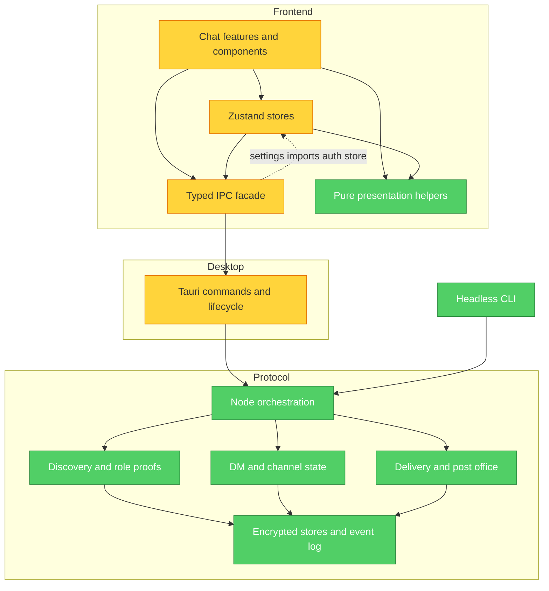

# Feature ownership and module boundaries — 2026-10-15

**Mode:** Architecture Audit  
**Scope:** Entire repository structure; all 129 production frontend TS/TSX modules and their 547 resolved internal import edges were scanned. Rust core, Tauri host, CLI, and feature entry points were mapped; the large implementation modules named below were sampled at their public interfaces and relevant call paths. This is a structural review, not a line-by-line proof of every protocol path.  
**Brooks-Lint architecture score:** 80/100 (four warnings at five points each). This risk-counting rubric is different from the earlier qualitative 95/100 architecture assessment and the 96/100 lightweight four-dimension dashboard; the numbers are not a time series.

The protocol/host/UI layering is mostly legible. The strongest remaining risks are a runtime frontend dependency cycle, repeated peer identity projections, large UI edit hotspots, and host auth/startup responsibilities sharing one production module.

## Module Dependency Graph

The frontend import graph has four syntactic cycles; three are type-only edges around `chat.ts`, `outgoingIntent.ts`, and `conversationState.ts`. The API/settings/auth cycle is a runtime value-import cycle. No cross-crate Rust dependency cycle was found in the declared workspace direction (`src-tauri` and the CLI use `mesh-talk-core`).

## Findings

### Warning — R5 Dependency Disorder: settings API depends on UI session state

- **Symptom:** `frontend/src/lib/api/settings.ts` reads `useAuth.getState()`; `store/auth.ts` imports the `lib/api.ts` facade, which exports settings. `lib/theme.ts` also imports `store/packs.ts`.
- **Source:** Martin, _Clean Architecture_ — dependency direction; Feathers, _Working Effectively with Legacy Code_ — testability seam.
- **Consequence:** API adapters cannot be understood or substituted independently of app state, and a new eager initializer can make the runtime cycle fail during module evaluation.
- **Remedy:** Give owner resolution to an application-level settings service or pass an immutable owner into an internal IPC adapter. Preserve the public `settings` facade until callers migrate. Keep pure theme parsing separate from theme-store effects. Add a dependency rule that `lib/api` never imports `store` or `features`.

### Warning — R3 Knowledge Duplication: peer identity is projected in multiple features

- **Symptom:** Device-to-account and display-name lookup appears separately in `ConversationView`, `MembersDialog`, `GroupAvatar`, `SearchDialog`, `Sidebar`, and `memberProfileDetails`. Some paths use `account_id ?? user_id`; others search the raw roster. `contactVisibility.ts` centralizes the relay filter for pickers, but not identity resolution.
- **Source:** Hunt and Thomas, _The Pragmatic Programmer_ — DRY as one authoritative decision.
- **Consequence:** A changed role or stale proof can leak into one people-facing surface while another behaves correctly. The search regression fixed in `55bcf93` demonstrated this class of omission in the core's live-versus-history role resolution.
- **Remedy:** Build one typed, memoized roster projection keyed by device and account. It should expose role, verified account binding, display name, and source freshness; keep membership itself authoritative in the channel snapshot. UI components consume the projection rather than rebuilding maps. Add contract tests for relay-only, mixed-role account, offline human, hidden contact, and changed role.

### Warning — R1 Cognitive Overload: chat screens are shared edit hotspots

- **Symptom:** `Sidebar.tsx` is 1,291 lines with 35 direct internal imports; `ConversationView.tsx` is 883 lines after extracting states and headers, with 28 imports; `SettingsDialog.tsx` handles loading, queued saves, owner changes, and field rendering in one file. `DiagnosticsDialog.tsx` combines diagnostics data and several views.
- **Source:** Fowler, _Refactoring_ — Divergent Change and Long Method; Ousterhout, _A Philosophy of Software Design_ — module depth.
- **Consequence:** Unrelated feature edits collide in the same files and reviewers must keep several state lifetimes in mind at once.
- **Remedy:** Keep each screen as a composition root. Move sidebar row/virtual navigation and roster projection, conversation attachment intake and message actions, settings sections, and diagnostics data acquisition behind small feature-local interfaces. Extract by responsibility and behavior, not by line count; retain existing component props and focus/keyboard behavior.

### Warning — R2 Change Propagation: desktop auth and runtime boot share one module

- **Symptom:** Production code in `src-tauri/src/commands.rs` includes login, auto-login, logout, registration, account rename, session helpers, runtime spawning, and linked-account adoption. `NodeState` already owns the installed runtime and owner checks, while `chat_commands/` is split by business area.
- **Source:** Fowler, _Refactoring_ — Divergent Change; Ousterhout, _A Philosophy of Software Design_ — information hiding.
- **Consequence:** Changes to credentials, session ownership, and node startup all edit the same host module and raise the chance of inconsistent lifecycle checks.
- **Remedy:** Separate auth command handlers from runtime bootstrap and linked-account adoption. Keep `NodeState` as the owner of runtime installation/retirement and preserve Tauri command names and errors through re-exports. Test a replaced session during each asynchronous transition.

## Feature responsibility map

| Feature                                    | Authoritative owner                                                                       | Reuse or encapsulation target                                                                             | Boundary to preserve                                                                |
| ------------------------------------------ | ----------------------------------------------------------------------------------------- | --------------------------------------------------------------------------------------------------------- | ----------------------------------------------------------------------------------- |
| Identity, discovery, routed peers, bridge  | Core `discovery/`, `node/privacy_routing.rs`, `node/bridge_*`                             | One live-role-over-history rule for people-facing queries; separate route hints from presence             | Signed proofs and routing data remain in core; UI receives a typed projection       |
| Contacts, profiles, search                 | Core search + frontend contact policy and roster projection                               | Shared device/account/name/role resolver; shared visible-contact selector                                 | Channel membership and message history do not derive from a filtered sidebar list   |
| DM and channel messages                    | Core `node/dm*`, `node/channel*`; frontend `conversationState.ts` and `outgoingIntent.ts` | Conversation-scoped selectors and action modules; retain lease/identity guards                            | Wire/event formats, optimistic-send settlement, and recall rules stay authoritative |
| Group membership and custody               | Core `ChannelBook` and custody modules                                                    | Channel-keyed UI snapshots and member-action controller; shared member identity projection                | Protocol validation remains in core, not React components                           |
| Attachments and media                      | Core `node/files.rs`, `file/`, delivery store; frontend composer/media helpers            | One attachment-intake path for drop, paste, picker, screenshot; typed send intent                         | Consent, manifest validation, and byte limits remain in core                        |
| Post office and offline delivery           | Core `postoffice/`, `node/delivery_*`, `node/serving.rs`                                  | Shared role policy at query boundaries; keep runtime scheduling separate from persisted transaction state | Relays remain infrastructure, never inferred as channel members or contact pickers  |
| Session, settings, privacy, linked devices | Tauri `NodeState`/account config; frontend auth ownership and settings session            | Owner-scoped settings adapter; centralized lifecycle composition; linked-preference publisher             | Backend session authorization is mandatory even when UI supplies an owner           |
| Diagnostics, updates, customization        | Tauri diagnostics/updates; frontend dialogs and packs                                     | Feature-local data adapters and presentation components                                                   | Diagnostics may show relays explicitly; ordinary people surfaces must not           |

## Ordered refactoring steps

1. Break the settings/API/auth runtime cycle while retaining the facade; enforce the frontend import direction in a static check.
2. Introduce the typed roster projection and migrate one surface at a time, starting with channel members, search, profile cards, and avatar seeds. Use role-transition and offline-history contract tests before migration.
3. Split `Sidebar`, then the remaining `ConversationView` behaviors along state and event boundaries. Run affected component tests, typecheck, lint, and format after each move.
4. Move host runtime boot and linked-account adoption out of `commands.rs` while preserving command registration and `NodeState` ownership checks.
5. Only then assess `delivery_store.rs` and `node/channel.rs` for internal submodules. Their public interfaces already hide substantial protocol complexity; file length alone is not evidence that a new abstraction would help.

Use focused unit/integration tests during each step. Reserve full Rust, Playwright, and multi-machine suites for CI, pre-PR, or explicit release validation. The review did not execute those suites and does not claim every code path or platform was verified.
