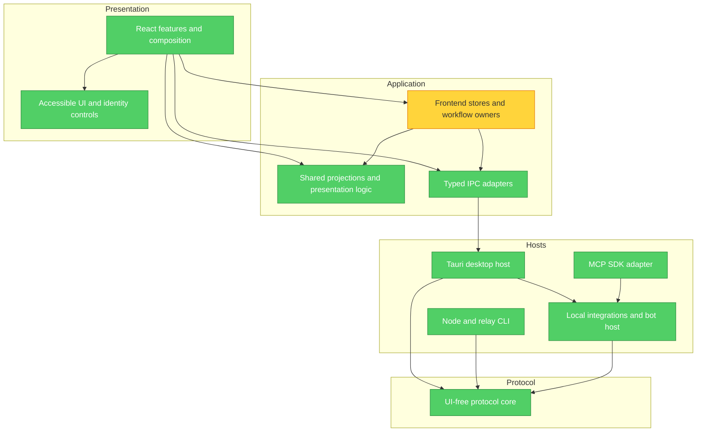

# Feature responsibility and reuse review — 2026-10-19

**Follow-up:** F1–F4 are resolved. The same scoped balanced rubric now gives
**100/100**, exceeding the requested 95 threshold. The baseline findings and graph
below remain historical evidence; see [implementation follow-up](#implementation-follow-up)
for verification, intentional behavior corrections, and limits.

**Mode:** Architecture Audit  
**Scope:** Feature inventory across all four Rust crates, the React application,
desktop/platform adapters, help, and development tooling at `f0cc58d`. All source
paths were inventoried; implementation review concentrated on interfaces,
composition roots, and representative feature flows. This is comprehensive
feature coverage, not an exhaustive line-by-line or security audit.  
**Health Score:** 92/100 under the Brooks balanced finding rubric:
100 − one Warning × 5 − three Suggestions × 1. The earlier 95/100 uses the
five-dimension module-depth rubric in [architecture-score.md](architecture-score.md);
these numbers are different measures and do not establish a regression.  
**Trend:** Previous Brooks Architecture Audit: 90 → 92 (+2); scope and evidence
have expanded, so the trend is indicative only.

The architecture is sound overall; remaining work should concentrate shared
frontend workflows rather than introduce another application-wide abstraction.
No fundamental business-design defect was established in the inspected flows.

## Module Dependency Graph

Arrows point from caller to dependency. The React-to-desktop edge is typed IPC;
desktop-to-React events are runtime data flow, not a reverse source dependency.
Colors represent findings in this review, not security assurance.



## Findings

### Warning

**F1 · Change Propagation — channel mutation workflows remain in chat composition**

Symptom: [chat.ts](../../frontend/src/store/chat.ts#L1086) independently implements
add-member, remove-member, and ownership-transfer workflows with the same owner
lease, active-request increment, command, member reload, stale-result checks, and
roster refresh. Creation, leaving, acceptance, dissolution, and renaming also live
in this aggregate alongside messaging, unread, contacts, and boot coordination.
History and outgoing intents already have narrower owners; channel mutations do
not. The repeated protocol here is frontend request coordination, not signed
membership validation.

Source: _Refactoring_ — Duplicate Code and Divergent Change; _A Philosophy of
Software Design_ — information hiding and deep modules.

Consequence: Adding a channel action or changing stale-result handling requires
editing the central composition file and reproducing a correctness-sensitive
sequence. Channel, contact, and message agents consequently compete for the same
file. This is demonstrated change coupling, not an observed production failure.

Remedy: Introduce a feature-owned channel-actions module with typed operations
and a narrow context for captured owner/session validity, active conversation,
member projection, roster refresh, and errors. Keep a common mutation-and-refresh
helper private. Preserve distinct transitions: leaving clears applicable unread
and selection; dissolution keeps read-only history; acceptance can succeed even
if the detail refresh fails. Keep protocol authority in core `channels.rs` and
`channel.rs`. Avoid exposing the aggregate chat getter/setter to the new module.

Validation: Focused standalone action tests for same-owner relogin, switching
conversations during a command, refresh failure after acceptance, and each distinct
leave/dissolve transition; existing chat and members-dialog consumers. Add its
validation contract and consumer edge when implementing the extraction.

### Suggestion

**F2 · Knowledge Duplication — attachment approval continuations have two owners**

Symptom: [MessageBubble.tsx](../../frontend/src/features/chat/MessageBubble.tsx#L128)
and [FilesTray.tsx](../../frontend/src/features/chat/FilesTray.tsx#L67) repeat the
same capture-lease → decide-attachment → refresh-availability → report-error
continuation. Saving already correctly reuses `lib/attachmentSave.ts` across the
bubble, tray, history, and media preview; that successful extraction should stay.

Source: _The Pragmatic Programmer_ — DRY and orthogonality.

Consequence: A new approval refresh or stale-session rule can reach one entry
point and miss the other. The current implementations are consistent, so this is
a small maintenance opportunity, not a reason to redesign file transfer.

Remedy: Put approval continuation in the attachments feature owner, parameterized
by lease validity and error reporting; expose accept/decline actions to both
views. Keep button state and layout local. Do not combine consent, byte readiness,
save destinations, and recipient completion into one boolean or generic action.

Validation: One action-level test for stale completion and refresh failure, plus
the two callers' focused behavior checks. Do not add E2E just to test delegation.

**F3 · Knowledge Duplication — search highlighting is copied between dialogs**

Symptom: [SearchDialog.tsx](../../frontend/src/features/chat/SearchDialog.tsx#L23)
and [ConversationHistoryDialog.tsx](../../frontend/src/features/chat/ConversationHistoryDialog.tsx#L61)
contain the same `Highlighted` implementation: trim the term, escape regex
metacharacters, split case-insensitively, and render identical marked spans.

Source: _Refactoring_ — Duplicate Code.

Consequence: Matching behavior, escaping, or accessible styling can diverge
between global search and conversation history. Current behavior is consistent.

Remedy: Extract one chat-local `HighlightedText` component accepting `text` and
`term`. The shared unit is rendered text, so a component is appropriate; a new
search service, global store, or generic dialog framework would add little value.

Validation: Focus on literal metacharacters, repeated matches, whitespace-only
terms, and preserving unmarked text; use existing dialog consumer tests.

**F4 · Knowledge Duplication — the composer separately observes reduced motion**

Symptom: [Composer.tsx](../../frontend/src/features/chat/Composer.tsx#L93) defines
a local media-query hook used by sticker thumbnails, while
[lib/motion.ts](../../frontend/src/lib/motion.ts#L47) exposes the application's
shared reduced-motion decision through `useMotionOK`. Thumbnail bitmap creation
and sticker presentation also remain inside the composer file.

Source: _The Pragmatic Programmer_ — DRY; _A Philosophy of Software Design_ —
locality of a shared decision.

Consequence: Preference observation and its initial-value behavior have two
implementations. Sticker-specific changes also touch the main input view.
Rendering a static sticker frame is a separate responsibility from observing the
preference and must be retained.

Remedy: Give shared motion preference observation one explicitly defined initial
state contract. Move `StickerThumb` and its bitmap lifecycle into a chat-local
component that consumes that decision. Preserve static-frame fallback, async
cancellation, and resource cleanup; do not simply replace the local hook without
checking the shared library's initial/unknown preference behavior.

Validation: Reduced-motion initial state and live changes, failed bitmap decode,
unmount before decode completion, and normal animated rendering. Browser evidence
is appropriate when changing actual animation/media behavior.

## Feature-by-feature responsibility and reuse decisions

Paths are relative to the repository root. `core/` means
`crates/mesh-talk-core/src/`; `ui/` means `frontend/src/`. “Keep” means no additional
extraction is justified by this review. Proposed names are targets, not existing
exports. A React component renders interaction; a workflow module owns ordering
and state transitions; a pure model owns repeatable decisions; an adapter owns
external translation. Reuse the right kind of module rather than turning every
repeated sequence into a component.

### Messaging, conversations, and people

| Feature                                          | Decision/workflow owner                                                                        | Reuse                                                                                              | Components and disposition                                                                                                                            |
| ------------------------------------------------ | ---------------------------------------------------------------------------------------------- | -------------------------------------------------------------------------------------------------- | ----------------------------------------------------------------------------------------------------------------------------------------------------- |
| Text DMs and personal messages                   | `core/node/dm.rs`, `outgoing_message.rs`; `ui/store/outgoingIntent.ts`                         | Existing acceptance, request identity, expiry admission, hydration and retry workflows             | `Composer`, `MessageBubble`; keep crypto and durable acceptance outside React.                                                                        |
| Delivery and retry status                        | Core `delivery_store.rs`, `delivery_runtime.rs`, `delivery_receipt.rs`                         | Persisted transitions, bounded retries, exact receipt evidence; frontend `refreshDeliveryStatuses` | `DeliveryFooter`, `TransferBar`; keep local acceptance, relay custody and recipient confirmation distinct.                                            |
| History loading and expanded archive             | `ui/store/conversationHistory.ts`, `conversationState.ts`; core `queries.rs`                   | Reload/revision scans, projection, reconciliation and bounded caches already have owners           | `ConversationHistoryDialog` owns its independent archive query/view; do not force it to share the live 200-message cache or read side effects.        |
| Unread, replay deduplication, viewed messages    | `ui/store/reception.ts`, `lib/unreadStorage.ts`; host `channel_reception.rs`                   | Reuse each layer's existing ledger and persistence functions                                       | `ReceptionStatus`, conversation rows; native notification deduplication and frontend viewed state are different decisions and should remain separate. |
| Replies, mentions, text display                  | Core authenticated message body; `lib/mentions.tsx`, `messageDisplayText.ts`                   | Shared segmentation and display-text projection                                                    | Keep input reply UI and message reply UI distinct; reuse parsing/display rules.                                                                       |
| Reactions                                        | Core `reaction.rs`, `reaction_store.rs`, `reactions.rs`                                        | Core aggregation and authorization; shared reaction palette where semantically identical           | Bubble reaction controls stay feature-local. Composer emoji choice is broader than quick reactions; differing palettes are not a defect.              |
| Recall, local deletion, clearing history         | Core `recall.rs`, `lifecycle.rs`; frontend conversation state                                  | Existing suppression, deletion reconciliation and history invalidation                             | `ClearHistoryButton` and confirmation dialogs; never merge recall and local erase into the same business operation.                                   |
| Fixed-deadline messages                          | Core `expiry_policy.rs` and authenticated expiry framing                                       | Acceptance, recipient expiry and cleanup policy; frontend supplies the user's duration             | Composer expiry control; retain sender-copy/recipient-copy differences and core clock authority.                                                      |
| Search                                           | Core `node/search.rs`; frontend visibility projection                                          | Existing search/hidden-contact filtering; extract highlighted text only (F3)                       | `SearchDialog`, archive search; global async search and local archive filtering remain separate workflows.                                            |
| Conversation navigation and viewport             | `sidebar/conversationList.ts`, `useConversationNavigation.ts`, `useConversationViewport.ts`    | Stable row models, keyboard targets, identity-aware scrolling                                      | Existing row/section/header/state components; keep DOM/virtualization behavior out of stores.                                                         |
| Drafts and composing                             | `conversationDrafts.ts`, outgoing-intent owner; intake hook for files                          | Existing conversation-keyed draft and handoff behavior                                             | `Composer`; sticker thumbnail is a useful internal extraction (F4). Do not replace typed send actions with a many-flag universal composer.            |
| People, account/device presentation              | `lib/rosterProjection.ts`, `contactVisibility.ts`, `memberProfileDetails.ts`                   | Account grouping, role filtering, display identity and device details                              | Identity controls, `MemberProfileDialog`, sidebar rows; presentation identities never grant protocol authority.                                       |
| Presence and availability                        | `store/presence.ts`, shared `lib/presence.ts`; core verified discovery/transport               | Existing expiry/aggregation and status vocabulary                                                  | `PresenceDot`, `PresenceAvailability`; keep reachability, identity, and online evidence separate.                                                     |
| Favorites, aliases, hidden contacts and deletion | Host `favorites.rs`, `contact_policy.rs`, `contact_policy/deletion.rs`; frontend contact store | Existing owner-scoped persistence and visibility projection                                        | Contact menu and hide/delete/restore dialogs; hidden, deleted, verified and protocol-allowed are different states.                                    |
| Verification and safety numbers                  | Core identity and `util/safety_number.rs`; host `trust.rs`                                     | Verified device fingerprints and existing formatted safety-number output                           | `VerifyContactDialog`, `SafetyNumber`; never trust an alias, avatar, IP or current roster alone.                                                      |

### Groups, attachments, identity, and privacy

| Feature                                               | Decision/workflow owner                                                               | Reuse                                                                                            | Components and disposition                                                                                                |
| ----------------------------------------------------- | ------------------------------------------------------------------------------------- | ------------------------------------------------------------------------------------------------ | ------------------------------------------------------------------------------------------------------------------------- |
| Group creation, invitations, membership and ownership | Core `channel.rs`, `channels.rs`; proposed frontend channel-actions owner             | Signed membership projection stays core-owned; concentrate frontend coordination (F1)            | `CreateChannelDialog`, `PendingChannelInvite`, `MembersDialog`; confirmation views stay local.                            |
| Group recovery and replicas                           | Core `channel_custody.rs`, projection cache, session reconciliation                   | Accepted membership, causal ordering and bounded recovery                                        | Existing status/footer/settings presentation; replica availability is not guaranteed delivery.                            |
| File/folder offers and transfer                       | Core `file/`, `node/files.rs`, `filebook.rs`                                          | Chunking, manifests, integrity, directory safety, transfer identity                              | File cards and transfer indicators; keep platform path selection in host/frontend adapters.                               |
| Attachment input: picker, drag, paste, screenshot     | `features/chat/attachments/useAttachmentIntake.ts`, `attachmentBatch.ts`              | Existing conversation/owner validity, temporary staging, partial handoff and retry ownership     | `ComposerImagePreview`, screenshot UI; do not create one staging path per input gesture.                                  |
| Attachment receive consent                            | Core `attachment_consent.rs`, `file_consent.rs`, `file_consent_store.rs`              | Exact-offer and contact/global decisions; share frontend action continuation (F2)                | Bubble/tray approval controls, `AttachmentReceiveSettings`; received card does not imply approved or complete bytes.      |
| File saving and remembered destinations               | `lib/attachmentSave.ts`, `download.ts`, `savedDownloads.ts`; host files adapter       | Existing save continuation and post-dialog lease/readiness checks                                | Bubble, tray, history and media actions already reuse this; retain different “Save” and “Save as” UX.                     |
| Media bytes, previews and URL lifetime                | Core `media_store.rs`; `mediaFile.tsx`, `lib/mediaTypes.ts`                           | Existing object URL/poster and media classification helpers                                      | `MediaPreview`, `ComposerImagePreview`; local unsent `File` previews and durable received media have different lifetimes. |
| Screenshot editing                                    | `screenshot/geometry.ts`, `annotations.ts`, `captureWindow.ts`                        | Existing pure geometry/painting and capture lifecycle                                            | `ScreenshotEditor`, `ScreenshotToolbar`; keep feature-local, do not promote a general graphics engine.                    |
| Device/account identity and linking                   | Core `identity/`, `pairing.rs`, `linking.rs`, device directory                        | Verified bindings and existing adoption/retirement flow                                          | `LoginScreen`, `LinkDeviceDialog`; host owns session installation, not account crypto.                                    |
| Linked-device synchronization                         | Core `account_sync.rs`, sync policy and bounded pages                                 | Existing certified-sibling and category policy                                                   | Link/sync settings; do not reuse relay custody as account-sync authorization.                                             |
| Avatar and incoming-language profile                  | Core `account_profile.rs`, profile/language journals                                  | Existing AccountProfiles edits, receive decisions and recovery snapshots                         | Avatar editor/gallery, `DmLanguageSettings`, composer advisory; core remains final authority.                             |
| Theme/contact synchronization                         | Core account preferences; `lib/linkedPreferencePublisher.ts`                          | Shared revision/dirty/pending publication machinery already reused by linked appearance/contacts | Theme and contact views retain their projections; avoid another per-feature retry implementation.                         |
| App lock and local privacy                            | Native `app_lock.rs`, host settings; frontend lock store                              | Native IPC gate and shared session generation                                                    | `LockScreen`, privacy pages; renderer interaction and native enforcement are complementary, not interchangeable.          |
| Invisible mode and network permissions                | Core `privacy_runtime.rs`, `privacy_sync.rs`, routing policy; host privacy adapter    | Core admission and signed route/membership checks                                                | Privacy/network settings derive effective availability; UI disabled controls are advisory, not authorization.             |
| Local retention                                       | Host `settings.rs`; core lifecycle/expiry owners                                      | Existing cutoff/prune and current-owner/revision checks                                          | `HistorySettings` confirmation; retain distinction between account retention and authenticated per-message expiry.        |
| Backup and restore                                    | Core `recovery/`, `node/recovery.rs`; host transactional publication in `recovery.rs` | Existing archive/key/snapshot validators and interrupted-publication recovery                    | `DataRecoverySettings`, `RestoreBackup`; restore creates a new device; linking is a different operation.                  |

### Calls, desktop services, integrations, and engineering workflow

| Feature                                     | Decision/workflow owner                                                                                  | Reuse                                                                                   | Components and disposition                                                                                                                                                           |
| ------------------------------------------- | -------------------------------------------------------------------------------------------------------- | --------------------------------------------------------------------------------------- | ------------------------------------------------------------------------------------------------------------------------------------------------------------------------------------ |
| Voice/video calls                           | `ui/store/calls.ts`; core `node/call.rs` authenticates ephemeral signaling                               | Existing single-call lifecycle, peer binding and media cleanup                          | `CallDialog`, call buttons/tone; WebRTC media stays separate from durable messaging/relay. Inject media adapters if a demonstrated test/change need warrants it.                     |
| Settings                                    | Native `settings.rs`; typed settings adapter; `useSettingsController`, dialog session/save queue         | Serialized read-modify-write, normalized acknowledged settings, owner/view invalidation | Existing category pages and `settings/primitives.tsx` are the right split. Avoid per-page persistence or reimplementing privacy presets in React.                                    |
| Notifications, badges and clipboard         | Host `events.rs`, notification context/ledger; frontend unread projection and sensitive clipboard helper | Existing privacy redaction and owner checks; shared sensitive-copy continuation         | Keep rendering/focus observations in frontend and native notification enforcement in host. Unread sums in ChatApp can be localized on the next badge change; not a separate finding. |
| Discovery, routed candidates and sessions   | Core `discovery/`, `transport/`, `session_pool.rs`; desktop `routed_discovery.rs`                        | Existing candidate-provider seam, pinned transport, bounded session reuse               | Diagnostics/connect controls consume facts; Tailscale/EasyTier inventory does not establish trust or protocol authority.                                                             |
| Post-office custody and federation          | Core `postoffice/`, `postbox.rs`, `opaque_relay.rs`, bridge modules                                      | Existing eligibility, routing, opaque envelopes and bounded scheduling                  | Post-office selectors/status; keep public directory participation, trust and custody permission distinct.                                                                            |
| Desktop auth and runtime lifecycle          | `desktop_session.rs`, auth service, `runtime_admission.rs`, `runtime_bootstrap.rs`                       | Shared exact-session capture, commit authorization and retirement                       | App/login UI invokes workflows; keep native secrets, installation and cancellation guarantees in host.                                                                               |
| Window, tray, autostart and OS capture      | Host platform/window/tray modules and Tauri plugins                                                      | Existing OS adapters and geometry rules                                                 | `WindowControls`; platform branches are justified adapters, not duplicate business policy.                                                                                           |
| Updates                                     | Host `updates.rs`; frontend update store                                                                 | Existing asset/version verification, cancellation and verified publication              | `UpdatePanel`; do not reuse ordinary unverified attachment download behavior.                                                                                                        |
| Themes, avatars, stickers and packs         | `lib/theme.ts`, pack parsing/image verification, avatar image helpers, pack/avatar stores                | Existing import limits, theme state and image transformations                           | Gallery, crop dialog, theme picker and pack manager; retain sticker-static-thumbnail extraction F4.                                                                                  |
| Diagnostics and offline connection tools    | `diagnostics/useDiagnosticsController.ts`, host diagnostics, `connectionState.ts`                        | Existing serial polling, copy/async feedback and connection projection                  | `DiagnosticsDialog`, `OfflineConnectDialog`; manual probe results are evidence, not persistent trust.                                                                                |
| Help and localization                       | `features/help/`, `tools/help/`, locale resources                                                        | Stable topic IDs, shared target resolution, parity checks                               | `HelpDialog`; keep executable navigation/actions out of untrusted help content.                                                                                                      |
| Local bots, grants and MCP                  | Integrations policy/service/IPC/client; SDK translation in MCP crate                                     | Existing grant enforcement, core retry-safe acceptance and host admission               | Desktop delegation controls and CLI remain adapters; do not copy grants into MCP or cryptography into integrations.                                                                  |
| Headless node and relay administration      | Core participant runtime plus CLI configuration/adapters                                                 | Existing prepared/running participant and graceful task retirement                      | No React component needed. CLI paths, process commands and relay configuration remain host-specific.                                                                                 |
| Validation, builds and parallel development | `scripts/validation/`, module `validation.json`, shared stage/resource machinery                         | Existing explainable affected plans, consumer closure and empty-selection rejection     | CLI/Make entry points; do not introduce per-feature shell runners or weaken final PR gates.                                                                                          |

## Testability and parallel-change assessment

Useful seams already exist: standalone history/outgoing contexts; injected settings
owner resolution; discovery `CandidateSource`; integration host/admission traits;
pure roster/conversation/geometry projections; encrypted record framing shared
under domain-specific stores. Reuse these before creating new dependency injection
frameworks. Composition roots importing many feature modules is expected:
`ConversationView` and `Sidebar` had 28 and 26 resolved static runtime dependencies,
respectively. Fan-out alone is not a defect.

Two areas deserve constraints rather than immediate redesign:

- Node's `pub(in crate::node)` fields are private externally but broadly accessible
  to sibling domain implementations. A file split alone therefore does not provide
  independent invariant ownership. On the next substantive delivery/files change,
  identify the single mutation owner and narrow private state where it materially
  reduces lock/order knowledge. Preserve existing transaction/WAL and restart tests;
  do not create one crate or trait per field.
- `IntegrationHost::with_node` exposes a full Node to trusted in-process callbacks.
  This is not the untrusted local IPC interface. Consider typed context/destination/
  status queries if this trusted extension surface grows; no current privilege
  bypass was established here.

Actual organizational/team ownership was not supplied. A Conway's Law mismatch
cannot be asserted. The parallel-agent recommendations follow observed shared
files and interfaces, not an invented team topology.

Use these ownership rules when assigning future work:

1. A feature owner changes its workflow, model, local views, and focused behavior
   evidence together. One integrator owns changes to shared composition roots.
2. Agree on the interface, owner/session lifetime, error outcomes and downstream
   consumers before parallel agents implement callers and owner separately.
3. Prefer feature-local components. Promote one to shared `components/` only when
   multiple features need the same interaction and semantics. Share decisions in
   models/workflows, not by passing business rules through UI props everywhere.
4. Add consumer validation when changing a shared interface. New code must not
   bypass the established adapter/store/rendering dependency direction.
5. Keep unrelated domain states separate: account/device, membership/visibility,
   consent/completion, accepted/delivered, lock/logout, deletion/recall,
   custody/sync, and configured/effective network settings.

These measures reduce avoidable coordination; neither components nor documentation
can guarantee zero merge conflicts or eliminate all future oversights.

## Implementation sequence and selective validation

| Order | Change                        | Required evidence during implementation                                                                    | Escalate when                                                                                                                         |
| ----- | ----------------------------- | ---------------------------------------------------------------------------------------------------------- | ------------------------------------------------------------------------------------------------------------------------------------- |
| 1     | F1 channel-actions owner      | Action behavior tests plus chat/members consumers; preserve the existing exported chat interface initially | Membership commands, core semantics or native admission change: add focused Rust/loopback evidence and relevant process/UI scenarios. |
| 2     | F2 shared attachment decision | Stale-lease and refresh-failure tests plus bubble/tray consumers                                           | Consent wire behavior, transfer completion or native save lifecycle changes.                                                          |
| 3     | F3 highlighted text           | Shared rendering edge cases plus the two dialog consumers                                                  | Search matching semantics or keyboard behavior changes.                                                                               |
| 4     | F4 sticker thumbnail/motion   | Preference observation, async cancellation and decode fallback; composer consumer evidence                 | Real media animation or reduced-motion behavior changes: use the affected browser scenario.                                           |

Use `make test-plan` before changing an owner and `make test-changed` for its mapped
development checks. Unknown paths require an explicit owner selection and rationale;
most core contracts intentionally require manual selection until consumer obligations
are established. A clean focused run does not substitute for missing contract edges,
runtime behavior, or the mandatory pre-PR/review gates in
[testing-feedback-loop.md](../testing-feedback-loop.md). Expand contracts alongside
real feature changes rather than declaring entire broad directories covered.

## Evidence and limits

- Read the capability index, architecture/network contracts, existing ownership and
  scoring reports, crate/package manifests, and source interfaces. Inspected
  representative messaging, group, file/consent, profile/language, session, search,
  settings, privacy, recovery, calls, integrations, and validation paths.
- Inventoried 264 frontend source/test files and 229 Rust files under the four
  crates' `src/` trees (51 host, 167 core, nine integrations, two MCP). These counts
  describe available scope, not the number of files exhaustively reviewed.
- A fresh TypeScript-AST scan found 171 production frontend modules, 623 resolved
  local static runtime import/re-export edges, and no cycles among those edges.
  Type-only edges were excluded. Three local specifiers were unresolved by the
  simple scan; dynamic imports, package internals and native execution were not
  covered. This is not proof that all runtime dependencies are acyclic.
- Source review established repeated implementations for F1–F4; their predicted
  maintenance consequences were not measured production incidents. Existing
  tests were read as interface evidence, not rerun as release certification.
- This change records analysis only. No production behavior, dependency, wire
  format or test-selection rule was modified. Validation is documentation
  formatting, local link targets, spelling and diff checks; full suites, E2E and
  comprehensive health gates are outside this documentation-only task.

## Summary

Concentrate channel coordination first, then share the three small repeated
frontend decisions when touching those features. Preserve the current core/host/
frontend division and existing deep workflow owners; a wholesale rewrite or a
general-purpose component framework is not justified by the evidence.

## Implementation follow-up

The reviewed changes resolve all four findings rather than changing the scoring
weights. Independent spec review and subsequent code-quality review found no
actionable gaps in the implementation. Under the original balanced formula,
zero remaining Critical, Warning or Suggestion findings give **100/100**. This
is a scoped finding-based score, not a claim that the repository is perfect or
that every runtime/platform combination was tested. The separate five-dimension
architecture assessment remains 95/100; it was not numerically reassessed here.

| Finding | Implemented ownership                                                                                        | Preserved responsibility                                                                                                               |
| ------- | ------------------------------------------------------------------------------------------------------------ | -------------------------------------------------------------------------------------------------------------------------------------- |
| F1      | `store/channelActions.ts`: all eight channel actions, narrow state/context, private member mutation sequence | Chat remains composition; core retains signed membership authority. Leave, dissolve, acceptance and creation retain distinct outcomes. |
| F2      | `attachments/attachmentDecision.ts`: shared decision, refresh and stale-session continuation                 | Bubble/tray retain local controls and translated errors; existing attachment saving stays separate.                                    |
| F3      | `HighlightedText.tsx`: one implementation used by both dialogs                                               | Literal escaping, matching, text and mark styling remain equivalent.                                                                   |
| F4      | `StickerThumb.tsx`: static-frame rendering and bitmap lifetime; `lib/motion.ts`: shared live preference      | Composer retains input behavior; unknown motion preferences conservatively render static fallback.                                     |

The motion change intentionally improves behavior beyond extraction: the previous
shared Framer Motion hook captured a snapshot rather than reacting to later OS
changes. A focused test reproduced this before the replacement. The shared
observer now updates mounted consumers and disables animation when a preference
cannot be determined. Sticker frames are keyed to their source, stale asynchronous
decodes cannot replace the current image, and bitmaps close even when drawing or
encoding fails. These are behavior corrections, so this follow-up does not claim
that every observable behavior is unchanged.

Validation executed:

```sh
node scripts/validation/changed.mjs --json
make test-changed
cd frontend
node node_modules/typescript/bin/tsc --noEmit
node node_modules/typescript/bin/tsc --noEmit -p tsconfig.e2e.json
npm run build
```

The selected run passed **380 frontend tests in 34 files** and **44 Node
validation-tooling tests** in 33 seconds. The selection includes standalone
channel coordination, actual chat/members consumers, attachment decision/caller
behavior, highlight rendering, sticker lifecycle and shared preference updates.
The new `frontend-channel-actions` contract declares its chat consumer; source
dependency selection includes the extracted component consumers. Targeted ESLint,
Prettier, spelling, local link and diff checks also passed.

The build retained its existing main-chunk size advisory. Node/Vitest emitted the
existing experimental localStorage warning. No Rust implementation or wire format
changed, so no Rust build/test run was added. Full suites, browser/native animation,
physical-media acceptance, comprehensive health and PR/preflight gates were not
run; those remain separate requirements before publishing a PR or release.
