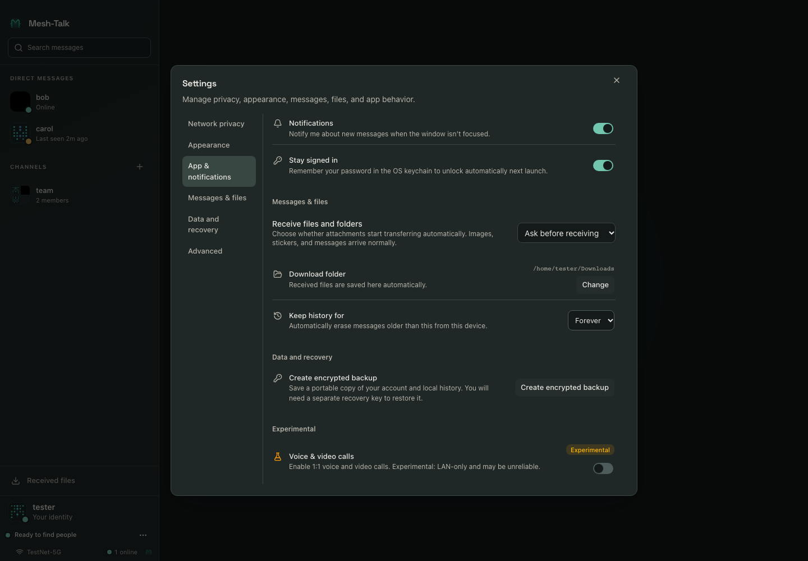
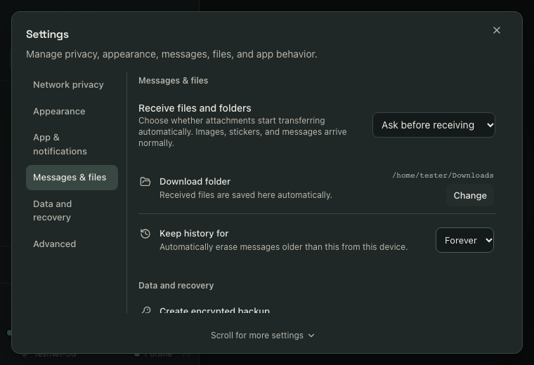

# Settings: Information Architecture and Interaction Review

Date: 2026-10-16. Status: **historical pre-change review; recommendations implemented in the follow-up below**.
Reviewed source baseline: `0702ead` on `perf/optimization-series-20261015`.

## Decision

Retain Mesh Talk's Quiet signal visual system and existing protocol/configuration
semantics. Reorganize settings around tasks, present a single category at a time,
and improve high-consequence actions and effective-state explanations. Aesthetic
replacement is not justified by the evidence.

This review used independent source/design and browser/detector assessments,
then synthesis against the host settings persistence and current network design.
It covers the settings dialog and privacy, attachment, recovery and appearance
subflows; it is not a full product usability study or a native OS certification.

## Current information architecture

| Current destination | What users actually find                                                                                                                                                                                                                           |
| ------------------- | -------------------------------------------------------------------------------------------------------------------------------------------------------------------------------------------------------------------------------------------------- |
| Network privacy     | Invisible mode and reply permissions; relay master/send/receive; physical-only discovery; bridge discovery; preferred relay; device privacy preset; notification preview; idle/hidden locking; sensitive copy/clipboard controls; hidden contacts. |
| Appearance          | Theme/library management, optional theme wallpaper choices, wallpaper visibility, language.                                                                                                                                                        |
| App & notifications | A section headed Background: launch at login, close to tray, notifications, stay signed in.                                                                                                                                                        |
| Messages & files    | Global attachment acceptance, download folder, history retention.                                                                                                                                                                                  |
| Data and recovery   | Create encrypted backup; last-backup information appears only inside that workflow.                                                                                                                                                                |
| Advanced            | A section headed Experimental: voice/video calls and conditional ringtone/preview.                                                                                                                                                                 |

Source: [SettingsDialog.tsx](../../frontend/src/features/chat/SettingsDialog.tsx),
[PrivacySettings.tsx](../../frontend/src/features/chat/PrivacySettings.tsx),
[AttachmentReceiveSettings.tsx](../../frontend/src/features/chat/AttachmentReceiveSettings.tsx),
[DataRecoverySettings.tsx](../../frontend/src/features/chat/DataRecoverySettings.tsx),
[ThemePicker.tsx](../../frontend/src/features/chat/ThemePicker.tsx).
The security and contact sections are deliberately mapped to the privacy
navigation item by the former `settingsScroll.ts` module (removed by the follow-up).

## What works

- Consistent surfaces, typography, standard switches/selects, visible focus and
  readable explanations fit a sustained-use desktop messenger.
- The main save coordinator orders writes, rejects obsolete owner/view results,
  and updates visible values only after success. Retain these guarantees.
- Dependent relay preferences survive master-off and become disabled, supporting
  reversible configuration. Backup key confirmation and the separate permissions
  manager are valuable dedicated workflows.
- The supported minimum desktop size fits, keyboard traversal works, and awaited
  Escape closes settings. The scoped automated accessibility scan found zero
  violations; this does not certify every accessibility requirement.

## Prioritized findings

### P1 — immediate history deletion looks like a reversible preference

**Evidence:** `SettingsDialog.tsx:335–340` saves retention immediately;
`src-tauri/src/settings.rs:507–510` invokes pruning for the selected cutoff.
The help text mentions automatic erasure but does not explicitly warn that
existing eligible local history is deleted now. There is no confirmation in this
control's path. Destructive backend execution was not performed during review.

**Recommendation:** group retention with history/backup. Before tightening a
window, explain immediate local deletion and ask for confirmation. Offer backup
as an optional preceding action. Expanding a window does not recover deleted
local history. Do not add unnecessary confirmation to unrelated harmless toggles.
If an affected-message count is unavailable, do not invent one.

### P1 — privacy labels overstate their scope and obscure unrelated tasks

**Evidence:** the initial Network privacy destination contains about 1,388px of
content before Appearance at the measured desktop viewport. It includes device
locks, clipboard behavior and hidden-list presentation alongside relay controls.
The Privacy level preset changes only five fields: notification previews, idle
lock, hidden-window lock, copy confirmation and clipboard clearing
(`src-tauri/src/settings.rs:245–275`). It does not change network disclosure,
relay permissions, sign-in persistence or history retention.

**Recommendation:** expose Connection & delivery separately from Privacy &
security. Name the preset Device privacy preset and summarize its five effects
before applying. Custom is a derived/manual configuration state, not an unexplained
fourth protection strength. Keep category names and page headings identical.

### P2 — navigation can highlight a different category from the selected task

**Reproduction:** at 1440×1000, open Settings and click Messages & files. After
scroll settles, App & notifications becomes `aria-current="location"` while the
files controls are visible. Bottom clamping prevents the requested anchor from
reaching the top; scroll tracking then overrides the click selection. Later
bottom categories share the same clamped scroll position. At 760×520, Files can
align correctly, so the bug depends on viewport/content extent.

**Recommendation:** use one category panel at a time. If continuous scrolling is
retained, explicitly reconcile clicked destinations, end-of-scroll clamping and
scroll-derived active state; changing labels alone does not fix this bug.

### P2 — saved permissions are not clearly distinguished from effective behavior

**Evidence:** relay master-off disables children without per-control reasons;
physical-only discovery also disables bridge discovery. The bridge description
says invisible mode makes it unavailable, but its disabled expression does not
consult that state (`SettingsDialog.tsx:597–602`). Core policy suppression and
stored preference are distinct; this UI mismatch does not prove unauthorized
network disclosure. Receive help acknowledges that file consent and receipts
also need sending controls, making send-off/receive-on a partial workflow.

**Recommendation:** indent dependent options, preserve saved preferences and show
an explicit inactive reason. Explain partial-direction consequences. Keep
preferred relay distinct from an actually used relay. Display active route status
only if supported by backend evidence; do not infer it from the selected option
or known candidate roster.

### P2 — loading, saving and recovery affordances vary by subflow

**Evidence:** main settings have queued writes and global errors; privacy and
attachment controls own separate lifecycle states. There is no common quiet
Saving/Saved indication or explanation of immediate saving. Attachment policy
read failure leaves its initial Ask value displayed and enables editing after
`loading` clears, without a retry action (`AttachmentReceiveSettings.tsx:55–58`,
`:93–95`). Last-backup information requires entering key preparation first.

**Recommendation:** retain domain-specific authorities but standardize
presentation states: loading, known value, saving, saved, error/retry. Do not
present an unverified fallback as the persisted value. Associate save failures
with the affected field/category. Show existing backup metadata before starting
a new key/export workflow.

## Other confirmed defects and review follow-ups

- English saved-relay labels use `{name}` and `{id}` instead of i18next
  `{{name}}` and `{{id}}`. A direct translation-engine check returned the literal
  placeholders. Correct all locale variants consistently and add a semantic
  interpolation regression test.
- Automatic lock says inactivity or leaving the app, although hidden-window
  locking is a separate control. Describe idle time and hiding separately.
- Notifications and message previews belong together; Advanced currently means
  only experimental calling. Keep the experimental badge near the feature.
- Backup's native Save dialog is awaited before its `try` block and before busy
  state starts (`DataRecoverySettings.tsx:51–58`). Review picker rejection,
  duplicate invocation and stale view/session completion with focused tests.
  These paths were not reproduced against native dialogs in this review.
- Shared row descriptions are not explicitly connected with `aria-describedby`.
  Preserve accessible labels and add associated explanatory/dependency text in
  the redesign; zero axe findings do not establish screen-reader completeness.
- Fixed horizontal controls warrant long-locale/long-path testing. The current
  supported minimum fits; phone clipping below 760px is not a current desktop
  release blocker.

## Proposed category structure

This is the recommended seven-destination arrangement. Fewer destinations can
be achieved by merging General and Appearance, at the cost of a broader page.
Avoid merging network policy back into local device privacy.

| Proposed category     | Existing settings/actions                                                                                                    | Design intent                                                                        |
| --------------------- | ---------------------------------------------------------------------------------------------------------------------------- | ------------------------------------------------------------------------------------ |
| General               | Language, launch at login, close to tray                                                                                     | Routine application behavior.                                                        |
| Appearance            | Theme and library, theme wallpaper choices, wallpaper visibility                                                             | Visual personalization without networking controls.                                  |
| Notifications & calls | Notifications, message preview, experimental voice/video calls, ringtone/preview                                             | Notification behavior and calling capability, with a visible experimental qualifier. |
| Connection & delivery | Invisible mode, reply permissions, physical-LAN-only discovery, bridge discovery, relay master/send/receive, preferred relay | Who can discover/contact the device and which delivery routes are permitted.         |
| Privacy & security    | Device privacy preset, idle/hidden locking, sensitive copy/clipboard, stay signed in, hidden-contact manager                 | Local exposure, credentials and contact-list presentation, with explicit scope.      |
| Files & receiving     | Global attachment approval, contact-override explanation/link, download destination                                          | Acceptance of a transfer versus where accepted files are saved.                      |
| History & backup      | Local retention, encrypted backup, existing backup status, restore-entry explanation                                         | Data lifecycle and recovery, with destructive changes distinguished.                 |

Notification preview has one canonical editor in Notifications & calls. The device
privacy preset summarizes that it changes the same field and links to its editor;
do not create independent copies of its value. A shared store/controller must
settle updates across those pages.

## Merge presentation, preserve business distinctions

| Bring together                               | Keep distinct                                                               |
| -------------------------------------------- | --------------------------------------------------------------------------- |
| Notification enablement and preview          | Master notification preference versus preview disclosure.                   |
| Relay options under one delivery group       | Send permission, receive permission and public directory disclosure.        |
| Retention and backup                         | Local deletion policy, temporary relay retention, and portable backup.      |
| Startup and tray behavior                    | Starting at OS login versus staying signed in through keychain credentials. |
| File approval and destination                | Transfer consent versus filesystem save location.                           |
| Device privacy preset and its effect summary | Idle lock versus lock when hidden; preset versus network privacy.           |

Invisible mode is public-presence policy; hidden contacts are list presentation,
not message blocking. Group replica sharing belongs in group/member context,
per-contact attachment overrides in conversation context, and linked-device sync
categories in device management. Settings can link to those owners without
reimplementing their policies or duplicating their management forms.

## Layout, states and implementation seams

- Keep the incumbent restrained visual system. Use a stable dialog shell with a
  category list, selected-page title, scrollable content and quiet status area.
- Use category panels rather than a growing anchor document. Preserve the
  existing navigable section list and sensible focus restoration on close.
- Fit 760×520; let long controls stack when their content pane is constrained.
  Make navigation/content independently reachable at short heights. If mobile
  becomes supported, specify a separate compact navigation pattern then.
- Display device/account scope once per section, with exceptions on individual
  controls. OS startup and app-global flags differ from account settings; some
  appearance/contact choices can participate in linked-device synchronization.
  Do not label every setting globally as synced or unsynced.
- Preserve immediate acknowledged saving for routine controls; confirm immediate
  destructive history pruning. Avoid a generic Apply button that misrepresents
  already-running operations.
- Give each category a module; share section/row/help/status primitives. Keep
  `settingsDialogSession.ts` and backend authorization authoritative. Pure control
  dependency projection should supply enabled state and reason from the same
  rule, instead of repeating conditional expressions in JSX and copy.
- Add setting search only when its metadata/translation ownership is defined.
  Category-level reorganization and correctness fixes have higher priority than
  another feature layered onto the current growing dialog.

## Heuristic assessment

Qualitative Nielsen review, 0–4 per heuristic: 0 absent, 1 major obstacles,
2 functional with substantial friction, 3 good, 4 excellent. These are judgment
ratings of this settings surface, not measured task-success rates or repository
health scores.

| Heuristic           | Score     | Main observation                                                              |
| ------------------- | --------- | ----------------------------------------------------------------------------- |
| System status       | 2         | Saved preference versus effective state is unclear.                           |
| Real-world language | 2         | Privacy preset/network scope and section labels conflict.                     |
| User control        | 3         | Individual controls and dedicated managers; retention needs a safeguard.      |
| Consistency         | 2         | Category/header mismatch and inconsistent subflow status.                     |
| Error prevention    | 2         | Immediate pruning resembles a routine reversible preference.                  |
| Recognition         | 2         | Important local privacy controls are buried under Network privacy.            |
| Efficiency          | 2         | Long document and clamped anchor navigation add hunting.                      |
| Aesthetic restraint | 3         | Coherent existing visual system and controls.                                 |
| Error recovery      | 3         | Main retry/rollback is sound; attachment/picker cases need work.              |
| Help                | 3         | Useful accurate boundaries exist, but dependency context is scattered.        |
| **Total**           | **24/40** | Functional foundation; information architecture and interaction fixes needed. |

First-time users may mistake Strict for a network privacy preset; network users
must mentally derive partial relay modes; keyboard users can encounter a selected
category that does not match their navigation action. These are design hypotheses
supported by observed interface behavior, not claims from a participant study.

## Evidence and acceptance boundaries

The source detector returned zero findings on the four settings modules. A
whole-page runtime overlay reported 11 unclassified patterns; that includes the
underlying chat and must not be counted as 11 settings defects. Scoped axe found
zero violations. Fresh keyboard/Escape and synthetic backup challenge checks
worked. Native picker/export, assistive technology and all localized variants
were not exhaustively tested.

Desktop evidence used 1440×1000 and the supported 760×520 minimum. Additional
640×800, 390×844 and 1024×500 captures were below at least one native minimum and
are stress evidence only. The minimum screenshot below shows a stable files
section without horizontal overflow. Older committed settings goldens omit new
controls and were not treated as current implementation truth.

The existing browser mock lacked `prepare_backup_key`; its null response caused
an initial check failure. A valid synthetic key was then substituted to inspect
challenge gating. This harness gap is not evidence that the native command
returns an invalid key. Temporary capture/test servers were stopped.

### Implementation order after direction is agreed

1. Fix navigation selection, literal relay labels, attachment unknown/error
   state and native-picker lifecycle; add focused regression tests.
2. Implement the category/controller split and explicit permission dependency
   reasons, without changing saved configuration or protocol semantics.
3. Add retention confirmation, preset effect summaries and backup-status entry.
4. Verify supported minimum/large windows, long translations and relay names,
   keyboard/focus, slow/failing writes, owner changes, partial relay modes,
   invisible/physical-only combinations and reopen persistence.
5. Run affected unit/integration and targeted browser cases. Full suites remain
   CI/pre-PR or explicit-request gates.

## Implementation follow-up

The approved recommendation is implemented by the seven pages in
[`settings/`](../../frontend/src/features/chat/settings), the shared controller
and pure availability/retention model, and the
[maintained settings guide](../settings.md). The shell no longer tracks scroll
anchors; category and displayed content use one state. Presets stage an explicit
Apply action and read back canonical backend values. Retention tightening has
confirmation/backup-first; file policy has unknown/retry; backup has independent
status and guarded picker lifecycle; all six locales use correct interpolation.
The preceding screenshots and 24/40 rubric describe the reviewed baseline, not
the redesigned interface. Verification uses focused tests and targeted browser
cases; no new heuristic score or native-platform certification is inferred.
