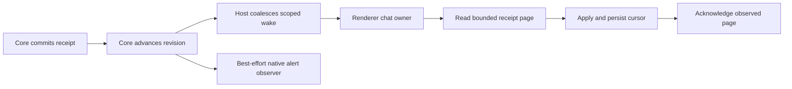

# Event-driven design and scheduling

Use this guide to choose an event, register a listener or replace background
polling. [Architecture](ARCHITECTURE.md) and the [network design
reference](network-design-reference.md#push-driven-reconciliation-and-recovery)
own protocol and recovery semantics. The [module map](module-boundaries.md)
owns implementation boundaries. The [performance guide](performance-requirements.md)
owns resource budgets and measurement. Use its
[core business metric coverage](performance-requirements.md#core-business-metric-coverage)
to locate the operation owner before instrumenting a new event.

## Choose the right kind of signal

| Kind | Meaning | Delivery contract | Examples |
| --- | --- | --- | --- |
| Durable fact | The owning transaction committed a business outcome | Read from the authoritative store or cursor. Consumers may replay and deduplicate within the supported window. | Message accepted, recipient receipt recorded, account document committed |
| Invalidation | Data within a known scope may have changed | Multiple wakes may coalesce. Read the current snapshot or continue from a durable cursor. | Reception wake, document revision, roster refresh |
| Runtime observation | Current state or a bounded transient signal from an active owner | Scope to the installed runtime and define how missed signals are handled. | Network cost, transfer progress, call signaling |
| User intent | A user requested an operation in the current interaction | Route directly to the owning handler or command. Derive success from its result or committed state. | Send, navigate, dismiss, apply a shortcut |
| Deadline | Owned work becomes eligible or must stop at a particular time | Recheck the current condition and deadline when awakened. Give it a cancellation and overdue policy. | Expiry, retry, debounce, call setup timeout |

Use the names in the next section as a shared vocabulary when designing a feature.
Use the listed source identifiers when integrating with code. Treat any proposed
shared adapter as a design seam until it has real callers and focused tests.

## Event catalog and registration

| Event family | Producer and meaning | Registration and consumer behavior |
| --- | --- | --- |
| Message, file and receipt reception | Core commits reception and publishes a coalesced wake. The durable cursor defines observable progress. A receipt-only generation wakes the bounded desktop consumer without invalidating unrelated projections. | Core consumers use the [UI generation watch](../crates/mesh-talk-core/src/node/ui_state.rs) for wakeup and the [receipt API](../crates/mesh-talk-core/src/node/host_reception.rs) to read. Desktop uses [reception IPC](../src-tauri/src/reception_host.rs) and the [chat owner](../frontend/src/store/chat.ts) to page, persist and acknowledge. |
| Runtime startup readiness | The Host installs an authenticated runtime and sends the existing scoped reception wake. | The [renderer boot owner](../frontend/src/store/chat.ts) coalesces the wake for its active startup request and re-reads native identity. An earlier hint can accelerate the read. The repair timer covers missing hints, and current desktop identity still gates readiness. |
| Account documents and sync status | Core tracks cumulative desktop revisions. Document changes and sync-status changes have distinct meanings. | Host subscribes through [runtime bootstrap](../src-tauri/src/runtime_bootstrap.rs). Renderer features use [sync invalidation](../frontend/src/lib/syncInvalidation.ts), scoped by owner. A status-only change refreshes status readers. Exact read receipts notify receipt observers through their own scope. The renderer groups exact identities by conversation before applying each bounded page or successfully published local batch. Repeated identities are deduplicated before application so replay does not rewrite the reception snapshot per receipt. General document and broad state events still wake receipt readers for recovery. Document readers use the document subscription and recover conservatively from unknown scope. |
| Roster, contact and channel changes | Core roster and channel owners publish scoped changes. Presence, contact eligibility and conversation membership have separate authorities. | Reuse the Core [watch APIs](../crates/mesh-talk-core/src/node/ui_state.rs) and [channel change broadcast](../crates/mesh-talk-core/src/node/channels.rs). Host handles channel receiver lag by invalidating state. Renderer consumers use existing chat and presence selectors or the matching invalidation. Periodic roster repair defers group member fan-out while presentation is hidden and retries on restoration. Explicit group and personal-state changes still reconcile. |
| Transfer progress and delivery | Transfer progress is a latest observation for a transfer and direction. Delivery and read outcomes derive from their owning receipt state. | Reuse [Host event adapters](../src-tauri/src/events.rs) and the [desktop reception gate](../src-tauri/src/reception_host.rs). Update the matching transfer or message and coalesce progress under load. |
| Network availability and cost | The platform adapter observes network cost. A change may permit previously blocked work. | Reuse the [native network-cost observer](../src-tauri/src/network_cost/mod.rs). macOS uses native callbacks. Linux and Windows share a serial query owner with event-triggered repair and a sparse fallback. Protocol reconnect, discovery and recovery stay with their existing owners. |
| Call signaling, audio and media | Call signaling is transient and separately bounded. Device and media callbacks describe active resources. | Use [node event registration](../frontend/src/lib/events.ts), the [call owner](../frontend/src/store/calls.ts) and native browser media callbacks. Stop tracks, sounds and listeners when their call or interaction retires. |
| Runtime installation, lock, logout and account switch | Session owners grant and revoke authority. Installation, retirement and lock affect which work can publish. | Host tasks register with [NodeRuntime](../crates/mesh-talk-core/src/node/runtime.rs). Renderer session effects live in [App](../frontend/src/App.tsx) and account-scoped stores. Dispose old subscriptions and reject late results using the captured authority. |
| Window focus, visibility and page exit | The browser reports presentation lifecycle. Foreground is a useful reconciliation trigger. | Use the owning effect's focus and visibility handlers. [Chat](../frontend/src/store/chat.ts) already resumes reception and flushes pending receipt state. [Serial polling](../frontend/src/features/chat/useSerialPoll.ts) offers a scoped refresh with one in-flight read and a visible recovery deadline. Use [shared recovery scheduling](../frontend/src/lib/recoveryRefresh.ts) for presentation work that parks while the WebView is hidden or the native window is minimized. Durable recovery keeps its background deadline. |
| Navigation, selection and actions | The component, router or store receives a user intent. Explicit activation carries the target and context. | Use React handlers or the existing store action. Route global capture through the existing [screenshot shortcut router](../frontend/src/features/chat/screenshot/shortcutRouter.ts) when applicable. Keep pointer capture and gesture cancellation with the interaction owner, as in [sidebar resizing](../frontend/src/features/chat/sidebar/useSidebarWidth.ts). |
| Viewport, layout and visual updates | The renderer observes the viewport or an active gesture. A frame update belongs to presentation. | Use the owning viewport hook, DOM observers or animation frames for frame-bound work. Disconnect observers and cancel pending frames on retirement. Aggregate work by frame and avoid forwarding raw pointer, resize or scroll streams through IPC. |

### Follow the reception path



The [Host gate](../src-tauri/src/reception_host/gate.rs) retains pending domains
until the matching acknowledgement. A newer change survives an older ack. The
native alert observer has its own launch cursor and one-second observation budget.
Delivery of a native alert does not acknowledge the renderer's durable page.

## Register a new consumer

1. Find the producer and the authoritative read or command. Identify the
   smallest scope using existing account, runtime, conversation or transfer
   identifiers. Reuse a matching subscription before adding a new IPC event.
2. Define startup and recovery together. Register before taking the initial
   snapshot when a change could otherwise fall between the two. Use a revision
   or cursor to reconcile after registration, reconnect, reload or lag.
3. Bind the consumer to its lifecycle. A React effect returns cleanup and drops
   any asynchronously completed registration after disposal. Host tasks belong
   to the installed runtime. Recheck captured ownership after asynchronous work
   and immediately before publishing a result or performing a side effect.
4. Bound work at the receiver. Keep one in-flight refresh and one pending
   indication when latest-state semantics suffice. For durable work, use a
   bounded page or cursor. Keep synchronous listener callbacks small. Route
   failure to the owner and give any retry a deadline.
5. Treat event payloads as input to the owning boundary. Prefer scoped
   identifiers or revisions. Keep sensitive message content in authorized
   queries where the existing contract allows it. Preserve legacy payloads
   and wire identifiers when existing callers depend on them.

For example, an account-document panel can reuse the scoped renderer
subscription without opening another Tauri listener. Its effect owns the
initial read, refresh and disposal:

```tsx
useEffect(() => {
  let active = true;
  const refresh = () => {
    // The feature's serial read owner coalesces requests and rejects stale results.
    if (active) requestDocumentRefresh(owner);
  };
  const unsubscribe = subscribeDocumentInvalidation(owner, refresh);
  refresh();
  return () => {
    active = false;
    unsubscribe();
  };
}, [owner, requestDocumentRefresh]);
```

Here `requestDocumentRefresh` represents the feature's existing refresh
operation. The callback guard controls entry. The operation itself must check
owner and lifetime again before applying an asynchronous result.

For a new event family, record its owner, producer, source identifier, scope,
commit timing, authorized consumers, initial read and recovery path. Record
whether it may coalesce, duplicate, reorder, drop or replay. Also record its
capacity, cancellation boundary and the focused regression for these rules.

### Register relay work with its owner

For post-office work, identify the authoritative state transition and inspect
the existing mailbox, federation, topology or policy owner before creating a
producer. Register a scoped consumer with the existing event or watch if its
commit timing, identity and retirement semantics match. When those semantics
differ, add the smallest event type to the owning module and document its scope,
coalescing, cancellation and reconciliation behavior.

When there is no reliable event, register with the existing deadline, retry or
repair component described in [Scheduled work and recovery](scheduled-work.md).
Use a cursor or bounded snapshot to repair missed events. Keep protocol
heartbeats and lease deadlines with their protocol owner. Keep new threads or
periodic loops for cases where an existing component cannot meet the documented
contract. Verify that an empty or unchanged result parks, real work wakes
promptly, and failures retain bounded retry and recovery.

## Schedule work by purpose

See [Scheduled work and recovery](scheduled-work.md) for existing components,
registration contracts and verification.

| Purpose | Reuse policy |
| --- | --- |
| Absolute expiry or lease | Reuse the owning expiry path, such as [chat expiry](../frontend/src/store/chatExpiry.ts). Schedule the nearest deadline and recompute after resume. Preserve persisted expiry and authority across restart. |
| Coalesce a burst | Store the pending revision or dirty bit. Schedule at most one trailing delay or animation frame as appropriate. Define whether sustained input may defer the work and bound that delay. |
| Retry transient failure | Keep the existing retry/backoff owner and classify failures that may retry. Allow a meaningful dependency change to wake blocked work when its contract permits it. Preserve concurrency and due-work limits. |
| Repair missed invalidation | Reconcile through the owner's snapshot or cursor on startup, reconnect or foreground. Use a sparse fallback where delivery can be absent or incomplete. Measure necessity before changing it. |
| Limit an active operation | Use the operation's timeout and cancellation owner. A caller giving up does not free a native concurrency slot until the operation actually retires. See [serial refresh](../frontend/src/features/chat/useSerialPoll.ts). |
| Drive live protocol or presentation | Heartbeats, active ringtone cadence and frame-bound gestures have their own lifetimes. Stop their scheduling when the owning session or interaction ends. |

Reuse policy and lifecycle ownership within each runtime. Introduce a shared
helper once callers demonstrate the same scheduling semantics and cancellation
requirements. Core, desktop Host and WebView each keep their executor and
resource ownership.

## Review an existing polling path

Document its trigger, cadence, actual work, foreground and background scope,
recovery guarantee, and cancellation path. Check whether a reliable producer
already signals the relevant state and whether the listener can reconstruct
current state after loss. Test idle, a burst, a change during an in-flight read,
listener retirement, runtime replacement, and missed or duplicate notification
as applicable. Keep retry, expiry, heartbeat and recovery controls specific to
the affected contract.

Start with redundant observation work such as a timer that only checks an
existing watch. Consolidate lifecycle listeners when their consumers genuinely
share a policy. Measure both normal foreground operation and return to idle,
including wakeups, CPU, latency, and bounded pending work. Keep OS-level
measurements separate from paused-clock scheduling tests.

For the next app-wide review, inspect these candidates in order of how clearly
their replacements can preserve behavior:

- Find idle intervals that only inspect an existing revision or wake flag. Native
  reception alerts provide the reference conversion.
- Compare foreground handlers in chat, unread badges, notification permissions
  and settings. Share foreground observation only where hide/show handling,
  initial refresh and retirement match. Keep the business refresh in each owner.
- Trace account-profile projection from commit to Host before deciding whether
  its recurring read can use an event. Cover storage failure, startup and runtime
  replacement before changing its recovery cadence.
- Keep discovery reconciliation, delivery retry and active media scheduling with
  their current owners until runtime measurements identify a concrete cost.
