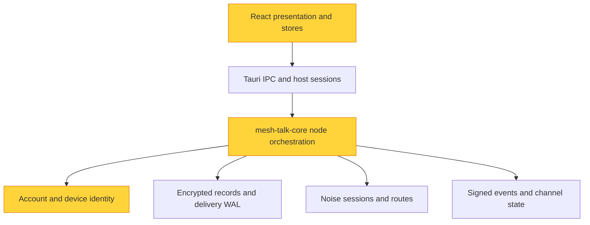

# Personal messaging and cross-device synchronization: proposed design

**Status: proposal, not implemented.** Researched and inspected on 2026-10-18
against `762525d86f81c4fcbf2ae3dd5f90b02f30f5f0de`. The inspection was scoped
to account/device identity, linking, DM delivery, account history, channel
enrollment, files, preference replication, desktop IPC, and conversation/settings
presentation. Existing test bodies were inspected; this research task did not
execute application tests or establish new runtime guarantees.

Read the [primary-source research](research/multi-device-sync-patterns.md) for
product comparisons and evidence, and the [implementation plan](multi-device-sync-plan.md)
for sequencing and acceptance criteria. [Architecture](ARCHITECTURE.md) and the
[network reference](network-design-reference.md) remain the owners of current behavior.

## Recommendation and alternatives

**Confirmed priority: messages and files.** The first release covers personal
messages/files, their replication across linked devices, and authorized group
messages/files in the combined scenario. New synchronization of read positions,
drafts and other preferences is outside this release. Existing profile,
appearance and contact synchronization remains supported.

Extend Mesh Talk's existing authenticated account replication. Make its existing
self-addressed DM a permanent **Saved Messages** conversation, independent of
discovery. Use typed account-private records for settings and other application
state; keep shared group events in the existing group log. These are different
authorization scopes using the existing transport and storage foundations.

| Approach                                               | Fit and benefit                                                                                  | Cost or limitation                                                                                                                   | Decision                                                                   |
| ------------------------------------------------------ | ------------------------------------------------------------------------------------------------ | ------------------------------------------------------------------------------------------------------------------------------------ | -------------------------------------------------------------------------- |
| Extend existing event/account replication              | Reuses account routes, durable delivery, certified linking, history recovery and encrypted media | Requires explicit self-only persistence, policy coverage and versioned extensions                                                    | Recommended                                                                |
| Adopt a general CRDT/file-sync engine                  | Useful for a future concurrently editable document                                               | Does not supply enrollment, authorization, key distribution, retention or messaging transactions; introduces another durable history | Defer until an actual collaborative document requires it                   |
| Move to a central account service or full Matrix stack | Could provide an authoritative directory and continuously available mailboxes                    | Changes the serverless deployment/trust model and requires a major migration                                                         | Reject for this feature; optional peer-operated custody remains compatible |

The first approach follows Signal's separation of personal conversation,
per-device delivery and history bootstrap, Matrix's separation of private account
state from shared room state, and Syncthing's device-local selection model.
Their implementations have different authority/storage assumptions; borrow the
patterns rather than their entire protocols. See the
[comparison and source links](research/multi-device-sync-patterns.md#comparison-for-mesh-talk).

## The three scenarios

| Scenario                 | Content audience                 | Replication and authorization                                                                              |
| ------------------------ | -------------------------------- | ---------------------------------------------------------------------------------------------------------- |
| Sync with yourself       | Certified devices of one account | Saved Messages plus eligible account-private state; never a public group                                   |
| Sync with others         | Accepted members of a group      | Existing signed channel events, member authorization and sender keys                                       |
| Combined synchronization | Both, with separate scopes       | Each account's devices reconcile eligible private state and independently participate in authorized groups |

Example: Alice's laptop writes a personal note and sends a group message to Bob.
Alice's phone may receive both. Bob receives only the group message. Alice's theme,
private contact aliases, drafts and personal note never become group events. Bob's
membership does not make him a custodian of Alice's account-private plaintext.

For a future shared checklist or document, define a typed group object whose
operations are signed and authorized under that group's membership rules, then
project it from the group log. Sharing an object is an explicit user action;
never obtain shared objects by exporting an account-private namespace wholesale.
The conflict strategy belongs to the object type, while group authorization,
retention and key distribution continue to belong to the existing channel owner.

## Existing implementation and concrete gaps

### Scoped architecture audit

The graph shows dependency direction, not the flow of message delivery. Yellow
marks the owners of gaps below; it does not assign a repository-wide quality score.



The protocol core does not depend on React or Tauri. Node's high fan-out is
intentional orchestration. This scoped inspection found no reason to replace
those layer boundaries. Team ownership is unknown, so no Conway's Law conclusion
is drawn. The findings below use information hiding, domain vocabulary and
testability-seam principles from Ousterhout, Evans and Feathers; they are scoped
design risks rather than a full architecture/quality audit.

| Area                    | Inspected behavior and evidence                                                                                                                                                                                                                                                                                    | Consequence for this feature                                                                                                                                |
| ----------------------- | ------------------------------------------------------------------------------------------------------------------------------------------------------------------------------------------------------------------------------------------------------------------------------------------------------------------ | ----------------------------------------------------------------------------------------------------------------------------------------------------------- |
| Identity and enrollment | [`identity/account.rs`](../crates/mesh-talk-core/src/identity/account.rs), [`node/linking.rs`](../crates/mesh-talk-core/src/node/linking.rs): shared account signing secret, individual device identities, one-time authenticated linking, encrypted history backfill                                              | Extend certified linking; identical local usernames/passwords do not establish one mesh account                                                             |
| Self messaging          | [`node/dm.rs`](../crates/mesh-talk-core/src/node/dm.rs): account fan-out includes siblings and deduplicates; `enqueue_account_inner` rejects when no target device is known                                                                                                                                        | Self-DM works with a known sibling, but a personal notebook must also accept a write with zero sibling destinations                                         |
| Self identity/history   | [`node/conversation.rs`](../crates/mesh-talk-core/src/node/conversation.rs) defines stable account-pair IDs; [`queries.rs`](../crates/mesh-talk-core/src/node/queries.rs) deduplicates logical IDs                                                                                                                 | Preserve `account_conversation_id(own, own)` and existing self-DM IDs; do not create a second personal namespace                                            |
| Current test evidence   | [`node/node_tests.rs`](../crates/mesh-talk-core/src/node/node_tests.rs): `send_to_account_self_syncs_to_own_other_device` explicitly exercises a note to self; `linked_device_catches_up_incoming_dm_after_reconnect` exercises offline catch-up                                                                   | This is an extension, not a missing sync engine. Test presence is not a fresh pass claim                                                                    |
| Account catch-up        | [`account_sync.rs`](../crates/mesh-talk-core/src/node/account_sync.rs), [`account_sync/page.rs`](../crates/mesh-talk-core/src/node/account_sync/page.rs): certified siblings, bounded pages, digest sweeps, policy revision invalidation, ten-second retry tick                                                    | Reuse this owner. Current cursors are in-memory and policy-scoped; they are not a durable causal clock                                                      |
| Selection               | [`account_sync_policy.rs`](../crates/mesh-talk-core/src/node/account_sync_policy.rs): history/profile on; attachments/appearance/contacts off by default; encrypted device-local policy                                                                                                                            | Preserve existing defaults on migration. Add new categories as explicit opt-ins                                                                             |
| Live versus backfill    | `serve_account_history` intersects offered/wanted categories; `pull_account_history_page` rejects stale policy revisions. `dm.rs` fan-out and `delivery_runtime.rs::accept_dm_event` do not consult the history switch                                                                                             | A backfill switch cannot be described as an end-to-end exclusion contract. Centralize policy decisions before extending the promise                         |
| Preferences             | [`account_preferences.rs`](../crates/mesh-talk-core/src/node/account_preferences.rs): appearance/contact registers, tombstones, ordering by `(revision, device_id)`; revision uses wall time and previous per-key revision                                                                                         | Deterministic convergence already exists. Clock skew can dominate concurrent intent; richer state needs typed merge semantics, not an arbitrary JSON bucket |
| Files                   | [`account_sync.rs`](../crates/mesh-talk-core/src/node/account_sync.rs): file-card import rejects a peer account equal to self; export/attachment hosts derive from channels and known other accounts. [`serving.rs`](../crates/mesh-talk-core/src/node/serving.rs) has a raw-device fallback for sibling manifests | Personal attachment routing and proofs require explicit support; removing the rejection alone is unsafe                                                     |
| Groups                  | [`channels.rs`](../crates/mesh-talk-core/src/node/channels.rs): owner-signed sibling invitation and certified-sibling autoaccept; history import requires local accepted membership                                                                                                                                | An offline/unreachable group owner can delay a new device's enrollment. Same-account possession alone must not bypass membership                            |
| Read state              | [`frontend/src/lib/unreadStorage.ts`](../frontend/src/lib/unreadStorage.ts), [architecture](ARCHITECTURE.md): local owner/account-scoped unread counts                                                                                                                                                             | Add private read positions; do not replicate counters or emit public read receipts without consent                                                          |
| UI                      | [`LinkDeviceDialog.tsx`](../frontend/src/features/chat/LinkDeviceDialog.tsx) already exposes five category switches and device status; [`Sidebar.tsx`](../frontend/src/features/chat/Sidebar.tsx) builds conversations from account/channel lists                                                                  | Reuse settings. Add a permanent personal row independent of roster/contact hiding; current self-account discovery is not a durable personal entry           |
| Lost device             | [`runtime.rs::rekey_account`](../crates/mesh-talk-core/src/node/runtime.rs) deliberately changes the account ID and requires relinking; [`account_devices.rs`](../crates/mesh-talk-core/src/node/account_devices.rs) has insert/list, no revocation lifecycle                                                      | Identity-preserving secure revocation is a separate authority migration, not a remove button                                                                |

### Maintainability findings and remedies

1. **Self-conversation depends on peer discovery.** Symptom: zero destinations fail
   before durable acceptance, while downstream enqueue code indexes the first
   destination. Source principle: Evans's domain vocabulary distinguishes a local
   personal conversation from a remote peer. Consequence: a UI-only self row fails
   offline and an empty-vector workaround risks a panic. Remedy: an explicit
   account-message acceptance path with zero-destination support and replay tests.
2. **Selection knowledge is spread across delivery and history paths.** Symptom:
   history/category checks cover reconciliation but not ordinary sibling DM
   fan-out/import. Source principle: Ousterhout's information hiding. Consequence:
   adding a category can create inconsistent live/bootstrap behavior. Remedy: a
   small core-owned decision function reused at each actual boundary; keep group
   membership separate from account replication policy.
3. **Data policy and security authority have different meanings.** Symptom: roster
   entries lack a revoked state and all linked devices hold the account signing
   secret. Source principle: Evans's bounded contexts. Consequence: treating a
   preference tombstone as revocation creates a false security promise. Remedy:
   retain honest account-rekey behavior and design authority changes separately.

Test seams already exist for pure policy/register/page logic and temporary
encrypted stores. Network and lifecycle tests use actual loopback connections.
Keep merge/policy decisions pure, inject a clock where needed, and use loopback
tests for cross-device authorization. Do not introduce a framework just to mock
Node internals.

## Proposed product contract

### Personal messaging and login

Always show Saved Messages after the current runtime's mesh account ID is known.
It opens the ordinary account conversation with that same ID and supports notes,
replies, stickers and eventually file cards through the existing message model.
Create local durable content without requiring another online or known device.
Display **Saved on this device**, **Waiting for a linked device**, and **Synced to
N linked devices** as distinct facts. Count only confirmed applicable devices;
avoid the ambiguous label “delivered” when only the local WAL has accepted a note.

Keep local unlock credentials distinct from cryptographic account membership.
On another device, offer **Link existing account** using the existing authenticated
pairing flow or the supported [encrypted recovery flow](backup-recovery.md).
A fresh local registration with the same spelling/password must not silently
merge identities. Show account fingerprint and link confirmation before adoption;
preserve host-session/runtime generation guards during the transition.

### Categories and defaults

These are proposed final semantics. Mixed-version peers retain their explicitly
limited legacy behavior until upgraded; never label partial capability as complete.

| Category             | Proposed content                                                              | Default and merge rule                                                                  |
| -------------------- | ----------------------------------------------------------------------------- | --------------------------------------------------------------------------------------- |
| Message history      | Personal notes and eligible DM/channel history; authorized file-card metadata | Keep current history default on; immutable IDs, existing edit/recall rules              |
| Attachment bytes     | Optional managed encrypted media/files referenced by authorized cards         | Keep off; verify size/hash, on-demand retrieval, separate availability                  |
| Profile              | Existing signed own-profile data                                              | Keep on; preserve existing profile authority and format                                 |
| Appearance           | Allowlisted portable appearance preferences                                   | Keep off; independent per-key registers                                                 |
| Contacts             | Private aliases, pins and presentation preferences                            | Keep off; do not interpret hidden/deleted contact presentation as a communication block |
| Read position        | Private per-conversation/per-author read frontiers                            | New opt-in, initially off; merge frontier union/max for comparable author positions     |
| Drafts               | One private draft per conversation with base version and conflict copies      | New opt-in, initially off; retain concurrent alternatives                               |
| Other settings       | Reviewed portable values such as language or display preferences              | Only explicitly allowlisted keys, opt-in; no wholesale settings-file replication        |
| Structured documents | Future independently editable domain objects                                  | Outside initial rollout; evaluate a document CRDT for a concrete editing feature        |

Device-local sync choices never synchronize themselves. Do not sync passwords,
account/ratchet private keys as content records, OS keychain entries, local paths,
download directories, window placement, caches, network endpoints, relay trust,
privacy grants or OS permissions through the ordinary preference mechanism.
Enrollment/recovery have their own reviewed secret-transfer paths.

Initially keep the existing symmetric category toggle: this device offers and
requests that category. Preserve local writes while disabled and backfill retained
eligible data when re-enabled. “Off” does not erase prior copies. A separate
confirmed **Remove local copies** action purges local material. Publish-only and
receive-only controls add substantial state and are deferred until requested.

“Linked-device history off” stops sibling replication, including live sibling
copies. It does not stop a group member device from receiving new group traffic
as an independently authorized member, or a user from sending to another account.
Say this explicitly in settings. A future **Do not participate in this conversation
on this device** control must additionally govern group enrollment, key release
and live traffic; it must not be presented as already provided by this switch.

Account policy and group **Share a copy** remain independent: one governs private
sibling reconciliation; the other governs serving retained group events to group
members. Group membership, leave/removal, retention and expiry continue to restrict
what a sibling can import. Sync settings never grant missing membership.

## Data models and conflict rules

Preserve existing `DmEnvelope`, logical `msg_id`, conversation derivation, signed
events, delivery WAL and encrypted sidecars. Avoid copying database/keystore files
or active ratchet state between devices. New private state uses a separately
versioned encrypted record log, conceptually:

```text
PrivateRecordV2 {
  schema_version, account_id, category_id, object_key,
  author_device_id, author_sequence, logical_time,
  operation: Put(typed_payload) | Tombstone,
  parents_or_base_versions, record_id, device_signature
}
```

Sign a canonical, domain-separated encoding covering every field except the
signature; derive `record_id` from that encoding. Validate account/device binding,
category schema, size, signature, author sequence and permitted scope before
durable acceptance. Keep author sequence allocation and record append crash-safe.
Different payloads at the same author sequence are equivocation, not duplicates.
This signature establishes the author's private-state assertion; it does not
retroactively prove an original remote chat plaintext imported by a sibling.

| Data                              | Conflict resolution                                                                                                                                         |
| --------------------------------- | ----------------------------------------------------------------------------------------------------------------------------------------------------------- |
| Messages/file cards               | Stable logical/event IDs; duplicate imports are no-ops; conflicting immutable IDs are rejected                                                              |
| Ordinary preference key           | Logical register order `(logical_time, author_device_id, record_id)`; local time advances beyond observed valid records; wall time is display metadata      |
| Independent contact/settings keys | Merge independently, including explicit tombstones; no whole-object replacement that drops unrelated edits                                                  |
| Drafts/editable notes             | Carry base versions; keep concurrent values in a bounded conflict set with a visible resolution action; a resolution references all resolved versions       |
| Private read state                | Union causal read frontiers; counters are derived locally. Unordered message IDs or wall-clock maxima cannot establish what was actually read               |
| Mark unread                       | Separate explicit per-conversation user-intent register; do not roll a monotonic read frontier backward                                                     |
| Clear/delete                      | Local suppression stays local; account-wide deletion is a distinct authorized tombstone, mandatory for the affected collection when that collection resumes |
| Group/security control            | Existing signed membership rules or separately reviewed authority rules; never preference LWW                                                               |

For read state, retain the original signed event author/sequence or explicit read
IDs when importing history; a recovered plaintext row is not by itself a safe
causal frontier. On concurrent draft overflow, stop accepting additional variants
with a visible conflict/quota error rather than silently discard user text.

Existing appearance/contact records use the old wall-time revision format.
Keep that format working during the first rollout. Upgrade a category only through
an explicit cutover: persist an import boundary, deterministically seed its V2
snapshot and logical clock, then reject further legacy writes to that migrated
category. Legacy-only devices must show the category as unsupported until upgraded.
Do not dual-write competing authorities or pretend legacy records had signatures
they never carried.

## Synchronization protocol and lifecycle

### Existing paths to reuse

Use existing authenticated Noise sessions, route privacy/admission checks, durable
delivery, bounded account history pages and channel reconciliation. The current
account-history codec is `MTAHS1`, version 1; its policy/frame enums and persisted
bincode layouts must remain frozen. A new protocol identifier must be explicitly
negotiated before new frame contents are sent. New state should not force a new
global `EventKind` into every old group member's decoder.

### Proposed extended flow

1. Resolve and authenticate the peer's full device identity and account binding.
   Exchange supported protocol/category versions through a compatible capability
   probe. On legacy fallback, expose precisely which operations are unavailable.
2. Exchange mandatory identity/admission controls independently of optional content
   categories. This means existing trust controls now and revocation epochs only
   after an authority migration; it does not invent revocation in V1.
3. Compute `allowed = peer_authorized AND source_offers AND destination_requests
AND conversation_authorized AND not_expired_or_suppressed`. Evaluate it for
   live fan-out, incoming projection, bootstrap, backfill and attachment release.
   For proactive live delivery, obtain a current authenticated category request
   from the destination through the negotiated sibling session; an absent/stale
   request cannot establish a strict no-transfer guarantee. A receiver still
   enforces its current local policy even when the sender has older consent.
4. Reconcile selected collections using the current digest/cursor scheme initially.
   Bind each continuation to peer, collection, selection fingerprint, policy
   generation and snapshot/digest boundary. Category toggles invalidate affected
   continuations, including an off/on ABA transition.
5. Validate and durably append each accepted record before applying projections
   and acknowledging it. Replay after a crash is idempotent. Never acknowledge
   excluded/failed records as imported. Control acknowledgements must distinguish
   accepted metadata, available blob and remote read position.
6. Continue bounded pages fairly across siblings and collections. Keep current
   frame/chunk budgets (16 KiB chunks, 256 KiB records) and no greater page/work
   budget unless measurement justifies a documented change. For new metadata,
   start with the current preference bounds of 2,048 keys and 4 KiB values;
   reject/quota-report overflow. A draft must fit its declared category budget.
   Allow at most one active account-sync exchange per sibling and schedule a
   bounded peer set fairly; keep blob work from starving control/message sync.
   Validate initial limits against the existing shared session/resource budgets.
7. Re-run a digest sweep if the source changes during pagination. An inserted
   record sorting before an exclusive cursor must appear in a subsequent sweep.
   Report caught up only after a stable eligible sweep. On restart, safely restart
   enumeration before introducing persisted cursors as an optimization.
8. Fetch blobs independently only when authorized and requested. Verify signed
   manifest binding, bounded declared size and SHA-256 before the managed-store
   commit. Use chunk offset/hash checkpoints only in a negotiated resumable blob
   extension; current transfers can restart safely without claiming byte resume.

Do not use one global timestamp or a naïve per-author maximum as a complete
checkpoint for filtered streams. Sparse selections require hole tracking or
separate collection checkpoints. A compact snapshot must cover a stated frontier
and include deletion information, followed by deltas after that frontier.

The existing ten-second maintenance loop is a reliable starting point. Wake it on
eligible local writes, authenticated reconnection and policy change. Add bounded
per-peer jitter/backoff for failures, retain periodic anti-entropy for lost wakeups,
and honor cancellation/session generations before committing results. Measure
full-scan cost before replacing digest sweeps with more elaborate indexes.

## Offline support, retention and deletion

Local writes succeed once the relevant WAL/record commit is durable. A second
device catches up when an authorized path to a retained copy becomes available.
There is no immediate synchronization between unreachable devices without custody.
An always-on trusted sibling can supply private history; an opaque post office can
only supply the record types/recipient envelopes its protocol actually supports.

Current post-office handling must not be advertised as a general private-state
backup. To support devices that never overlap online, add recipient-bound encrypted
custody for private records through existing custody infrastructure after auditing
type support, acknowledgement semantics, quotas and expiry. Keep relay custody
separate from device authorization and plaintext access. A new device still needs
authenticated enrollment and a history holder/backup; an old device mailbox is not
automatically a new device's archive.

Retain existing local suppression, recall and expiry rules. Never revive a locally
erased message through sibling backfill. Account-wide delete of private content
needs its own durable tombstone and explicit label; it is not a recall sent to other
people. A later intentional recreation uses a new identity/version and explicit
restore semantics. Do not silently change ordinary conversation clear to global
delete.

Initially retain deletion metadata. Compact it only with a collection snapshot
and a minimum accepted epoch/frontier: stale replicas must rebootstrap rather than
upload pre-compaction state. Without an enforced bootstrap boundary, waiting a
fixed number of days is not enough to prevent resurrection. Retention of bytes
and retention of suppressions/control evidence are separate policies.

Distinguish **waiting for peer**, **caught up for selected categories**, **history
unavailable**, **attachment unavailable**, **membership pending**, **unsupported
peer version**, **storage full** and **retrying**. Show the selected category and
last successful eligible exchange without exposing message content in diagnostics.

## Security, device management and recovery

### Compatible first release

Retain the existing pinned Noise/device-certificate trust, code-authenticated
pairing, key possession checks, durable enrollment and session invalidation after
adoption. Show device identity/fingerprint, last observed contact, reachability and
per-category progress; last observed is not proof a device has been revoked.
Keep the existing 64-entry roster bound unless an explicit lifecycle design changes
it. Do not release blobs merely because a caller knows a content hash.

Selected sync is a transfer/storage preference among trusted devices. It is not
cryptographic exclusion from the account. Account-root possession is enrollment
authority, even though DM/session encryption uses separate device keys. A trusted
device may retain plaintext, keys or previously exported content. Backfill also
deliberately broadens historical access to a newly trusted device; preserve the
existing retained-history default and show this choice before linking, with an
explicit no-history option in a negotiated pairing extension.

Continue to label the current lost-device operation as **Create a new account
identity and relink trusted devices**. `rekey_account` abandons the old ID. Hiding
a roster row, adding a local denylist or signing a revocation with a secret the
lost device also holds cannot provide robust identity-preserving revocation.

### Separate authority migration for identity-preserving revocation

If keeping the same account ID after device compromise is required, design and
review account authority V2 before promising it:

- Preserve the account public root as the stable ID anchor, but use it to certify
  a management authority rather than copying its private key to ordinary devices.
- Management signs a strictly ordered, hash-chained roster/authority epoch with
  full device signing/DH bindings and enrollment/revocation operations. Ordinary
  device certificates cannot authorize management changes. Concurrent management
  branches freeze changes and require root-authorized recovery; do not pick a
  roster winner with wall time or preference LWW.
- Pin the highest accepted authority epoch and chain hash durably. Refuse rollback,
  reject revoked devices at every admission/key-release boundary, cancel their
  active sessions and future jobs, and rotate affected sender/collection keys.
- Migrate all relying peers/groups to require the new authority chain; a device
  presenting only a legacy root-signed certificate must no longer enter a migrated
  account's sessions. Older peers cannot enforce these guarantees and need an
  explicit upgrade/security boundary.
- Existing V1 devices already know the root private key. Moving that same root
  offline cannot undo exposure: a compromised V1 device could sign a competing
  authority. An uncompromised migration requires a new trust anchor/account
  identity with explicitly verified continuity, or an externally pinned management
  authority and rejection of later root substitutions. This is not seamless
  backward-compatible revocation for an already compromised V1 account.
- Store the management/root recovery credential separately from routine sync;
  build on the existing encrypted recovery UX. Explain what is recoverable when
  all devices and recovery material are lost. Prefer one management authority plus
  offline recovery first; multi-administrator consensus is a separate requirement.

A peer learns revocation only once authenticated evidence reaches it. Offline
devices may have authored valid-looking records before learning a revocation;
wall-clock claims cannot establish whether they predate compromise. Define a
signed accepted frontier at revocation and quarantine unaccepted revoked-author
records for explicit review. No scheme retracts plaintext already copied by a
device. These constraints follow from the inspected shared-root model and the
[device/key lifecycle research](research/multi-device-sync-patterns.md#availability-recovery-and-revocation-constraints).

## Compatibility and release boundaries

- Keep existing account/self conversation IDs and logical message IDs. Support old
  encrypted logs without in-place layout changes; write new log magic/version for
  new state and retain recoverable originals until migration commits.
- Keep legacy history/profile/appearance/contact behavior available for unchanged
  categories. Never send a new bincode variant to a peer that did not negotiate it.
- Unknown categories are unsupported, not enabled. Do not mark skipped categories
  caught up, and do not silently downgrade an enforced security requirement.
- Preserve existing privacy generations, host ownership, group consent, expiry,
  sender-key behavior, message recall and delivery-receipt eligibility. Personal
  replication acknowledgements are not receipts from another person.
- Implement personal text/history and policy correctness before self files, but
  require both messages and files before calling the first release complete.
  New private-state categories, extended custody and authority V2 are separate milestones
  with their own protocol/security reviews and acceptance evidence.

## Decisions proposed for the first rollout

Use the defaults in the category table; treat exclusions as transfer/storage
choices; preserve existing history access for verified siblings and accepted group
members; retain local deletion scope; do not introduce central infrastructure or
a general CRDT. Deliver messages and files first, including file metadata,
optional byte downloads and accurate availability reporting. Read positions,
drafts and new preference categories remain optional future work, not part of the
confirmed scope. Require a real retained source for offline history; promise no
indefinite archive. Keep identity-preserving revocation outside the compatible
release and accurately retain current rekey recovery.

These choices make the initial feature useful while preserving existing contracts.
The implementation plan includes separate work packages for the additional
availability and authority requirements so they are not hidden inside UI work.
