# Network design: scenario questions and answers

**Design baseline · 2026-10-16.** This document states the design as questions, answers them against the current implementation, and identifies acceptance boundaries. **Current** means supported by code or the existing protocol; **Proposed** means a design goal, not a delivered guarantee; **Needs validation** means the behavior needs a targeted real-network test. The [architectural baseline and illustrated walkthroughs](network-design-reference.md#illustrated-walkthroughs-for-every-catalog-case) cover every catalog case step by step; the [topology baseline](network-topologies.md) maps current switches, ports, and data flows.

## Recommended design baseline for review

The design is an **application-level federation**. IP subnets remain distinct. The rules below are the implementation baseline; the numbered answers describe concrete behavior and limits.

1. **Reachability precedes discovery.** A physical LAN and a permitted Tailscale path can both give two devices a direct application route, but only the physical LAN carries local multicast. A Tailscale link between A and D does not expose B or E, their LAN neighbors. Discovery identifies a candidate; authenticated transport and conversation authorization still decide whether data may flow.
2. **Federation has an explicit trust boundary.** Post offices may automatically discover candidates on reachable links. They exchange directory entries and mail only after mutual identity-based enrollment in the same trusted federation. LAN co-location and Tailscale reachability are transport facts, not authorization. Enrolled relays have equal protocol roles; each keeps its own identity and host-specific addresses. Revoking a relay stops future exchange but cannot retract metadata or ciphertext already copied to it.
3. **Visibility is distinct from delivery.** Only a client's fresh, self-signed, explicitly opted-in public presence may enter the cross-site directory. A person may remain absent from that directory yet communicate with a previously known, authorized contact when a valid route exists. Directory entries have short expiry and do not confer chat, group, or private-contact permission. Relays synchronize eligible presence over authenticated sessions; they do not broadcast every LAN device or extend multicast.
4. **Direct delivery is preferred; custody is separately defined.** The sender tries a verified direct route when available. With relay use enabled, it may also place recipient-encrypted events in a reachable post office for offline recovery. Tracked per-device custody covers outstanding recipient confirmation; group custody separately supports authorized recovery. Neither relay acceptance nor TCP success counts as recipient delivery. Distinguish **queued locally → held by relay → delivered to recipient → read**; retries and copies deduplicate by event identity. Read status requires its own recipient action.
5. **A preferred relay is a soft preference.** A client selects among post offices it can directly reach and authenticate, uses an eligible alternative when an operation fails, and resumes the preferred one when healthy. Equal relays can reconcile opaque mail over surviving trusted links. Failover cannot cross a partition without an alternate physical route; locally queued or relay-held ciphertext waits for reconnection. Delivery is eventual and bounded by retention and capacity, not guaranteed for 30 days.
6. **Conversation authority stays at the endpoints.** Only accepted group members may serve group history; a post office never becomes a member or authorizes invitations. File bytes require separate consent, integrity, size and failover rules. Calls require live direct Noise signaling and a separate WebRTC media route; there is no mailbox-signaling fallback. Linked-device history needs its own authenticated synchronization. Successful text delivery proves none of these paths.

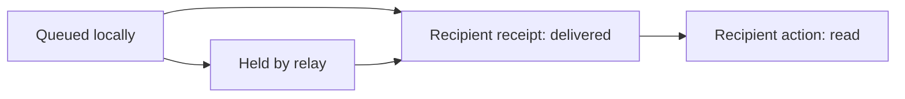

The diagram names distinct delivery states; it does not require every event to pass through a relay. A relay may hold a copy after direct delivery until its normal cleanup runs. Expiry or eviction can end relay custody before the recipient returns.

Client controls separate **public discovery scope**, **cross-site directory visibility**, **relay sending**, **relay receiving**, and an **optional preferred relay**. The existing **Use post offices** master switch remains compatible and preserves the two direction preferences when disabled. A post-office service role is configured independently. Both directions remain enabled by default.

**Federation enrollment** is explicit: discover candidates automatically, then require mutual identity-based trust before data exchange. Trust-on-first-sight would reduce setup but expose presence and mailbox metadata to an arbitrary reachable relay; a central registry would simplify enrollment at the cost of a new dependency. The [operator workflow](post-office-federation.md) now implements a shared versioned public manifest with explicit enrollment, listing and whole-identity revocation. Changes require restarting each affected service; there is no automatic trust or hot revocation.

Here, a **client** runs the Mesh Talk app, a **post office** is a separate relay role, a **LAN** is a discovery scope with local UDP/TCP reachability, and a **Tailscale path** is routed IP connectivity between particular machines. A Tailscale path does not automatically forward LAN multicast or expose all machines on either LAN.

## Q1. With three clients on one LAN and no post office, how do discovery, direct messages, and group messages work?

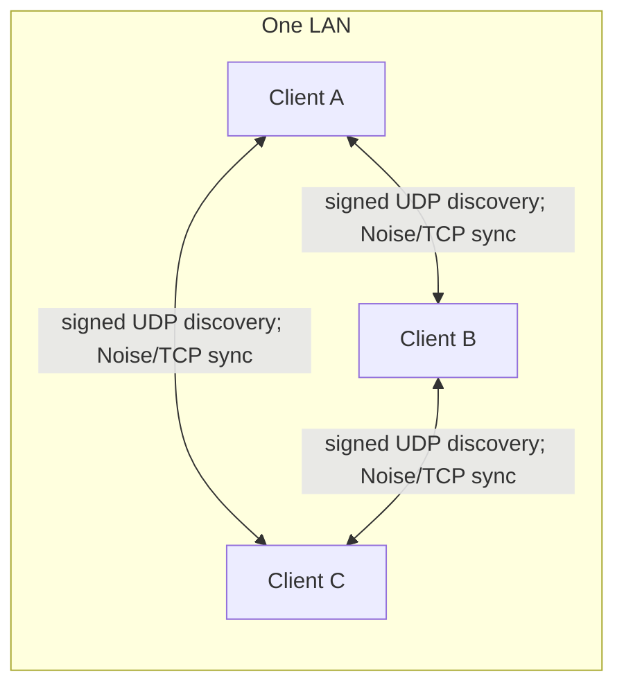

**Concrete example — Alice (A), Bob (B), Carol (C):**

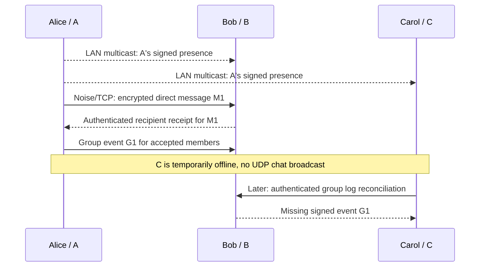

1. A, B and C learn one another's **own** identities from local discovery. A's direct message M1 goes only to B; the multicast packets contain no M1 text.
2. In a group of A/B/C, A records G1 and attempts member delivery. If C misses it, C can later pull G1 from B while B is online and **Share a copy** is on. A need not remain online after B has the event.
3. If B also goes offline before C can reach a holder, C waits. With no post office, the LAN provides no separate mailbox. A visible peer icon is not proof that G1 or M1 reached its recipient.

**Current.** Each visible device announces its own signed identity on the LAN's IPv4 multicast group (`224.0.0.167:47474`) roughly every two seconds. First-sight unicast replies and a bounded local `/24` unicast scan help when multicast is lost or blocked. These packets advertise presence and a listening port; they do **not** broadcast chat content. A recipient's signed identity is checked again by the Noise TCP connection.

For a direct message, the sender durably records the encrypted event, tries the recipient's verified direct route, and retries when a route becomes available. A message is **Delivered** only after an authenticated receipt from the intended recipient; finding the peer or completing a TCP session is not enough. Without a post office, both devices need a later direct route for an offline recipient to catch up.

A group is an authorized **conversation**, not a network multicast group. Its owner invites devices; a member must accept the invitation before its content is surfaced. Messages are encrypted with group sender keys and recorded as signed events. For a three-member group, the sender attempts direct delivery to the other members. A member that missed an event can later reconcile the channel log with another authorized online member holding it, even if the original author is offline. Accepted members share their channel copy by default and can turn **Share a copy** off; this is the current configurable sync-peer behavior. An arbitrary non-member cannot become a channel sync node. Membership/key controls are distributed to every known routed member. Signed membership and event validation still apply during recovery.

**Important conditions.** Devices must be visible, in the relevant multicast/unicast scope, and allowed through local firewalls; client isolation or blocked TCP can break discovery or delivery. A discovery proof is not a manually verified safety number. A device with channel **Share a copy** off keeps receiving messages but does not serve retained third-party history, including through outbound recovery or retries. Its own outgoing event waits if the recipient lacks third-party ancestry required by that signed event. Calls use a separate media path; files require an offer/consent and encrypted chunk transfer.

## Q2. What changes when the same LAN also has one post office?

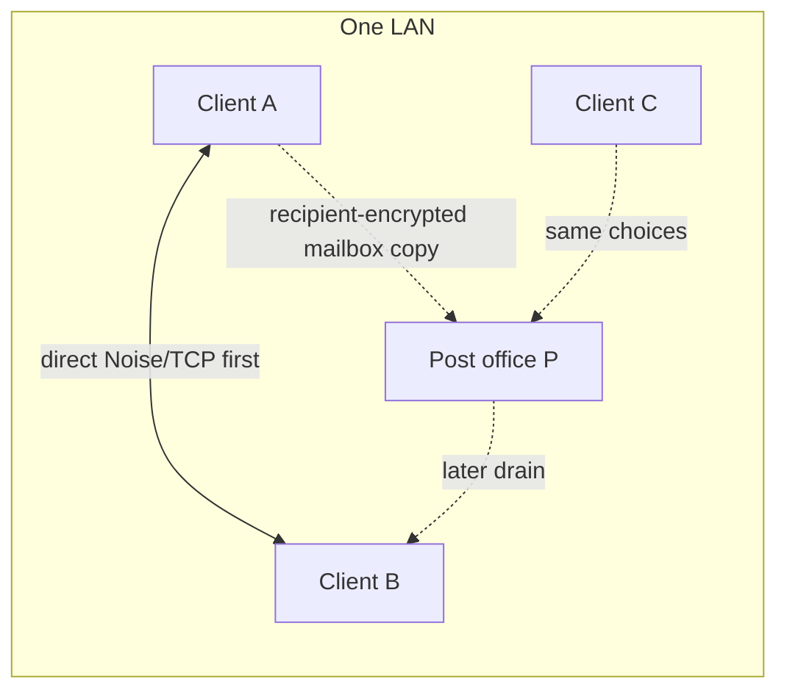

**Concrete example — B goes offline before A sends M2:**

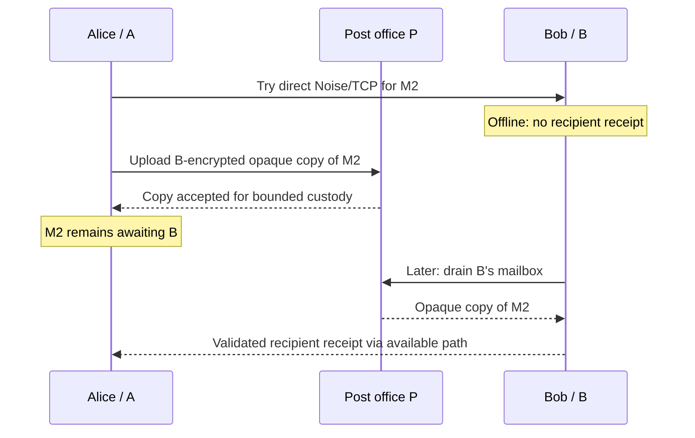

1. A and B still discover each other locally when online. P announces **its relay role**, not B's identity on B's behalf. P need not be a group member.
2. A's failed direct attempt leads to relay custody if **Use post offices** is on. The current group-send path can also add a relay copy after a successful direct attempt; strict fallback-only custody is an **open design decision**.
3. P cannot decrypt M2 or claim it was delivered. If P expires or evicts the copy before B drains it, A must retry from its own retained work when a route is available.

**Current.** Client-to-client discovery and direct sync remain the normal live path. If client post-office use is enabled (the desktop default), the sender can also upload recipient-encrypted events to P. The current channel send path attempts direct fanout **and then** mailbox replication; relay upload is not limited to cases where a direct send failed. This is useful offline custody, but it costs an extra sync and P's finite storage. The recipient drains known relays periodically and validates/decrypts through its ordinary admission path.

P has two application-level functions: **temporary encrypted storage** and **store-and-forward routing** to the recipient, including through trusted relay federation when configured. It can hold DMs, group events, invitations/controls, and file-related events in opaque pairwise mailboxes. It cannot decrypt the inner content, join a group, grant membership, or confirm receipt on behalf of a recipient. It is not a general IP router or an arbitrary TCP proxy. A mailbox copy can expire or be evicted: **30 days is a maximum, not a guaranteed delivery period**. Count and byte limits may evict whole mailboxes earlier.

`--post-office` alone does not create a peer directory. Same-LAN clients already discover one another directly; `--bridge` plus each client's **Discover peers through a post office** opt-in becomes relevant for introducing otherwise disconnected clients. A user can disable **Use post offices** while retaining direct P2P communication.

**Refinement:** say “prefer a direct path for live delivery and optionally add relay custody,” rather than “use the post office only after P2P fails.”

## Q3. What changes with two or three post offices on that LAN? Are they identical, and how does failover work?

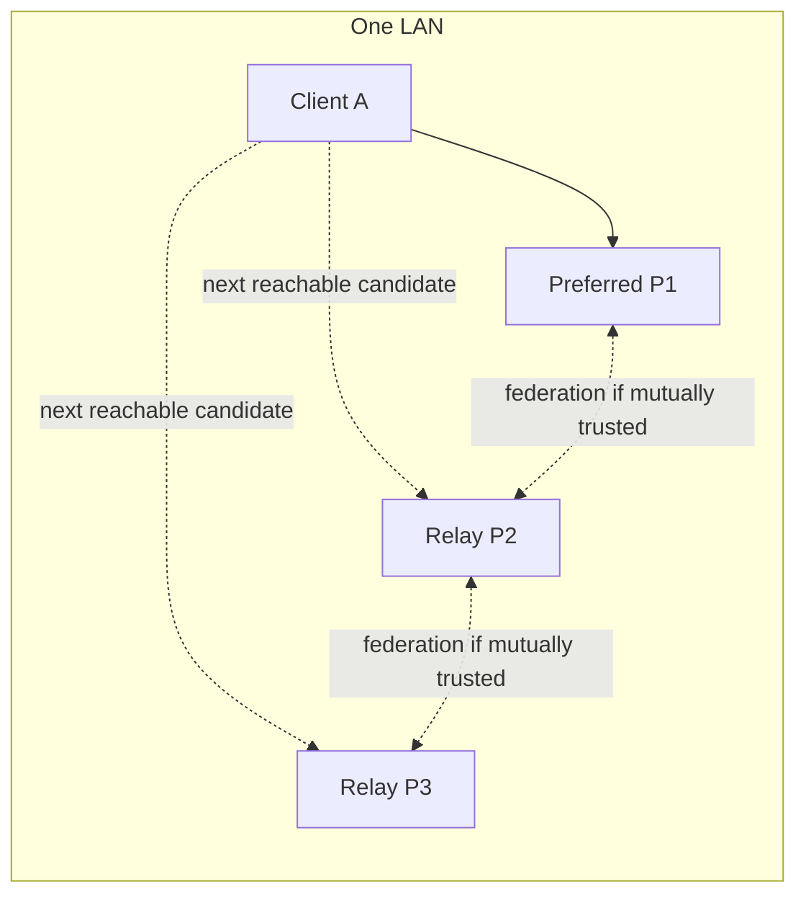

**Concrete example — P1 is preferred and then stops:**

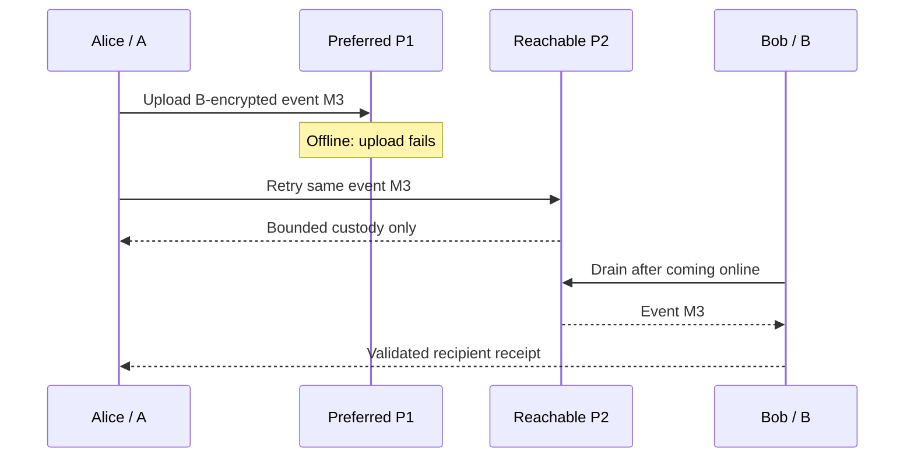

1. A can choose P2 only because A can authenticate and reach P2 directly. P1/P2 use distinct identities even if they have the same relay role and policy.
2. On one LAN, P2 can serve B directly when B knows and drains it. For a remote B, P2 also needs a surviving route to a trusted remote relay; otherwise M3 waits at P2 or A. P1 returning later must not create a duplicate chat row.
3. If P1 and P2 are mutually trusted bridge relays, eligible v3 opaque mailboxes can reconcile. If they are merely two mailbox-only processes, accepting M3 at P2 does **not** copy it to P1 automatically.

**Current.** The relays can run the same binary and the same **role and trust policy**. They cannot have literally identical host settings: each needs its own persistent key/identity, keystore, password file, listening ports as needed, and reachable addresses. Equal federation needs `--post-office --bridge` and the same trusted public manifest via `--federation-config` on each relay (or the existing repeated `--federation-peer` flags). See the [operator workflow](post-office-federation.md) for enrollment, revocation and required restarts. Merely starting two `--post-office` processes does not replicate their mailboxes; without federation, each is an independent offline store.

The app keeps direct client paths. Message and consented-file uploads share one candidate ordering: an explicit preferred relay stays first; for an introduced recipient, the reporting relays lead the remaining fallback candidates; other candidates prefer LAN reachability and stable identity ordering. A failed upload tries another candidate. This is **per operation**, not a permanent elected primary or an always-open connection. The recipient checks all known relays because a fallback copy can remain there after the preferred relay returns. With federation and client bridge opt-in, v3 encrypted mailboxes reconcile among trusted relays; legacy relay-bound mailboxes do not. Signed file consent and verified-save completion can return through those encrypted mailboxes without a direct client connection.

**Needs validation.** A two-relay outage test should stop P1, confirm P2 accepts a new message and the intended recipient issues a receipt, then restart P1 and check deduplication. With all relays on one machine or one power/network segment, multiple processes do not provide failure independence.

## Q4. With three isolated LANs and no post offices, what does one A–D Tailscale path expose?

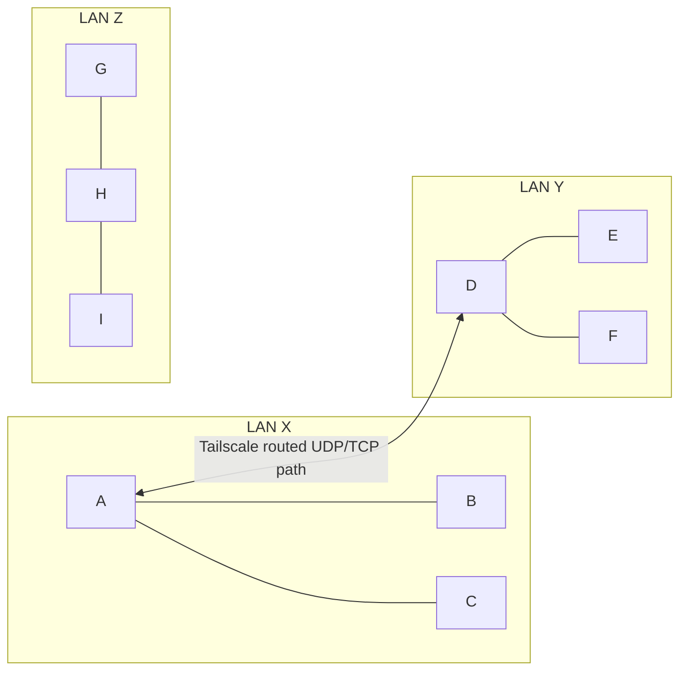

**Concrete example — A knows D's Tailscale candidate address:**

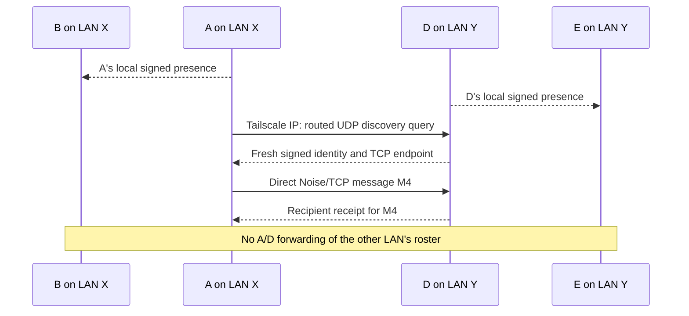

1. A sees B, C and D; D sees A, E and F. B does not see D merely because B sees A. E does not see A merely because E sees D. Z remains isolated.
2. A and D may share an accepted group and sync directly across the Tailscale edge. B/C and E/F need their **own** permitted route or an authorized group-member sync chain to exchange that group's events; A and D do not proxy arbitrary LAN traffic.
3. If A never obtains D's candidate IP, or UDP/TCP is blocked, the Tailscale installation alone does not establish Mesh Talk discovery and delivery.

**Current, if the routed discovery query and TCP ports are reachable:** A can discover **B, C, D**; D can discover **A, E, F**. The proposed “D sees C, E, F” contains a naming error: C is on A's LAN, and A does not proxy C's presence. B and C do not automatically discover D, E, or F. E and F do not automatically discover A, B, or C. G, H, and I remain isolated from the other LANs. A and D can send direct messages and share a group if the normal invitation/membership rules are satisfied; they do not act as transit relays for their neighbors.

Desktop Tailscale candidate discovery is best effort, and the headless CLI needs an explicit probe/endpoint. A Tailscale peer may be in another account or hidden by ACL/firewall rules. A Tailscale IP is only a route candidate until a signed Mesh Talk response and Noise identity check succeed.

## Q5. Should “same LAN” include a direct Tailscale connection?

**Proposed wording:** “Two visible nodes with a permitted direct application route should be able to discover and communicate, whether that route is local Ethernet/Wi-Fi or Tailscale.” This is a useful **user-facing equivalence**, not a claim that the two networks are one broadcast domain.

**Current.** Physical LAN discovery uses signed multicast plus local unicast fallback. Tailscale discovery uses candidate IPs and signed **unicast** queries; it does not carry the Mesh Talk LAN broadcast, automatically discover a remote peer's LAN neighbors, or make all application ports reachable. Both paths eventually use the same identity-pinned Noise/TCP data protocol.

## Q6. Should two post offices on a LAN or Tailscale link broadcast all users and relay everything automatically?

**Proposed wording:** “Trusted, reachable post offices exchange eligible opt-in presence and opaque encrypted mailbox events over authenticated federation sessions.” This gives them equal protocol roles without treating their LANs as a single subnet.

**Current.** Relays advertise **their own** signed presence locally and probe pinned routed seeds. Their federation traffic is authenticated TCP exchange, **not** a LAN broadcast of all users or message contents. Only fresh, self-signed presence from clients that enabled bridge discovery is exported; relay identities and private LAN addresses are not substituted as client entries. The directory expires registrations after 15 seconds. Federation copies only relay-independent v3 mailboxes, preserving original arrival times and retention limits. A physical or Tailscale relay-to-relay path is still required.

**Recommended decision:** automatically discover relay candidates, but exchange presence or mail only after explicit mutual identity-based trust enrollment. The existing pinned seeds satisfy the trust boundary; a simpler enrollment UX is a separate design task. Automatic contact with every visible relay would weaken that boundary.

## Q7. Which post offices should an app be allowed to select?

**Current:** Offer relays with a known direct application route, including physical LAN and routed/Tailscale discovery. Connectivity and identity are rechecked when used. Prefer a local relay automatically, allow a user preference, and fall back per failed operation. Return to the preferred relay when it is healthy, without requiring the user to select it again. A relay that is visible only through another relay should not be presented as an ordinary directly reachable choice. A fallback relay provides cross-site continuity only when it has its own surviving route toward the recipient.

**Current nuance.** Candidate ordering already prefers LAN routes and has fallback, but a user preference can put a directly reachable routed relay ahead of a LAN relay. The older `--bridge-peer` gateway can expose a remote relay through a local TCP proxy for compatibility. Gateway-only relays are excluded from new preferred-relay choices; a saved indirect preference is retained with an unavailable-route label. A direct route learned later makes that identity selectable again. The app can register with multiple reachable directories; it does not require every user to pin a global hub ID. The relay's ability to forward to another site depends on its own trusted route graph.

### Does an app connected to a remote post office join its network?

**Yes at the Mesh Talk application level**, when the client and the other participants permit public bridge discovery. It participates in the relay's discovery and encrypted-mailbox domain. This is a useful meaning of “join,” and it does not require an extra post office on the client's physical LAN.

Example: A is on LAN X; Q, B and C are on LAN Y. A can reach Q through Tailscale, while B and C reach Q locally. Q runs `--post-office --bridge`. A/B/C enable **Use post offices** and **Discover peers through a post office**; for bidirectional mailbox traffic, sending and receiving are enabled. A selects **Device discovery scope → Local and routed networks**.

1. A discovers Q by a signed routed query; B/C discover Q locally.
2. Each participant registers its own eligible signed presence with Q.
3. Q introduces B/C to A and A to B/C. A can select Q as its preferred directly reachable relay, despite Q being on another physical LAN.
4. If A cannot connect directly to B, A publishes B-encrypted mail to Q. B drains it through its local Q connection; replies and recipient receipts can return through Q to A.
5. An accepted group can use the same encrypted relay paths. Directory participation does not grant group membership, keys or unrestricted history access.

A now participates alongside B/C in Mesh Talk. It does not receive Ethernet/Wi-Fi multicast from LAN Y, gain IP routes to unrelated machines, or introduce all of LAN X merely by connecting. Q also does not list every machine on LAN Y: only eligible Mesh Talk registrations appear. If Q stops, continuity requires another reachable relay with a surviving onward path or a direct peer route.

The settings picker uses the core's direct-route capability, not physical-LAN provenance. Gateway-only/mailbox-only routes remain excluded. A saved preference remains visible if its route disappears, and becomes selectable again when a direct route returns. Older desktop backends conservatively fall back to their LAN flag.

## Q8. What visibility and relay switches should users have?

**Proposed controls:** (a) public discovery scope, with “directly reachable peers only” versus explicit cross-site directory opt-in; (b) permission to use post offices for opaque offline custody and recovery; (c) optional preferred reachable relay with automatic fallback. These are different choices and should remain separate. A known authorized contact may still use a direct route when cross-site public listing is off; directory visibility is not messaging authorization.

**Current.** **Use post offices** defaults on and gates mailbox upload/drain. **Discover peers through a post office** defaults off and shares public signed presence with eligible directories. **Invisible mode** suppresses public presence, including bridge participation, and uses separate private permission rules. Turning bridge discovery off does **not** limit ordinary signed routed discovery to the physical LAN: a directly Tailscale-connected public client can still find this device. **Device discovery scope → Local network only** adds a stricter optional scope: recognized physical subnets and scoped IPv6 link-local discovery, excluding routed/Tailscale probes and public bridge directories. It does not revoke an authorized TCP contact. See Q13 for independent send/receive modes and adapter boundaries.

## Q9. What layered architecture should express these principles?

**Recommended model:**

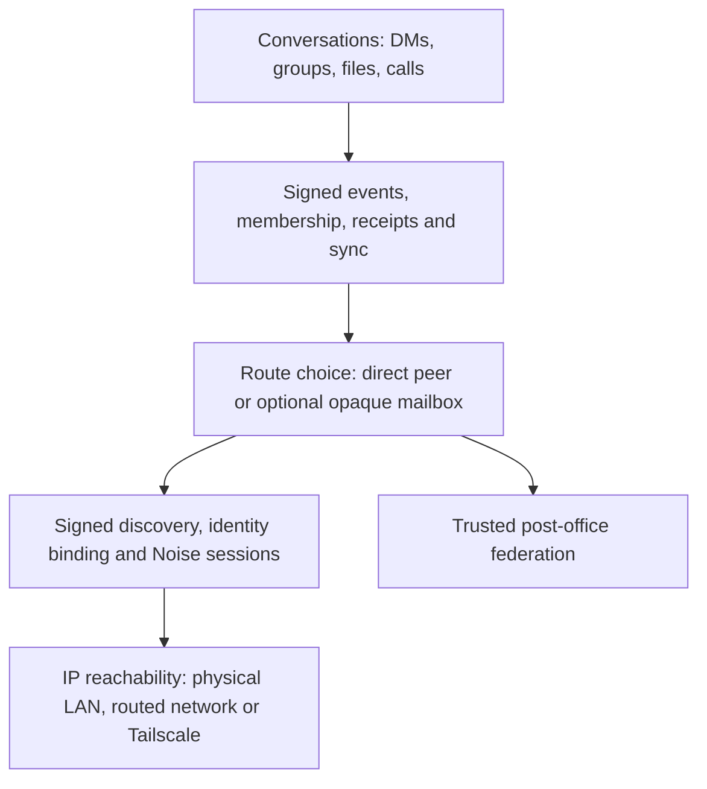

This preserves your intent—local-first messaging with optional relays—while separating concerns. Tailscale belongs below Mesh Talk as one possible IP route. Discovery names/authenticates nodes; it does not transmit chat content. The route layer coordinates direct sessions and optional application mailbox copies. The post office stores and forwards **opaque events**, not arbitrary TCP/IP packets. Group membership, consent, and delivery receipts remain above the transport choice. Calls require a separate media path.

**Proposed invariant:** prefer direct delivery when available; use encrypted relay custody when enabled; never report a message delivered until the recipient confirms it. Keep the preference/fallback policy behind one route-selection interface so app UI and protocol code do not implement different rules.

## Q10. Can one local relay connection serve 100 remote users and cap a client at eight active connections?

**Current bounded implementation.** A client Node has a shared budget of eight managed TCP slots across outbound dialing, authenticated sessions, retained idle sessions and accepted inbound sessions. Each direction has a seven-slot sublimit so it cannot consume every slot needed by the opposite direction. The accept loop reserves capacity before accepting; excess work waits, and an outbound capacity wait expires after two seconds instead of growing without bound. Pending connections in the operating system's listen backlog are outside this application budget, as are UDP discovery, WebRTC media and a separately deployed post-office process.

Successful sequential-sync exchanges can retain an authenticated connection for reuse. Idle entries expire after 15 seconds and are keyed by exact endpoint, both identity keys, account/role binding and policy generation. Errors, cancellation, revoked policy, changed bindings and remote closure discard a session. Calls, pairing, directory and account-history protocols that interpret the first frame specially always use fresh connections. There is at most one **idle** entry per identity/route; concurrent busy operations can use additional slots within the shared eight-slot cap. There is no wire multiplexing or strict one-busy-connection-per-relay guarantee.

Thus the bound is an enforced resource policy, not arithmetic derived from “five users plus three relays.” A 100-user directory can be fetched and recipient mailboxes reconciled sequentially over local relay sessions without 100 simultaneous TCP connections. Modern directory/federation pages admit up to 1,024 entries (legacy: 128); only opted-in, unexpired, eligible identities are included. Relay federation has its own independent probe/sync bounds. Group fanout and file transfer still incur per-recipient work; the connection cap does not imply a throughput SLA.

## Q11. What else must be specified before calling the design complete?

| Concern            | Principle / question to settle                                                                                                                                            |
| ------------------ | ------------------------------------------------------------------------------------------------------------------------------------------------------------------------- |
| Trust              | Who authorizes relay federation? Current full-identity pins prevent an arbitrary LAN relay from learning the opt-in directory or mailbox inventory.                       |
| Revocation         | How are federation keys replaced, and how is a relay removed? Removal stops future exchange but cannot erase metadata or ciphertext already copied there.                 |
| Failure domains    | A fallback relay only helps cross-site delivery if a route survives the failed relay. Test relay process, host, LAN, and inter-site link failure separately.              |
| Delivery semantics | Distinguish locally queued, relay-held, recipient-delivered, and read states; deduplicate by signed event ID.                                                             |
| Retention and cost | Relay mail is bounded by a 30-day maximum plus event/byte caps; directory presence is short-lived. Specify capacity and eviction behavior at larger scale.                |
| Group security     | Federation must not create membership, bypass acceptance, or surface events after removal. Versioned replica controls affect mixed-client channel sync.                   |
| Other data         | File offers/chunks need consent and integrity checks; calls need ICE media; sibling pairing/history needs its own authenticated path. Do not infer these from DM success. |
| Privacy            | A cross-site directory is a deliberate metadata-sharing opt-in. Local-only discovery, invisible mode, and trusted private contacts must remain distinct.                  |
| Operations         | “Same configuration” means same role/trust policy, with per-host identities, ports, addresses, and persistent keystores. Document service health and boot behavior.       |

## Q12. What exactly is end-to-end encrypted, and what can a post office observe?

**Current.** Message bodies, group content and eligible file data remain encrypted for their intended recipients; direct sessions additionally use identity-pinned Noise transport encryption. Before an event is uploaded to a post office, the client wraps the signed event inside a recipient-encrypted opaque mailbox event. The relay stores and forwards that outer event and cannot read its inner message, group control, file metadata or plaintext. Federation exchanges the same encrypted mailbox events between trusted relays without granting them recipient keys.

“All data is encrypted” needs one qualification: public discovery announcements are **signed presence data**, not secret messages. A relay necessarily sees the connecting device's identity/IP, pseudonymous mailbox ID, approximate size bucket, event count and timing. It can correlate traffic and can delay or drop it; encryption does not make the communication anonymous or guarantee delivery. The exact boundary and limitations are in [post-office metadata privacy](post-office-metadata-privacy.md). A post office that separately holds an authorized recipient's private key would have that recipient's access; the relay role alone does not.

## Q13. Can users independently choose cross-LAN visibility, post-office sending, receiving, and the relay role?

**Design intent.** Keep three decisions distinct: (1) whether this device shares public presence with cross-site directories, (2) whether it uses a post office for outgoing encrypted custody and incoming recovery, and (3) whether this machine operates a post-office service for other users. Same-LAN clients—or clients with a direct permitted Tailscale path—can exchange messages without any post office. Relay use is optional for these direct paths; it becomes useful for offline custody or for cross-LAN peers without a direct client route.

**Current controls.** **Discover peers through a post office** is the cross-site public-directory opt-in (off by default). **Use post offices** is the master switch (on by default). **Send through post offices** and **Receive through post offices** are independent, both on by default. Directory participation remains a separate choice when the master is on; disabling both data directions does not itself grant or withdraw public-directory consent. The post-office service role remains a separate `--post-office` deployment; bridge federation uses explicit trust.

**Device discovery scope** defaults to **Local and routed networks**. Selecting **Local network only** stops routed discovery probes, rejects off-LAN discovery announcements and responses, sends multicast only on recognized physical interfaces, and withdraws local bridge introductions. Physical IPv4 netmasks and scoped IPv6 link-local interfaces define the scope. Tailscale/other known overlays are excluded. Adapter classification is conservative: renamed or unrecognized physical adapters can be excluded. This is a disclosure policy, not a firewall, source-spoofing defense or recall of advertisements already copied by other nodes. Existing explicitly authorized TCP contacts remain usable. Authenticated sessions may advertise public presence only to endpoints admitted by the physical-interface scope; routed endpoints do not receive that public-discovery consent.

**Partial-direction consequences.** Disabling sending also prevents outgoing relay receipts and signed file decisions; receive-only mode cannot promise a sender will learn completion through the relay. Disabling receiving prevents decrypted events and durable seen markers from being installed. The existing bidirectional wire protocol can still carry encrypted response frames, which are discarded before content admission; the setting is not a zero-download-byte guarantee. Accepted local outgoing work remains queued while sending is disabled and can resume after re-enabling it. Direct peers remain available under either setting. Group **Share a copy** remains a per-member permission and does not create unrestricted third-party sync nodes.

## Q14. Which implementation limits prevent a blanket elegance or high-performance claim today?

**Current review findings:**

- **Feature-consistent failover:** ordinary messages and consented file chunks share recipient-aware relay candidates. A focused test proves alternate-relay custody when the preferred relay is offline. Signed consent and completion now return through encrypted mailboxes; a two-relay loopback test verifies full bytes, sender restart and recipient completion without client listeners. A physical current-Mac→mac-mini transfer through the installed relays saves a matching SHA-256 attachment. A four-host physical acceptance run now stops the preferred relay, completes a 130,000-byte transfer through Windows→mac2015→mac-mini, restarts the sender before approval and verifies SHA-256 and returned completion.
- **Federation work:** each relay probes every configured peer and attempts synchronization with every reachable route about every five seconds. Inventory generation hashes every retained event ID in each v3 mailbox. This is reasonable for a few relays, but a larger trust set can create repeated handshakes and inventory work; there is no measured large-mesh throughput guarantee.
- **Directory and connection bounds:** modern directory/federation requests support up to 1,024 entries; legacy requests retain 128. Refresh visits all eligible relays with at most eight queries in flight, so later candidates are not starved. The Node enforces a shared eight-slot managed TCP budget with bounded reusable sync sessions; this excludes OS backlog sockets, WebRTC media and separate relay processes. Roster size does not change the budget.
- **Deployment proof:** a focused loopback test verifies remote-client decryption through an alternate federated relay while the preferred relay is offline, and another verifies three-relay mailbox/presence propagation. Existing live tests still do not establish delivery to an independent client host on mac-mini's LAN during that outage. Group, file, call, and linked-device flows require separate evidence.

Physical preferred-relay outage and bridge-partition recovery now have separate four-host/two-site evidence. Native WKWebView media, physical capture quality and a third independent LAN remain distinct acceptance boundaries. Capacity bounds and single-machine measurements do not establish a large-mesh throughput SLA.

For a code-level review, the main seams are [LAN and routed discovery](../crates/mesh-talk-core/src/discovery/service.rs), [group send and recovery](../crates/mesh-talk-core/src/node/channels.rs), [client delivery and relay drain](../crates/mesh-talk-core/src/node/serving.rs), [relay candidate ordering](../crates/mesh-talk-core/src/node/postbox.rs), [bridge registration](../crates/mesh-talk-core/src/node/bridge_client.rs), [federated directory limits](../crates/mesh-talk-core/src/node/bridge_directory.rs), [relay federation](../crates/mesh-talk-core/src/postoffice/federation.rs), and [desktop settings](../src-tauri/src/settings.rs).

## Q15. Can accepted group members themselves bridge several LANs without post offices?

**Yes, in principle, through member-to-member event synchronization.** Suppose A/B are on LAN X, C/D on LAN Y, and E/F on LAN Z. B↔C and D↔E each have their own permitted Tailscale path. All six have accepted the same group and every bridge member serves its retained copy.

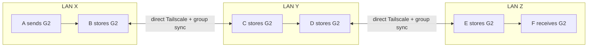

1. A sends signed, encrypted G2 to B while A and B have a direct local route. No chat content goes into LAN discovery packets.
2. C discovers B's actual Tailscale endpoint, authenticates B, and reconciles the authorized group log; C gets G2 from B. D later gets it from C over LAN Y. E gets it from D across their separate Tailscale edge; F gets it from E on LAN Z.
3. Each intermediary is an **accepted member holding a legitimate group copy**, not a general-purpose router or post office. Unlike a post office, that member can read content addressed to the group; choose bridge members accordingly. Members do not need to discover every other site's entire roster, but each required neighbor edge needs a verified route. A group invitation/key update must also reach each member and pass normal admission checks.
4. Delivery is **eventual and conditional**, not a synchronous broadcast guarantee. If B goes offline before C obtains G2 and never returns, the chain stops unless another holder or relay copy supplies G2. A non-sharing member at the only cross-site cut, missing history/keys, blocked application ports, or non-overlapping online periods can likewise stop propagation.

**Current evidence:** six-member logical-chain tests exercise five real authenticated Noise/TCP hops, sharing disabled, duplicate convergence, member removal, outsider denial and partition recovery. The physical three-LAN/two-Tailscale-edge arrangement remains unmeasured; logical topology coverage is not physical-site evidence. See the [illustrated scenario catalog](network-design-reference.md#6-scenario-catalog).

## Settled decisions and acceptance criteria

| Priority | Decision or requirement              | Recommended direction                                                                                                                                                                                                                                                               |
| -------- | ------------------------------------ | ----------------------------------------------------------------------------------------------------------------------------------------------------------------------------------------------------------------------------------------------------------------------------------- |
| 1        | Federation enrollment and revocation | Discover candidates automatically; explicitly enroll mutually trusted relay identities before any directory/mail exchange. Define removal and key replacement.                                                                                                                      |
| 2        | Direct versus relay custody policy   | Keep direct-first delivery and encrypted custody for outstanding per-device work. Exact recipient receipts retire only their matching destination; other device copies and consented file chunks remain independent. Custody is not delivery.                                       |
| 3        | Visibility and controls              | Retain per-device opt-in to public cross-site directory; keep it separate from relay send/receive permissions and preferred-relay choice. Explicit authorized contacts remain contactable over actual routes when public listing is off.                                            |
| 4        | Relay route and failure semantics    | Choose only directly reachable authenticated relays; prefer local automatically, honor a soft user preference, retry another candidate, and return when healthy. State that partitions delay delivery and expiry/capacity can end custody.                                          |
| 5        | Feature scope                        | Specify separate acceptance tests for text/controls, group recovery and membership changes, consented file bytes, calls, and linked-device sync. Do not extend a text guarantee to other paths by implication.                                                                      |
| 6        | Performance targets                  | Measure concurrent dials, directory size/refresh cost, bytes per recipient, relay sync work and recovery latency at agreed client/relay counts. Bound pages, backpressure and retries; distinguish the eight managed TCP slots from media, OS backlog and separate relay processes. |

These decisions are the implementation baseline. The evidence tracker distinguishes enforced local rules, measured tests and physical topologies that the available machines cannot reproduce.

Use this Q&A and the [topology baseline](network-topologies.md) to compare the agreed rules with code and targeted cross-LAN evidence; avoid extending a test result to an untested feature or topology.

## Q16. What does a person's Online or Offline status actually mean?

**Online** means this client has unexpired eligible public evidence for at least
one currently valid device bound to the person's verified account. **Offline**
means this client has no such evidence; the person may have exited or may simply
be undiscoverable from this client's network. It is not a global sign-out claim.
Recent observations enrich Offline (for example, “Offline · Seen by this client
3m ago”); they are not a third primary state. A never-observed member has no
invented last-seen time.

The member profile shows fresh devices once each and their actual sources:
local network discovery, cross-network discovery, post-office discovery, or
public authenticated contact with unspecified network scope. Ordinary signed UDP
observations outside the established interface scope show signed discovery with
unspecified scope; they are not labeled local merely because of an address prefix.
Sources can overlap
on one device. Neither a source nor an endpoint establishes physical location.
A direct application path means no intermediate Mesh Talk post office; it says
nothing about Tailscale's underlying transport. Online does not guarantee TCP,
message delivery, file transfer, or calls. UDP discovery can succeed while TCP
fails; communication failures belong to delivery/call/connection diagnostics.

A group header shows “24 members · 6 known online”, relative to this client.
Both numbers count accepted current **verified accounts**, deduplicating devices
and paths. Pending and removed members and post-office identities are excluded.
The current account counts once in both numbers while its accepted local node is
running. Zero known online is valid. Membership controls remain device-addressed;
when a device's account cannot be verified, the UI explicitly adds “unbound device
members” separately rather than counting them as people. Those rows remain
inspectable and use their device-scoped observations without inventing an account.

Local, routed, and permitted public authenticated observations last 15 seconds.
Directory presence lasts at most 15 seconds from its origin observation, retaining the original expiry through
federation and the versioned v4 client directory response. Legacy directory
responses still provide route hints but cannot establish fresh presence because
they omit origin expiry. Older relays' 45-second metadata remains compatible;
new clients cap each observation at 15 seconds without renewing repeated identical
origin expiry. The 20-second logout bound requires upgraded origin relays, since
an old relay can first introduce a listing after that bound. Private authenticated routes do not refresh visible
presence. Cached routes, membership, stored contacts, historical messages,
receipts, relay reachability, and mailbox custody never establish presence.

A stopped desktop loses Online within 20 seconds, including the shared two-second
UI poll. Dial routes retain their separate, longer lifetimes; transport-only
authentication cannot renew public presence. Known names and avatars remain
available after presence expires.

The frontend ages observations even when refreshes fail, shows a global presence
availability explanation, and retries its normal shared poll. It does not infer
loss of LAN connectivity from Internet availability or claim everyone signed out.
A stopped discovery producer is reported as unavailable; silent packet loss is
not proof of a local network outage. Normal discovery/runtime recovery restores
observations. Last-seen history is bounded, session-local, and clears on lock,
logout, or account/runtime replacement; absence of history is not evidence that
the person has never run the application.

In A↔B↔C group recovery, A observing B or receiving C's historical events through
B does **not** establish C's presence at A. A needs its own eligible fresh discovery,
directory, or permitted public authenticated observation. There is no global
presence service or new transitive group-presence gossip.
