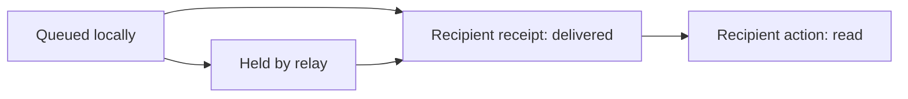
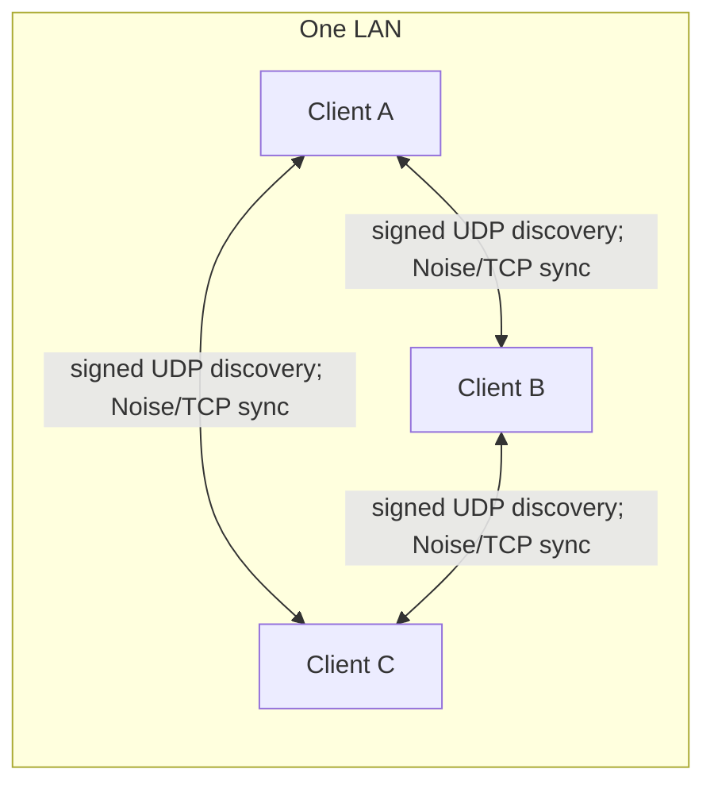
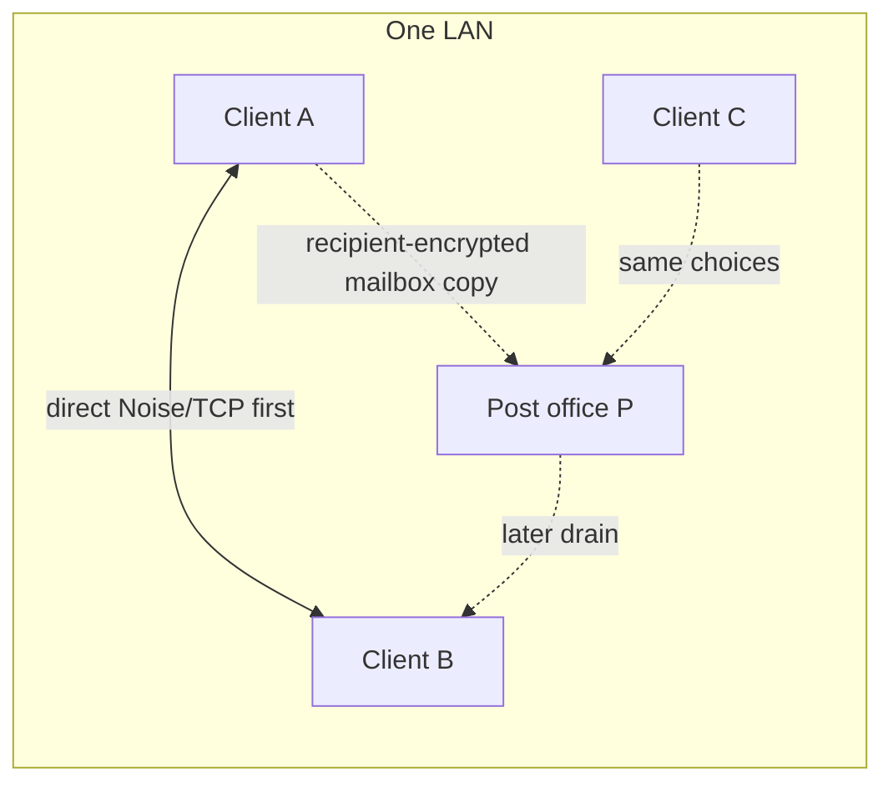
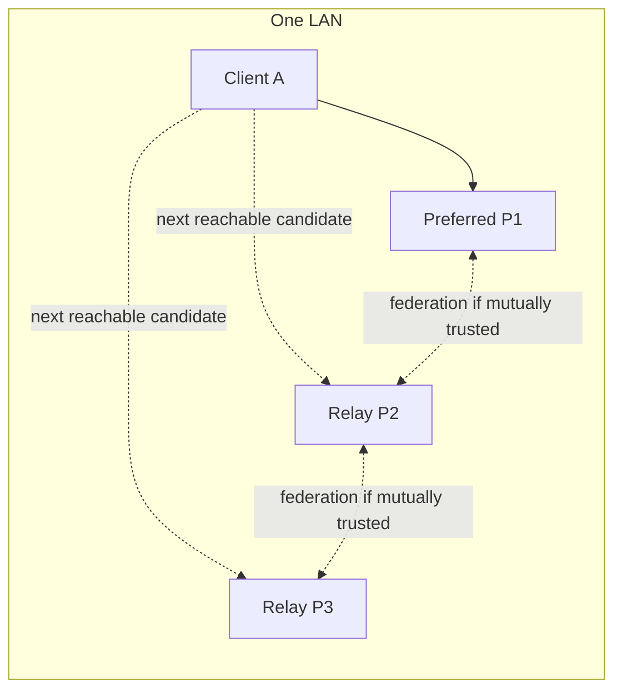
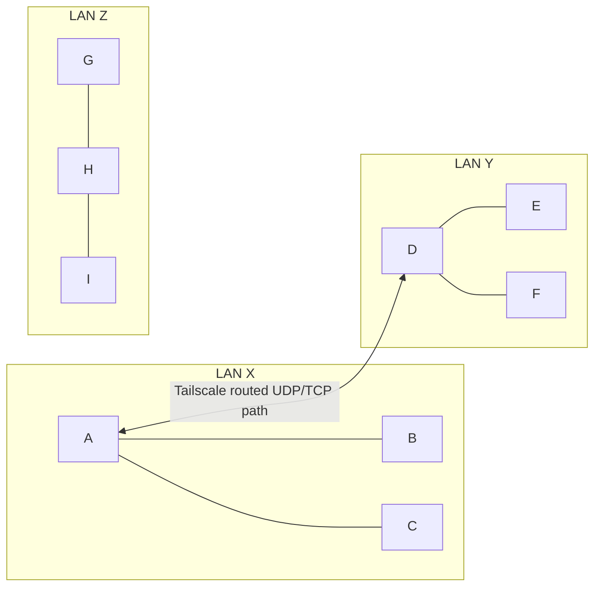
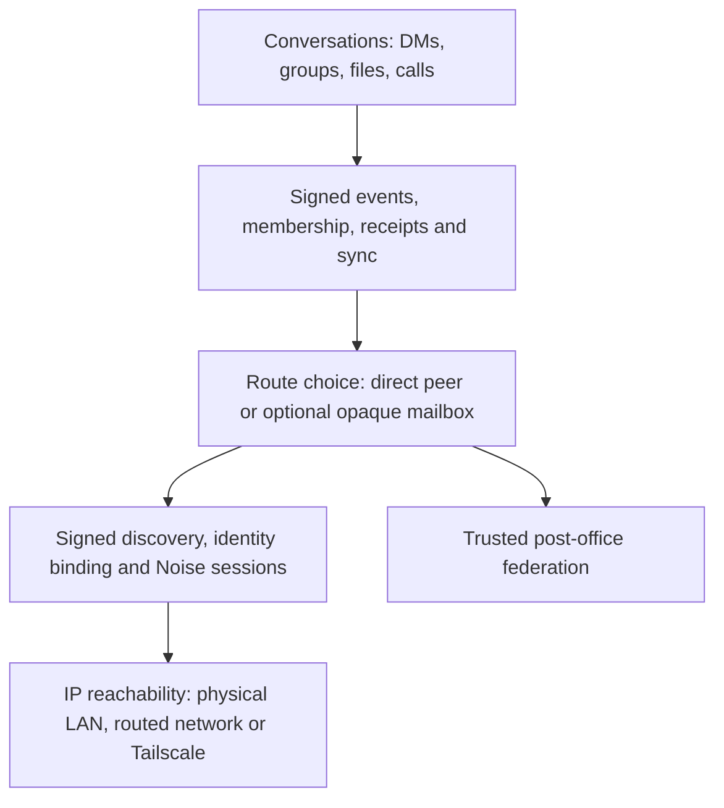

# Network design: scenario questions and answers

**Review draft · 2026-10-16.** This document restates the proposed behavior as questions, answers them against the current implementation, and marks decisions that are still open. **Current** means supported by code or the existing protocol; **Proposed** means a design goal, not a delivered guarantee; **Needs validation** means the behavior needs a targeted real-network test. The [topology baseline](network-topologies.md) is the companion map of switches, ports, and data flows.

## Recommended design baseline for review

This is a **proposed application-level federation**, not a merger of IP subnets. The rules below are recommendations to confirm before implementation; the numbered answers distinguish them from current behavior.

1. **Reachability precedes discovery.** A physical LAN and a permitted Tailscale path can both give two devices a direct application route, but only the physical LAN carries local multicast. A Tailscale link between A and D does not expose B or E, their LAN neighbors. Discovery identifies a candidate; authenticated transport and conversation authorization still decide whether data may flow.
2. **Federation has an explicit trust boundary.** Post offices may automatically discover candidates on reachable links. They exchange directory entries and mail only after mutual identity-based enrollment in the same trusted federation. LAN co-location and Tailscale reachability are transport facts, not authorization. Enrolled relays have equal protocol roles; each keeps its own identity and host-specific addresses. Revoking a relay stops future exchange but cannot retract metadata or ciphertext already copied to it.
3. **Visibility is distinct from delivery.** Only a client's fresh, self-signed, explicitly opted-in public presence may enter the cross-site directory. A person may remain absent from that directory yet communicate with a previously known, authorized contact when a valid route exists. Directory entries have short expiry and do not confer chat, group, or private-contact permission. Relays synchronize eligible presence over authenticated sessions; they do not broadcast every LAN device or extend multicast.
4. **Direct delivery is preferred; custody is separately defined.** The sender tries a verified direct route when available. With relay use enabled, it may also place recipient-encrypted events in a reachable post office for offline recovery. Whether custody is always attempted or only while recipient delivery is unconfirmed is a policy decision; neither relay acceptance nor TCP success counts as recipient delivery. Distinguish **queued locally → held by relay → delivered to recipient → read**; retries and copies deduplicate by event identity. Read status requires its own recipient action.
5. **A preferred relay is a soft preference.** A client selects among post offices it can directly reach and authenticate, uses an eligible alternative when an operation fails, and resumes the preferred one when healthy. Equal relays can reconcile opaque mail over surviving trusted links. Failover cannot cross a partition without an alternate physical route; locally queued or relay-held ciphertext waits for reconnection. Delivery is eventual and bounded by retention and capacity, not guaranteed for 30 days.
6. **Conversation authority stays at the endpoints.** Only accepted group members may serve group history; a post office never becomes a member or authorizes invitations. File bytes require separate consent, integrity, size and failover rules. Calls need a separate media route; linked-device history needs its own authenticated synchronization. Successful text delivery proves none of these paths.

The diagram names distinct delivery states; it does not require every event to pass through a relay. A relay may hold a copy after direct delivery until its normal cleanup runs. Expiry or eviction can end relay custody before the recipient returns.

Three user choices remain separate: **cross-site public visibility**, **use post offices for encrypted custody and recovery**, and an **optional preferred post office**. The post-office service role is configured independently. Keep outgoing upload and incoming drain under one **Use post offices** control unless a concrete send-only or receive-only use case justifies the confusing partial states.

The first design decision to confirm is **federation enrollment**. Recommended: discover candidates automatically, then require explicit mutual identity-based trust before data exchange. Trust-on-first-sight would reduce setup but expose presence and mailbox metadata to an arbitrary reachable relay; a central registry would simplify enrollment at the cost of a new dependency. The enrollment UX and revocation procedure need a separate specification before changing the current pinned-seed mechanism.

Here, a **client** runs the Mesh Talk app, a **post office** is a separate relay role, a **LAN** is a discovery scope with local UDP/TCP reachability, and a **Tailscale path** is routed IP connectivity between particular machines. A Tailscale path does not automatically forward LAN multicast or expose all machines on either LAN.

## Q1. With three clients on one LAN and no post office, how do discovery, direct messages, and group messages work?

**Current.** Each visible device announces its own signed identity on the LAN's IPv4 multicast group (`224.0.0.167:47474`) roughly every two seconds. First-sight unicast replies and a bounded local `/24` unicast scan help when multicast is lost or blocked. These packets advertise presence and a listening port; they do **not** broadcast chat content. A recipient's signed identity is checked again by the Noise TCP connection.

For a direct message, the sender durably records the encrypted event, tries the recipient's verified direct route, and retries when a route becomes available. A message is **Delivered** only after an authenticated receipt from the intended recipient; finding the peer or completing a TCP session is not enough. Without a post office, both devices need a later direct route for an offline recipient to catch up.

A group is an authorized **conversation**, not a network multicast group. Its owner invites devices; a member must accept the invitation before its content is surfaced. Messages are encrypted with group sender keys and recorded as signed events. For a three-member group, the sender attempts direct delivery to the other members. A member that missed an event can later reconcile the channel log with another authorized online member holding it, even if the original author is offline. Accepted members share their channel copy by default and can turn **Share a copy** off; this is the current configurable sync-peer behavior. An arbitrary non-member cannot become a channel sync node. Membership/key controls are distributed to every known routed member. Signed membership and event validation still apply during recovery.

**Important conditions.** Devices must be visible, in the relevant multicast/unicast scope, and allowed through local firewalls; client isolation or blocked TCP can break discovery or delivery. A discovery proof is not a manually verified safety number. A device with channel **Share a copy** off keeps receiving its own messages but does not serve its local channel history to others. Calls use a separate media path; files require an offer/consent and encrypted chunk transfer.

## Q2. What changes when the same LAN also has one post office?

**Current.** Client-to-client discovery and direct sync remain the normal live path. If client post-office use is enabled (the desktop default), the sender can also upload recipient-encrypted events to P. The current channel send path attempts direct fanout **and then** mailbox replication; relay upload is not limited to cases where a direct send failed. This is useful offline custody, but it costs an extra sync and P's finite storage. The recipient drains known relays periodically and validates/decrypts through its ordinary admission path.

P has two application-level functions: **temporary encrypted storage** and **store-and-forward routing** to the recipient, including through trusted relay federation when configured. It can hold DMs, group events, invitations/controls, and file-related events in opaque pairwise mailboxes. It cannot decrypt the inner content, join a group, grant membership, or confirm receipt on behalf of a recipient. It is not a general IP router or an arbitrary TCP proxy. A mailbox copy can expire or be evicted: **30 days is a maximum, not a guaranteed delivery period**. Count and byte limits may evict whole mailboxes earlier.

`--post-office` alone does not create a peer directory. Same-LAN clients already discover one another directly; `--bridge` plus each client's **Discover peers through a post office** opt-in becomes relevant for introducing otherwise disconnected clients. A user can disable **Use post offices** while retaining direct P2P communication.

**Refinement:** say “prefer a direct path for live delivery and optionally add relay custody,” rather than “use the post office only after P2P fails.”

## Q3. What changes with two or three post offices on that LAN? Are they identical, and how does failover work?

**Current.** The relays can run the same binary and the same **role and trust policy**. They cannot have literally identical host settings: each needs its own persistent key/identity, keystore, password file, listening ports as needed, and reachable addresses. Equal federation needs `--post-office --bridge` and the same trusted `--federation-peer` identity/endpoint set on each relay. Merely starting two `--post-office` processes does not replicate their mailboxes; without federation, each is an independent offline store.

The app keeps direct client paths. For ordinary message relay work, it orders verified candidates by an optional preferred relay, then LAN reachability and identity; for an introduced recipient, the relay that reported that recipient can take priority. A failed message upload can move to another reachable candidate. This is **per operation**, not a permanent elected primary or an always-open connection. The recipient checks all known relays because a fallback copy can remain there after the preferred relay returns. With federation and client bridge opt-in, v3 encrypted mailboxes reconcile among trusted relays; legacy relay-bound mailboxes do not. **File-chunk retry is narrower:** it selects one post office per attempt rather than iterating the candidate list, so the same immediate failover promise does not yet apply to files.

**Needs validation.** A two-relay outage test should stop P1, confirm P2 accepts a new message and the intended recipient issues a receipt, then restart P1 and check deduplication. With all relays on one machine or one power/network segment, multiple processes do not provide failure independence.

## Q4. With three isolated LANs and no post offices, what does one A–D Tailscale path expose?

**Current, if the routed discovery query and TCP ports are reachable:** A can discover **B, C, D**; D can discover **A, E, F**. The proposed “D sees C, E, F” contains a naming error: C is on A's LAN, and A does not proxy C's presence. B and C do not automatically discover D, E, or F. E and F do not automatically discover A, B, or C. G, H, and I remain isolated from the other LANs. A and D can send direct messages and share a group if the normal invitation/membership rules are satisfied; they do not act as transit relays for their neighbors.

Desktop Tailscale candidate discovery is best effort, and the headless CLI needs an explicit probe/endpoint. A Tailscale peer may be in another account or hidden by ACL/firewall rules. A Tailscale IP is only a route candidate until a signed Mesh Talk response and Noise identity check succeed.

## Q5. Should “same LAN” include a direct Tailscale connection?

**Proposed wording:** “Two visible nodes with a permitted direct application route should be able to discover and communicate, whether that route is local Ethernet/Wi-Fi or Tailscale.” This is a useful **user-facing equivalence**, not a claim that the two networks are one broadcast domain.

**Current.** Physical LAN discovery uses signed multicast plus local unicast fallback. Tailscale discovery uses candidate IPs and signed **unicast** queries; it does not carry the Mesh Talk LAN broadcast, automatically discover a remote peer's LAN neighbors, or make all application ports reachable. Both paths eventually use the same identity-pinned Noise/TCP data protocol.

## Q6. Should two post offices on a LAN or Tailscale link broadcast all users and relay everything automatically?

**Proposed wording:** “Trusted, reachable post offices exchange eligible opt-in presence and opaque encrypted mailbox events over authenticated federation sessions.” This gives them equal protocol roles without treating their LANs as a single subnet.

**Current.** Relays advertise **their own** signed presence locally and probe pinned routed seeds. Their federation traffic is authenticated TCP exchange, **not** a LAN broadcast of all users or message contents. Only fresh, self-signed presence from clients that enabled bridge discovery is exported; relay identities and private LAN addresses are not substituted as client entries. The directory expires registrations after about 45 seconds. Federation copies only relay-independent v3 mailboxes, preserving original arrival times and retention limits. A physical or Tailscale relay-to-relay path is still required.

**Recommended decision:** automatically discover relay candidates, but exchange presence or mail only after explicit mutual identity-based trust enrollment. The existing pinned seeds satisfy the trust boundary; a simpler enrollment UX is a separate design task. Automatic contact with every visible relay would weaken that boundary.

## Q7. Which post offices should an app be allowed to select?

**Proposed:** Offer relays that this client can reach and authenticate directly over an application path (local LAN or an actual routed Tailscale path). Prefer a local relay automatically, allow a user preference, and fall back per failed operation. Return to the preferred relay when it is healthy, without requiring the user to select it again. A relay that is visible only through another relay should not be presented as an ordinary directly reachable choice. A fallback relay provides cross-site continuity only when it has its own surviving route toward the recipient.

**Current nuance.** Candidate ordering already prefers LAN routes and has fallback, but a user preference can put a directly reachable routed relay ahead of a LAN relay. The older `--bridge-peer` gateway can expose a remote relay through a local TCP proxy for compatibility. This is an exception to the proposed **direct-reachability-only UI rule** and should be marked as such if retained. The app can register with multiple reachable directories; it does not require every user to pin a global hub ID. The relay's ability to forward to another site depends on its own trusted route graph.

## Q8. What visibility and relay switches should users have?

**Proposed controls:** (a) public discovery scope, with “directly reachable peers only” versus explicit cross-site directory opt-in; (b) permission to use post offices for opaque offline custody and recovery; (c) optional preferred reachable relay with automatic fallback. These are different choices and should remain separate. A known authorized contact may still use a direct route when cross-site public listing is off; directory visibility is not messaging authorization.

**Current.** **Use post offices** defaults on and gates mailbox upload/drain. **Discover peers through a post office** defaults off and shares public signed presence with eligible directories. **Invisible mode** suppresses public presence, including bridge participation, and uses separate private permission rules. Turning bridge discovery off does **not** limit ordinary signed routed discovery to the physical LAN: a directly Tailscale-connected public client can still find this device. Therefore a strict “visible only to physical LAN, but not direct Tailscale peers” switch is **not currently implemented**. Define the desired scope precisely before adding one; the user phrase “local LAN including direct Tailscale” is best modeled as **directly reachable peers only, without federation introductions**.

## Q9. What layered architecture should express these principles?

**Recommended model:**

This preserves your intent—local-first messaging with optional relays—while separating concerns. Tailscale belongs below Mesh Talk as one possible IP route. Discovery names/authenticates nodes; it does not transmit chat content. The route layer coordinates direct sessions and optional application mailbox copies. The post office stores and forwards **opaque events**, not arbitrary TCP/IP packets. Group membership, consent, and delivery receipts remain above the transport choice. Calls require a separate media path.

**Proposed invariant:** prefer direct delivery when available; use encrypted relay custody when enabled; never report a message delivered until the recipient confirms it. Keep the preference/fallback policy behind one route-selection interface so app UI and protocol code do not implement different rules.

## Q10. Can one local relay connection serve 100 remote users and cap a client at eight active connections?

**Goal, not current guarantee.** One relay endpoint can avoid a client dialing every remote client just to fetch directory entries or upload opaque events. But the current protocol has **pairwise recipient mailboxes**, periodic directory/drain operations, direct P2P attempts, and group fanout/recovery. Operations can open independent Noise/TCP sessions; there is no global persistent connection pool or invariant of one socket per relay. Group membership/key controls contact every known routed member, while larger text groups seed a small number of members and recover through anti-entropy. Therefore “5 local users + 3 relays = at most 8 active connections” is **not correct today**, and it does not follow from federation alone.

The directory is also bounded (currently 128 members per relay), so “the post office returns the full online list of 100 users” depends on who opted in, expiry, capacity and the federated relay graph. Client roster deduplication should use verified device identity; an account may legitimately have multiple devices. A useful future efficiency requirement is a **measured** cap on concurrent dials, bounded directory pages, backpressure, and optional connection reuse, without hiding group/control delivery costs. A full mesh of relays adds roughly quadratic pair relationships as the federation grows; use bounded inventory exchange and measure reconciliation work before promising large-federation scale. One connection per local relay is an optimization target, not a protocol invariant.

## Q11. What else must be specified before calling the design complete?

| Concern            | Principle / question to settle                                                                                                                                            |
| ------------------ | ------------------------------------------------------------------------------------------------------------------------------------------------------------------------- |
| Trust              | Who authorizes relay federation? Current full-identity pins prevent an arbitrary LAN relay from learning the opt-in directory or mailbox inventory.                       |
| Revocation         | How are federation keys replaced, and how is a relay removed? Removal stops future exchange but cannot erase metadata or ciphertext already copied there.                 |
| Failure domains    | A fallback relay only helps cross-site delivery if a route survives the failed relay. Test relay process, host, LAN, and inter-site link failure separately.              |
| Delivery semantics | Distinguish locally queued, relay-held, recipient-delivered, and read states; deduplicate by signed event ID.                                                             |
| Retention and cost | Relay mail is bounded by a 30-day maximum plus event/byte caps; directory presence is short-lived. Specify capacity and eviction behavior at larger scale.                |
| Group security     | Federation must not create membership, bypass acceptance, or surface events after removal. Versioned replica controls affect mixed-client channel sync.                   |
| Other data         | File offers/chunks need consent and integrity checks; calls need ICE media; sibling pairing/history needs its own authenticated path. Do not infer these from DM success. |
| Privacy            | A cross-site directory is a deliberate metadata-sharing opt-in. Local-only discovery, invisible mode, and trusted private contacts must remain distinct.                  |
| Operations         | “Same configuration” means same role/trust policy, with per-host identities, ports, addresses, and persistent keystores. Document service health and boot behavior.       |

## Q12. What exactly is end-to-end encrypted, and what can a post office observe?

**Current.** Message bodies, group content and eligible file data remain encrypted for their intended recipients; direct sessions additionally use identity-pinned Noise transport encryption. Before an event is uploaded to a post office, the client wraps the signed event inside a recipient-encrypted opaque mailbox event. The relay stores and forwards that outer event and cannot read its inner message, group control, file metadata or plaintext. Federation exchanges the same encrypted mailbox events between trusted relays without granting them recipient keys.

“All data is encrypted” needs one qualification: public discovery announcements are **signed presence data**, not secret messages. A relay necessarily sees the connecting device's identity/IP, pseudonymous mailbox ID, approximate size bucket, event count and timing. It can correlate traffic and can delay or drop it; encryption does not make the communication anonymous or guarantee delivery. The exact boundary and limitations are in [post-office metadata privacy](post-office-metadata-privacy.md). A post office that separately holds an authorized recipient's private key would have that recipient's access; the relay role alone does not.

## Q13. Can users independently choose cross-LAN visibility, post-office sending, receiving, and the relay role?

**Design intent.** Keep three decisions distinct: (1) whether this device shares public presence with cross-site directories, (2) whether it uses a post office for outgoing encrypted custody and incoming recovery, and (3) whether this machine operates a post-office service for other users. Same-LAN clients—or clients with a direct permitted Tailscale path—can exchange messages without any post office. Relay use is optional for these direct paths; it becomes useful for offline custody or for cross-LAN peers without a direct client route.

**Current controls.** **Discover peers through a post office** is the cross-site public-directory opt-in (off by default). **Use post offices** jointly gates this client's mailbox upload **and** drain (on by default); it does not provide separate send-only and receive-only switches. The post-office role is configured when launching a separate node with `--post-office`; `--bridge` adds its opt-in directory, and identity-pinned `--federation-peer` seeds configure equal-relay federation. An ordinary Mesh Talk client does not become a relay for its LAN neighbors merely by enabling mailbox use. A directly reachable Tailscale peer can still discover a public client even when bridge discovery is off; a strict physical-LAN-only visibility switch is not implemented.

**Recommended control model.** Keep outgoing upload and incoming drain under one **Use post offices** setting unless a concrete send-only or receive-only workflow is specified. A send-only device may miss receipts/replies, while a receive-only device may fail to provide offline custody for its own messages. Group recovery from other online peers is already configurable **per accepted member** through **Share a copy**; there is no unrestricted third-party sync-node role.

## Q14. Which implementation limits prevent a blanket elegance or high-performance claim today?

**Current review findings:**

- **Feature-consistent failover:** ordinary message uploads iterate relay candidates, but the file-chunk retry path selects one relay per attempt. A historical cross-relay file diagnostic delivered the offer but did not complete the saved file within 120 seconds. That test used the older gateway topology, so current federation file behavior still needs an independent test; do not infer full file delivery from DM success.
- **Federation work:** each relay probes every configured peer and attempts synchronization with every reachable route about every five seconds. Inventory generation hashes every retained event ID in each v3 mailbox. This is reasonable for a few relays, but a larger trust set can create repeated handshakes and inventory work; there is no measured large-mesh throughput guarantee.
- **Directory and connection bounds:** a relay directory is capped at 128 members, and a client queries at most eight relay directories per refresh. The client has no global persistent TCP connection pool, so a visible roster size cannot be converted into a fixed concurrent-connection count.
- **Deployment proof:** existing live tests do not establish delivery to an independent client host on mac-mini's LAN during a preferred-relay outage. Group, file, call, and linked-device flows require separate evidence.

These are different kinds of work: the file path is a concrete implementation inconsistency, the limits are explicit capacity choices, and the cross-site cases are validation gaps. Keep those categories separate when planning fixes.

For a code-level review, the main seams are [LAN and routed discovery](../crates/mesh-talk-core/src/discovery/service.rs), [group send and recovery](../crates/mesh-talk-core/src/node/channels.rs), [client delivery and relay drain](../crates/mesh-talk-core/src/node/serving.rs), [relay candidate ordering](../crates/mesh-talk-core/src/node/postbox.rs), [bridge registration](../crates/mesh-talk-core/src/node/bridge_client.rs), [federated directory limits](../crates/mesh-talk-core/src/node/bridge_directory.rs), [relay federation](../crates/mesh-talk-core/src/postoffice/federation.rs), and [desktop settings](../src-tauri/src/settings.rs).

## Decisions and acceptance criteria before implementation

| Priority | Decision or requirement              | Recommended direction                                                                                                                                                                                                                      |
| -------- | ------------------------------------ | ------------------------------------------------------------------------------------------------------------------------------------------------------------------------------------------------------------------------------------------ |
| 1        | Federation enrollment and revocation | Discover candidates automatically; explicitly enroll mutually trusted relay identities before any directory/mail exchange. Define removal and key replacement.                                                                             |
| 2        | Direct versus relay custody policy   | Keep direct-first delivery. Decide whether relay upload occurs after every direct attempt or only while recipient receipt is unconfirmed; specify group-recipient behavior and retry limits. Never label custody as delivered.             |
| 3        | Visibility and controls              | Retain per-device opt-in to public cross-site directory; keep it separate from the combined relay-use setting and preferred-relay choice. Define contactability for known peers who are not publicly listed.                               |
| 4        | Relay route and failure semantics    | Choose only directly reachable authenticated relays; prefer local automatically, honor a soft user preference, retry another candidate, and return when healthy. State that partitions delay delivery and expiry/capacity can end custody. |
| 5        | Feature scope                        | Specify separate acceptance tests for text/controls, group recovery and membership changes, consented file bytes, calls, and linked-device sync. Do not extend a text guarantee to other paths by implication.                             |
| 6        | Performance targets                  | Measure concurrent dials, directory size/refresh cost, bytes per recipient, relay sync work and recovery latency at agreed client/relay counts. Bound pages, backpressure and retries; do not promise a fixed eight-socket ceiling.        |

These are proposed rules, not claims that the implementation already meets them. Once the decisions are accepted, compare each rule with code and targeted physical-network tests before declaring the design delivered.

No code changes are implied by this review draft. Once these decisions are settled, update both this Q&A and the [topology baseline](network-topologies.md) with the agreed behavior, then compare it with code and targeted cross-LAN tests.
