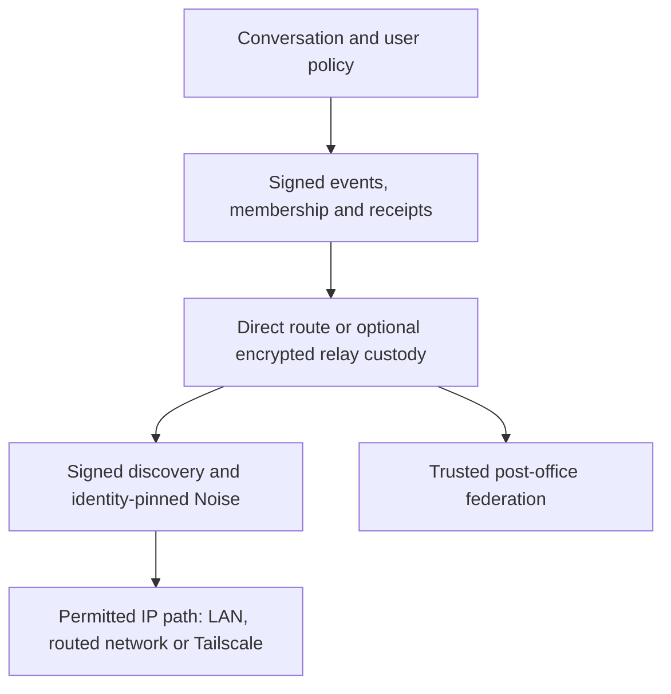
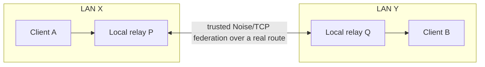
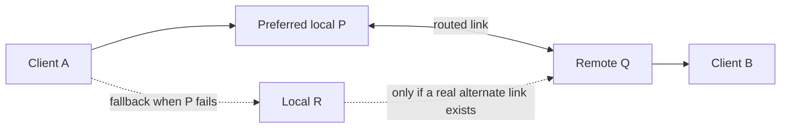
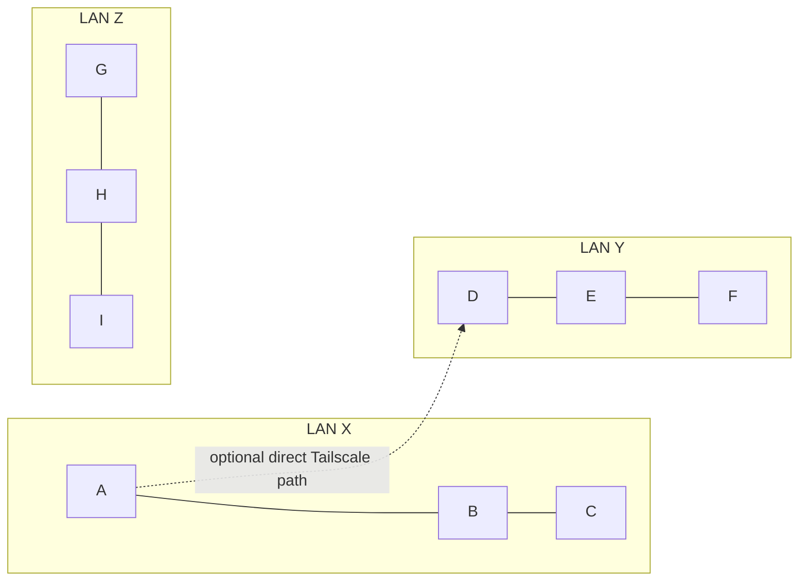
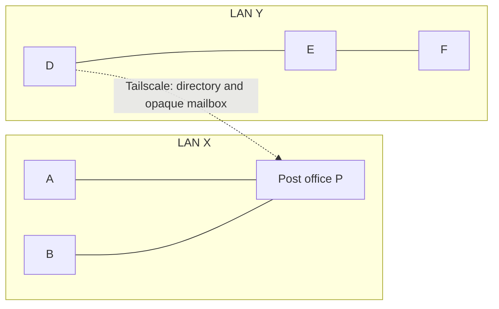

# Mesh Talk network design reference

**Design review draft · 2026-10-16.** This is the consolidated reference for deciding what Mesh Talk's network behavior **should** be. It includes implementation facts so that a desired behavior is not mistaken for an existing guarantee. No code change is implied by this document.

**Reading key:** **Current** describes the repository today; **Recommended** is the proposed product rule; **Open** needs a decision; **Validate** requires a targeted test before claiming support. The [topology guide](network-topologies.md) owns the current switch/port matrix and diagrams; the [scenario Q&A](network-design-qa.md) gives shorter answers. [Architecture](ARCHITECTURE.md) owns protocol detail, and [relay metadata privacy](post-office-metadata-privacy.md) owns the exact encryption boundary.

## 1. Purpose and boundary

Mesh Talk is a local-first, end-to-end encrypted conversation system. Devices should communicate directly when they have an authenticated application route. A peer-operated **post office** can temporarily hold recipient-encrypted events and exchange eligible information with other trusted post offices. Tailscale can supply IP reachability, but Mesh Talk neither creates a VPN nor merges LANs into one broadcast domain.

The intended result is **similar user experience across reachable sites**, not identical network behavior. Same-LAN multicast, routed unicast discovery, direct encrypted sync, directory introductions, relay custody, and relay federation are separate operations. The distinction determines what can be discovered, who can deliver a message, and what survives an outage.

### Glossary

| Term                                 | Meaning and important boundary                                                                                                                                                                                                                                             |
| ------------------------------------ | -------------------------------------------------------------------------------------------------------------------------------------------------------------------------------------------------------------------------------------------------------------------------- |
| **Client / Mesh Talk app**           | A device running the chat application. A client does not forward its LAN neighbors' discovery or act as a post office simply because it has Tailscale.                                                                                                                     |
| **Device identity / account**        | A device has signing and key-agreement keys and an account certificate. One account may own multiple devices; deduplicate devices by verified device identity, then group them under an account.                                                                           |
| **Peer**                             | Another verified Mesh Talk device, including a post office in the connection view. A post office is infrastructure and must not appear as an ordinary person or group member.                                                                                              |
| **Physical LAN**                     | A local interface/discovery scope in which application UDP multicast or unicast and TCP may be permitted. Wi-Fi client isolation, firewall rules, VLANs, and blocked ports can still prevent contact.                                                                      |
| **Direct application route**         | A permitted UDP discovery and/or TCP data path between two particular devices. It may use a physical LAN, routed IP, or Tailscale. A route is not identity proof.                                                                                                          |
| **Tailscale path**                   | Routed IP reachability between particular enrolled machines, subject to the existing tailnet policy and local firewall. It does not forward Mesh Talk multicast or automatically expose the machines' LAN neighbors.                                                       |
| **Discovery / presence**             | Signed, short-lived evidence that a device is available. Local discovery is multicast plus unicast fallback; routed discovery queries known candidate IPs; an opted-in relay directory can introduce remote devices. None grants conversation access.                      |
| **Directory introduction**           | A relay-provided, verified identity and potential relay route for an opted-in device. It is not a direct IP route, friendship, group membership, or proof that the recipient is online now.                                                                                |
| **Post office / relay**              | A peer-operated application mailbox service. It accepts and forwards opaque recipient-encrypted events and, with bridge mode, exchanges eligible opt-in presence with trusted relays. It is not an IP router, LAN broadcast repeater, group member, or WebRTC media relay. |
| **Host versus node**                 | One physical computer may run both the app and a separate post-office process. They have distinct Mesh Talk identities and may advertise different reachable interface addresses even though they share hardware.                                                          |
| **Federation**                       | Mutual, authenticated exchange between trusted post offices over an actual reachable link. Equal protocol roles do not mean identical device keys, ports, addresses, or identical live routes.                                                                             |
| **Event / sync**                     | A signed, content-addressed conversation record. Authorized peers reconcile event logs; group members may provide retained history to one another. Chat content is not sent in discovery announcements.                                                                    |
| **Custody / delivery / read**        | **Custody:** a relay has an encrypted copy. **Delivered:** the exact recipient produced a validated receipt. **Read:** a separate recipient action, if represented. A TCP session or relay upload alone establishes neither delivery nor reading.                          |
| **Direct recipient / known contact** | A verified identity that the sender already knows. A known contact can sometimes be addressed without appearing in a public cross-site directory, provided an authorized data path exists.                                                                                 |
| **Visibility**                       | Whether a device publishes public presence locally/directly or opts in to cross-site directory sharing. Invisible/private-contact behavior has additional authorization rules.                                                                                             |
| **Channel / group**                  | An authorized conversation with accepted members and encryption keys, not a network multicast group. A relay carrying a sealed group event never acquires membership.                                                                                                      |

### The three kinds of “broadcast”

| Phrase                            | Actual operation                                                                                                                             | Who receives it                                                                                                                       |
| --------------------------------- | -------------------------------------------------------------------------------------------------------------------------------------------- | ------------------------------------------------------------------------------------------------------------------------------------- |
| **LAN announcement**              | A device sends its own signed presence over IPv4 multicast, with unicast reply/scan fallback.                                                | Devices in that permitted local UDP scope. Tailscale does not carry the multicast onward.                                             |
| **Cross-site directory exchange** | Trusted post offices synchronize fresh, self-signed presence from clients that opted in.                                                     | Enrolled relays and clients querying eligible directories. This is authenticated application sync, not a LAN broadcast of every user. |
| **Group message delivery**        | The sender creates encrypted, signed events for accepted members; direct fanout, member recovery and optional opaque relay copies move them. | Authorized recipients only. No group plaintext is sent over UDP multicast.                                                            |

## 2. Responsibility map

Each boundary should have one owner. The UI presents policy and status; it does not invent routes or decide that relay custody equals delivery.

| Owner                      | Repository area                                                           | Responsibility                                                                                                                                    | Must not do                                                                             |
| -------------------------- | ------------------------------------------------------------------------- | ------------------------------------------------------------------------------------------------------------------------------------------------- | --------------------------------------------------------------------------------------- |
| Desktop UI                 | `frontend/src/`                                                           | Present people, groups, direct/relay status and settings; exclude relay-role devices from person/group pickers; explain pending versus delivered. | Infer a remote LAN from a Tailscale address or independently implement relay selection. |
| Desktop IPC/settings       | `src-tauri/src/`                                                          | Validate and persist user choices, pass them to the core, publish state changes.                                                                  | Duplicate crypto, discovery, or route-policy logic.                                     |
| Node orchestration         | `crates/mesh-talk-core/src/node/`                                         | Coordinate identity, roster, route candidates, direct delivery, relay upload/drain, retry and receipts.                                           | Treat a relay directory entry as direct TCP reachability.                               |
| Discovery                  | `crates/mesh-talk-core/src/discovery/`                                    | Produce and validate local/routed presence and maintain device/address observations.                                                              | Carry conversation content or authorize group membership.                               |
| Transport                  | `crates/mesh-talk-core/src/transport/`                                    | Establish identity-pinned Noise/TCP sessions over reachable IP endpoints.                                                                         | Trust IP or Tailscale identity as a Mesh Talk identity by itself.                       |
| Event log and crypto       | `crates/mesh-talk-core/src/{eventlog,identity,ratchet,channel}/`, `dm.rs` | Sign, encrypt, validate, order and reconcile conversation events; enforce DM/group keys and membership.                                           | Let a relay create membership or issue recipient delivery receipts.                     |
| File and media paths       | `crates/mesh-talk-core/src/file/` and call code                           | Enforce file offer/consent, encrypted chunk integrity, and separate call signaling/media rules.                                                   | Assume text-message success proves file completion or WebRTC reachability.              |
| Post office                | `crates/mesh-talk-core/src/postoffice/`                                   | Bound opaque mailbox storage, expiry, directory registration and trusted federation reconciliation.                                               | Decrypt inner content, publish all LAN users, or act as a general TCP/IP gateway.       |
| Local storage              | `crates/mesh-talk-core/src/storage/`                                      | Keep identities, accepted events and local history durable.                                                                                       | Claim post-office retention is the same as the user's local history retention.          |
| Existing network/Tailscale | Outside Mesh Talk                                                         | Provide permitted IP connectivity between endpoints.                                                                                              | Supply Mesh Talk authorization or automatically bridge physical LANs.                   |

**Recommended modular seam:** one core route-policy interface should order directly reachable, authenticated relays and apply preference/failover. UI, DM, group and file paths should consume that policy instead of recreating candidate rules. The delivery-state model should likewise have one definition across backend and UI. This is a design boundary, not a claim that every current path already shares one implementation.

### Feature summary and routing ownership

| Feature                          | Required authority and payload                                                                                | Route choices and independent limit                                                                                                             |
| -------------------------------- | ------------------------------------------------------------------------------------------------------------- | ----------------------------------------------------------------------------------------------------------------------------------------------- |
| One-to-one messages and controls | Sender signs and encrypts events for the intended recipient; exact recipient receipts govern delivery status. | Direct Noise/TCP first; optional opaque mailbox custody and trusted relay federation for eligible paths. An online indicator is not a receipt.  |
| Group messages and history       | Accepted membership and sender keys govern event admission; sharing members can provide retained history.     | Direct fanout and member anti-entropy; optional per-recipient relay copies. One member's copy does not prove another member received the event. |
| Files and folders                | Recipient consent, encrypted chunks, manifests and integrity checks.                                          | Direct or eligible relay event paths; a file card arriving does not prove all bytes were saved. Chunk failover needs its own check.             |
| Calls                            | Signaling and WebRTC ICE media negotiation.                                                                   | Application routes may carry signaling; media needs its own reachable path. A post office is not a media relay.                                 |
| Linked devices                   | Account-certified devices and authenticated sibling synchronization.                                          | Ordinary event introductions may use reachable paths; full history/settings catch-up is a separate protocol responsibility.                     |
| Discovery and visibility         | Self-signed presence, user privacy policy and short expiry.                                                   | Local multicast/unicast, routed unicast, or opt-in trusted relay directory. Discovery carries no chat plaintext or membership grant.            |
| Offline custody                  | Recipient-encrypted, bounded mailbox copy with an original arrival time.                                      | Reachable post office and optionally trusted federation; 30-day maximum and capacity limits apply independently of local history.               |

## 3. Design philosophy and invariants

1. **Local first.** Attempt a verified direct route for a live recipient. A post office is optional for direct contact and valuable for offline custody or a cross-site destination without direct client reachability.
2. **Reachability is specific to an edge.** A↔D over Tailscale says nothing about B↔D, A↔E, or the two LANs as a whole. Every diagram edge requires its own permitted application path.
3. **Identity and authorization are separate from reachability.** Signed discovery and Noise authenticate a device; DM trust rules, private permissions and group membership decide what the device may receive or sync.
4. **Presence sharing is opt-in.** A post office advertises itself as infrastructure. It federates only fresh, eligible client presence. A relay's existence cannot opt all users on its LAN into cross-site visibility.
5. **Equal relays require trusted enrollment.** A relay may find another automatically, but discovery alone must not authorize directory/mail exchange. Enrollment uses verified identities; all enrolled relays perform the same protocol role. There is no global elected hub.
6. **Data stays opaque at relays.** Conversation bodies and applicable file data are encrypted for recipients. Relays still observe connection addresses, mailbox identifiers, sizes and timing; they can delay or drop traffic. Public discovery presence is signed, not confidential.
7. **Custody is bounded and best effort.** A relay copy has a **maximum** age of 30 days; byte/event limits can evict it earlier. Clients retain their own durable state and retry. No system can deliver across a permanent partition or after every available copy expires.
8. **Failure paths are explicit.** A preferred relay is a soft choice. Retry another directly reachable relay on failure; cross-site continuity requires that alternative to have a surviving path toward the destination. Deduplicate retransmissions by stable event identity.
9. **Conversation rules survive routing changes.** A relay cannot add a group member, grant a file offer, mark a recipient delivered, or provide a call media route. An accepted member may optionally share retained group history with other authorized members.
10. **Bounded work beats a fixed socket promise.** Limit directory pages, retries, concurrent dials, mailbox inventory exchange and group fanout. Measure at named scales; “one connection per relay” and “eight connections for 100 users” are not current guarantees.

### Recommended layered flow

**Open policy:** the current channel path can upload relay copies even after a direct attempt. Decide whether future custody is always attempted when enabled or only while recipient receipt remains unconfirmed. The latter saves relay work but changes offline recovery. Define this separately for each group recipient; a successful send to one member does not acknowledge another.

## 4. Settings and deployment configuration

### Client and channel switches

| Setting                                  | Current default and effect                                                                | If off or unavailable                                                                                                                  | Recommended interpretation                                                                                                                                                             |
| ---------------------------------------- | ----------------------------------------------------------------------------------------- | -------------------------------------------------------------------------------------------------------------------------------------- | -------------------------------------------------------------------------------------------------------------------------------------------------------------------------------------- |
| **Use post offices**                     | On; client may upload and drain opaque mailboxes.                                         | Direct P2P still works. No mailbox upload/drain; the UI gates bridge discovery.                                                        | Keep send and receive together unless a concrete partial-mode use case is defined.                                                                                                     |
| **Discover peers through a post office** | Off; when on, a public device registers signed presence and accepts bridge introductions. | No new public cross-site directory introductions; direct LAN/routed discovery remains. Legacy known-peer mailbox paths may still work. | Cross-site public visibility needs per-device opt-in. It does not authorize a conversation.                                                                                            |
| **Preferred post office**                | Automatic; optional verified identity preference can reorder candidates.                  | Automatic selection favors locally discovered reachability.                                                                            | Show only directly reachable authenticated relays as normal choices; keep alternatives and return to preference when healthy. Legacy gateway routes need a distinct label if retained. |
| **Invisible mode**                       | Off; when on, suppresses public bridge presence and applies private-contact rules.        | Visible behavior follows other switches.                                                                                               | Do not equate invisibility with merely disabling federation.                                                                                                                           |
| **Channel: Share a copy**                | On for an accepted member.                                                                | Member receives its own events but does not serve retained channel history to others.                                                  | Only authorized members may be sync peers; disabling copies can reduce offline group recovery.                                                                                         |
| **Calls**                                | Off; enables call UI/signaling when on.                                                   | Text/file event paths continue.                                                                                                        | A call needs its own WebRTC ICE media route; a post office is not TURN.                                                                                                                |

These settings apply **per client device**, not to the whole LAN or account by implication. Two devices of one account may have different visibility or relay-use choices. A preferred relay does not pin a global hub for every participant.

**Effective client combinations** (assuming an otherwise reachable relay):

| Relay use | Bridge discovery     | Invisible | Effective behavior                                                                                                                                                                                                                       |
| --------- | -------------------- | --------- | ---------------------------------------------------------------------------------------------------------------------------------------------------------------------------------------------------------------------------------------- |
| Off       | Off                  | Off       | Public direct discovery and direct data only; no relay upload/drain.                                                                                                                                                                     |
| Off       | On in saved settings | Off       | **Recommended:** no directory participation. **Current gap:** the UI disables the bridge switch, but the core directory refresh checks its saved bridge flag separately; this combination needs a targeted behavior test and policy fix. |
| On        | Off                  | Off       | Direct discovery plus opaque mailbox use for known peers; no new public cross-site directory introductions.                                                                                                                              |
| On        | On                   | Off       | Direct paths remain; public presence is eligible for a reachable bridge relay's directory and trusted federation.                                                                                                                        |
| On        | On                   | On        | No public bridge registration; invisible/private-contact authorization governs any permitted communication.                                                                                                                              |

For the fourth row, the relay also needs `--bridge` and a permitted client↔relay path. A user preference changes candidate order, not these visibility rules. A group member's **Share a copy** setting independently controls whether that member serves history to other accepted members.

The saved-flag gap is visible in [settings application](../src-tauri/src/settings.rs) and [directory refresh](../crates/mesh-talk-core/src/node/bridge_client.rs): the latter checks bridge opt-in and invisibility without checking the separate relay-use flag. The table records the **desired** switch interaction and flags the present implementation for later review; this document does not silently treat a disabled UI control as a backend security gate.

### Post-office modes

| Deployment                            | Configuration concept                                                                                 | Result and limit                                                                                                                                                    |
| ------------------------------------- | ----------------------------------------------------------------------------------------------------- | ------------------------------------------------------------------------------------------------------------------------------------------------------------------- |
| **P0: no relay**                      | Ordinary clients only.                                                                                | Direct discovery/sync and authorized member recovery; no post-office custody.                                                                                       |
| **P1: mailbox-only relay**            | `--post-office`, without `--bridge`.                                                                  | Holds opaque mail for known identities; does not introduce cross-site users or federate directories.                                                                |
| **P2: bridge relay**                  | `--post-office --bridge`; clients individually enable bridge discovery.                               | Maintains short-lived opt-in directory and v3 mailboxes for eligible clients. One bridge is a single-site dependency.                                               |
| **P3: several relays on one LAN**     | Each has its own persistent identity, host address and service port; equal role/trust policy.         | Clients can choose/fail over among directly reachable relays. Mailbox replication needs mutual federation trust; co-location alone does not replicate data.         |
| **P4: federated relays across sites** | P2 on each site, mutually pinned `--federation-peer` identities and reachable routed/Tailscale paths. | Synchronizes eligible signed presence and relay-independent encrypted mailboxes. Relays never gain direct routes to every remote client.                            |
| **P5: legacy gateway**                | `--bridge-peer` and pinned remote ID on a bridge relay.                                               | Compatibility forwarding to a remote relay for old clients. It is a proxy path, not equal-relay mailbox federation or an ordinary directly reachable client choice. |

**Same configuration** means same software version, role, trust policy, retention policy and protocol settings where appropriate. Every relay still requires unique persistent keys, identity, host-specific endpoints, credentials and a service that survives reboot. A trust set can be managed consistently without giving every host an identical address file. A relay without `--bridge` remains useful as a mailbox service but is not a cross-site directory member.

**Recommended enrollment UX:** discover candidate relays automatically on permitted links, show their verified identities, and enroll trusted federation peers explicitly before exchange. Current identity-pinned seeds provide the authorization boundary. **Open:** how to approve, rotate and revoke trust with minimal operator work. Revocation prevents future exchange but cannot retract previously copied metadata or ciphertext.

### Tailscale link shapes

| Link                                            | What the path enables                                                                                                                | What it does not enable                                                                         |
| ----------------------------------------------- | ------------------------------------------------------------------------------------------------------------------------------------ | ----------------------------------------------------------------------------------------------- |
| Client ↔ client                                 | Signed routed unicast discovery and direct Noise/TCP sync if both application ports are permitted and a candidate endpoint is known. | Sharing either client's other LAN peers automatically.                                          |
| Client ↔ post office                            | That client can discover/authenticate the relay, register if opted in, and use its directory/mailbox if permitted.                   | The client's other LAN machines joining the relay's LAN or choosing it without their own route. |
| Post office ↔ post office                       | Candidate discovery and, after mutual trust, authenticated presence/mailbox federation.                                              | Automatic trust or a LAN-wide multicast bridge.                                                 |
| Two relays in separate tailnets/accounts        | Same as above **only if** policy and routing actually permit their UDP/TCP endpoints to communicate.                                 | Reachability or trust merely from knowing the other machine's name/IP.                          |
| One Tailscale machine with no Mesh Talk service | IP connectivity to that machine only.                                                                                                | Mesh Talk discovery, directory, storage or forwarding.                                          |

**Current discovery qualification:** desktop candidate collection from an installed Tailscale client is best effort; a manual address or CLI probe can be needed. A Tailscale IP remains just a candidate until a signed answer and identity-pinned Noise handshake succeed. Application UDP/TCP can be blocked even when a Tailscale machine itself appears online.

## 5. Concrete data flows

### A. Two directly reachable clients

1. A and B each announce **their own** signed presence on a permitted physical LAN, or A obtains B's routed candidate IP and sends a signed-response unicast discovery query.
2. A verifies B's identity and opens a Noise/TCP route. The direct sync layer exchanges authorized signed events; it does not send message text inside discovery packets.
3. A records outgoing work locally. B validates and stores a delivered event, then sends an authenticated receipt for tracked messages. Presence, a successful dial and an event merely held at a relay leave delivery unconfirmed.
4. If B is offline, A retries when a route returns. If relay use is on, a relay may hold a recipient-encrypted copy; the exact upload policy is the open decision above.

### B. One group with an offline member

1. A, B and C have accepted membership and the necessary keys. A sends a signed, encrypted group event; this is event fanout, not UDP broadcast.
2. B receives it directly; C is offline. If B has **Share a copy** on, C can later reconcile missing authorized events from B even if A is offline. A reachable post office may separately hold C's opaque copy when relay use is on.
3. C must pass the normal membership, signature and encryption checks. B and the relay cannot invite C, revive a removed member or invent a receipt for C. A direct receipt from B says nothing about C's delivery.

### C. Cross-site message through equal relays

1. A and B each explicitly opt into cross-site public presence and register with a relay they can directly reach. P and Q already have a mutual trust relationship and an actual permitted link.
2. P/Q exchange B's eligible, fresh signed presence. A sees B as introduced **via relay**, not as a fabricated directly reachable LAN address.
3. If A lacks a direct route to B, A uploads B's recipient-encrypted event to P. P/Q reconcile the opaque mailbox; Q later serves B's drain. Q cannot read the inner content or mark it delivered.
4. B validates and stores the event, then produces a recipient receipt that can return along an available path. A may display **Delivered** only after validating that receipt. Directory expiry, relay custody expiry and local message history are different clocks.

### D. Multiple relays and route failure

If P stops, A can try directly reachable R. **Case D1:** R↔Q survives; the encrypted event can reach B, subject to normal recipient drain and receipt. **Case D2:** R has no onward route; R may hold ciphertext, but B cannot receive until a path returns. **Case D3:** no local relay is reachable; A keeps its durable outgoing work and retries later. The UI must distinguish all three from delivered. **Recommended:** return to P when healthy while retaining R as an alternative; this automatic return requires validation. Copies on P and R must deduplicate at B by stable event identity.

## 6. Scenario catalog

Examples assume compatible software, verified application identities and allowed UDP/TCP unless the row names a restriction. **X: A/B/C**, **Y: D/E/F**, **Z: G/H/I** are ordinary clients. **P/Q/R/S** are post offices. A cell saying **Current** is described by existing guides/code; **Recommended** describes an intended rule; **Validate** needs independent-host evidence.

In the first diagram, the dotted edge exists **only** in scenarios T1–T3. Remove it for the fully isolated L7 case. The local lines represent potential direct paths, not guaranteed authorization or always-open connections.

A client-to-relay Tailscale edge is different: in R1, D can reach P, while E and F still cannot reach P merely because they share D's LAN.

### Local networks and direct routed clients

| ID  | Topology and settings                                          | Discovery / broadcast                                                                                                      | Data forwarding and outcome                                                                                                                                                                                                         |
| --- | -------------------------------------------------------------- | -------------------------------------------------------------------------------------------------------------------------- | ----------------------------------------------------------------------------------------------------------------------------------------------------------------------------------------------------------------------------------- |
| L1  | X has A/B/C; no relay.                                         | Each public client announces itself within X.                                                                              | A→B is direct Noise/TCP; group events go to authorized members and recover from another sharing member. Offline B needs a later direct route. **Current.**                                                                          |
| L2  | L1 plus P, mailbox-only; A/B use relays.                       | Clients still find each other locally; P advertises only itself as a relay.                                                | A tries direct B and may upload an opaque copy to P. B drains later. P cannot introduce a remote user. **Current.**                                                                                                                 |
| L3  | L1 plus P, but A disables **Use post offices**.                | Local discovery is unchanged.                                                                                              | A cannot upload/drain through P. Direct A↔B and authorized group peer recovery continue. **Current.**                                                                                                                               |
| L4  | X has P/Q/R in bridge mode with mutual trust; clients opt in.  | Clients see local relays; eligible client presence may enter their authenticated directory sync.                           | Local direct delivery still applies. Multiple relays can hold/reconcile v3 opaque mail; preference/fallback is per reachable candidate. No relay appears in a channel member list. **Current with policy refinements recommended.** |
| L5  | X has P/Q/R but no mutual federation trust.                    | Each relay advertises itself, but no authorized relay-to-relay directory exchange.                                         | A may choose another relay on failure, yet a copy on P is not automatically replicated to Q/R. B must drain a relay that holds the copy. **Current boundary.**                                                                      |
| L6  | A/B share a physical network, but multicast is blocked.        | First-sight unicast and bounded local scan may help; firewall/client isolation can still block discovery.                  | If A learns B's endpoint and TCP is permitted, direct sync works. Same Wi-Fi name alone guarantees nothing. **Current boundary.**                                                                                                   |
| L7  | X, Y and Z are isolated; no client or relay has a routed link. | Each public client announces only within its own permitted LAN scope.                                                      | Direct/group sync stays within each site. No setting can manufacture a route between sites. **Physical limit.**                                                                                                                     |
| L8  | A client and P run as separate processes on one host.          | Each process signs and advertises its own identity; interface selection may yield different displayed IPs.                 | Their shared machine does not merge their roles. P stays out of the people/group-member list, and A still follows its own relay-use policy. **Current model; inspect addresses before diagnosing a bug.**                           |
| T1  | X and Y are isolated; A↔D only over Tailscale; no relays.      | A sees B/C locally and may find D by routed unicast. D sees E/F locally and may find A. No other cross-site introductions. | A↔D can directly chat or share an authorized group. B/C do not see D/E/F; E/F do not see A/B/C. Z remains isolated. **Current, subject to routed candidate/port reachability.**                                                     |
| T2  | T1 but A's routed UDP query or TCP port is blocked.            | A may fail to discover D, or may discover D but fail to sync; these are different failures.                                | No direct delivery until the required application path is restored or an independently reachable relay route is configured. **Current boundary.**                                                                                   |
| T3  | A↔D Tailscale works; A disables bridge discovery.              | Direct A↔D discovery can still work; A is absent from cross-site public relay directories.                                 | Known, authorized A↔D traffic stays direct. Bridge opt-out is not a physical-LAN-only firewall. **Current.**                                                                                                                        |

### One or more cross-site post offices

| ID  | Topology and settings                                                                     | Discovery / broadcast                                                                              | Data forwarding and outcome                                                                                                                                                                                                  |
| --- | ----------------------------------------------------------------------------------------- | -------------------------------------------------------------------------------------------------- | ---------------------------------------------------------------------------------------------------------------------------------------------------------------------------------------------------------------------------- |
| R1  | P on X; D on Y has a direct Tailscale path to P; A/B on X and D opt in.                   | P can introduce the opted-in clients to one another. D does not export E/F merely by being on Y.   | A↔D uses P's opaque mailbox if no direct client route exists. P is a single cross-site dependency. **Current model.**                                                                                                        |
| R2  | R1, but D does not opt into bridge discovery.                                             | D is not a public cross-site listing; A/B cannot infer D from P's LAN.                             | A previously known D may still be reachable on an independently authorized direct or known-peer path. Public listing and delivery permission are distinct. **Current boundary / recommended clarity.**                       |
| R3  | P on X and Q on Y have mutual trust and a permitted Tailscale link; clients opt in.       | P/Q exchange only eligible signed presence over Noise, not LAN multicast.                          | A→D can use P→Q opaque mailbox federation; D drains Q and acknowledges. No direct A↔D IP path is created. **Current model.**                                                                                                 |
| R4  | P/Q are Tailscale-reachable but not mutually enrolled.                                    | They may discover each other's relay identity, but must not exchange client directory/mail data.   | They are independent mailboxes. Automatic trust-on-sight is **not recommended**. **Current boundary.**                                                                                                                       |
| R5  | P/Q are mutually trusted but Tailscale policy blocks the link.                            | No live federation despite matching config.                                                        | Mail and presence do not cross sites until a permitted route appears. **Current boundary.**                                                                                                                                  |
| R6  | X has P/R; Y has Q; P↔Q only. A prefers P, then P fails.                                  | A still sees R locally; any previously introduced remote presence may expire.                      | R can accept a copy, but cannot reach Q through failed P. Cross-site delivery waits. Adding R↔Q creates an alternate path. **Physical limit.**                                                                               |
| R7  | X has P/R; Y has Q; P↔Q and R↔Q. A prefers P, then P fails.                               | Directory sync may continue through R↔Q for opted-in clients.                                      | A chooses reachable R; R/Q move ciphertext, D drains and acknowledges. A should later resume P as preference. **Recommended; outage test required.**                                                                         |
| R8  | X has P/R, Y has Q, Z has S; only P↔Q↔S.                                                  | Eligible presence can propagate only across surviving trusted paths.                               | A→G may traverse P, Q and S as opaque mailbox reconciliation. Q failure partitions X from Z unless another trusted route exists. **Design model; multi-hop live proof required.**                                            |
| R9  | X has P/R, Y has Q, Z has S; fully connected relay links.                                 | Each trusted edge can reconcile eligible directory information; no network broadcast domain forms. | More paths improve availability but add pairwise inventory/handshake work; bound and measure at scale. **Design model, not a performance guarantee.**                                                                        |
| R10 | A on X can directly reach Q on Y via Tailscale, although P is also on X.                  | Q is a genuine directly reachable candidate for A; X's other clients do not gain that path.        | A may choose Q under user preference, but local-first automatic ordering should normally favor P. A remote relay visible only through P should not appear as an ordinary direct choice. **Current nuance / recommended UI.** |
| R11 | P on X and Q on Y run the same binary/flags but have different identities; no trust seed. | Each advertises itself in its own reachable scope.                                                 | Same executable does not create federation. Configure mutual trusted identities and a physical route. **Current boundary.**                                                                                                  |

### Policy, privacy, group and other feature combinations

| ID  | Topology and settings                                         | Discovery / broadcast                                                                                                                 | Data forwarding and outcome                                                                                                                                                                             |
| --- | ------------------------------------------------------------- | ------------------------------------------------------------------------------------------------------------------------------------- | ------------------------------------------------------------------------------------------------------------------------------------------------------------------------------------------------------- |
| S1  | A is public locally, relay use on, bridge discovery off.      | A announces directly but is absent from the public cross-site directory.                                                              | Known-peer legacy mail may still use a relay; v3 federated participation is gated by opt-in. **Current.**                                                                                               |
| S2  | A turns **Use post offices** off while P/Q remain federated.  | Direct discovery is unchanged; UI disables the bridge switch. A previously saved bridge-on flag needs the separate audit noted above. | A stops ordinary mailbox upload/drain. The desired rule is also to stop directory participation; current core refresh does not check relay use. **Current gap.**                                        |
| S3  | A enables bridge discovery; B on the same LAN does not.       | Trusted relays may introduce A across sites, not B.                                                                                   | Remote clients cannot infer B merely because it shares A's LAN or group. **Current privacy boundary.**                                                                                                  |
| S4  | A is invisible or a private contact.                          | No public bridge registration; private authorization rules apply separately.                                                          | A relay has no automatic exemption to reveal A. A known contact still needs the relevant authorized route. **Current boundary.**                                                                        |
| S5  | A sends to offline D through P/Q.                             | A directory entry may expire while ciphertext remains in a mailbox.                                                                   | D drains when online, if a copy and route survive. Thirty days is an upper bound, not guaranteed storage. Relay custody does not mark Delivered. **Current.**                                           |
| S6  | A/B/D share a group; D offline; B has **Share a copy** on.    | Group membership is not advertised by UDP discovery.                                                                                  | D may recover authorized events from B or its own opaque mailbox. P/Q cannot become sync members. **Current model.**                                                                                    |
| S7  | Same group, but B disables **Share a copy** and A is offline. | Discovery may still show B online.                                                                                                    | B does not serve its retained group history; D needs another authorized sharing member or relay copy. **Current.**                                                                                      |
| S8  | A sends a file to D via federated P/Q.                        | A file offer can arrive as an encrypted event.                                                                                        | D must consent; manifest/chunk integrity and full byte completion need separate evidence. A card receipt is not file completion; current file failover is narrower than text. **Validate.**             |
| S9  | A calls D across sites.                                       | Signaling may use available application paths.                                                                                        | Media requires an independent WebRTC ICE route. P/Q are not TURN; encrypted text delivery does not prove a call works. **Current boundary.**                                                            |
| S10 | A has two devices, one on X and one on Y.                     | Each device has its own presence, settings and identity under one account.                                                            | Roster groups the devices by account; delivery and recipient receipts remain device-specific where required. Full sibling history/settings sync needs its own authenticated path. **Current boundary.** |
| S11 | Two trusted relays hold duplicate copies of one event.        | Directory may contain multiple routes to one verified device.                                                                         | Recipient validates and deduplicates by event identity; the UI shows one person/device, not one entry per relay. **Recommended invariant; test under failover.**                                        |

### Worked example: current Mac, Windows, mac2015 and mac-mini

Suppose the current Mac and Windows share LAN X with relays P (mac2015) and R (Windows). Q (mac-mini) sits on LAN Y and has a permitted Tailscale path to P. A separate client D runs on mac-mini's LAN. If Q and P are mutually trusted and D opts into bridge discovery, A on LAN X can learn D's signed presence through P/Q and send D a recipient-encrypted event through an available relay path. D's **own** route to Q is required; merely running Mesh Talk on the same machine as Q is not a substitute for testing a separate LAN Y client.

If P fails and R has no route to Q, choosing R cannot bridge the failure. Add and verify a trusted R↔Q path to achieve that failover. D may still communicate directly with a LAN Y peer without any relay. If A and D themselves have a permitted direct Tailscale route, they may communicate directly even when relay directory sharing is off. This is a conditional topology explanation, **not** a claim that all of these physical links and feature paths have been verified on the named machines.

## 7. Security, availability and scale checks

| Check               | Required interpretation or proposed acceptance evidence                                                                                                                                                                                                |
| ------------------- | ------------------------------------------------------------------------------------------------------------------------------------------------------------------------------------------------------------------------------------------------------ |
| Relay trust         | Candidate discovery can be automatic; federation data exchange starts only after mutual verified enrollment. Include key rotation and revoked-relay behavior.                                                                                          |
| Metadata            | Message bodies remain opaque to relays, but IP/identity associations, mailbox IDs, sizes, counts and timing can be observed or correlated. A formerly trusted relay may retain what it already copied.                                                 |
| Message state       | Test local queue, relay-held copy, exact recipient receipt, duplicate/reordered copies and expiry separately. Do not conflate a green online dot with delivery.                                                                                        |
| Failure domains     | Stop a relay process, an entire host, a site LAN, and an inter-site route in separate tests. Fallback is meaningful only if an alternate end-to-end relay path survives.                                                                               |
| Group authority     | Test invite acceptance, removed members, key rotation, member recovery with **Share a copy** on/off and duplicate federation copies.                                                                                                                   |
| Files/calls/devices | Test consented file bytes and hash, not merely a file card; test WebRTC media separately; test linked-device catch-up separately.                                                                                                                      |
| Scaling             | Agree on client/relay/group sizes and measure concurrent dials, refresh traffic, mailbox inventory work, recovery latency and bytes per recipient. The current directory has a 128-member cap and the client queries at most eight relays per refresh. |
| Retention           | Test the 30-day maximum separately from byte/event eviction and local history. Surface expired/undeliverable work honestly.                                                                                                                            |

Federation should also converge after duplicate paths and partitions: use event identity for deduplication, expire stale presence, and bound inventory exchange, retries and per-peer work. These are scale and abuse-resistance requirements to measure rather than assumptions derived from the diagrams.

## 8. Current implementation deltas to review later

| Desired rule                                                                    | Present evidence or gap                                                                                                                                                                                                                                    |
| ------------------------------------------------------------------------------- | ---------------------------------------------------------------------------------------------------------------------------------------------------------------------------------------------------------------------------------------------------------- |
| Disabling relay use also disables directory participation.                      | The desktop disables the bridge switch, but [core directory refresh](../crates/mesh-talk-core/src/node/bridge_client.rs) checks the saved bridge and invisibility flags separately from `post_office_enabled`. Verify and align the backend policy.        |
| Relay preference and fallback apply consistently to all eligible data.          | Ordinary message uploads iterate relay candidates; file-chunk retry selects one per attempt. A complete cross-relay file byte transfer still needs separate evidence.                                                                                      |
| Equal relays work at the intended scale.                                        | Current directory membership is capped at 128 per relay, clients query at most eight directories per refresh, and configured relays periodically reconcile inventories. No global one-socket-per-relay pool or large-federation performance target exists. |
| A preferred-relay outage still reaches an independent client on mac-mini's LAN. | Existing tests do not establish this entire physical topology with an alternate onward route, exact recipient receipt and independent client host.                                                                                                         |

These are implementation comparison points, not changes authorized by this design document.

## 9. Decisions for the design review

1. **Trust enrollment:** retain explicit identity pins as the authority boundary and design a simpler mutual enrollment workflow? **Recommended: yes.** Candidate detection may be automatic; trust should not be.
2. **Relay custody policy:** upload after every direct attempt, or only while a recipient receipt is outstanding? **Open.** Define cost, offline resilience and per-member group behavior before implementation.
3. **Known but unlisted contacts:** which authenticated paths may reach a contact that disabled cross-site public presence? **Open.** Public listing must remain distinct from private permission and actual route.
4. **Preference and return:** should a user-selected relay take precedence over a reachable local relay, and when should the client return after fallback? **Recommended:** explicit preference wins when healthy, automatic mode favors local, failed operations retry another candidate, then recover the preference.
5. **Feature promise:** which features must have cross-site relay failover in the first acceptance milestone? **Recommended:** explicitly scope text and group controls first; require separate criteria for full file bytes, calls and linked-device sync.
6. **Scale target:** what client/relay/group sizes and latency/traffic budgets are required? **Open.** Do not turn a topology sketch into an unsupported fixed connection ceiling.

Use these decisions to revise the design baseline before comparing it against code. The current [topology guide](network-topologies.md) and [scenario Q&A](network-design-qa.md) remain evidence and focused explanations; neither should silently convert a proposed rule into a shipped guarantee.
