# Mesh Talk: Network Topology and Communication Architecture

This document defines the network architecture and development principles for Mesh Talk's discovery, direct communication, post-office custody, federation, group recovery, file delivery, calls and linked devices. It combines the product intent, current implementation contracts, concrete topology examples and the limits of available evidence.

It is the starting point for evaluating whether a change preserves the agreed communication model. [Architecture](ARCHITECTURE.md) owns the broader protocol and cryptographic reference; the [topology guide](network-topologies.md) provides a compact switch and diagram overview. Operator commands belong in the linked deployment guides.

**Status vocabulary:** **Implemented** means a code path exists under stated conditions. **Configured** means endpoints, permissions or trust must be supplied. **Verified** means a named test observed the specified outcome. **Conditional** names an environmental dependency. **Future** is an explicit extension, not a current promise. A normative statement below describes an invariant to preserve; it does not establish that every topology has passed a physical test.

## Reading paths

- **Evaluate the overall design:** sections 1, 3, 4 and 6.
- **Implement or refactor a feature:** sections 2, 5, 8 and 10.
- **Deploy relays or investigate reachability:** sections 4, 6 and 7, then the operator guides.
- **Assess completeness and evidence:** section 9 and its acceptance boundaries.

## Contents

1. [Purpose, overview and glossary](#1-purpose-and-boundary)
2. [Module responsibilities and contracts](#2-responsibility-map)
3. [Design philosophy and invariants](#3-design-philosophy-and-invariants)
4. [Settings, deployments and Tailscale participation](#4-settings-and-deployment-configuration)
5. [Feature-by-feature communication flows](#5-concrete-data-flows)
6. [Scenario catalog and illustrated walkthroughs](#6-scenario-catalog)
7. [Security, privacy and failure semantics](#7-security-privacy-and-failure-semantics)
8. [Resource budgets, compatibility and performance](#8-resource-budgets-compatibility-and-performance)
9. [Decisions, requirement assessment and evidence](#9-settled-decisions-and-acceptance-evidence)
10. [Development guardrails and review checklist](#10-development-guardrails-and-review-checklist)

## 1. Purpose and boundary

### Product intent and background

Mesh Talk is a local-first conversation system with local identity, authenticated peer connections and end-to-end encrypted content. A local network must remain useful without a post office or vendor-operated account service. A directly routed connection, including Tailscale or EasyTier, extends which application endpoints can communicate. A peer-operated post office adds temporary encrypted custody and, when configured as a bridge, introduces consenting participants and reconciles opaque mail with trusted equal relays.

The desired user experience is that reachable, permitted participants can discover one another and communicate without choosing a global hub. The implementation must still preserve the distinctions between network reachability, device identity, visibility, conversation authority and delivery confirmation.

A client connected to a remote post office can **join that post office's Mesh Talk network**: it can discover eligible registered participants and communicate through the relay. This is application-level participation. It does not install IP routes to every remote machine, forward Ethernet multicast, grant group membership or export all of the client's LAN neighbors.

### Network handoff

Discovery observes interface identities/addresses every two seconds and wakes
existing gated producers after changes, while retaining the 30-second multicast
join retry. Queue replay and authenticated receipts remain owned by the delivery
runtime. Network-namespace handoff acceptance and its limits are maintained in
[routed discovery](routed-network-discovery.md#network-changes-and-recovery).
Physical Wi-Fi/hotspot latency remains a separate hardware acceptance boundary.

### Managed discovery ports

Desktop discovery uses UDP 47474. Every managed post office uses dedicated UDP
47478 and shared LAN UDP 47474, regardless of platform or host. Installers reject
other service discovery ports before modifying installation state. Routed VPN
inventories supply host addresses; desktops probe both role ports within the
existing candidate budget. Managed post offices use main TCP 47479; desktops choose and attempt to reuse
their TCP port. Signed discovery advertises the applicable TCP port;
port numbers and VPN membership never establish identity or authority. Raw CLI
custom-port overrides remain available for isolated tests and explicit endpoints,
not automatic managed discovery. See [routed setup](routed-network-discovery.md).

### Architectural overview

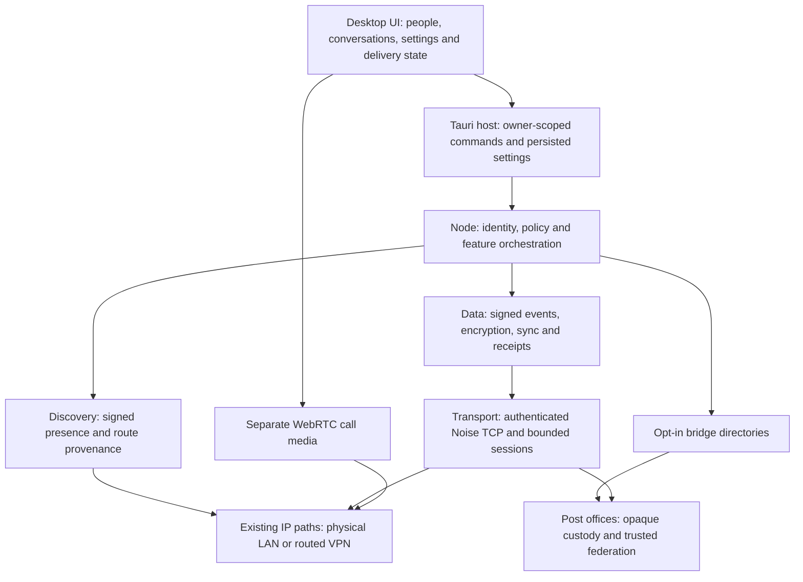

The drawing shows ownership and dependencies, not a requirement that every message visit every box. Two directly reachable clients can exchange authorized events without a post office. A relay directory can provide a mailbox route when no direct client route exists. Calls have their own live signaling and media requirements.

### Glossary

The [canonical domain glossary](../CONTEXT.md) defines identity, conversations,
network availability, acceptance and delivery. Use its terms here rather than
maintaining a second set of definitions. [DDD conventions](domain-design.md)
explain overloaded code identifiers and translation rules.

The sections below own network-specific mechanisms and invariants: route
provenance, source lifetimes, bridge/federation configuration, recipient
confirmation, custody budgets and recovery limits. A protocol-specific use of
“channel,” “group” or “session” must be qualified when it differs from the
conversation or desktop-session meaning.

### Three operations often called “broadcast”

| Operation                    | Actual mechanism                                                                              | Scope                                                                |
| ---------------------------- | --------------------------------------------------------------------------------------------- | -------------------------------------------------------------------- |
| LAN announcement             | A device sends its own signed presence over multicast, with local unicast assistance.         | Permitted local discovery interfaces; no chat plaintext.             |
| Cross-site presence exchange | Bridge registration and authenticated directory/federation exchange.                          | Eligible opted-in participants across surviving trusted relay paths. |
| Group message distribution   | Encrypted event fanout, member reconciliation and optional recipient-specific opaque custody. | Accepted, authorized recipients; never UDP group-chat broadcast.     |

## 2. Responsibility map

The UI-free core owns protocol decisions. The desktop host owns account/session boundaries and persistence integration. The frontend presents those decisions. A feature must reuse its owner's interface rather than recreate the same policy in another layer.

Paths below are relative to the repository root. `core/` is shorthand for `crates/mesh-talk-core/src/` in tables only; links use actual paths.

### Module inventory and contracts

Desktop address inventory is owned by
[`routed_discovery.rs`](../src-tauri/src/routed_discovery.rs), with
[`Tailscale`](../src-tauri/src/tailscale_discovery.rs) and
[`EasyTier`](../src-tauri/src/easytier_discovery.rs) adapters. Both use the same
signed discovery and privacy gates. Concurrent bounded snapshots merge fairly
into one 256-candidate budget; VPN-specific commands and schemas stay outside
core. See the [routed setup guide](routed-network-discovery.md) for refresh,
CLI/RPC configuration and supported-version boundaries.

| Owner                              | Implementation                                                                                                                                                                                                                                                                                          | Contract                                                                                                                                                                                                                     |
| ---------------------------------- | ------------------------------------------------------------------------------------------------------------------------------------------------------------------------------------------------------------------------------------------------------------------------------------------------------- | ---------------------------------------------------------------------------------------------------------------------------------------------------------------------------------------------------------------------------- |
| Runtime lifecycle                  | [`node/runtime.rs`](../crates/mesh-talk-core/src/node/runtime.rs), [`runtime_work.rs`](../crates/mesh-talk-core/src/node/runtime_work.rs)                                                                                                                                                               | Initialize identity, persisted policy and network options before producers start; retire admitted work and tasks safely. Original `RuntimeConfig` remains compatible; additive `RuntimeNetworkOptions` carries new controls. |
| Identity and account devices       | [`identity/`](../crates/mesh-talk-core/src/identity), [`node/account_devices.rs`](../crates/mesh-talk-core/src/node/account_devices.rs)                                                                                                                                                                 | Verify full device identity and account certificates; retain explicit sibling authority independently of online presence.                                                                                                    |
| Discovery protocol                 | [`discovery/service.rs`](../crates/mesh-talk-core/src/discovery/service.rs), [`discovery/query.rs`](../crates/mesh-talk-core/src/discovery/query.rs)                                                                                                                                                    | Announce self, validate signed candidates, perform bounded queries and preserve discovery provenance. Discovery cannot carry conversation authority.                                                                         |
| Discovery disclosure               | [`discovery/visibility.rs`](../crates/mesh-talk-core/src/discovery/visibility.rs), [`scope.rs`](../crates/mesh-talk-core/src/discovery/scope.rs)                                                                                                                                                        | Centralize public/physical-interface disclosure checks across announcements, responses, scans and routed producers.                                                                                                          |
| Roster and direct-route capability | [`discovery/roster.rs`](../crates/mesh-talk-core/src/discovery/roster.rs)                                                                                                                                                                                                                               | Deduplicate verified devices, retain bounded routes, expire observations and distinguish direct routes from gateway/mailbox hints.                                                                                           |
| Privacy and admission              | [`node/privacy_runtime.rs`](../crates/mesh-talk-core/src/node/privacy_runtime.rs), [`privacy_sync.rs`](../crates/mesh-talk-core/src/node/privacy_sync.rs), [`peer_directory.rs`](../crates/mesh-talk-core/src/node/peer_directory.rs)                                                                   | Apply current account/group permissions, pin identity/account bindings, filter sync projection and revoke obsolete I/O generations.                                                                                          |
| Relay direction policy             | [`node/relay_policy.rs`](../crates/mesh-talk-core/src/node/relay_policy.rs)                                                                                                                                                                                                                             | Define master/send/receive admission once; apply it to ordinary events, file controls, chunks, receipts and retries.                                                                                                         |
| Relay candidate ordering           | [`node/postbox.rs`](../crates/mesh-talk-core/src/node/postbox.rs)                                                                                                                                                                                                                                       | Apply the soft preference, local ordering and recipient-specific provenance consistently across eligible feature paths.                                                                                                      |
| Secure transport                   | [`transport/channel.rs`](../crates/mesh-talk-core/src/transport/channel.rs), [`transport/net.rs`](../crates/mesh-talk-core/src/transport/net.rs)                                                                                                                                                        | Noise authentication/encryption, bounded frames and socket primitives. IP reachability does not establish Mesh Talk identity.                                                                                                |
| Node TCP/session management        | [`node/session_pool.rs`](../crates/mesh-talk-core/src/node/session_pool.rs)                                                                                                                                                                                                                             | Enforce shared capacity and retain only explicitly reusable, fully completed sequential-sync sessions.                                                                                                                       |
| Signed log reconciliation          | [`eventlog/`](../crates/mesh-talk-core/src/eventlog), [`node/session.rs`](../crates/mesh-talk-core/src/node/session.rs), [`serving.rs`](../crates/mesh-talk-core/src/node/serving.rs)                                                                                                                   | Exchange missing events, validate causal/signature constraints and expose only authorized content.                                                                                                                           |
| Durable delivery                   | [`node/delivery_store.rs`](../crates/mesh-talk-core/src/node/delivery_store.rs), [`delivery_runtime.rs`](../crates/mesh-talk-core/src/node/delivery_runtime.rs), [`delivery_receipt.rs`](../crates/mesh-talk-core/src/node/delivery_receipt.rs)                                                         | Persist accepted immutable work, schedule direct/relay attempts, validate exact receipts and make retries idempotent.                                                                                                        |
| Group authority and recovery       | [`node/channel.rs`](../crates/mesh-talk-core/src/node/channel.rs), [`channels.rs`](../crates/mesh-talk-core/src/node/channels.rs), [`channel_custody.rs`](../crates/mesh-talk-core/src/node/channel_custody.rs)                                                                                         | Project signed membership, govern sharing, bound fanout/recovery and keep replica custody separate from per-recipient delivery.                                                                                              |
| Opaque relay wrapping              | [`node/opaque_relay.rs`](../crates/mesh-talk-core/src/node/opaque_relay.rs), [`postoffice/opaque.rs`](../crates/mesh-talk-core/src/postoffice/opaque.rs)                                                                                                                                                | Seal original signed events for the device pair, validate received wrappers and keep readable inner metadata away from relays.                                                                                               |
| Client directory participation     | [`node/bridge_client.rs`](../crates/mesh-talk-core/src/node/bridge_client.rs)                                                                                                                                                                                                                           | Register/query only when policy permits, refresh all eligible candidates with bounds and roll back canceled or obsolete introductions.                                                                                       |
| Relay directory                    | [`node/bridge_directory.rs`](../crates/mesh-talk-core/src/node/bridge_directory.rs)                                                                                                                                                                                                                     | Validate opt-in signed presence, bound snapshots and expire entries without extending source lifetime through federation.                                                                                                    |
| Relay storage and federation       | [`postoffice/mod.rs`](../crates/mesh-talk-core/src/postoffice/mod.rs), [`federation.rs`](../crates/mesh-talk-core/src/postoffice/federation.rs)                                                                                                                                                         | Store only accepted opaque events, enforce age/capacity rules and reconcile eligible inventories under explicit trust.                                                                                                       |
| Relay operator/runtime             | [`bin/mesh-talk-node/federation_config.rs`](../crates/mesh-talk-core/src/bin/mesh-talk-node/federation_config.rs), [`federation_runtime.rs`](../crates/mesh-talk-core/src/bin/mesh-talk-node/federation_runtime.rs)                                                                                     | Validate shared public enrollment, serialize configuration edits and bound seed probing/reconciliation.                                                                                                                      |
| Files and completion               | [`node/files.rs`](../crates/mesh-talk-core/src/node/files.rs), [`file_consent.rs`](../crates/mesh-talk-core/src/node/file_consent.rs), [`file_consent_store.rs`](../crates/mesh-talk-core/src/node/file_consent_store.rs), [`file_completion.rs`](../crates/mesh-talk-core/src/node/file_completion.rs) | Bind consent to the exact offer/revision, keep decisions durable, verify encrypted chunks and publish valid completion independently of file-card arrival.                                                                   |
| Calls                              | [`node/call.rs`](../crates/mesh-talk-core/src/node/call.rs), [`frontend/src/store/calls.ts`](../frontend/src/store/calls.ts)                                                                                                                                                                            | Send ephemeral device-addressed signals over a fresh live Noise connection; manage separate WebRTC media and capture cleanup. No mailbox-signaling fallback exists.                                                          |
| Pairing and sibling sync           | [`node/linking.rs`](../crates/mesh-talk-core/src/node/linking.rs), [`account_sync.rs`](../crates/mesh-talk-core/src/node/account_sync.rs), [`account_sync_policy.rs`](../crates/mesh-talk-core/src/node/account_sync_policy.rs)                                                                         | Enroll via an authorized code, apply device-local sync categories and reconcile certified siblings over an authenticated reachable source.                                                                                   |
| Desktop settings/bootstrap         | [`src-tauri/src/settings.rs`](../src-tauri/src/settings.rs), [`runtime_bootstrap.rs`](../src-tauri/src/runtime_bootstrap.rs)                                                                                                                                                                            | Persist owner/device choices, preserve legacy defaults, apply startup options before discovery and coordinate live changes with the core.                                                                                    |
| Desktop roster IPC                 | [`chat_commands/models.rs`](../src-tauri/src/chat_commands/models.rs)                                                                                                                                                                                                                                   | Project `PeerRecord` through one conversion; expose direct-route capability separately from LAN provenance.                                                                                                                  |
| UI roster and relay choices        | [`rosterProjection.ts`](../frontend/src/lib/rosterProjection.ts), [`postOfficeOptions.ts`](../frontend/src/lib/postOfficeOptions.ts), [`SettingsDialog.tsx`](../frontend/src/features/chat/SettingsDialog.tsx)                                                                                          | Exclude infrastructure from people/group pickers, group devices by account and present core-derived eligible relay choices without inferring routes from IP text.                                                            |

### Route contract and UI projection

`PeerRecord::has_direct_route()` accepts `Lan`, `RoutedQuery`, `Authenticated` and unscoped `Discovery` routes. `Gateway` and `PostOffice` routes alone do not qualify. A device with both direct and indirect alternatives remains eligible through its direct route. An address string alone is insufficient evidence.

The desktop publishes two different fields:

- `discovered_on_lan`: provenance of a local discovery route.
- `directly_reachable`: existence of a known direct application route, including routed/Tailscale candidates. This is not a promise that a future connection will succeed.

The preferred-relay picker requires the post-office role and direct-route capability. An older backend without the new field falls back conservatively to its LAN flag. A saved preference is not erased when its route disappears; it is shown as unavailable/indirect and becomes selectable when a direct route returns. A relay shown through another post office must not become a new ordinary direct choice.

Role classification and route classification are separate. A post office belongs in routing diagnostics and settings, but not in person lists, group invitees or member-profile actions intended for human participants. Account grouping must not erase distinct device keys, per-device routes or receipt targets.

### User-facing identity, membership and network details

The [group reception contract](group-conversation-reception.md) separates author
time, causal conversation order and local arrival observation. Recovery status
must describe only local work and checked reachable peers; it cannot certify
global history completeness. Catch-up and own-device replication must not replay
live-message notifications. Group custody, recipient delivery, reading and file
byte availability remain distinct evidence. Legacy archive rows without signed
ancestry use an explicit compatible fallback rather than invented causal proof.

The [member profile](../frontend/src/features/chat/MemberProfileDialog.tsx) uses [shared profile projection](../frontend/src/features/chat/memberProfileDetails.ts) to show the account ID, known device IDs and observed network endpoints. A device that is no longer in the live roster can still appear as a historical/profile target with an unavailable endpoint. Displayed endpoints are observations, not proof of physical location, a unique machine or a directly usable remote listener.

Sidebar contacts, group invite candidates and counts must use the shared person/role projection. Raw connection diagnostics may include post offices because their role and endpoint matter for routing. Group membership is owned by signed channel state, not rebuilt from whoever is currently discoverable. A member can be offline without leaving the group; a discovered relay cannot become a member through a UI picker.

When one machine runs both the app and a relay, their names, keys, TCP listeners and selected interface addresses can differ. A directory-introduced user's route may point at the mailbox relay; it must not be interpreted as that user's physical machine IP. New UI must consume route provenance and account/device identity explicitly, retaining this distinction for profiles and connection explanations.

### Person presence contract

**Online** is this client's presentation of eligible public availability, with
source-specific loss tolerance. Pure physical LAN and unscoped discovery expire
after 15 seconds. Verified routed observations, current-origin directory
introductions, and public authenticated contact without physical LAN discovery for the same
endpoint address retain Online until 120 seconds from their original public observation.
When their fresh evidence expires, show **Online · slow connection**. The
presentation tolerance does not manufacture fresh device evidence or prove
transport, delivery or read state. Group known-online counts use this same
presentation consistently. The running local account contributes a fifteen-second
current-device lease; it must not serialize a zero presentation expiry or inherit
an older routed quality hint. This self observation ages normally if IPC stops. **Offline** means the bounded observation has expired
here, not a global sign-out claim.

Initial discovery displays Online immediately. After a loss, fresh observations
must remain successful for five seconds and include a renewed origin before
clearing recovery confirmation. Authoritative withdrawal or revoked account
binding ends the presentation immediately. Private traffic, cached addresses,
failed probes, failed IPC and re-querying the same directory origin cannot renew
it. Recent local history can enrich Offline without inventing observation times.

The member profile shows fresh devices once each and their actual sources:
local network discovery, cross-network discovery, post-office discovery, or
public authenticated contact with unspecified network scope. Ordinary signed UDP
observations outside the established interface scope show signed discovery with
unspecified scope; they are not labeled local merely because of an address prefix.
Sources can overlap on one device. The profile's **Discovery source** summary
retains local **UDP multicast** and selects the closest identified visible post
office to each device's original presence registration. Directory v5 reports a
bounded origin distance: zero means the responding office directly registered
the device; each trusted federation v3 forwarding hop adds one, up to sixteen.
A hidden origin therefore falls back to the identified visible introducer with
the smallest known distance, with stable device-identity tie breaking. Multiple
devices can contribute different source offices. Unknown legacy distance, missing
identity or ambiguous endpoint mapping yields an unknown office origin rather
than a guessed source. The raw evidence remains available for device diagnostics.
The host resolves names only when an exact introducing endpoint uniquely matches
verified infrastructure; IP prefixes, ports and response ordering are not origin
proof. Distances are trusted relay routing hints, not signatures by the originating
office, geographic claims or conversation authority. They cannot renew presence.
Legacy federation/directory records retain their existing encodings and never
acquire fabricated origin distances. A newer registration supersedes older
metadata; equal-expiry forwarded observations may improve the retained distance.
Each source disappears at its own evidence deadline, including during failed IPC;
Online tolerance never extends a source label. Neither this summary nor an endpoint
establishes the route of a particular message. The UI does not expose message paths.
A direct application path means no intermediate Mesh Talk post office; it says
nothing about Tailscale's underlying transport. Online does not guarantee TCP,
message delivery, file transfer, or calls. UDP discovery can succeed while TCP
fails; communication failures belong to delivery/call/connection diagnostics.

A group header shows “24 members · 6 known online”, relative to this client.
Both numbers count accepted current **verified accounts**, deduplicating devices
and paths. Pending and removed members and post-office identities are excluded.
The current account counts once in both numbers while its accepted local node is
running. Zero known online is valid. Membership controls remain device-addressed;
when a device's account cannot be verified, the UI explicitly adds “unbound device
members” separately rather than counting them as people. Those rows remain
inspectable and use their device-scoped observations without inventing an account.

Public freshness remains distinct from presentation tolerance. Local and public
authenticated observations last 15 seconds. Signed routed observations learn a
freshness lease from verified nonce-bound RTT within 15–60 seconds, with healthy
samples shrinking a prior long lease by at most five seconds. The adaptive lease
is a tolerance budget, never evidence that a currently renewing connection is slow.
Show a quality hint when public observations have stopped renewing within the
normal fifteen-second freshness window while cross-network tolerance keeps the
person Online. Across member headers, profiles and status tooltips, use the same
concise **Online · slow connection** label; do not add a long explanatory paragraph.
Routed quality recovery requires thirty seconds of healthy renewed observations;
fresh physical LAN evidence clears inherited routed quality immediately, without
waiting through that cross-network hysteresis. Delivery and receipt retries progress
independently. Discovery latency is not a measured message-delivery SLA.

The separate cross-network presentation expiry is 120 seconds from the original
public observation, even when the learned freshness lease is shorter. LAN-only
observations receive no extended recovery grace. Directory origin authority is
never extended or advertised onward by this local presentation policy.
Directory presence lasts at most 15 seconds from its origin observation, retaining the original expiry through
federation and the versioned v4 client directory response. Legacy directory
responses still provide route hints but cannot establish fresh presence because
they omit origin expiry. Older relays' 45-second metadata remains compatible;
new clients cap each observation at 15 seconds without renewing repeated identical
origin expiry. The 20-second logout bound requires upgraded origin relays, since
an old relay can first introduce a listing after that bound. Private authenticated routes do not refresh visible
presence. Cached routes, membership, stored contacts, historical messages,
receipts, relay reachability, and mailbox custody never establish presence.

The frontend ages observations even when refreshes fail, shows a compact presence
availability disclosure in the sidebar connection footer, and retries its normal
shared poll. Its expandable explanation includes the latest refresh rejection,
timeout or unreadable response; diagnostics clear on successful refresh and
session retirement, and never accept a superseded response. It does not infer
loss of LAN connectivity from Internet availability or claim everyone signed out.
A stopped discovery producer is reported as unavailable; silent packet loss is
not proof of a local network outage. Normal discovery/runtime recovery restores
observations. Last-seen history is bounded, session-local, and clears on lock,
logout, or account/runtime replacement; absence of history is not evidence that
the person has never run the application.

In A↔B↔C group recovery, A observing B or receiving C's historical events through
B does **not** establish C's presence at A. A needs its own eligible fresh discovery,
directory, or permitted public authenticated observation. There is no global
presence service or new transitive group-presence gossip.

The desktop [presence projection](../src-tauri/src/chat_commands/presence.rs)
aggregates one verified roster snapshot by account, retaining device/source
observations with independent monotonic lifetimes. Membership and cached routes
are never freshness evidence. Retired or conflicting device/account bindings and
infrastructure cannot contribute. Legacy unbound devices remain explicit device
identities rather than invented account associations.

| Eligible public observation                                | Presence lifetime                          | Boundary                                                                                                                |
| ---------------------------------------------------------- | ------------------------------------------ | ----------------------------------------------------------------------------------------------------------------------- |
| Local signed discovery within the observed interface scope | 15 seconds                                 | No TCP success required; no physical co-location claim.                                                                 |
| Signed UDP discovery with undetermined scope               | 15 seconds                                 | Show signed discovery only; do not infer local or cross-network location.                                               |
| Routed signed discovery                                    | 15–60 seconds                                 | A permitted Tailscale candidate alone is insufficient.                                                                  |
| Public authenticated contact                               | 15 seconds                                 | No inferred LAN scope or continuing connection. Private route knowledge remains excluded.                               |
| Directory/federation introduction                          | Original origin expiry, at most 15 seconds | v4 client response preserves expiry; forwarding and re-querying cannot renew it. Legacy responses provide routing only. |

Push invalidations refresh the desktop snapshot; a two-second clock ages freshness and source-specific
presentation deadlines locally, even when IPC fails. LAN-only observations lose
Online at their 15-second deadline; cross-network observations at 120 seconds
without a new valid public observation. Explicit withdrawal remains immediate. Route retention is independent: authenticated
routes remain dial candidates for 300 seconds and routed candidates for 120 seconds.
Transport-only authentication cannot renew the public observation deadline.
Historical-route authentication probes run once per device, with its addresses
sharing the existing bounded route race. Their five-second schedule starts at
the beginning of each round, without overlapping rounds or appending another
sleep after slow authentication. A cached address must not allocate a separate
probe lane for the same device. Only permitted fresh public authentication can
renew presence; the fifteen-second observation lease is unchanged.
Routed probes and the local fallback scan run every five seconds; routed candidate
pacing is 20 ms (at most 256 candidates per sweep). Bridge registration starts
refresh waves every five seconds, independently of an earlier stalled relay.
At most eight exact identity/endpoint queries are active across all waves;
known healthy relays are visited first and duplicate active queries are skipped.
Activity slots are released on completion, cancellation, policy withdrawal and
runtime retirement. A network change cancels obsolete waves and starts fresh.
Directory exchanges use the existing authenticated adaptive 15–60 second budget;
failed relays wait at most the five-second refresh interval before eligibility.
A slow relay cannot hold the refresh metadata lock while doing network or disk I/O.
Existing origin authority and per-source response limits remain unchanged.

The directory's fifteen-second recovery-membership expiry is separate from
presentation history. Expiry revokes recovery admission but does not impersonate
explicit withdrawal by deleting the bounded public-origin history. Roster cleanup
preserves that history until its original 120-second deadline; it never renews it.
Explicit bridge disable clears both active and expired mailbox introductions.
Committed origin renewal emits a presence-only watch notification, not an
expensive mesh recovery wake; the desktop's thirty-second fallback is not the
normal heartbeat delivery path. The frontend schedules exact presentation expiry independently
of polling and suppresses the stranded prompt while a recently observed
cross-network peer remains Online under the bounded tolerance. Shell, group
counts, member headers and diagnostics consume the same account projection.
Known names and signed avatars persist independently of these observation leases.

The explicitly negotiated `MTBD4Q`/`MTBD4R` directory extension carries the
existing self-signed identity proof with the trusted directory's origin expiry.
It preserves bounded pagination, gateway provenance, policy generation checks,
and staged rollback. v1–v3 request/response layouts and resource budgets remain
unchanged. New clients try v4 first and retain legacy fallback for route hints;
legacy clients retain their existing behavior. Existing 45-second origin metadata
remains accepted for mixed-version routing compatibility. A new client caps its
public lease at 15 seconds and repeated identical origin expiry cannot renew it;
only a newer origin registration can. An old relay can still introduce an already
stale listing for the first time, so the 20-second logout bound requires upgraded
origin relays. Federation's existing fixed
expiry remains authoritative. No group presence propagation protocol is added.

Group summaries count accepted current verified accounts once, including self
when accepted and the local node runs. Pending/removed devices and infrastructure
are excluded. Unresolved device memberships are reported separately; the signed
membership model still addresses devices. Group presence never means “any member
online”; each person's own eligible observations determine their status and the
known-online count. A↔B↔C history recovery cannot establish C's presence at A.

Source details belong in the member profile. A device may have overlapping local,
routed, directory, and public authenticated observations; source categories are
not disjoint device totals. Source is distinct from physical location, an
established connection, delivery, file completion and call readiness. Discovery
with blocked TCP can still validly show Online. Only current authenticated
transport evidence could justify “Connected”; the presence projection makes no
such claim and opens no new connections.

The isolated frontend store uses pushed snapshots with bounded fallback reads,
permits at most two active UI refreshes, guards owner/runtime generations and
response ordering, and ages every observation on the shared two-second clock even
during failure. Timed-out native operations retain their global admission slots
until they actually settle. IPC timeouts,
failed reads and discovery task termination produce a global availability notice,
not an empty successful snapshot or a fabricated network diagnosis. Successful
withdrawals take effect immediately. Up to 1,024 actually observed historical
account/device entries remain Offline within the session, without inventing times
for never-observed people. Lock/logout/replacement clears this history.

### Optional registration-origin disclosure

Registration origin is separate from the immediate directory introducer. A
participant can opt in to sharing the identity and display name of the post
office with which that device registered. The device-local setting defaults off,
including after upgrading an installation that has no saved choice. Ordinary
bridge discovery and messaging do not require this optional disclosure.

The registering device signs a consent bound to its full device identity, the
exact office identity and a fixed expiry. The office signs that registration
relationship and its bounded display name. Versioned directory and federation
envelopes preserve the proof unchanged across forwarding hops. Receivers verify
both signatures and the participant binding before projecting it; hop counts,
preferred routes, office names and address prefixes cannot establish origin.
The client consents to one eligible registration office: a locally discovered
office first, otherwise the first office in the established candidate order
(including an explicit preference). Refreshes through other offices do not
authorize them to claim origin. Different devices may register with different
offices. The profile distinguishes these offices from immediate introducers.

Origin proofs have a fixed maximum 15-second lease. Forwarding, re-querying and
Online presentation tolerance never extend that lease. Missing metadata means
unavailable; it does not prove that the participant explicitly withheld it.
Older protocol versions continue ordinary discovery without optional origin
metadata, using their existing wire layouts. No origin binding is added to
public UDP multicast announcements or durable route hints.

Changing the sharing choice uses the existing privacy send gate and generation
checks. Disabling waits for already admitted sends, invalidates prepared work,
stops signing new consent and wakes directory refresh. A fresh registration
without consent clears the source office's optional proof. Already forwarded
proofs can remain on disconnected peers until their original lease expires;
information another party has already read cannot be recalled. This setting
does not conceal socket addresses from connected peers or the registering office.

Origin metadata uses the existing authenticated encrypted channels. Participating
post offices can read it; it has no additional recipient encryption. Office
names may reveal a network or site, so sharing requires the participant's own
choice. The payload contains no participant IP, subnet, coordinates or full
relay path. It authenticates a registration relationship, never physical location.

### Protocol surfaces and durable ownership

| Surface                   | Transport and validation                                                                                                       | Persistence / compatibility boundary                                                                               |
| ------------------------- | ------------------------------------------------------------------------------------------------------------------------------ | ------------------------------------------------------------------------------------------------------------------ |
| Local presence            | Signed UDP announcements and unicast assistance.                                                                               | Short-lived roster observations; not chat history.                                                                 |
| Routed discovery          | Candidate UDP query with fresh nonce and signed response tied to the returned announcement/identity.                           | Candidate source is untrusted input until verification; a response does not prove TCP availability.                |
| Peer session              | Noise-authenticated TCP with bounded framing and full identity/account checks.                                                 | Connection state is ephemeral; invalid framing or authentication cannot admit content.                             |
| Event reconciliation      | Authorized have/missing-event exchanges over Noise; verify signatures, content addresses and applicable ancestry.              | Local signed log and feature stores own durable truth. Inner event identity survives retries.                      |
| Relay mailbox             | Recipient-pair opaque event wrapper over the signed sync wire.                                                                 | Legacy wrapping binds a relay; v3 is relay-independent. Relays cannot inspect the original event headers or body.  |
| Directory / federation    | Explicit directory v1/v2/v3 and federation inventory v1/v2 negotiation; signed presence validation and trusted Noise sessions. | Snapshot bounds differ by version. Origin expiry/arrival age cannot be renewed through forwarding.                 |
| Delivery / file decisions | Exact destination-bound signed/encrypted controls admitted by their feature owner.                                             | Persist confirmation/decision before exposing the state it establishes; stale revisions do not authorize new work. |
| Pairing / sibling replay  | Distinct first-frame pairing/account-sync protocols over authenticated sessions; code/certificate/category checks.             | Account secret/device enrollment and replay state are separate from public discovery.                              |
| Call signaling            | Distinct first-frame device-addressed ephemeral frame over a fresh live Noise channel.                                         | No durable log, account fanout or mailbox fallback; media negotiation belongs to the frontend.                     |

Wire layouts are versioned protocol contracts, including bincode enum order and domain-separation rules. A structural refactor must not change serialization, content addresses or encryption domains accidentally. Consult [Architecture](ARCHITECTURE.md) and the source owner before altering a frame or cryptographic field.

### State and concurrency contract

Accepted user work, cryptographic ratchets and delivery bookkeeping must commit through their existing durable transition mechanisms. An I/O success alone cannot advance user-visible delivery truth. Durable receipt handling and file decisions retain independent responsibilities.

Transport awaits must not retain ordinary store/roster mutex guards. Network tasks use owned snapshots, bounded work and cancellation-safe ownership. Privacy generation checks revoke retained sessions and in-flight publication after a policy transition; directory queries additionally validate their captured directory/preference generation before publishing results. Startup applies network preferences before disclosure or delivery producers run.

### Runtime delivery observations

The delivery runtime can attach an optional local observation to the existing
account-conversation status query. `attempting` means the worker admitted one
exact immutable recipient destination; `retry_scheduled` means that worker
completed and the existing retry scheduler recorded its next eligible turn.
Neither state establishes transport success, relay custody, recipient presence,
delivery failure or a recipient receipt. The scheduler shares pacing across a
peer's lane, so the observation does not promise a message-specific retry delay.
The worker can additionally attach an optional recovery reason to a completed
attempt. `post_office_disabled` means no eligible direct peer was known and local
post-office sending was disabled; `no_known_route` means neither an eligible
direct peer nor a permitted post-office candidate was known. These are local
route/policy observations, not proof of a remote outage. `attempt_timed_out`
requires an actual exchange deadline to expire without progress. An ordinary
false progress result, connection rejection or malformed response cannot be
relabeled as a timeout. Successful progress suppresses recovery reasons and
still does not replace recipient confirmation.

Observations are runtime memory only, capped at 256 logical messages with oldest
observation eviction. Multiple recipient devices share that message budget.
Elapsed age uses a monotonic clock, independently of wall-clock corrections.
An absent observation means no current detail is available, including after
restart, eviction or invalidation. It does not establish that no attempt occurred.

The immutable destination and admission token bind updates to their originating
attempt. A late completion cannot replace a newer attempt or publish across a
privacy-generation change. Cancellation, route reset and participant retirement
invalidate retained observations. Receipt completion and local erasure remove
their eligibility. Existing expiry maintenance cancels expired work; observation
queries then prune its details. Durable `Delivered` always suppresses runtime hints.
Own-account synchronization and receipt/control work do not produce recipient
delivery observations. Querying another conversation's ID returns no state or
detail. Hosts retain their exact-session admission checks and the 256-ID limit.
Reasons share that lifetime and are omitted when unknown. UI consumers ignore
unrecognized future reason codes and retain the ordinary awaiting explanation.

The registered desktop response adds an optional observation, allowing existing
consumers to continue using durable status alone. This surface does not change
the wire protocol, persisted journals, receipt validation, retry timing, socket
budgets or attachment-byte confirmation. Visible delivery disclosure is a
separate consumer of this evidence contract.

## 3. Design philosophy and invariants

1. **Local first.** Direct communication works without a post office whenever a permitted authenticated route exists. Relay sending/receiving is optional per device.
2. **Specific edges, explicit reachability.** A↔D does not imply B↔D or A↔E. Neither co-location nor an address with a Tailscale prefix proves a working application port.
3. **Authenticate identities independently of routes.** Full device/account bindings survive address changes. Tailscale identity, a friendly name and an IP address cannot replace Mesh Talk authentication.
4. **Separate visibility from authority.** Presence opt-in does not grant DM permissions, account secrets, group membership, file approval or historical access.
5. **Equal relay roles with explicit trust.** There is no global primary relay. Automatic candidate discovery is compatible with explicit device pins or mutually verified operator-approved network memberships; discovery itself does not authorize federation. Network mode binds expiring authority-signed memberships to Noise device identities and a local revocation snapshot before any bulk exchange; it never falls back to pin-only admission.
6. **Direct first, custody while needed.** Attempt the direct path first. Relay-enabled devices can also retain encrypted custody while exact recipient delivery is outstanding. Group recovery custody is independently useful after direct fanout.
7. **Endpoint-owned delivery truth.** Valid recipient confirmation is distinct from local acceptance, relay custody, successful sync and human reading. One group member or sibling cannot acknowledge another destination's work.
8. **Soft preference and recoverable failure.** A preference orders candidates; failure permits alternatives. A usable alternative needs a surviving onward graph, and later operations can return to the healthy preference.
9. **Opaque, temporary relay storage.** Relays cannot decrypt inner content without separately holding an authorized recipient's keys. They can observe metadata and can delay/drop copies. Thirty days is an upper age bound, not guaranteed archival retention.
10. **Conversation semantics outlive transport changes.** Group authority, file consent, sender-key rules and sibling certification remain in force through direct, relay, retry and recovery paths.
11. **Bound resource use explicitly.** Directory size, socket capacity, concurrency, idle lifetime and storage are enforced budgets. They do not establish a WAN latency or large-federation throughput SLA.
12. **One policy owner, reusable interfaces.** Shared relay direction, candidate ordering, route capability and person-role projection must be reused. Features must not silently invent different definitions.
13. **Evidence is topology- and feature-specific.** Text success does not prove file completion, call media or sibling replay. A loopback graph is not independent physical-site evidence.

### Layered model

The TCP/IP analogy is useful for separating responsibilities. Mesh Talk implements an application routing and synchronization system above existing IP connectivity.

| Layer                    | Owns                                                                            | Does not imply                                                      |
| ------------------------ | ------------------------------------------------------------------------------- | ------------------------------------------------------------------- |
| Product and conversation | User intent, membership, recipient identity, consent and delivery presentation. | Any available transport is authorized to expose the conversation.   |
| Durable event and crypto | Signed/encrypted events, immutable IDs, local state and admission.              | A relay can interpret inner content or create recipient completion. |
| Application route policy | Direct candidates, eligible relay preference, fallback and recovery scheduling. | Transitive IP connectivity between every visible participant.       |
| Transport/session        | Noise/TCP authentication, framing, bounded capacity and explicit reuse.         | All protocols can share one multiplexed connection.                 |
| Existing network         | Physical LAN, routing, Tailscale, firewall and ACL reachability.                | One broadcast domain or automatic Mesh Talk trust.                  |

This uniformity applies to identity and protocol handling across permitted routes. Apps and post offices retain distinct business roles. “Every deployment uses the same configuration” means a common deployment model and trust/retention policy, with unique identities and host-specific endpoints.

### Required distinctions in language and code

- **Discoverable** is not **authorized**, **directly reachable** or **delivered**.
- **Directory introduction** is not **the remote device's IP address**.
- **Received through a member** is not **opaque custody through a relay**: the member is a legitimate reader.
- **Recipient completion** is not **read status**, **file saved to an arbitrary destination**, or **all account devices synchronized**.
- **Eight managed TCP slots** is not **one socket per visible user**, **exactly one per relay**, or **eight total OS/network sockets**.
- **Application-network participation** is not **physical LAN membership**.

## 4. Settings and deployment configuration

### Client and channel switches

Settings apply per client device. Shared account identity does not silently apply one device's visibility or relay choices to another.

| Control                                  | Default                   | Effective contract                                                                                                                                                                                                                                                                                        |
| ---------------------------------------- | ------------------------- | --------------------------------------------------------------------------------------------------------------------------------------------------------------------------------------------------------------------------------------------------------------------------------------------------------- |
| **Use post offices**                     | On in desktop settings    | Master admission for ordinary relay data and public bridge participation. Off preserves direction preferences and pending local work; direct peers remain available.                                                                                                                                      |
| **Send through post offices**            | On                        | Permit opaque publication under the master. Off also withholds relay receipts, consent decisions and completion controls.                                                                                                                                                                                 |
| **Receive through post offices**         | On                        | Permit incoming mailbox content admission under the master. Off installs no received content or durable seen markers from ignored data. Existing bidirectional sync can still return encrypted frames.                                                                                                    |
| **Discover peers through a post office** | Off                       | Opt into public signed directory registration and introductions when master on, visible and physical-only mode off. It does not itself grant conversation authority.                                                                                                                                      |
| **Device discovery scope**               | Local and routed networks | Selecting **Local network only** restricts disclosure to recognized physical IPv4 subnets and correctly scoped IPv6 link-local interfaces, suppressing routed discovery and public directories. The persisted `physical_lan_only` boolean is unchanged. Existing authorized TCP contacts are not revoked. |
| **Preferred post office**                | Automatic                 | Order a directly reachable LAN or routed/Tailscale relay first, retaining alternatives. A saved unavailable choice remains a preference for later recovery.                                                                                                                                               |
| **Invisible mode**                       | Off                       | Suppress public discovery/directory presence and apply the separate explicit private-contact/account/group admission rules.                                                                                                                                                                               |
| **Channel: Share a copy**                | On for accepted members   | Permit serving authorized retained group history. Off does not prevent receiving one's own events, but can interrupt a member-sync chain.                                                                                                                                                                 |
| **Calls**                                | Off                       | Enable desktop call UI/signaling. A live direct application signaling route and separate WebRTC media route are still required.                                                                                                                                                                           |
| **Sibling sync categories**              | Device-local policy       | Independently control supported history, attachment/profile/settings catch-up categories between certified devices. They do not turn an arbitrary relay into a sibling.                                                                                                                                   |

The desktop persists and applies the new network settings at startup through `RuntimeNetworkOptions`; older SDK startup entry points keep compatible defaults. The CLI exposes its documented flags and commands, not every desktop switch. Do not assume an identically named CLI option exists for each UI control.

### Direction matrix

Assume the master is on. Direct P2P remains independent in every row.

| Send | Receive | Behavior and user-visible consequence                                                                                               |
| ---- | ------- | ----------------------------------------------------------------------------------------------------------------------------------- |
| On   | On      | Publish and admit encrypted mailbox work, including valid return controls.                                                          |
| On   | Off     | Publish work, but do not admit incoming content or completion. A sent message may remain Awaiting.                                  |
| Off  | On      | Admit content, but withhold outgoing relay receipts and file decisions. A remote sender may not learn completion through the relay. |
| Off  | Off     | Neither publish nor admit mailbox content. Directory consent remains a separate choice.                                             |

Master-off overrides both directions and public directory participation without erasing saved values. “Receive off” is a content-admission preference, not a zero-download-byte guarantee. Changing visibility does not recall signed advertisements already copied elsewhere.

### Visibility matrix

| Master | Bridge discovery   | Physical-only | Invisible | Public discovery and directory behavior                                                                                              |
| ------ | ------------------ | ------------- | --------- | ------------------------------------------------------------------------------------------------------------------------------------ |
| Off    | Either saved value | Off           | Off       | Direct LAN/routed discovery continues; no ordinary relay upload/drain or directory participation.                                    |
| On     | Off                | Off           | Off       | Direct LAN/routed discovery; no new public relay introductions. Authorized known-peer mailbox recovery remains separately permitted. |
| On     | On                 | Off           | Off       | Direct discovery plus eligible registration/introduction through reachable bridge relays.                                            |
| Either | Either             | On            | Off       | Physical-interface disclosure only; no overlay probes or public directory participation.                                             |
| Either | Either             | Either        | On        | No public presence; private authorization governs permitted contact.                                                                 |

Physical-only adapter classification is conservative. Common overlay, point-to-point and unrecognized/renamed adapters are excluded; recognized physical names and actual subnet masks define IPv4 scope. IPv6 requires link-local scope matching the physical interface. Noise's public-presence bit is endpoint-specific: local physical contacts remain visible, while overlay contacts do not receive public-discovery consent. This is not an IP firewall, source-spoofing defense or guarantee about custom OS routes.

### Post-office modes

| Mode | Deployment                                                                          | Result                                                                                                                         |
| ---- | ----------------------------------------------------------------------------------- | ------------------------------------------------------------------------------------------------------------------------------ |
| P0   | No post office                                                                      | Direct discovery/data and authorized group-member recovery only.                                                               |
| P1   | `--post-office`                                                                     | Bounded opaque mailbox service; no bridge directory or cross-site federation.                                                  |
| P2   | `--post-office --bridge`                                                            | Opt-in participant directory and compatible relay-independent mailbox participation. Clients choose their own permissions.     |
| P3   | Multiple P2 services on one LAN, mutually enrolled                                  | Equal local alternatives and eligible federation reconciliation; no primary role. Co-location alone does not replicate mail.   |
| P4   | P2 services across sites with a shared `--federation-config` and surviving IP edges | Exchange eligible presence and opaque v3 mailbox events across trusted reachable paths.                                        |
| P5   | Legacy `--bridge-peer` plus pinned identity                                         | Compatibility TCP gateway. Gateway-only remote identities remain distinguishable from normal directly reachable relay choices. |

All relays may use the same executable, role flags, public trust manifest and retention policy. Each must keep unique persistent keys, its own data directory, valid local endpoints and host-specific boot-service configuration. An app and relay on one host remain separate identities. Windows deployment data belongs on drive D in the maintained operator setup.

Alternatively, `--relay-network` plus `--relay-membership` enables automatic discovery within an operator-approved network, using mutual expiring device certificates and a public revocation policy. It authorizes relay reconciliation only and does not attest the running binary. See [network membership operations](post-office-federation.md#automatic-membership-in-an-approved-network).

The versioned public manifest provides enrollment, listing and whole-identity revocation, with serialized edits. Changes take effect after restarting each affected relay. Identity rotation requires verified replacement enrollment and removal of the old identity. Revocation cannot erase copies a previously trusted operator already obtained.

See [federation operations](post-office-federation.md), [deployment](../specifications/deployment_guide.md), [macOS service](post-office-macos-service.md), [Windows service](post-office-windows-service.md) and [release artifacts](post-office-release.md). The root-owned macOS boot service requires administrator authorization; configuring a user login item is a different startup guarantee.

### Tailscale link shapes and application participation

| Connected endpoints                                      | Enabled behavior                                                                                                     | What does not propagate automatically                                                        |
| -------------------------------------------------------- | -------------------------------------------------------------------------------------------------------------------- | -------------------------------------------------------------------------------------------- |
| App A ↔ app D                                            | Direct discovery/authentication and permitted direct features; accepted group history can progress across the edge.  | Their LAN rosters, arbitrary DMs for neighbors and all IP traffic.                           |
| App A ↔ remote relay Q                                   | A may select Q and participate in Q's opted-in Mesh Talk discovery/mailbox network. No relay is required on A's LAN. | Nonparticipating machines, Ethernet multicast, A's LAN neighbors or private group authority. |
| Relay P ↔ relay Q                                        | Mutual trust plus bridge configuration permits eligible presence/mailbox reconciliation.                             | Automatic federation trust or general subnet routing.                                        |
| App A ↔ app D ↔ app G                                    | Authorized group events may propagate through sharing members.                                                       | Direct A↔G discovery or a generic relay path for every conversation.                         |
| Two isolated tailnets with one dual-connected relay host | Only the actual reachable edges can participate; that host may connect the application federation graph.             | Transitive Tailscale routing between clients in different accounts.                          |

For **A on X joining Q's Mesh Talk network on Y**, Q runs bridge mode and A/B/C on Y opt into directory participation and permit the needed mailbox directions. A discovers Q via a permitted routed query; Q introduces registered B/C; A uploads B-encrypted mail if A↔B lacks a direct route; B drains Q locally and returns valid controls through Q. A sees the eligible participants, not every machine on Y. Known contacts can have independently authorized paths without public listing.

## 5. Concrete data flows

### A. Direct message acceptance, transfer and confirmation

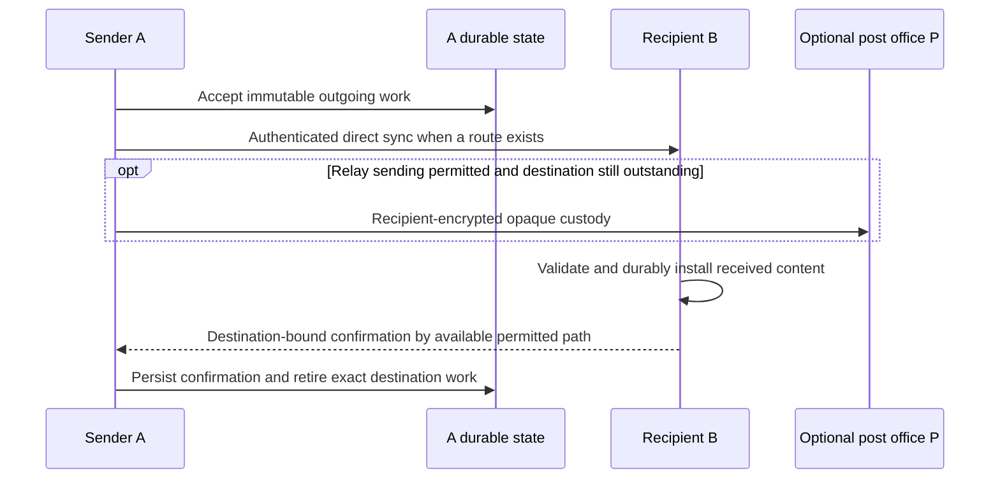

1. Discovery or an authorized known-contact route supplies a candidate. Transport verifies full identity/account binding.
2. Account-addressed work can include multiple per-device destinations and own-device copies. A single account conversation in the UI does not collapse their delivery obligations.
3. Direct transfer is attempted first; a completed TCP/sync exchange is not sufficient to mark the recipient delivered. While exact destination work remains, relay-enabled custody may also be attempted.
4. The recipient validates cryptographic and conversation authority, installs its receive transition and produces eligible confirmation. The sender validates and durably applies it.
5. Retries retain immutable event identity. A stale work snapshot must recheck outstanding state before opening another relay connection. A confirmed destination does not retire another device's work.

The useful conceptual states are **accepted locally**, **held somewhere**, **recipient confirmed** and **read**. These are distinct evidence types; they are not a requirement that the UI expose four enum values or that every message pass through a relay-held state. Read status requires its own supported user/protocol action.

### B. Cross-site discovery and opaque federation

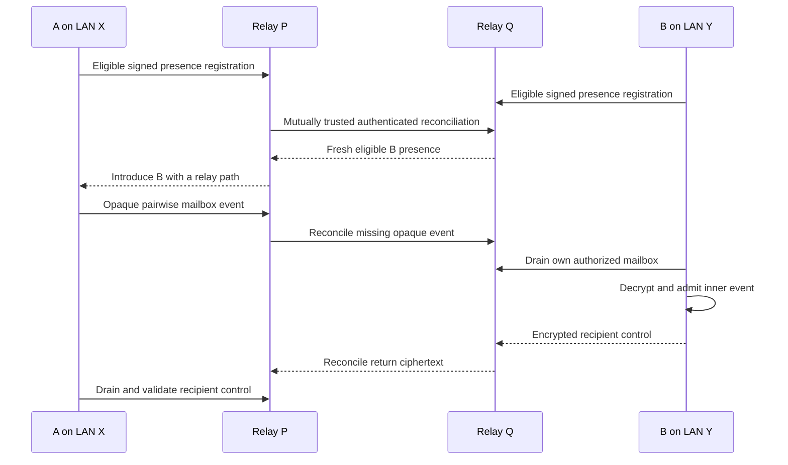

Directory freshness and mailbox retention are independent. Removing a public listing does not delete every retained encrypted copy or revoke an existing private contact. Federation preserves origin presence expiry and mailbox arrival age; forwarding must not reset retention clocks.

There are two wrapper scopes. Legacy opaque copies bind the device pair and a particular relay. V3 opaque copies use a relay-independent mailbox identity and can reconcile across trusted relays. Public directory/federation participation is gated; an old relay-specific copy does not become globally available merely because a different relay is selected.

### C. Relay preference, failover and partitions

For an explicit healthy preference P, the shared candidate policy keeps P first.
Automatic candidates use unclamped authenticated handshake/control latency
estimates from the bounded session timing owner; timeout penalties and existing
retry cooldowns demote failed paths. Samples expire after 120 seconds and clear
on network changes. Cold routes retain local-first defaults, with known fresh
origin distance contributing a small forwarding allowance (50 ms per hop;
unknown distance uses four hops). These are estimates of usable relay paths,
not measured end-to-end delivery latency or a global shortest-path guarantee.
Equal costs retain stable ordering. All eligible feature paths reuse the owner.
Bounded batches always include the current best candidate and rotate three
alternatives; existing upload concurrency races two attempts so a silent relay
cannot monopolize progress. Source presentation and communication selection
remain independent; no per-message path UI is added.

A failed operation can try R. If R has a surviving trusted path to Q, recipient delivery can progress; otherwise local/relay custody waits. A recipient may need to drain alternative known relays after the preference returns because copies can remain on a fallback. Subsequent operations can favor P again; this is per-operation recovery, not a centralized primary-election protocol or guaranteed instantaneous health convergence.

An alternate relay that accepts ciphertext has demonstrated custody only. It has not demonstrated an onward route, recipient admission or confirmation. Retrying P/R must not create duplicate user-visible events.

When local storage cannot persist a received file-consent control, the current mailbox operation defers that wrapper after its first failed attempt and continues admitting unrelated messages. This deferral is operation-local: it does not mark the control durably received, and a later drain retries it after storage recovers. A failed control must not create repeated apparent sync progress within one operation.

### D. Group creation, distribution and member recovery

Account-group capability maintenance probes certified account routes and existing
group relationships only. An unrelated discovery entry must not create a background
group connection or consume the connection budget reserved for ordinary delivery.
Private route rounds launch at most two probes concurrently and advance their
cursor only for launched work; canceled queued routes retain their next turn.

Membership and key controls are signed authority. Invitations require normal acceptance; owners, transfers, removals and departures affect the projected authorized membership. A directory or relay cannot grant access. Historical recovery obeys invitation/key/visibility constraints and must not expose uninvited ancestry to a new participant.

Account-authorized groups grant membership and owner roles to accounts, not
individual devices. An accepted account's certified devices inherit its role
without owner interaction. The signed account authority commits grant lifetimes,
full device bindings and account-wide revocations. Account-root signatures cover
management controls and new-device inheritance proofs; device signatures and
certificates alone cannot substitute another encryption key. Pending account
invitations grant metadata visibility only, never sender keys or content.
Acceptance activates the account; removal revokes its entire grant lifetime,
including offline devices. Reinvitation requires a new grant and acceptance.
Concurrent revocations merge without restoring removed members and advance the
key epoch before further content is sent. Conflicting additions or owner transfers
require a fresh decision against current authority; they do not implicitly merge
stale owner snapshots.

Legacy device-only groups migrate through a new owner-authorized commitment.
Explicit kept-source consent or locally recorded group creation binds the owner
to the exact legacy root. Participant account bindings come from authenticated
Noise announcements pinned to the existing full device keys; a cached UDP hint
or an old account label cannot replace that proof. Legitimate adoption before
this new commitment can therefore merge devices into their current account.
Afterward its grant bindings remain immutable. Missing, conflicting or unsupported
evidence defers migration rather than inventing historical authority. After migration, an accepted same-account sibling can
provide signed group state and current receiving chains while the owner is
offline. Each device generates its own sending chain. Consumed keys and another
device's outgoing ratchet are never copied. Version 4 channel sync gates these
new controls; older envelopes receive an upgrade response before unknown kinds
are transferred. Group counts and composite avatars use the same accepted
account projection; pending invitations and duplicate devices do not add people.

Same-account group inventory is independent of that authority upgrade. Certified
devices exchange bounded, versioned descriptive references through the existing
private account-document session, including legacy groups currently held by only
one of their devices. This metadata follows the mandatory account-directory
contract even when optional personal-data categories are off. Other document
domains retain their own policies; unsupported inventory exchange must neither
disable supported older domains nor leave an immediate retry loop.

References merge by exact group ID, never by name. A device publishes observations
from its actually authorized local group state, not from references received from
another device. Prior account documents are never reassigned after adoption;
current legacy device membership and modern account binding remain separate
eligibility rules. A local absence is not evidence of global deletion. Source
retractions and later observations retain their version ordering, and one source
cannot erase another source's valid reference.

Authoritative local state wins over descriptive references. Borrowed member facts
are display data: they cannot enter the ChannelBook, establish network account
bindings, grant membership, install keys, enable sends or authorize management.
A reference-only group remains read-only until validated authority is available.
No additional plaintext history store or history-wire version is introduced.
Member display facts are capped at 256 per source snapshot, retaining its owner
and observer. The snapshot carries the full accepted-account count and an explicit
roster-completeness flag; consumers must identify a partial roster rather than
presenting it as every member. Source status flags describe that device's observed
group state and do not establish account-wide authority or departure.
Descriptive labels normalize control characters and bound UTF-8 text with a
visible ellipsis or ID fallback. Invalid display text must not suppress a group
entry, and this projection never renames its authoritative local group.

Small groups retain direct fanout. Text/sticker distribution in larger groups seeds a bounded subset and relies on authorized member recovery; membership/key controls retain their broader bounded fanout. File manifests have their own fanout behavior and must not inherit a text-only optimization without an explicit retention/recovery design.

Channel send acceptance returns the exact locally committed event ID before
network fanout completes. “Sending” describes local acceptance only. Authenticated
member custody and post-office custody update independently, so a stalled peer or
optional relay cannot leave an already accepted message pending in the composer.
A post-office copy requires a positive durable-have response for the exact opaque
wrapper, not successful sync alone. Its historical confirmation is stored apart
from member identities in the existing custody journal. Relay copies do not satisfy
member-replication targets or imply that recipients have received or read content.

Channel file offers reach directly routed members before optional relay custody.
For automatic inline images, direct chunk fanout follows that offer before any
relay replication is awaited. A stalled custody path must not strand a reachable
receiver with a file offer but no image bytes. Other attachments retain signed
receive-consent requirements for direct pushes and local installation; encrypted
post-office custody can precede approval as described below.

A source's local image preview does not complete channel delivery. Channel media
with other members retains its original signed chunks under the same 64 MiB,
newest-first budget as channel attachments. Sources retain these chunks even
when their sharing preference is off; that preference continues to deny inbound
recovery. Sharing receivers can retain channel media as bounded replicas too.
An incoming fingerprint probe must not reclaim the source bytes before the next
chunk-page request. Media in a channel with no other members can still reclaim
transient chunks after its durable local copy is verified.

### Ordinary file custody

Private and group file sends can deposit recipient-encrypted chunk wrappers in
eligible post offices before a recipient comes online or approves the offer.
This is custody of ciphertext, not recipient delivery or permission to install
file contents. A retained card alone does not prove chunk custody. Existing
post-office capacity, retention, federation trust and relay direction policy
still apply. The source must remain available until the needed encrypted chunks
have actually reached a surviving eligible post office; there is no guarantee
for a source that disappears before custody succeeds.

Direct chunk pushes and the recipient's durable log admission still require the
exact local receive decision. An opaque drain defers unapproved or otherwise
denied wrappers only for that operation, allowing unrelated wrappers to advance;
after approval a later drain retries the same immutable chunks. Refusal stops
new deposits once observed, but does not promise deletion of ciphertext already
held elsewhere. The recipient continues to enforce its own current decision.

Group consent uses the existing signed, pairwise encrypted mailbox controls,
bound to an exact retained manifest and each recipient device independently.
Current signed membership, invitation visibility, account binding, expiry,
recall and local erasure remain authoritative. Sharing a group never grants
private-DM consent or history access. Incoming group files reserve the existing
verified-save completion evidence when the author's certified proof is known;
otherwise valid group-history cards remain visible and proof reservation retries
when that proof becomes available. Relay custody never substitutes for a saved,
integrity-checked recipient completion.

`node/group_file_delivery.rs` extends the existing attachment producer rather
than adding a transport or daemon. Its active index holds at most 10,000 jobs;
bounded rotating scans of durable source rows refill it, including pre-upgrade
sends and restarts. A pass launches at most two recipient jobs and races at most
two relay exchanges at once under the existing whole-file deadline. Rotation
advances at launch, failed paths do not pin later recipients, and exact durable
chunk custody suppresses redundant inventory work for 30 seconds. The index
contains outgoing group files, not historical private consent controls. Pending
work keeps the producer's existing short retry interval. Payload pages recheck
current authority, refusal, relay role and managed runtime I/O admission.

This worker deposits the original sender's retained chunks. Existing authorized
sharing-member recovery still works over reachable application routes; it does
not promise relay-only recovery from a third-party replica when the original
sender disappeared before depositing the file. No wire, encrypted record layout,
manifest identity or chunk cryptography changes are required. Both endpoint
clients need the updated behavior; existing opaque post offices are reused.

Each accepted member controls **Share a copy**. A receiver can obtain its own authorized events while declining to serve retained history. Recovery automatically selects accepted sharing members from signed group state; users need not inspect individual members or grant separate DM permissions. Lower-frequency reconciliation still checks known non-sharing members so a later sharing change can be learned. The serving peer always enforces current authority and sharing preference.

Newly validated messages and projected group-info changes coalesce targeted recovery work. Duplicate processing and empty rounds remain quiet. Recovery bounds concurrent groups and peer exchanges, so a stalled peer does not delay a healthy source in the same batch. Identity/channel-specific rotation distributes peer selection. Idle history reconciliation uses capped exponential backoff with jitter; discovery changes wake recovery immediately. Custody and failed plaintext retain their own retry schedules.

Signed name, owner, membership, invitation and sharing changes also publish bounded local group invalidations. The desktop forwards them only under the originating runtime authority. The frontend coalesces bursts, refreshes affected member details with at most four concurrent queries, and updates the open group's name, owner and members together with its avatar cache. Failed queries preserve the last successful details. A 30-second full metadata reconciliation repairs missed events and older hosts; event-buffer lag requests a full reconciliation. Presence leases and delivery status retain their separate timing contracts. Contact aliases are private account preferences; they synchronize between certified devices without changing public nicknames or membership authority.

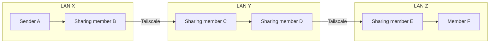

If all six are accepted members with the needed keys, B can serve A's retained event to C, then C/D/E propagate it to F. A need not know F's endpoint. Every adjacent edge must exist, and each serving holder must retain and share the event. If the sole holder disappears before the next hop copies it, progress waits. These intermediaries are authorized readers, unlike opaque relays. Presence rosters do not automatically flood along this chain.

Replica custody counts and exact-have checks are historical copy evidence. They are not a lease guaranteeing a holder will remain online forever, a human read receipt, or proof that every group destination received the event.

Linked devices share the sender account's copy observations through the existing
certified private account-document channel. Versioned records bind each claim to
its exact channel, event and holder, including negative rechecks. They carry an
account device's attestation of its authenticated check; they do not introduce
holder-signed delivery receipts. Later confirmations and revocations reconcile
independently of the immutable message-history digest. Local legacy observations
migrate automatically without replacing newer shared revisions.

The displayed member-copy count deduplicates accepted external member accounts
and excludes the sender's entire account. Own-device synchronization and opaque
post-office custody remain separate facts. A device missing status data displays
an unavailable state; it must not invent a zero-copy claim or a positive check.
Unsupported optional custody exchange must leave older supported account-data
domains usable. History synchronization policy also governs this private domain.
Post-office observations remain a separate historical aggregate: one missing
recipient wrapper or a connection timeout cannot retract another wrapper's
confirmed copy at the same office. Unsupported custody exchange is exposed as
requiring an upgrade, even while the older supported domains continue.

### Cost-aware group attachment sharing

The desktop starts with unknown network cost before participant producers run.
Unknown or restricted cost pauses export of other devices' retained group file
chunks. Group text, controls and file offers remain available; the original
author can still send its own file chunks. Certified same-account synchronization
keeps its independent category policy. Receive consent is unchanged. The saved
signed **Share a copy** preference and local retention/expiry rules never change
because of this temporary restriction. The members dialog exposes only this
device's cost status, with an authenticated temporary exception for all its groups.
The exception expires when the observed cost class changes or the runtime ends;
refreshing an unchanged class does not revoke it. It cannot enable sharing that
the member has explicitly disabled or override conversation authority.

This policy applies to attachment copies of every size rather than an arbitrary
large-file threshold. It defines no daily byte allowance or upload-rate limit.
A later optional cumulative budget must define its traffic and local-user/device
scope, persist usage, reserve concurrent sends, and keep network exceptions
independent from budget exceptions. Storage budgets never stand in for uploaded
bytes; limited payload export must preserve actual possession inventories.

`node/network_cost.rs` owns effective file-serving policy; the desktop
`network_cost/` adapter supplies observations. macOS uses Network.framework path
updates for expensive/Low Data Mode flags. Windows re-queries connection cost,
roaming, limits and background restrictions; Linux reads NetworkManager's Metered
property, including guessed states. Windows/Linux refresh every two seconds,
with Linux queries bounded to one second. An unavailable provider yields unknown.
The runtime owns cancellation and drops native observers at retirement. SDK,
CLI and integration hosts preserve unrestricted compatibility defaults unless
they supply an initial/current observation. The additive
`start_configured_guarded_with_network_cost_observed` constructor applies initial
cost before launch; existing constructor signatures and `RuntimeNetworkOptions`
fields remain compatible.

Cost is a conservative default-path observation, not universal hotspot detection
or a carrier billing guarantee. A hotspot can also carry local-only traffic.
This implementation has no physical-route exemption: automatic assistance can
pause even on a local hotspot, and the user can explicitly allow it temporarily.
VPNs, multiple interfaces and unrecognized hotspots still require native route
evidence before stronger guarantees. No SSID inference or network-name logging
is used. Existing peers may continue selecting a paused sharing member; normal
bounded recovery/source rotation still applies without changing wire formats.

Both sync directions recheck file export projections at each bounded page,
including existing sessions. Possession inventories and fingerprints remain
accurate while serving is paused, preventing peers from sending retained chunks
back to the metered holder. Already selected/buffered bytes may finish, and
native observation latency precedes enforcement; a switch does not promise zero
additional bytes. This policy neither deletes cached chunks nor treats a pause
as recipient completion. It limits optional group attachment assistance, not
original fanout, downloads, updates, backups or opaque post-office service traffic.
Focused loopback tests cover pause/resume, existing stores, ordinary receive
consent, inline media and retained bytes. Platform hotspot/VPN/sleep-wake and
active-transfer acceptance remain separate from simulated policy assertions.

### E. Files, folders, consent and completion

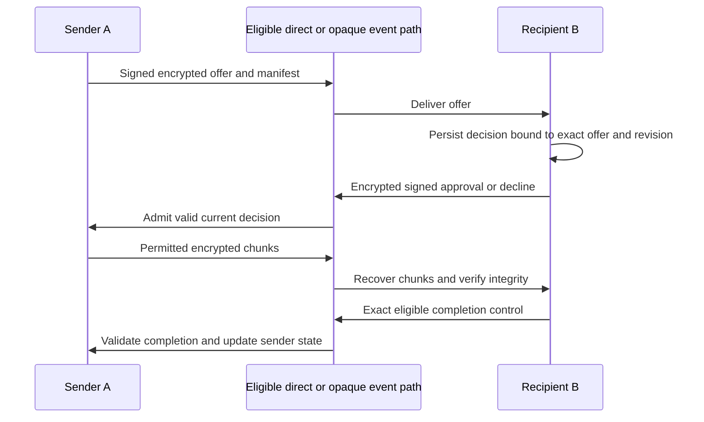

The middle participant describes the appropriate feature transport; it is not a plaintext-reading intermediary. Offers, consent controls, manifests, chunks and completion have distinct validation rules. Approving one offer must not authorize another sender, file, recipient or superseded revision. A file card is not completed byte delivery. Chunk completion and saving/exporting to a user path remain separate operations.

Consent/completion controls can travel in encrypted mailboxes without a direct client listener. Decisions persist independently so a sender restart before approval can recover. Invalid controls, stale revisions, failed durable writes and interrupted transfers must preserve correct pending state. File chunks share recipient-aware relay alternatives and must recheck current permission before continued transfer. Folder packaging and safe export paths retain the file subsystem's own limits.

### F. Calls: live signaling and separate media

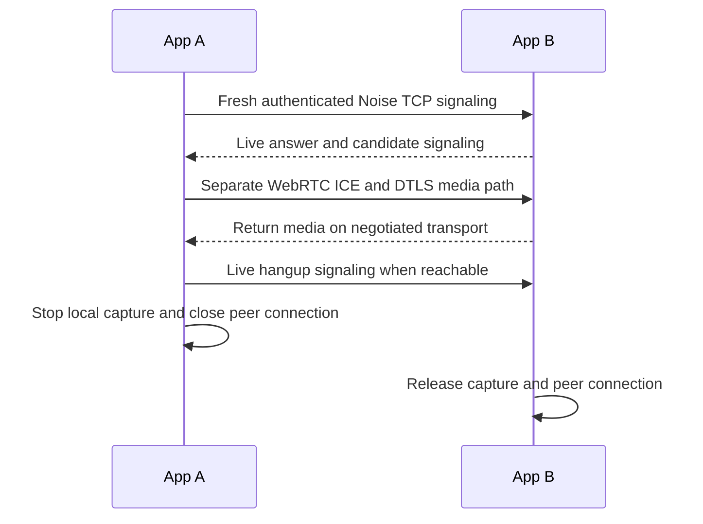

Current `send_call_signal` is ephemeral, device-addressed and uses a fresh live Noise connection. It does not append signals to the durable message log or upload them to post-office mailboxes. A participant visible only through opaque federation therefore does not automatically have a usable call-signaling path. WebRTC then needs its own permitted ICE/media path; post offices supply no TURN service. Text/file relay success proves neither requirement.


### G. Linking and ongoing account synchronization

Device adoption prepares a durable exact-device account-transition record before
replacing the account keystore. The old account root, adopted account root and
unchanged device sign domain-separated transition bytes, including the complete
Ed25519/X25519 tuple, both certificates, predecessor and nonce. Only loading the
matching adopted account commits publication. Loading the old account discards
an unpublished future tail; a write error alone cannot prove that atomic key
replacement did not occur. Security rekey deliberately emits no linking continuity.

Updated peers carry a bounded committed transition chain in a session-bound Noise
presence extension. Existing announcements, certificates and channel event layouts
remain unchanged. A receiver updates only a matching full-device prior binding,
checks persisted lineage and rejects forks, cycles, stale replay and changed keys.
Existing disclosure policy remains authoritative; an accepted transition does not
mark a safety number verified, rewrite old conversation history, alias whole
accounts, or change established account-group grants. Group count projections
then use the repaired binding. Proofs remain available across restarts and are
resent on authenticated reconnect, allowing an offline or upgraded recipient to
recover without repeating per-recipient manual acceptance. Private login data,
contact remarks and account preferences stay within certified same-account sync.

Clients without this extension must upgrade to consume automatic transition
repair. Early linking operations that did not retain the old-account signature
cannot manufacture it after key replacement; their existing explicit account
change recovery remains available. Names, account IDs alone, discovery hints and
new-account certificates are insufficient replacement evidence.

Typed private account documents reuse the existing certified sibling session and
account worker. Domains cover conversation drafts (text and protection together),
grow-only exact-message read receipts, customization packs and private avatar
overrides, and private DM reaction/recall controls. History consent gates drafts,
read receipts and DM controls; appearance consent gates
libraries/photos. Shared settings retain the existing per-key preference owner.
The native account adapter rejects stale owner/runtime/account admissions, releases
blob bytes only for the requested current version, and uses compare-and-set writes.

Device hostnames are private account-directory metadata, separate from public
nicknames, discovery announcements, certificates and ordinary peer profiles.
The desktop reads its OS hostname at startup and publishes a bounded (255-byte,
nonblank, control-free UTF-8) source-device document through the existing encrypted
certified-sibling session. Hostnames persist encrypted for offline display and
remain independent of optional history and appearance synchronization. Only the
local device and certified roster entries appear in the device-list projection.
Generic document writes cannot forge hostname metadata; its device key must match
its writer. Native reads require the current desktop owner, runtime and expected
cryptographic account. Other accounts cannot request hostname documents even if
they know the account ID and establish a Noise connection. The version-5 document
domain has an independent legacy-peer cooldown; older peers keep ordinary sync
and existing device labels. Unavailable hostnames fall back to the existing labels.

Each domain compares a deterministic digest of signed metadata. Mismatches exchange
paged manifests, then only needed verified content; a patch carries a complete
record for its key, never an unvalidated full-state replacement. Version order is
revision, writer device and content hash, independent of wall-clock skew. Deletion
tombstones participate in the digest. Equal metadata with a missing blob remains
incomplete and cannot report up to date. Interrupted transfers preserve the old
accepted version. Startup removes only managed incomplete document chunks.

Manifests carry at most 64 records per turn; chunks are at most 16 KiB and a turn
transfers at most 12 MiB. Drafts are capped at 64 KiB, packs at 12 MiB and private
avatars at 1 MiB; the store bounds ordinary records, read receipts and aggregate
assets separately. Unsupported legacy extensions cool down without disabling
ordinary history. Additional document status distinguishes upgrade required,
source consent off, transient failure and complete convergence.

DM controls retain their semantic ordering: reaction state is keyed by peer,
message, actor and emoji, with the original event timestamp and removal precedence.
A delayed add cannot supersede a later removal. Recall records are immutable and
apply only to the target's authenticated author and conversation; a control may
arrive before its target. Generic document writes cannot create either control.
Verified live controls retain the signed original event and certified author and
observer evidence; the account signature attests the sibling's verified decryption.
Historical recall caches lack the original recaller signature. Only explicit
kept-source preparation can attest such a retained mark, after validating the
retained current-account route and exact target author. Joining startup never
attributes unbound legacy controls to the adopted account. Failed publication is
retryable without discarding an already accepted local action.

Original document domains retain version-1 requests. DM control domains use
version 2; an older source requires an upgrade for those domains while ordinary
history continues. Known recalls exclude private message bodies and file cards
from account archive export, including cached pages. Control revisions invalidate
stale exports; late original content also observes accepted recall state. Local
hide/delete and conversation clearing do not become global recalls.

Sibling file bytes use an optional checked attachment request on the same account
session. Only that request admits the appended typed unavailable/source-disabled
response; legacy attachment layouts and responses remain frozen. The source checks
the exact certified account/device, active disclosure guard and local sync consent
before observing availability. Available data keeps the existing authenticated
manifest, byte-count and checksum validation. Transport closures, corrupt bytes
and staging failures are never reclassified as missing content.

Unavailable bytes retain their file cards and pending count. A bounded cache of
256 peer/file observations defers identical unavailable probes for 60 seconds;
unsupported checked requests use a peer-wide capability cooldown and the existing
legacy byte exchange. New clients expose waiting for file copies separately from
errors and complete convergence. Missing files cannot block messages, preferences
or private documents, or prevent trying later available files. A later retry can
recover bytes when any eligible sibling has a usable copy; an absent copy cannot
be recreated from metadata. Both sides must support the checked exchange for its
explicit availability status.

Group recovery stays separate from private account records: accepted members can
relay bounded verified device-transition proofs over the existing group-authority
exchange. Full device tuples and old/new account signatures, plus current accepted
requester membership, are required. A relayed binding patch never grants endpoint
reachability or exposes account credentials, remarks, drafts or settings. Group
authority and membership compare signed event summaries and request missing events;
a newer claimed version without its verified authority chain is not authoritative.

A one-time 128-bit code authorizes a specific device identity to obtain the account secret/certificate and eligible backfill over Noise. Enrollment is durable before use. It permits only the exact certified Ed25519/X25519 identity to adopt the account; fresh signed announcements alone cannot rebind a historical identity.

The enrollment transition serializes current-code validation and durable authority changes, invalidates pre-transition managed session guards, clears idle reuse and refreshes only its current pairing exchange. Code consumption is atomic. After a lost response/adoption failure, a new valid code can authorize a restricted incoming pairing-only retry for the exact prior enrolled binding; that channel cannot enter ordinary sync, calls or attachment/history protocols before code validation. New account presence permanently retires the old-binding retry exception.

Pairing requires a direct authenticated application route: a shared LAN or a
reachable routed/VPN path can supply one. Post-office directory presence and
opaque message custody do not tunnel enrollment or sibling synchronization.
A mailbox address must never be dialed as if it belonged to the device. The
dialog excludes peers with no known direct route, explains how to establish one,
and offers discovery refresh. Roster hints are observations rather than an
authorization or reachability verdict; the core rechecks routes and identity.

The SDK/CLI initiator uses `MTPQ3` / `MTPS2` to authenticate the history
selection and preserve immutable account creation metadata. It never downgrades
to a metadata-losing response after connection, protocol or capability failure.
Responders still accept frozen V1/V2 request layouts and preserve their exact
response bytes; old clients do not gain new account metadata implicitly.

Desktop pairing requires `MTPQ4` / `MTPS4`: the response includes a validated
signed private account-access snapshot before the joining node adopts account
keys, together with optional signed account profile and immutable creation
metadata. It never falls back to V1/V2/V3, including when history is enabled. An older
source requires upgrading both desktop apps and issuing a fresh code; transport
failures still retain their actual cause. The historical SDK/CLI V1/V2 layouts
and their explicit history negotiation remain compatible.

`node/account_access.rs` admits only bounded, signed records for the current
account and exchanges them only with eligible certified siblings over Noise.
The opaque host payload is encrypted at rest, independently revisioned and
independent of optional history/profile/preference switches. Public discovery,
trust cards, contact aliases and ordinary messages never carry login passwords.
The desktop source initializes this record only through the explicit keep-account
action; a joining device cannot seed its former credentials during startup.
One runtime-owned essential worker shares transport capacity and the adaptive
control deadline (initially 15 seconds, bounded to 60 seconds), independently of
bulk history and optional profile/preferences. Transient failures retry after
2, 5, 15 then 30 seconds; unsupported or invalid protocol responses cool down for
60 seconds. A verified route, key or privacy-generation change resets cooldown;
ordinary presence heartbeats do not. Typed per-device status exposes phase,
revision, static failure reason, attempts and retry delay, never payloads or raw
errors. Runtime retirement cancels the worker and its admitted operation.
`identity/account_login.rs` maps the shared login to the retained local-user UUID
and storage namespace through an atomic encrypted envelope. The envelope retains
separate legacy identity-auth and raw node-storage passwords without rewriting
history. Name collisions fail before account-key adoption and are rechecked at
publication. Migration disables previous-login fallback; corrupt or mismatched
envelopes fail closed. `src-tauri/src/shared_account_login.rs` applies snapshots
under the exact desktop/runtime owner and permits a cross-account replacement
only for a matching persisted, device-bound explicit adoption intent.

Signed-out enrollment uses `node/enrollment.rs` with only a device identity to
send anonymous discovery queries and pin a signed source announcement before
the same V4 pairing exchange. It creates no temporary account or public presence.
A pending explicit code permits an authenticated accountless device only on a
pairing-restricted channel; code proof still binds both device keys and history
selection before any account data is released. Anonymous discovery queries carry
no local identity: an empty target list selects LAN multicast, while explicit
IPv4/IPv6 endpoints limit probing to those endpoints. Responses require the fresh
query nonce, source signature and account certificate. The V4 response carries
the source's signed account profile. At most three `MTPC4` fragments, each at most
60 KiB of response bytes, reassemble at most 144 KiB, covering a supported 128 KiB
avatar plus bounded profile/access metadata. Reordered, oversized and truncated
sequences fail before staging; frozen earlier protocols do not use fragments. The desktop requires
that profile and verifies shared sign-in in isolated staging before publication.
`src-tauri/src/device_enrollment.rs` commits the staged local user and account
through the existing recovery publication journal, guarded by the login namespace,
signed-out session generation and profile lifecycle. Cancellation before publication
removes staging; a committed account remains recoverable through ordinary sign-in.

Generic account preferences use an account-specific encrypted journal and key
domain. Old unscoped preference journals are preserved rather than guessed to
belong to an adopted account. Explicit source preparation republishes its saved
portable choices; a joining device cannot seed unrelated local defaults.

The device dialog names the enrollment direction before either action: the code
issuer keeps its account, and the code submitter adopts it. The submitter sees the
selected device, current/target account IDs, and explicit consent to replace this
device's account login name and password with the source account's credentials.
The source shows its login name separately from its account nickname.
Consent is invalidated by a different selection, account binding, route removal or
new dialog lifetime. A checked complete-sync option enables all five supported
categories on each participating UI before its code/request; opting out retains
saved category choices without changing global defaults. Source contact and
appearance snapshots are durably prepared before category enablement/code
issuance. Joiners never seed their unrelated local defaults over source data.
Explicit joining-device category choices are captured with device-bound adoption
intent and survive credential installation. Signed-out enrollment stages its
chosen history policy and application marker with the verified profile; a source
full-sync default cannot silently enable declined history after startup.

The authenticated account profile owns the account nickname, avatar and bio. Linked devices
project that same profile into local display state. The private account-access
record separately supplies their shared login name and password; profile data
never substitutes for credential authority. Nickname edits preserve other card
fields and follow the existing signed revision ordering; a joining device cannot publish its old
local nickname as the adopted account's initial profile.

Contact presentation prefers the verified nickname recorded from device
announcements, including the durable nickname retained while offline. A legacy
public trust card can contain an older login/display label; importing or reading
it must not replace a known contact nickname. The card name is only a fallback
when no verified nickname is known. Own linked-device profile projection still
uses the shared signed account profile. It never derives a nickname from a login
name or a contact remark. Credential synchronization preserves the private local
storage username while presenting the canonical shared login name.

The device-link picker excludes peers explicitly reported as having no known direct
application route. Mailbox-only presence is not pairing eligibility. A selected
peer that disappears or loses its direct route cannot be submitted; discovery can
make it selectable again. A discovered LAN or routed/VPN candidate still requires
transport verification. Older hosts without route provenance retain dial-time
validation.

Each pairing dial, including permit/admission waiting and staggered candidates,
has a 25-second ceiling; individual route authentication retains the transport
owner's adaptive deadline. The authenticated request/response shares one
adaptive control budget (15–60 seconds) for both send and receive. Timeout drops
the attempt and its socket/permits. It never retries a possibly consumed code.
The host preserves typed route, connection, response-timeout, clean-close,
history-capability and protocol failures for localized inline recovery guidance;
raw diagnostics remain available through an optional disclosure. Code and
account-secret bytes must not appear in errors. Successful response validation,
one-time code consumption and bounded best-effort backfill retain their existing
semantics.

Sibling history invalidations that arrive while an older page is active retain
one coalesced follow-up per active worker (at most four). The worker immediately
queues that follow-up and cannot report UpToDate while it is pending; policy
replacement/cancellation and worker failure clear the pending marker. Saved
Messages participates in the same bounded UI history reconciliation even when
the own account is absent from the contact roster.

Every account-target enqueue persists verified recipient and sibling fanout
bindings before constructing immutable delivery destinations. Acceptance cannot
depend on an earlier UI roster poll. A sibling archive is independent of external
recipient delivery and cannot produce a recipient confirmation. If a recipient
retains a device's previous account pin, discovery does not silently replace it.
Read-only diagnostics may expose a currently verified full-key account change;
explicit recipient acceptance rechecks the exact device and old/new account IDs
under current session/policy authority and changes only that reviewed binding.
It never marks a safety number verified or merges old-account conversations.

Ongoing `MTAHS2` reconciliation separates file cards from file bytes; frozen `MTAHS1` retains its attachment-coupled behavior. Source and receiver category intersections and process-local policy revisions guard selected exports and durable imports. These changes keep the existing bounded page/frame budgets.

Channel archive, file-card and attachment-byte exports require both source and requester to be accepted channel members. A pending invitation alone is not read permission.

Message Yourself is the self-account route. With no siblings, acceptance commits local history and encrypted file retention without reserving remote delivery capacity. A later certified sibling can reconcile retained records with their original logical IDs. Signed personal file evidence binds the exact manifest to its personal host; it does not grant access to unrelated account or channel files. Local acceptance and a completed selected exchange are distinct facts, and neither promises indefinite availability.

Favorites is a separate account-owned encrypted snapshot collection. Its optional,
explicitly versioned sibling request preserves frozen history encodings and uses
bounded pages/chunks. Both endpoints' history permission gates snapshots, notes
and removal tombstones; attachment permission additionally gates retained bytes.
The ordinary self-chat and contact preference journals do not own this capability.
See [Favorites](favorites.md) for revision ordering, resource limits, independent
retention and exact-reference acceptance requirements.

After restart, the account-device registry reconstructs expected bindings and obsolete roster presence stays retired. Certified siblings use their own live authenticated account-sync path and device-local category controls for ongoing history/settings/media catch-up. Ordinary message fanout or directory visibility does not replace that protocol. Pairing/replay must retain original logical IDs and avoid duplicating local history.

## 6. Scenario catalog

Examples assume compatible software, verified application identities and allowed UDP/TCP unless the row names a restriction. **X: A/B/C**, **Y: D/E/F**, **Z: G/H/I** are ordinary clients. **P/Q/R/S** are post offices. The rows describe implemented paths or explicitly conditional topology models. Evidence is recorded separately in section 9; a diagram does not establish a physical acceptance result.

In the first diagram, the dotted edge exists **only** in scenarios T1–T3. Remove it for the fully isolated L7 case. The local lines represent potential direct paths, not guaranteed authorization or always-open connections.

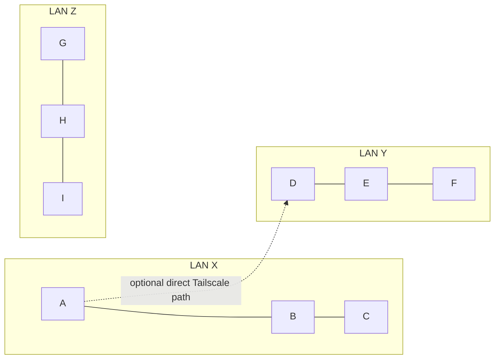

A client-to-relay Tailscale edge is different: in R1, D can reach P, while E and F still cannot reach P merely because they share D's LAN.

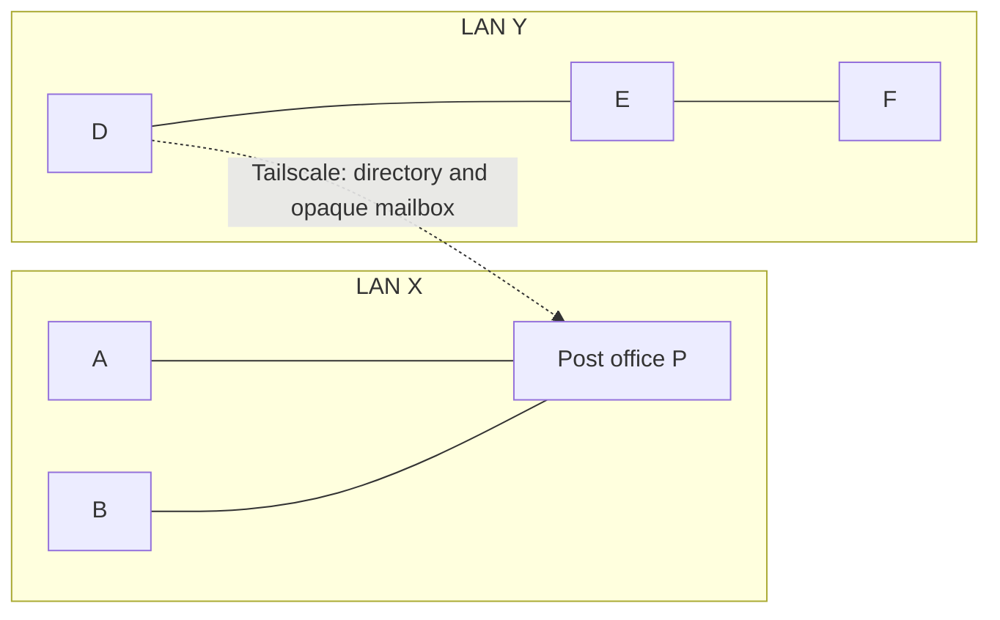

### Local networks and direct routed clients

| ID  | Topology and settings                                                         | Discovery / broadcast                                                                                                                                                          | Data forwarding and outcome                                                                                                                                                                                                                                                |
| --- | -------------------------------------------------------------- | -------------------------------------------------------------------------------------------------------------------------- | ------------------------------------------------------------------------------------------------------------------------------------------------------------------------------------------------------------------------ |
| L1  | X has A/B/C; no relay.                                         | Each public client announces itself within X.                                                                              | A→B is direct Noise/TCP; group events go to authorized members and recover from another sharing member. Offline B needs a later direct route. **Current.**                                                               |
| L2  | L1 plus P, mailbox-only; A/B use relays.                       | Clients still find each other locally; P advertises only itself as a relay.                                                | A tries direct B and may upload an opaque copy to P. B drains later. P cannot introduce a remote user. **Current.**                                                                                                      |
| L3  | L1 plus P, but A disables **Use post offices**.                | Local discovery is unchanged.                                                                                              | A cannot upload/drain through P. Direct A↔B and authorized group peer recovery continue. **Current.**                                                                                                                    |
| L4  | X has P/Q/R in bridge mode with mutual trust; clients opt in.  | Clients see local relays; eligible client presence may enter their authenticated directory sync.                           | Local direct delivery still applies. Multiple relays can hold/reconcile v3 opaque mail; preference/fallback is per reachable candidate. No relay appears in a channel member list. **Implemented under explicit trust.** |
| L5  | X has P/Q/R but no mutual federation trust.                    | Each relay advertises itself, but no authorized relay-to-relay directory exchange.                                         | A may choose another relay on failure, yet a copy on P is not automatically replicated to Q/R. B must drain a relay that holds the copy. **Current boundary.**                                                           |
| L6  | A/B share a physical network, but multicast is blocked.        | First-sight unicast and bounded local scan may help; firewall/client isolation can still block discovery.                  | If A learns B's endpoint and TCP is permitted, direct sync works. Same Wi-Fi name alone guarantees nothing. **Current boundary.**                                                                                        |
| L7  | X, Y and Z are isolated; no client or relay has a routed link. | Each public client announces only within its own permitted LAN scope.                                                      | Direct/group sync stays within each site. No setting can manufacture a route between sites. **Physical limit.**                                                                                                          |
| L8  | A client and P run as separate processes on one host.          | Each process signs and advertises its own identity; interface selection may yield different displayed IPs.                 | Their shared machine does not merge their roles. P stays out of the people/group-member list, and A still follows its own relay-use policy. **Current model; inspect addresses before diagnosing a bug.**                |
| T1  | X and Y are isolated; A↔D only over Tailscale; no relays.      | A sees B/C locally and may find D by routed unicast. D sees E/F locally and may find A. No other cross-site introductions. | A↔D can directly chat or share an authorized group. B/C do not see D/E/F; E/F do not see A/B/C. Z remains isolated. **Current, subject to routed candidate/port reachability.**                                          |
| T2  | T1 but A's routed UDP query or TCP port is blocked.            | A may fail to discover D, or may discover D but fail to sync; these are different failures.                                | No direct delivery until the required application path is restored or an independently reachable relay route is configured. **Current boundary.**                                                                        |
| T3  | A↔D Tailscale works; A disables bridge discovery.              | Direct A↔D discovery can still work; A is absent from cross-site public relay directories.                                 | Known, authorized A↔D traffic stays direct. Bridge opt-out is not a physical-LAN-only firewall. **Current.**                                                                                                             |

### One or more cross-site post offices

| ID  | Topology and settings                                                         | Discovery / broadcast                                                                                                                                                          | Data forwarding and outcome                                                                                                                                                                                                                                                |
| --- | ----------------------------------------------------------------------------------------- | -------------------------------------------------------------------------------------------------- | --------------------------------------------------------------------------------------------------------------------------------------------------------------------------------------------------------------------------------------- |
| R1  | P on X; D on Y has a direct Tailscale path to P; A/B on X and D opt in.                   | P can introduce the opted-in clients to one another. D does not export E/F merely by being on Y.   | A↔D uses P's opaque mailbox if no direct client route exists. P is a single cross-site dependency. **Current model.**                                                                                                                   |
| R2  | R1, but D does not opt into bridge discovery.                                             | D is not a public cross-site listing; A/B cannot infer D from P's LAN.                             | A previously known D may still be reachable on an independently authorized direct or known-peer path. Public listing and delivery permission are distinct. **Implemented boundary.**                                                    |
| R3  | P on X and Q on Y have mutual trust and a permitted Tailscale link; clients opt in.       | P/Q exchange only eligible signed presence over Noise, not LAN multicast.                          | A→D can use P→Q opaque mailbox federation; D drains Q and acknowledges. No direct A↔D IP path is created. **Current model.**                                                                                                            |
| R4  | P/Q are Tailscale-reachable but not mutually enrolled.                                    | They may discover each other's relay identity, but must not exchange client directory/mail data.   | They are independent mailboxes. Automatic trust-on-sight is **not recommended**. **Current boundary.**                                                                                                                                  |
| R5  | P/Q are mutually trusted but Tailscale policy blocks the link.                            | No live federation despite matching config.                                                        | Mail and presence do not cross sites until a permitted route appears. **Current boundary.**                                                                                                                                             |
| R6  | X has P/R; Y has Q; P↔Q only. A prefers P, then P fails.                                  | A still sees R locally; any previously introduced remote presence may expire.                      | R can accept a copy, but cannot reach Q through failed P. Cross-site delivery waits. Adding R↔Q creates an alternate path. **Physical limit.**                                                                                          |
| R7  | X has P/R; Y has Q; P↔Q and R↔Q. A prefers P, then P fails.                               | Directory sync may continue through R↔Q for opted-in clients.                                      | A chooses reachable R; R/Q move ciphertext, D drains and acknowledges. A should later resume P as preference. **Implemented; see the outage evidence in section 9.**                                                                    |
| R8  | X has P/R, Y has Q, Z has S; only P↔Q↔S.                                                  | Eligible presence can propagate only across surviving trusted paths.                               | A→G may traverse P, Q and S as opaque mailbox reconciliation. Q failure partitions X from Z unless another trusted route exists. **Implemented graph model; three physical sites remain conditional.**                                  |
| R9  | X has P/R, Y has Q, Z has S; fully connected relay links.                                 | Each trusted edge can reconcile eligible directory information; no network broadcast domain forms. | More paths improve availability but add pairwise inventory/handshake work; bound and measure at scale. **Design model, not a performance guarantee.**                                                                                   |
| R10 | A on X can directly reach Q on Y via Tailscale, although P is also on X.                  | Q is a genuine directly reachable candidate for A; X's other clients do not gain that path.        | A may choose Q under user preference, but local-first automatic ordering should normally favor P. A remote relay visible only through P should not appear as an ordinary direct choice. **Current; direct routed selection supported.** |
| R11 | P on X and Q on Y run the same binary/flags but have different identities; no trust seed. | Each advertises itself in its own reachable scope.                                                 | Same executable does not create federation. Configure mutual trusted identities and a physical route. **Current boundary.**                                                                                                             |

### Policy, privacy, group and other feature combinations

| ID  | Topology and settings                                                         | Discovery / broadcast                                                                                                                                                          | Data forwarding and outcome                                                                                                                                                                                                                                                |
| --- | ----------------------------------------------------------------------------- | ------------------------------------------------------------------------------------------------------------------------------------------------------------------------------ | -------------------------------------------------------------------------------------------------------------------------------------------------------------------------------------------------------------------------------------------------------------------------- |
| S1  | A is public locally, relay use on, bridge discovery off.                      | A announces directly but is absent from the public cross-site directory.                                                                                                       | Known-peer legacy mail may still use a relay; v3 federated participation is gated by opt-in. **Current.**                                                                                                                                                                  |
| S2  | A turns **Use post offices** off while P/Q remain federated.                  | Direct discovery is unchanged; UI disables the bridge switch. The core now clears prior relay introductions and gates directory participation even if bridge-on remains saved. | A stops ordinary mailbox upload/drain and public directory participation. **Focused regression test passes; remote registration expires on its existing TTL.**                                                                                                             |
| S3  | A enables bridge discovery; B on the same LAN does not.                       | Trusted relays may introduce A across sites, not B.                                                                                                                            | Remote clients cannot infer B merely because it shares A's LAN or group. **Current privacy boundary.**                                                                                                                                                                     |
| S4  | A is invisible or a private contact.                                          | No public bridge registration; private authorization rules apply separately.                                                                                                   | A relay has no automatic exemption to reveal A. A known contact still needs the relevant authorized route. **Current boundary.**                                                                                                                                           |
| S5  | A sends to offline D through P/Q.                                             | A directory entry may expire while ciphertext remains in a mailbox.                                                                                                            | D drains when online, if a copy and route survive. Thirty days is an upper bound, not guaranteed storage. Relay custody does not mark Delivered. **Current.**                                                                                                              |
| S6  | A/B/D share a group; D offline; B has **Share a copy** on.                    | Group membership is not advertised by UDP discovery.                                                                                                                           | D may recover authorized events from B or its own opaque mailbox. P/Q cannot become sync members. **Current model.**                                                                                                                                                       |
| S7  | Same group, but B disables **Share a copy** and A is offline.                 | Discovery may still show B online.                                                                                                                                             | B does not serve its retained group history; D needs another authorized sharing member or relay copy. **Current.**                                                                                                                                                         |
| S8  | A sends a file to D via federated P/Q.                                        | Encrypted offers, consented bytes and sender-observed completion have loopback and dated physical recovery evidence; see [S8](#s8--cross-site-file-offer-and-bytes) and [the evidence tracker](#implementation-and-evidence-tracker). | A card receipt is not file completion. The 2026-10-16 four-host/two-site run verified 130,000 bytes, matching SHA-256 and completion through surviving R→Q→S after preferred-relay outage and sender restart. Three independent sites and arbitrary large-folder workloads remain unverified. |
| S9  | A calls D across sites.                                                       | Signaling may use available application paths.                                                                                                                                 | Media requires an independent WebRTC ICE route. P/Q are not TURN; encrypted text delivery does not prove a call works. **Current boundary.**                                                                                                                               |
| S10 | A has two devices, one on X and one on Y.                                     | Each device has its own presence, settings and identity under one account.                                                                                                     | Roster groups the devices by account; delivery and recipient receipts remain device-specific where required. Full sibling history/settings sync needs its own authenticated path. **Current boundary.**                                                                    |
| S11 | Two trusted relays hold duplicate copies of one event.                        | Directory may contain multiple routes to one verified device.                                                                                                                  | Recipient validates and deduplicates by event identity; the UI shows one person/device, not one entry per relay. **Required deduplication invariant; validate each new fallback path.**                                                                                    |
| S12 | Accepted group members span X, Y and Z; B↔C and D↔E use Tailscale; no relays. | Only directly connected member pairs discover each other; LAN rosters do not cross.                                                                                            | A→B→C→D→E→F can propagate by authorized group-log reconciliation while each bridge holds and shares its copy. Six-member Noise/TCP loopback coverage verifies the chain; physical three-site Tailscale coverage remains pending. **Implemented / physically conditional.** |

### Illustrated walkthroughs for every catalog case

The diagrams below show an **example operation**, not a permanent socket or an IP route for every drawn pair. Solid arrows are application discovery/sync or direct data as labeled; dotted arrows are optional or failed operations. A missing arrow means that operation cannot be inferred from the topology. Each example assumes accepted conversation permissions where a chat/group event is shown. The quick tables above remain the index; these walkthroughs explain the sequence.

#### L1 — one LAN, no post office

On Windows, discovery joins the multicast group on loopback as well as the active IPv4 adapters so co-resident app and CLI processes can discover one another. Public announcements explicitly select each available IPv4 interface rather than relying on the default multicast route; an unavailable adapter does not prevent sends on healthy adapters. The visibility gate and physical-LAN-only scope still apply before sending, and each multicast packet has a TTL of one.

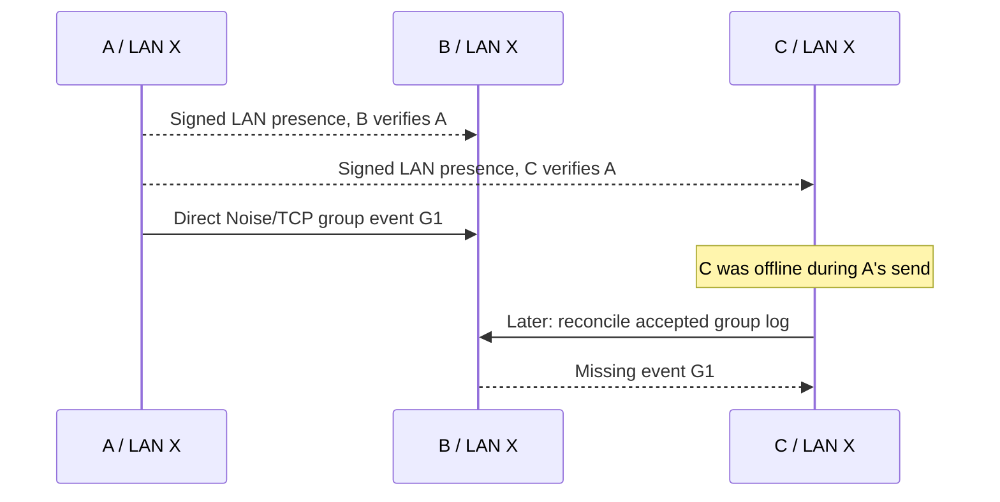

**Result:** C receives G1 from B if B retained it and **Share a copy** is on. For a direct A→B message, B's authenticated receipt—not the LAN announcement—marks delivery. Without a later reachable holder, C continues waiting.

#### L2 — one mailbox-only relay on the LAN

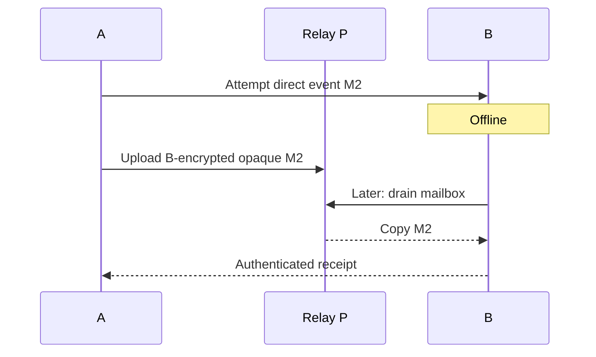

**Discovery:** A/B still learn one another locally; P announces only its own relay identity. P has no bridge directory, so it does not introduce a client from another LAN. P's acceptance is bounded custody, not B's receipt.

#### L3 — relay exists but sender disables relay use

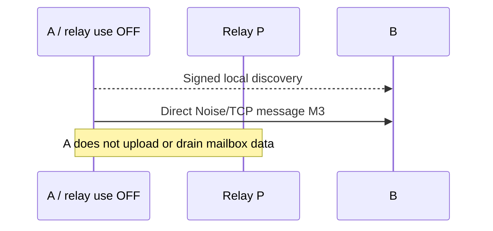

**Result:** B receives M3 directly when online. If B is offline, A waits and retries after a direct route returns; P's mere presence cannot override A's relay-use choice.

#### L4 — three trusted, equal relays on one LAN

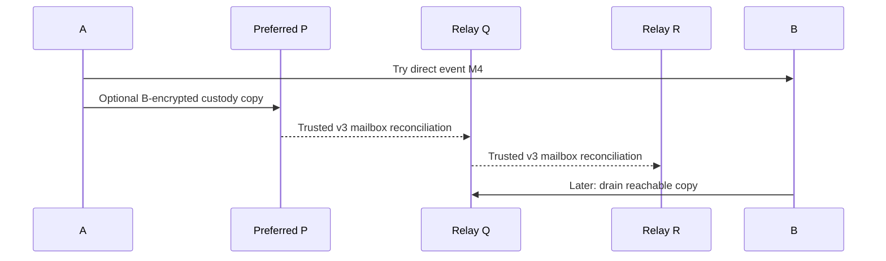

**Discovery:** each relay advertises its own identity; opted-in client presence may be exchanged through their authenticated directories. The relays are equal in role but have separate keys/endpoints. B still receives one validated event even if several relay copies arrive.

#### L5 — three relays without mutual trust

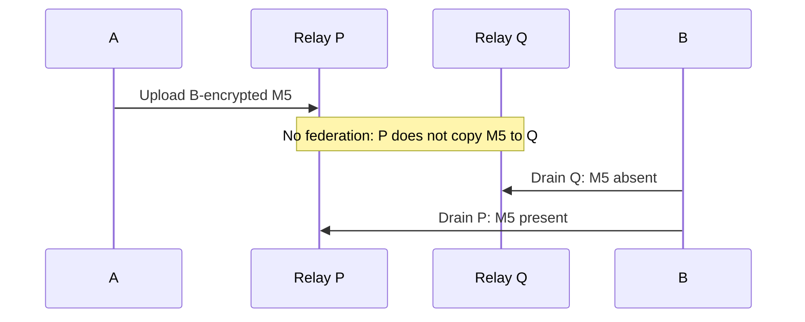

**Result:** Q can still be an alternate relay for a _new_ upload if A reaches it, but Q cannot serve the old P-held copy without federation. B must contact the holder or wait for A to retry elsewhere.

#### L6 — local multicast is blocked

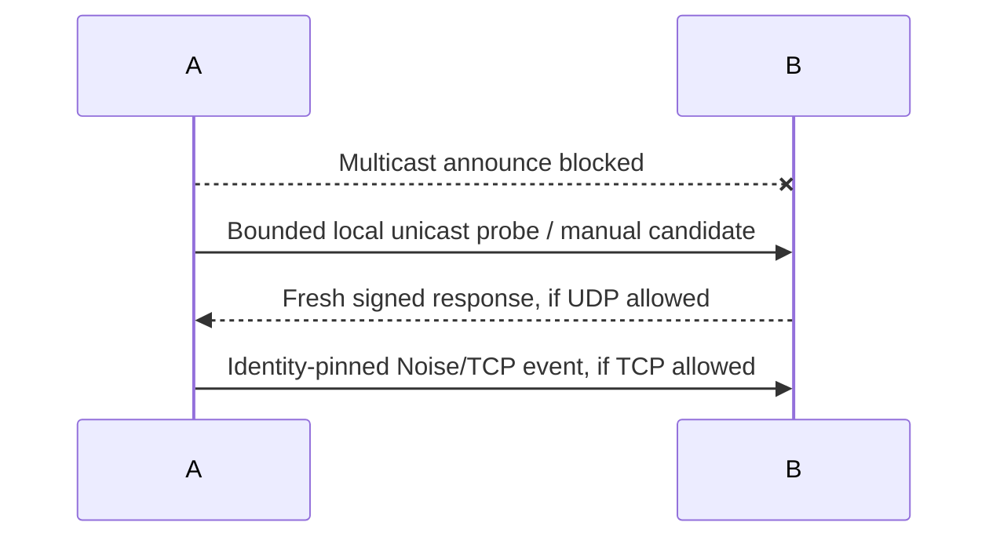

**Result:** unicast can recover discovery, but blocked application UDP or TCP still prevents the corresponding step. Two machines sharing a Wi-Fi name is insufficient evidence of reachability.

#### L7 — three completely isolated LANs

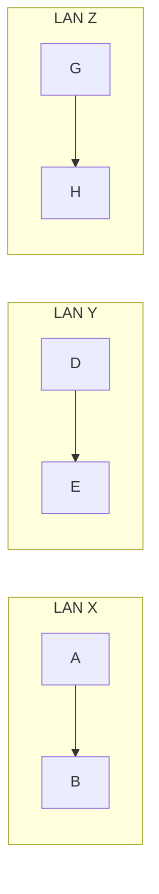

**Operation:** A, D and G announce signed presence only within their own permitted local scopes. A→B, D→E and G→H can use direct encrypted sync. There is no X↔Y↔Z edge, so neither an opt-in switch nor a group membership record can deliver an event across the sites.

#### L8 — app and post office on one computer

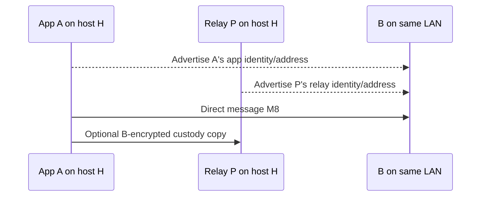

**Result:** B sees A as a person and P as infrastructure. A and P may show different interface IPs or ports; their distinct identities and roles matter more than the shared host. P is excluded from B's group-member picker.

#### T1 — one direct Tailscale client pair across LANs

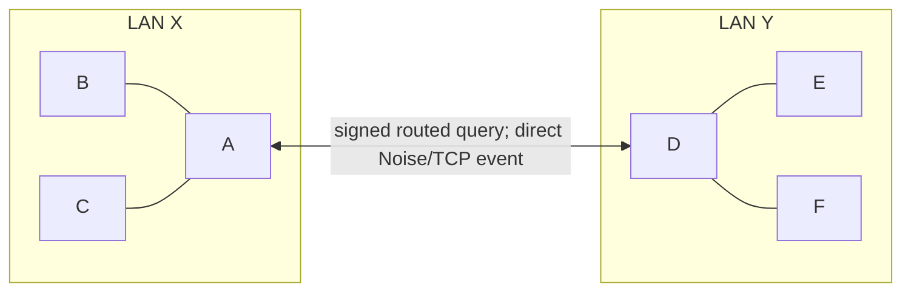

**Operation:** A finds B/C locally and D through D's known Tailscale candidate. A sends D a direct encrypted message and D returns a receipt. B does not learn D/E/F through A; E does not learn A/B/C through D. A and D can sync an accepted group, but neither forwards all LAN discovery.

#### T2 — Tailscale machine reachable but application port blocked

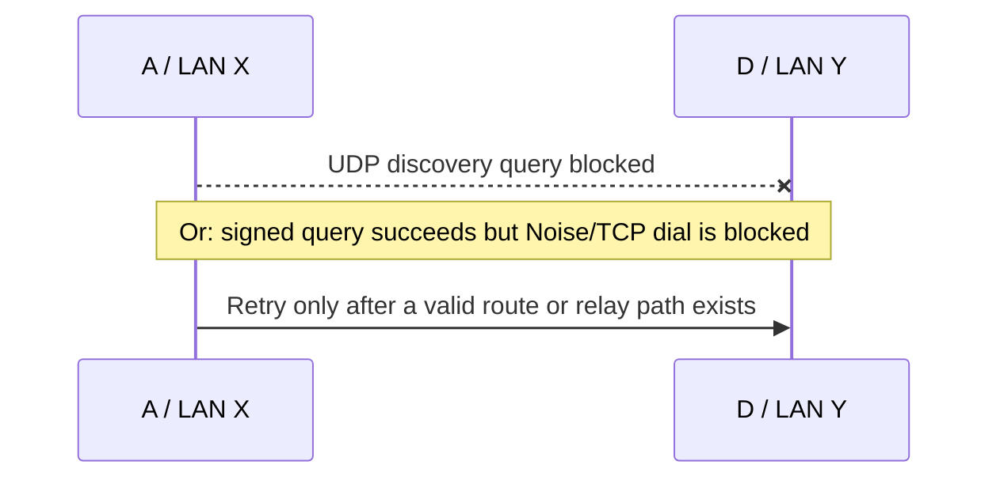

**Result:** Tailscale status alone cannot place D in A's verified roster or deliver a message. A known identity does not manufacture a working application port; a separately reachable post office could provide a different route if configured.

#### T3 — direct Tailscale link with bridge discovery off

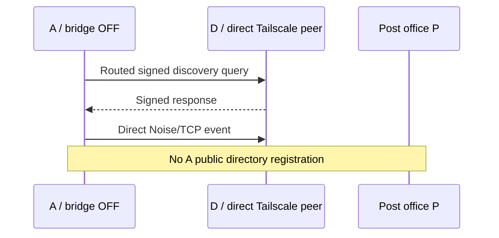

**Result:** A and D can communicate directly even though A is not publicly introduced by P. Turning bridge discovery off limits relay directory visibility; it is not a firewall against a directly reachable permitted peer.

#### R1 — one relay reachable from two LANs

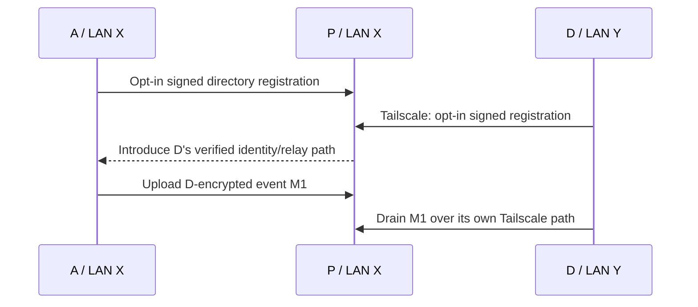

**Result:** D's LAN neighbors E/F do not register merely because D can reach P. P cannot create direct A↔D TCP reachability; it is the mailbox path here. If P disappears, this single-relay cross-site route stops until P or another independently reachable route returns.

#### R2 — the remote client declines public bridge discovery

```mermaid
sequenceDiagram
  participant A as A / LAN X
  participant P as Bridge P
  participant D as D / bridge OFF
  A->>P: Query public directory
  P-->>A: No public D entry
  Note over A,D: A known, authorized D could use a separate valid route
```

**Result:** P does not advertise D's identity to A. A cannot infer D from D's LAN membership. A pre-existing contact/route is a separate question: opt-out of public listing does not itself delete an already authorized direct address or known-peer mailbox path.

#### R3 — two mutually trusted relays across LANs

```mermaid
sequenceDiagram
  participant A as A / LAN X
  participant P as P / LAN X
  participant Q as Q / LAN Y
  participant D as D / LAN Y
  D->>Q: Opt-in signed registration
  Q-->>P: Trusted Noise federation: D presence
  P-->>A: Introduce D via relay route
  A->>P: Upload D-encrypted M3
  P-->>Q: Reconcile opaque v3 mailbox copy
  D->>Q: Drain M3, validate and store
  D-->>A: Recipient receipt by an available route
```

**Result:** No LAN multicast or plaintext crosses P↔Q. A knows D as an introduced Mesh Talk identity, not as a fabricated LAN neighbor. A's delivered status requires D's validated receipt.

#### R4 — relays can see one another but are not trusted

```mermaid
sequenceDiagram
  participant P as P / LAN X
  participant Q as Q / LAN Y
  participant A as A / LAN X
  participant D as D / LAN Y
  P-->>Q: Discover relay candidate identity
  Note over P,Q: No mutual federation enrollment
  A->>P: Upload D-addressed event if D is already known
  Note over P,Q: No authorized directory/mailbox exchange
```

**Result:** A Tailscale link and matching relay software are insufficient. P and Q remain independent stores, so P's copy does not appear at Q. **Rule:** automatic candidate discovery must not silently grant federation trust.

#### R5 — relays trust one another but the routed link is blocked

```mermaid
sequenceDiagram
  participant A as A
  participant P as P / LAN X
  participant Q as Q / LAN Y
  participant D as D
  A->>P: Upload D-encrypted M5
  P--xQ: Federation UDP/TCP blocked
  Note over P,D: M5 remains at P within retention/capacity limits
  P->>Q: Retry when permitted route returns
```

**Result:** Identity pins authorize exchange but do not provide IP reachability. Q cannot serve D's new mail or presence while the link is down; stale directory entries must expire rather than pretend D is freshly reachable.

#### R6 — preferred relay fails; fallback has no onward route

```mermaid
flowchart LR
  A[A] -. "preferred P failed" .-> P[P offline]
  A -->|upload M6| R[R reachable]
  Q[Remote Q] --> D[D]
```

**Result:** before the outage P had the only route to Q; after P stops, the diagram has **no R→Q edge**. A can hand encrypted M6 to R, but R cannot reach Q. D does not receive M6 now, and no recipient receipt exists. R holds it only within capacity/age limits; A must retain retry work. This is **local relay failover without cross-site continuity**.

#### R7 — preferred relay fails; fallback has its own remote route

```mermaid
sequenceDiagram
  participant A as A
  participant P as Preferred P / offline
  participant R as Alternate R
  participant Q as Remote Q
  participant D as D
  A--xP: Upload M7 fails
  A->>R: Upload same D-encrypted M7
  R-->>Q: Trusted federation over R-Q link
  D->>Q: Drain M7
  D-->>A: Validated receipt
```

**Result:** R is directly reachable from A **and** has a surviving R↔Q route. This is the topology that makes cross-site automatic fallback possible. The shared ordering preserves P for later operations when healthy, and retries preserve original event identity. The physical outage/partition evidence verifies a surviving route; any claim about a particular preference-return timeline needs its own assertion.

#### R8 — three-site relay chain

```mermaid
flowchart LR
  A[A / X] --> P[P / X]
  P <-- "trusted routed edge" --> Q[Q / Y]
  Q <-- "trusted routed edge" --> S[S / Z]
  S --> G[G / Z]
```

**Operation:** opted-in G registers with S; eligible presence must travel S→Q→P before A learns G through this chain. A's G-encrypted event travels P→Q→S as opaque mailbox reconciliation, and G drains S. If Q fails, X and Z lose their only relay chain. **Design model:** confirm multi-hop presence/mail convergence on real independent sites before promising it.

#### R9 — three-site fully connected relay graph

```mermaid
flowchart LR
  A[A / X] --> P[P / X]
  P <-- "trusted" --> Q[Q / Y]
  Q <-- "trusted" --> S[S / Z]
  P <-- "trusted alternate" --> S
  S --> G[G / Z]
```

**Operation:** when P↔Q fails, P can still exchange with S directly; when P↔S fails, P→Q→S may remain. Multiple paths can carry duplicate ciphertext, which G must deduplicate by event identity. More relay links improve route diversity but increase authentication and inventory work; a full mesh is **not** an unbounded scaling promise.

#### R10 — client can reach both a local and a remote relay directly

```mermaid
sequenceDiagram
  participant A as A / LAN X
  participant P as Local P
  participant Q as Q / LAN Y via Tailscale
  A-->>P: Signed local relay discovery
  A->>Q: Routed signed relay discovery
  Q-->>A: Verified Q identity and endpoint
  A->>P: Automatic local-first upload for M10
  Note over A,Q: Explicit healthy Q preference may reorder candidates
```

**Result:** Q can be a valid direct choice for A because A itself has a permitted Tailscale path to Q; B on A's LAN does not inherit it. A relay visible _only through P_ is excluded from new direct choices; an existing saved indirect preference remains visible as unavailable.

#### R11 — equal binary and flags, but missing trust configuration

```mermaid
sequenceDiagram
  participant P as P / LAN X
  participant Q as Q / LAN Y
  P-->>Q: Signed candidate discovery, if a route exists
  Note over P,Q: Unique identities, no mutual federation pins
  P--xQ: Directory/mailbox exchange refused
```

**Result:** two `--post-office --bridge` deployments are not automatically one federation. Give each host its own persistent identity and reachable endpoint, then enroll trusted identities on both sides. Identical keys would be a deployment error, not equality.

#### S1 — relay custody on, public bridge discovery off

```mermaid
sequenceDiagram
  participant A as A / LAN X
  participant P as Post office P
  participant D as Known D
  A-->>P: Discover P as infrastructure
  Note over A,P: No A public bridge registration
  A->>P: Known-peer D-encrypted legacy mailbox copy, if eligible
  D->>P: Drain a known mailbox, if reachable
```

**Result:** A can remain absent from cross-site public introductions while still using eligible known-peer mailbox paths. D cannot discover A merely by asking P's public directory. Direct LAN or Tailscale discovery remains independent.

#### S2 — relay use off with a saved bridge-on setting

```mermaid
sequenceDiagram
  participant A as A / relay use OFF
  participant P as Relay P
  participant B as B
  A->>B: Direct encrypted event M2
  Note over A,P: Ordinary mailbox upload/drain disabled
  Note over A,P: Saved bridge-on flag remains, but core rejects directory refresh
```

**Result:** the core now blocks relay directory participation while relay use is off and clears prior introductions immediately, even when the saved bridge switch remains on. Existing remote registrations can remain visible until their bounded expiry; disabling one client cannot erase proofs already copied by a relay. The focused regression test covers local authorization and clearing, not a remote revocation round-trip.

#### S3 — only one of two LAN neighbors opts into cross-site presence

```mermaid
sequenceDiagram
  participant A as A / bridge ON
  participant B as B / bridge OFF
  participant P as P / LAN X
  participant Q as Q / LAN Y
  participant D as D / LAN Y
  A->>P: Register A's signed presence
  P-->>Q: Trusted exchange of eligible A proof
  D->>Q: Query directory, receive A, not B
```

**Result:** B may still chat locally with A, but B's location beside A cannot enroll B in the remote directory. If D is also a member of a group with B, group membership does not make B publicly discoverable.

#### S4 — invisible device and authorized private contact

```mermaid
sequenceDiagram
  participant A as Invisible A
  participant P as Relay P
  participant B as Authorized B
  Note over A,P: No public A bridge registration
  B->>A: Private/direct contact only if explicit policy and route allow
  A-->>B: Signed encrypted response if admitted
```

**Result:** P has no automatic exemption to publish A's presence. B's knowledge of A's identity is not enough by itself; the relevant private authorization and reachable data path are still required.

#### S5 — remote recipient is offline

```mermaid
sequenceDiagram
  participant A as A
  participant P as Local P
  participant Q as Remote Q
  participant D as D / offline
  A->>P: Upload D-encrypted M5
  P-->>Q: Copy opaque M5 with original arrival time
  Note over A,D: Status remains awaiting D, directory presence can expire
  D->>Q: Later: drain if copy survived retention/capacity
  D-->>A: Exact validated receipt
```

**Result:** D may receive M5 after coming online; the post-office maximum is 30 days and capacity can evict earlier. If every copy expires, A needs its own retained retry work and a new route. P/Q custody does not mean D read or received the message.

#### S6 — offline group member recovers from a sharing member

```mermaid
sequenceDiagram
  participant A as A / group member
  participant B as B / Share a copy ON
  participant D as D / offline member
  A->>B: Signed encrypted group event G6
  Note over A,D: A goes offline, D returns
  D->>B: Reconcile accepted group log
  B-->>D: Missing G6 and required ancestry
```

**Result:** D can recover without A or a post office because B has an authorized retained copy and a direct route to D. A relay copy, if separately enabled, would be another possible source; it never becomes a group member.

#### S7 — the only reachable group holder stops sharing

```mermaid
sequenceDiagram
  participant A as A / offline
  participant B as B / Share a copy OFF
  participant D as D / missing G7
  D->>B: Ask for missing group history
  B--xD: B does not serve its retained copy
  Note over A,D: Need another sharing member or surviving mailbox copy
```

**Result:** B may be online and may have read G7, yet D cannot recover from B under this setting. When A comes back or another authorized holder becomes reachable, D can try that source.

#### S8 — cross-site file offer and bytes

```mermaid
sequenceDiagram
  participant A as A
  participant P as Local P
  participant Q as Remote Q
  participant D as D
  A->>P: Encrypted file offer/manifest event
  P-->>Q: Opaque federation copy
  D->>Q: Drain offer, inspect and consent
  D->>Q: Signed exact-offer decision inside encrypted mailbox
  Q-->>P: Opaque consent copy
  A->>P: Drain and durably validate recipient consent
  A->>P: Encrypted chunk events after consent
  P-->>Q: Eligible chunks, if route/storage permit
  D->>D: Verify dense chunk chain and final hash
  D->>Q: Signed completion after durable verified save
  Q-->>P: Opaque completion copy
  A->>P: Drain exact recipient completion, finish delivery
```

**Result:** an offer or card reaching D is not proof that the file bytes arrived. Consent, size limits, exact chunk confirmation and integrity determine completion. Signed consent and completion now use the existing encrypted mailbox path, so neither client needs a direct listener. A two-relay loopback test covers sender restart, full bytes, exact recipient completion, stale decisions and a failed consent-store write alongside ordinary chat. A physical current-Mac→mac-mini test saves a 4096-byte attachment through the installed relays with matching SHA-256. File-chunk retry uses the shared recipient-aware candidate ordering. A separate four-host acceptance run stops the preferred relay before a 130,000-byte transfer, restarts the sender before consent, saves the exact SHA-256 bytes and validates completion back at the sender through the surviving R→Q→S route.

#### S9 — cross-site call request

```mermaid
sequenceDiagram
  participant A as App A
  participant P as Post office P
  participant D as App D
  Note over A,P: Directory/mailbox visibility cannot provide call signaling
  A->>D: Live direct Noise TCP offer, only with a real route
  D-->>A: Live direct answer and candidates
  A->>D: Separate WebRTC ICE and DTLS media
  D-->>A: Return audio/video on negotiated media path
```

**Result:** current signaling is ephemeral and has no post-office fallback. If A and D have only opaque relay reachability, a successful text exchange does not establish a usable call. A direct signaling path and a separate working media path are both required; P is not TURN.

#### S10 — two devices under one account

```mermaid
sequenceDiagram
  participant A1 as A1 / LAN X
  participant P as Local P
  participant Q as Remote Q
  participant A2 as A2 / LAN Y
  A1-->>P: Signed presence for device A1
  A2-->>Q: Signed presence for device A2
  P-->>Q: Eligible per-device introductions
  A1->>A2: Authenticated sibling sync, only with a valid path
```

**Result:** the roster may group A1/A2 under one account, but they retain distinct device identities, settings, routes and receipt targets. Ordinary relay visibility does not substitute for full sibling history/settings catch-up.

#### S11 — duplicate relay copies of one logical event

```mermaid
sequenceDiagram
  participant A as A
  participant P as Relay P
  participant Q as Relay Q
  participant D as D
  A->>P: Upload event ID E11
  A->>Q: Retry same event ID E11
  D->>P: Drain E11
  D->>Q: Drain E11 again
  Note over D: Validate and retain one logical event
```

**Result:** the UI should show one message and one verified device, not a row per mailbox or route. Every new fallback/restart path must preserve this deduplication invariant; different outer relay envelopes must not cause duplicate conversation content.

#### S12 — group-member chain across three LANs, no post office

```mermaid
flowchart LR
  subgraph X[LAN X]
    A[A sends G12] --> B[B holds G12]
  end
  subgraph Y[LAN Y]
    C[C holds G12] --> D[D holds G12]
  end
  subgraph Z[LAN Z]
    E[E holds G12] --> F[F receives G12]
  end
  B <-- "direct Tailscale group sync" --> C
  D <-- "direct Tailscale group sync" --> E
```

**Operation:** all six have accepted group membership and the needed keys. A→B is a local signed-event sync; C later pulls G12 from B over their Tailscale edge; D gets it locally from C; E gets it from D over the second Tailscale edge; F gets it locally from E. Each intermediate member must retain and **Share a copy**, and each adjacent pair must discover/authenticate a real route. These intermediaries are actual group members who can read group content, unlike opaque post offices. A need not know every machine on Y/Z, and no LAN multicast or general IP routing crosses sites. If the sole bridge holder goes offline before the next hop copies G12, propagation waits or fails without another holder. **Verified logical topology:** a six-member loopback test exercises five adjacent Noise/TCP hops, sharing off, original event identity, duplicate convergence, outsider/removal denial and a bridge partition/recovery. This is not a physical three-site Tailscale measurement.

## 7. Security, privacy and failure semantics

### Encryption boundary

Direct connections use authenticated Noise/TCP. Conversation events retain their own signing and content-encryption rules. Relay paths add an opaque outer event containing the original signed inner event and metadata. Relays see pseudonymous mailbox/event identities, size buckets, traffic times and authenticated connecting endpoints; they cannot derive the pairwise inner content key from a public directory entry.

Opaque wrapping uses domain-separated key derivation from the device pair, authenticated encryption and padded size buckets. V3 preserves mailbox identity across trusted relays; legacy opaque wrapping also binds the relay. Recipients validate wrapper integrity, inner signatures, event identity, causal constraints and feature permissions. Production relays reject old clear-header event shapes; there is no automatic downgrade that exposes inner metadata to obtain delivery.

This minimizes readable metadata; it does not provide anonymity or eliminate relationship inference. A trusted federation extends the set of operators that can correlate pseudonymous mailboxes. Opaque wrapping has no forward secrecy against later compromise of a pair's long-term X25519 key. Conversation encryption has additional bootstrap and group-distribution limits under endpoint-key compromise; see the [security policy](../SECURITY.md#known-limitations). Public presence is signed rather than confidential. See [metadata privacy](post-office-metadata-privacy.md) for the exact cryptographic and migration boundary.

### Independent clocks and ownership

| State         | Owner and lifetime                                                               | Must not be inferred                                                                 |
| ------------- | -------------------------------------------------------------------------------- | ------------------------------------------------------------------------------------ |
| Presence      | Originating client; short-lived signed registration and route observation.       | A long-lived mailbox copy means the client is currently online.                      |
| Relay custody | Each relay; original first-arrival time plus age/capacity limits.                | Federation can renew a copy indefinitely by circulating it.                          |
| Local history | Client storage and local retention/backup policy.                                | Relay expiry deletes all endpoint history, or local history guarantees a relay copy. |
| Delivery work | Sender's durable destination state and retry policy.                             | Relay acceptance retires outstanding recipient confirmation.                         |
| Group copy    | Authorized holder's retained event and sharing policy.                           | A historical exact-have observation is a future availability guarantee.              |
| File decision | Exact recipient/offer/revision durable control state.                            | A stale approval authorizes a newer offer or every attachment from that sender.      |
| Session       | Connection identity, authenticated role/account, policy epoch and idle lifetime. | Previously admitted I/O remains allowed after permission or account changes.         |

### Failure and user-visible outcomes

| Failure                                                        | Correct system behavior                                                                                                                         |
| -------------------------------------------------------------- | ----------------------------------------------------------------------------------------------------------------------------------------------- |
| Multicast blocked                                              | Try permitted local assistance/routed candidates; report no discovery if no validated response arrives. Same SSID is insufficient.              |
| UDP discovery succeeds, TCP blocked                            | Preserve the distinction between a known participant and a successful data connection; attempt eligible alternatives or retain pending work.    |
| Preferred relay stops                                          | Retry eligible alternatives. Recipient delivery progresses only through a surviving onward route. Preserve the preference for later operations. |
| Sole federation bridge stops                                   | The graph partitions. Retain permitted bounded ciphertext/local work and reconcile after a route returns; do not claim Delivered from custody.  |
| Recipient is offline                                           | Retained authorized copies may permit later recovery, within independent storage and trust limits. No route/copy means no guaranteed delivery.  |
| Direction or privacy preference changes mid-operation          | Recheck current admission/generation, stop obsolete publication/admission and retain accepted work according to its durable policy.             |
| Directory query completes after cancellation/preference change | Reject or roll back stale results without deleting independently learned routes.                                                                |
| Duplicate paths/retries                                        | Validate and deduplicate stable inner identity; do not duplicate conversation messages or extend origin lifetimes.                              |
| File approval or completion write fails                        | Preserve pending/retry state; never report a durable decision or completed bytes that were not established.                                     |
| Pairing response/adoption interrupted                          | Require a valid new code and the restricted exact-identity recovery path; do not unlock general sync under an obsolete account proof.           |
| Node TCP capacity is full                                      | Bound waiting and reject/defer work on timeout; idle retained connections cannot permanently prevent new progress.                              |
| Every copy expires or is lost                                  | Delivery cannot be manufactured. Recovery depends on a retained endpoint source or a separate backup.                                           |

A deleted local record or recalled event does not recall already copied data from a malicious endpoint. A revoked relay can retain previously observed metadata. Discovery scope is not a network firewall. These boundaries belong in product explanations and security reviews.

## 8. Resource budgets, compatibility and performance

### Enforced limits and scheduling

| Concern                              | Current implementation                                                                                                                                        | Interpretation                                                                                                                                                                                            |
| ------------------------------------ | --------------------------------------------------------------------------------------------------------------------------------------------------------------------------------------------------- | --------------------------------------------------------------------------------------------------------------------------------------------------------------------------------------------------------- |
| Default IPv4 discovery               | Multicast `224.0.0.167`, UDP 47474; configurable discovery port.                                                                                              | Custom deployments must make the actual UDP endpoint discoverable/probeable. TCP listen ports are separately advertised/configured.                                                                       |
| Node-managed TCP capacity            | Eight shared slots; at most seven per direction.                                                                                                              | Counts managed dialing, handshakes, active sessions, retained idle sessions and accept reservations. OS backlog sockets, UDP, WebRTC and separate relay processes are outside this budget.                |
| Sticker source and file identity metadata | Installed artwork cache: 128 images / 32 MiB per runtime. Signed identity registry: 20,000 logical messages / 100,000 indexed manifest aliases; at most 64 aliases per binding. Metadata exchanges carry at most eight exact identities; repair scans at most 256 raw file rows per pass. | Cache misses use ordinary bytes; metadata never grants file access or merges messages by artwork/time. Existing consent and exact completion remain authoritative. |
| Capacity wait                        | Two seconds.                                                                                                                                                  | A bound on waiting for a managed slot, not a delivery deadline.                                                                                                                                           |
| Idle sync reuse                      | Fifteen seconds; at most one idle session per exact identity/endpoint.                                                                                        | Concurrent busy sessions to the same relay remain possible. One-shot protocols dial fresh; no wire multiplexing is implemented.                                                                           |
| Routed discovery requests            | At most 256 pending IP/nonce pairs, expiring after five seconds; desktop inventories interleave both standard service ports within 256 endpoints.             | Colocated services cannot overwrite one another's nonce; inventory presence still requires signed discovery and pinned transport authentication.                                                          |
| Durable delivery control scheduling  | At most two destination retries, one receipt retry and one peer reconciliation; adaptive 15–60 second exchange windows; concurrent direct/relay alternatives. | Independent lanes retain retirement admission and existing TCP limits. Alternatives share a bounded wall-clock window rather than accumulating serial deadlines.                                          |
| Delivery retry pacing                | At most 256 runtime-local device/lane cooldowns; failed attempts back off from one to fifteen seconds with up to 250 ms jitter.                               | Timer wakes do not slide or reset cooldown. Changed exact routes, restored public reachability and local network changes permit prompt recovery. Successful transport work is not recipient confirmation. |
| Client mailbox receive scheduling    | At most two active relay exchanges; a successful primary retains its slot and its own completion-plus-three-second cadence, with one rotating alternative. Due metadata is capped at 256 exact relay keys. | A different relay's timeout cannot postpone the primary's next pull. Valid slow alternatives keep their own work; full identity/endpoint changes retire only affected work, while network/privacy generations cancel the owned batch. Mailbox master/direction switches retain a dedicated receive-worker wake: cancellation and resumption do not wait for the three-second idle cadence or consume delivery-worker notifications. |
| Roster and routes                    | Up to 1,024 known peers and eight route observations per peer.                                                                                                | Identity deduplication and route expiry are independent of the managed connection budget.                                                                                                                 |
| Modern directory snapshot            | Up to 1,024 entries.                                                                                                                                          | Only eligible fresh registrations; not a guarantee of all Internet users or a 1,024-member group benchmark.                                                                                               |
| Legacy directory/federation snapshot | 128 entries.                                                                                                                                                  | Explicit version negotiation/fallback retains legacy limits on compatible fresh sessions.                                                                                                                 |
| Client directory scheduling          | At most eight concurrent queries across five-second refresh waves; duplicate exact-relay queries suppressed.                                                                                             | Later eligible relays are visited, not permanently skipped after the first eight. Successful results publish without waiting for every stalled candidate.                                                 |
| Directory presence                   | At most 15 seconds.                                                                                                                                           | Origin freshness is not renewed by forwarding. Refresh and network delays can still affect observed liveness.                                                                                             |
| Relay seed probes / reconciliation   | Eight concurrent probes and eight relay sync operations, separately. Coalesced durable/directory/route wakes; immediate bounded-batch continuation; adaptive jittered idle fallback.             | Not a fixed five-second end-to-end convergence promise or a global eight-socket cap for the relay process.                                                                                 |
| Relay storage                        | Soft limits of 100,000 events and 512 MiB, with 5,000-event / 16 MiB compaction slack.                                                                        | Storage can temporarily exceed soft limits; capacity may evict younger copies before their age limit.                                                                                                     |
| Maximum relay event age              | Thirty days from retained original arrival semantics.                                                                                                         | Upper age bound, not minimum guaranteed retention. Forwarding/restart must preserve expiry behavior.                                                                                                      |
| Group initial text/sticker seeding   | Small-group threshold five members; larger groups normally seed two peers.                                                                                    | Authority controls and file manifests retain their separate fanout rules.                                                                                                                                 |
| Group recovery                       | Three peers per channel recovery step; coalesced wakes visit up to eight joined channels; jittered recovery fallback grows from three to sixty seconds, with independent three-second custody work.                      | Bounded anti-entropy with per-peer deadlines and fair cursor/identity rotation, not immediate all-member broadcast.                                                                        |
| Group control fanout                 | At most four concurrent contacts.                                                                                                                             | A stalled peer must not serialize every healthy member's control delivery.                                                                                                                                |

The authoritative constants live in `transport/net.rs`, `node/session_pool.rs`, `node/route_timing.rs`, `node/delivery_runtime.rs`, `node/delivery_retry.rs`, `node/serving.rs`, `discovery/query.rs`, desktop `src-tauri/src/routed_discovery.rs`, `node/bridge_client.rs`, `node/bridge_directory.rs`, `node/channels.rs`, `postoffice/mod.rs` and `bin/mesh-talk-node/federation_runtime.rs`. Change the implementation and this table together.

### Session reuse contract

A fresh node dial has one twenty-second deadline across privacy admission,
authentication admission, TCP capacity, and every candidate route. Per-route
adaptive deadlines cannot extend that overall lifetime. The disclosure read gate
still encloses the Noise handshake and verified-peer commit, so a completed
privacy change cannot be followed by an old attempt's identity disclosure.
Cancellation drops all racing sockets and their permits before releasing the gate.

Discovery owns each visibility guard together with its UDP operation. One second
bounds the complete announcement or routed probe, including guard acquisition;
socket backpressure cannot retain the guard indefinitely. A timeout cancels the
send, and the existing periodic producer owns retries. Disabling visibility still
waits for any already-admitted send and prevents subsequent publication.

The optional pinned relay gateway owns its proxy accept loop and every forwarding
task. Gateway cancellation and upstream replacement close the owned listener and
active streams; old forwarding tasks cannot retain a port or outlive their gateway.

A retained session is exclusive to one borrower and reusable only after a complete successful sequential sync exchange has consumed its responses. The key/admission checks include full public identity, endpoint, current policy generation and authenticated account/role consistency. Canceled operations, malformed replies, pending unexpected bytes, EOF and stale policy/bindings cause eviction. Idle expiry releases capacity even without another checkout. When an authenticated
route race wins a different endpoint from the caller's verified roster hint, the
next sync exchange may reuse the winning session only while both exact endpoints
remain direct routes for the same full verified identity. Explicit unadvertised
endpoints still require their own channel; account/role and policy checks remain.

Authentication and completed exchange durations are tracked separately per device
and endpoint, with at most 256 estimates. Smoothed duration and variation determine
authentication deadlines between three and twenty seconds. Cold routes start at
ten seconds; actual timeouts also back off routes that have never succeeded. The
Node's incoming authentication ceiling is twenty seconds so a slower learned
outgoing attempt can finish. Successful authenticated exchanges determine a
separate fifteen-to-sixty-second control budget, including multiple round trips.
An attempt can use a newly learned larger budget while it runs, but never exceeds
the hard ceiling. Newer completed exchange measurements supersede old handshake
margins, allowing fast reused sessions to reduce their budget after recovery. A control timeout grows its own budget independently of a
successful handshake. Successful completed receipt sync rounds retain their
authenticated session. Only valid completed operations contribute successful
samples; cancellation, malformed replies and wrong identities do not.

A local network change discards timing hints and idle sessions. Retry cooldowns
belong to the delivery worker's lifetime and leave the durable outbox intact.
These performance hints never establish authorization, fresh presence, custody
or recipient delivery. Socket permit/race budgets remain unchanged. Controlled
latency/loss and monotonic-time tests verify adaptation; physical handoff evidence
must distinguish reachable-path performance from intervals with no usable path.

Event-log sync and negotiated sibling account requests use separate pool classes.
V2 history, attachment and wake requests can carry an appended optional session
envelope with a random request ID. A matching ready acknowledgement confirms
reuse before the ordinary response, without another client request round trip.
Every request rechecks certified sibling and current policy authority; handlers
retain their existing deadlines and only continue after a successful terminal
write. V1 and older V2 peers retain fresh one-shot exchanges. Only an authenticated
clean close before acknowledgement permits fallback; truncated frames, malformed
acknowledgements and acknowledged failures do not downgrade. Unsupported-state
entries are capped at 256, expire after sixty seconds, and bind the actual
authenticated endpoint, full identity and privacy generation. A successful
negotiation clears that endpoint's negative entry.

Pool lookup preserves explicit listener isolation. Up to 256 bounded route
affinities remember an actually authenticated fallback for the same requested
endpoint, identity and policy generation; a fallback is reusable only while the
shared fresh-dial route policy still permits it. IPv4-mapped inputs canonicalize
before lookup. A different explicit listener cannot inherit another request's
fallback. Privacy/network invalidation clears affinities and capability state.
Stale reused DM and relay exchanges may retry a fresh connection once within
their existing caller deadline. Fresh failures and malformed/authentication
responses do not receive that retry. New file transfers borrow compatible pooled
sync channels, and successful final file custody proofs return their fully
consumed channel to the pool. Production inbound and
outbound sockets use `TCP_NODELAY` and best-effort TCP keepalive; application
deadlines remain authoritative for liveness.

Authentication admission is separate from reusable sessions. Concurrent fresh
handshakes for the same full peer identity, canonical candidate endpoint and
privacy generation share a bounded admission gate. Waiting callers acquire no
TCP permits; at most one unfinished handshake for that exact key consumes the
shared connection budget. The gate covers authentication only: every successful
channel still performs its own identity-pinned Noise handshake and retains its
own connection permits. A different candidate, identity or privacy generation
has independent admission.

The gate registry retains at most 256 live keys, prunes only expired weak entries
and never evicts an active owner into a duplicate gate. Gate acquisition uses
the existing two-second capacity wait; the actual handshake retains its adaptive
route deadline. Dropping a waiter, race loser or caller releases its owned state.
Network/session clearing cannot discard an active gate; old work must retire or
cancel before another request for that same key begins. These hints authorize
neither peer identity nor recipient delivery. Repeated unreachable probes must
leave bounded capacity for other authenticated peers and relay exchanges.

Historical-route rounds launch at most two device probes concurrently. Each may
race at most two candidates, so this producer alone consumes at most four of the
seven outbound slots; other protocol producers still share the remaining
capacity. A round launches at most eight devices under its existing deadline.
Its rotating cursor advances when a child is launched, rather than when a batch
is selected, so cancellation of a stalled prefix cannot repeatedly skip the
queued suffix. The round owns its children through the existing runtime-work
and cancellation lifecycle. This is a bound on historical probing, not a global
priority scheduler or an end-to-end delivery latency guarantee.

Actual outbound capacity timeouts produce a per-pool warning at most once every
30 seconds, including the wait duration, sampled shared/outbound availability
and accumulated timeout count. Successful acquisition and inbound waits do not
affect this diagnostic. It includes no message or account identifiers. Capacity
pressure is distinct from physical route latency and does not attribute a delay
to a particular message or prove delivery.

One-shot call, pairing and directory protocols keep their first-frame semantics by dialing fresh. A managed permit follows the connection lifetime. The accept loop reserves capacity before accepting and retains inbound handshake bounds. Opposite-direction progress must remain possible.

**There is no “exactly one connection per relay” guarantee.** Seeing 100 people does not require 100 simultaneous TCP connections; the shared budget remains eight. Different conversations can reconcile sequentially through retained relay connections, but parallel operations can use multiple slots for the same relay. Introducing true multiplexing would require explicit stream IDs, fairness, cancellation, backpressure and compatibility design rather than silently reusing the current sequential wire.

Mailbox receiving remains one participant-owned producer. Its bounded relay
exchanges have independent due times; it does not wait for every relay to finish
before scheduling another turn at a healthy source. The first successful source
becomes the local primary, leaving one slot reserved even during its three-second
idle interval. A rotating alternative retains the other slot so slow or recovered
sources can deliver copies held only there. Primary success does not cancel a
valid alternative. A failed or removed primary yields; due records are bounded
at 256 full-identity/endpoint/privacy-generation keys.

Roster timestamps, ordering and unrelated office churn do not restart valid
in-flight exchanges. Only retired exact keys are canceled individually; a network
or privacy-generation change cancels the producer's owned futures before a new
batch starts. Every relay and mailbox still rechecks current receive authority.
The public one-shot drain API retains its existing four-candidate/two-concurrent
behavior and shares the same one-office exchange implementation. Three seconds
is a scheduling interval after that office completes its own bounded exchange,
not a promise about end-to-end delivery. Relay custody remains distinct from
recipient confirmation.

### Performance interpretation

Availability and bounded resource use are distinct from throughput. Directory polling, pairwise federation inventory computation, encryption, disk persistence, per-recipient fanout and retries still cost work. A denser trusted relay graph can improve route availability while increasing repeated inventories and connections. A connection cap prevents unbounded concurrency; it can also increase waiting under load.

Measured loopback rehearsals on the reviewed checkout observed:

| Members | Sender contacts | Offline members | Send  | Online convergence | Offline recovery | Total including setup |
| ------- | --------------- | --------------- | ----- | ------------------ | ---------------- | --------------------- |
| 20      | 2               | 4               | 37 ms | 2,992 ms           | 103 ms           | 5,218 ms              |
| 50      | 2               | 10              | 78 ms | 2,673 ms           | 223 ms           | 8,277 ms              |

These are single-run observations with real authenticated loopback TCP, cryptography and local disk work. They are not controlled comparative benchmarks, three-site measurements, Internet latency promises or proof of a 1,024-member group's behavior. Retain named workload, topology, offline population and timing boundaries when reporting performance.

### Compatibility and migration

- Keep original public startup configuration entry points compatible; new optional network controls retain legacy defaults.
- Add roster capability without redefining the meaning of the existing LAN provenance flag. Older frontend/backend combinations fail conservatively for unknown route capability.
- Negotiate directory/federation versions explicitly. Legacy opaque mailbox copies remain relay-specific; modern v3 custody is the federation path.
- Never substitute clear-header relay upload for an unsupported opaque protocol.
- Preserve deterministic event identity, recipient binding, original arrival time and exact signed controls across retries, restarts and route changes.
- Preserve unique persistent relay keys and service data across deployment updates. Boot-service installation and reboot verification are separate acceptance tasks.

## 9. Settled decisions and acceptance evidence

### Implementation and evidence tracker

The table records existing observations from the optimization series, not fresh test execution each time this prose is edited. Tests below establish their named boundary only.

| Requirement                                  | Evidence                                                                                                                                                                                                               | Remaining boundary                                                                                                                                           |
| -------------------------------------------- | ---------------------------------------------------------------------------------------------------------------------------------------------------------------------------------------------------------------------- | ------------------------------------------------------------------------------------------------------------------------------------------------------------ |
| Direct LAN/routed discovery                  | Runtime candidate/manual probe tests, roster route-provenance tests and direct real-machine encrypted message/file checks. Windows departed-peer UDP reset regression preserves listener operation.                    | Actual firewall, adapter, ACL and custom-port conditions still determine deployment reachability.                                                            |
| Direct routed relay selection                | Core route-origin matrix, IPC projection including authenticated gateway exclusion, frontend legacy/transition tests and browser persistence with a Tailscale relay candidate.                                         | A known route is rechecked during actual connection use.                                                                                                     |
| App joins remote relay's application network | Four-process `bridge_introduces_both_lans_and_delivers_both_directions` uses isolated discovery scopes, relay introductions and bidirectional opaque delivery through one reachable relay.                             | Logical scope isolation is not a fresh physical Tailscale measurement.                                                                                       |
| Direction and startup controls               | Actual TCP permission matrix/ABA tests, file-control checks, startup migration, host settings and browser recovery tests.                                                                                              | Receive-off can still receive encrypted wire bytes; send-off withholds return controls.                                                                      |
| Physical-only discovery                      | Shared IPv4/IPv6 scope and disclosure tests, plus real TCP with injected physical inventory preserving LAN roster presence and hiding overlay public consent.                                                          | Unknown adapter names fail closed; this is not a firewall or spoofing defense.                                                                               |
| Session capacity and reuse                   | Tests cover reuse, identity/account/role changes, policy revocation, cancellation, idle expiry and saturation.                                                                                                         | No one-busy-session-per-relay or process-wide eight-socket claim.                                                                                            |
| Direct-first custody and recipient truth     | Durable delivery/receipt tests, stale-work guard and alternate-relay recipient confirmation checks.                                                                                                                    | One exact destination confirmation does not prove every sibling/group recipient completed.                                                                   |
| Consented file without a direct client route | Two-relay loopback validates controls, sender restart, full bytes, completion, invalid/stale controls and failed durable consent write handling. Physical recovery test transfers 130,000 bytes with matching SHA-256. | Arbitrary large-folder workloads and physical capture/storage failures need their own acceptance.                                                            |
| Equal federation and fallback                | Four-host text/group/file checks, three-relay logical propagation and the physical outage/partition case below.                                                                                                        | Four hosts at two physical sites do not establish three independent LANs.                                                                                    |
| Member-only group chain                      | Six-member authenticated TCP adjacent-chain tests cover background propagation after sender stop, sharing off, duplicates, outsider/removal denial and bridge partition/recovery.                                      | The physical three-site/two-Tailscale-edge arrangement remains conditional.                                                                                  |
| Pairing and sibling replay                   | Exact certificate/full-key tests, both-runtime restarts with third-party history, retained-session revocation, restricted retry and routed mac2015↔mac-mini history catch-up.                                          | Sibling certification and actual source reachability remain required; directory-only visibility cannot replace them.                                         |
| Live call media                              | Mac Chromium↔Windows Edge uses real SDK Noise signaling and an independently checked Tailscale ICE/DTLS pair; both decode 38 video frames and over 91,000 audio samples, then release capture/connections.             | Synthetic sources do not establish native WKWebView behavior or physical camera/microphone quality. No mailbox-signaling fallback was tested or implemented. |

### Worked example: current Mac, Windows, mac2015 and mac-mini

In the installed topology, the current Mac, Windows and mac2015 share one physical site. mac2015 has an actual Tailscale path to mac-mini at the second site. Windows/current-Mac reachability to mac2015 does not imply their own direct Tailscale path to the mini.

```mermaid
flowchart LR
  subgraph X[Physical site X]
    A[Current Mac app]
    W[Windows relay]
    P[mac2015 relay]
    A --- W
    A --- P
    W --- P
  end
  subgraph Y[Physical site Y]
    Q[mac-mini relay]
    B[Test client on mini host]
    Q --- B
  end
  P -- Actual Tailscale edge --> Q
```

A can prefer P and try W if P fails. W can deliver across sites only if a surviving route reaches Q; W→P→Q does not survive P's outage. The physical recovery rig therefore constructs and verifies a separate surviving graph before claiming failover.

**Dated physical recovery evidence (2026-10-16):** Four disposable equal relays share one public manifest: P/current Mac, R/Windows, Q/mac2015 and S/mac-mini. A bounded precheck establishes that R cannot directly open TCP to S. After preferred P stops, A/current Mac delivers encrypted mail through R→Q→S to B/mac-mini and obtains recipient confirmation. A 130,000-byte consented file survives sender restart before approval, saves matching SHA-256 bytes and returns completion. Stopping Q for at least three seconds leaves the next message absent from B's queried history and A Awaiting; restarting Q with its retained identity restores delivery and confirmation. Disposable profiles/rules are removed; installed services remain untouched.

**Other dated observations:** Disposable clients on the current Mac, Windows and mini completed all 12 directed encrypted DMs through configured legacy/federation paths, and a four-member group exchanged messages across the installed federation. Direct mac2015↔mini and current-Mac↔Windows Tailscale files matched SHA-256. Installed mac2015 and Windows relays separately delivered offline DM/group work to a restarted recipient. SDK pairing across mac2015↔mini preserved original history IDs, sharing off/on behavior and receiver restart persistence.

A client and relay on the mini are different application identities but share one physical machine. A separate ordinary client on the mini's LAN remains a distinct deployment acceptance case. Three independent physical sites, native macOS WebView calls and physical camera/microphone quality remain unverified; do not describe them as implementation completion evidence.

### Requirement assessment

| Original expectation                                      | Baseline decision                                                                                                                        |
| --------------------------------------------------------- | ---------------------------------------------------------------------------------------------------------------------------------------- |
| Same-LAN apps work without a relay.                       | Implemented, conditional on visibility and permitted application networking.                                                             |
| P2P first; post office optional.                          | Implemented. Custody can still be attempted while exact recipient completion is outstanding; group custody has its own recovery purpose. |
| Multiple equal relays and automatic alternatives.         | Implemented under reachability/trust. Same role does not mean cloned keys or automatic enrollment.                                       |
| Direct Tailscale app-to-relay participation.              | Implemented, including preferred-relay UI selection and eligible participant introductions.                                              |
| Any reachable relay automatically federates everything.   | Not the baseline. Federation trust is explicit and presence is opt-in.                                                                   |
| One TCP connection carries every conversation to a relay. | Not implemented. Bounded exclusive sequential reuse is current; true multiplexing is a separate design.                                  |
| One eight-connection bound for the whole machine.         | Not implemented or claimed. Eight is the Node-managed TCP budget with specified exclusions.                                              |
| Member chains can carry group messages across sites.      | Implemented for authorized connected sharing holders; physical three-site acceptance remains separate.                                   |
| Every feature works through opaque federation alone.      | Not implemented or claimed. Calls and full sibling replay require their own live authenticated routes.                                   |

## 10. Development guardrails and review checklist

### Change ownership and safe extension

1. Identify the policy/state owner before editing. New transports consume core candidate and admission interfaces; new UI surfaces consume role/provenance projection.
2. Keep device identity, account identity, endpoint and route source distinct. Never infer “same host,” “same LAN” or “human participant” from an IP/name.
3. Write down the feature's acceptance, custody, recipient completion and presentation transitions. Make durable mutation precede the claim it supports.
4. Apply send/receive/private policy to controls and retries as well as primary content. Recheck generation after asynchronous work and preserve accepted local intent.
5. Reuse sequential sessions only with explicit protocol completion. New first-frame protocols dial fresh unless compatibility and multiplexing are deliberately redesigned.
6. Bound snapshots, parsers, fanout, tasks, waiting, retained sessions and storage. State which budget owns each resource.
7. Avoid a central global hub assumption. Prove actual alternatives in the reachable trusted graph; a spare local relay without an onward edge is not cross-site failover.
8. Preserve group authority and sharing boundaries on every sync source. Do not expose an entire private log because one invited event is present.
9. Test restoration as well as steady state: offline/online, privacy changes, account adoption, cancellation, route loss, preference return and disk failures.
10. Update the owning guide and evidence row when a contract changes. Keep the Q&A and topology summary consistent; do not append contradictory “latest update” paragraphs.

### Minimum feature review matrix

| Change                 | Required focused checks                                                                                                                                         |
| ---------------------- | --------------------------------------------------------------------------------------------------------------------------------------------------------------- |
| Discovery/route policy | LAN and routed origin, IPv4/IPv6 where supported, indirect hints, interface changes, expiry and privacy toggles.                                                |
| Preferred relay UI     | LAN/routed eligibility, infrastructure-only role, legacy backend fallback, saved unavailable preference, route recovery and failed save/load.                   |
| Relay data path        | Both directions on/off, master off, live changes/ABA, receipt/file controls, direct-route coexistence and preserved local work.                                 |
| Federation             | Untrusted denial, version fallback, origin expiry, duplicates, multi-hop graph, partition/rejoin and alternate route with exact recipient result.               |
| Group propagation      | Accepted/removed/new member authority, sharing off, sender stop, adjacent member chain, duplicate paths and offline holder recovery.                            |
| Files/folders          | Exact consent revision, failed durable decision, sender/recipient restart, chunk integrity, completion binding, route failover and safe export.                 |
| Calls                  | Live direct signaling authentication, unknown/unreachable target, real ICE/DTLS/media, hangup/timeout and capture cleanup on each claimed platform.             |
| Pairing/siblings       | Wrong/expired/single-use code, concurrent enrollment, full-key/certificate binding, old-session revocation, lost-response retry and category-controlled replay. |
| Session manager        | Shared capacity, direction progress, identity/account/role changes, stale policy, canceled borrower, idle EOF/expiry and unexpected frames.                     |

Use affected unit/integration tests during ordinary development. Add a real loopback assertion for changed networking/crypto boundaries. Run a specific process/browser/physical case when it is needed to prove the changed path; reserve full suites for the established PR/CI gates or explicit requests. [Testing feedback loop](testing-feedback-loop.md) and [acceptance rigs](../scripts/README.md) define commands and environments. Temporary evidence and local planning files stay outside commits.

### Extensions requiring a separate design decision

True stream multiplexing, trust of unapproved discovered relays, hot federation revocation, anonymity, TURN/media relay, mailbox-backed call signaling, stronger replicated-storage guarantees and unrestricted cross-site IP routing are not implied by this baseline. Each would change authority, resource or wire semantics and needs explicit requirements, compatibility/security analysis and its own acceptance evidence.

The guiding question for future changes is: **Does this preserve local-first communication, explicit authority, equal trusted relay roles, endpoint-owned delivery truth and bounded recoverable work across the actual reachable graph?** If not, revise the design deliberately before presenting the behavior as compatible.

## Push-driven reconciliation and recovery

Durable state is authoritative. Notifications schedule reconciliation; they never
serve as delivery proof, replace signed membership, or transfer plaintext authority.
Per-domain coalescing watches retain only the newest generation. Desktop host
producers subscribe before installation, wait for the installation barrier, and
stop with their exact runtime authority. Invalidations carry host owner, account,
device and domain; locked sessions suppress emission and frontend consumers reject
retired scopes. Boot/unlock and periodic reconciliation repair missed notifications.

The desktop advertises push support through its owner identity snapshot. Supported
clients refresh roster, delivery, file availability and sibling preferences on
invalidations, with bounded fallback sweeps. Presence evidence still ages locally;
a timer used for expiry does not require a fresh IPC snapshot. Older hosts retain
the compatibility polling path. UI observations have ten-second watchdogs and an
explicit global budget of 64 unfinished read operations; a watchdog cannot cancel a
native mutation or release its actual backend resources. Runtime observation and
admission waits have five-second deadlines. Successful group summaries and member
subsets publish without waiting for a stalled member; publication bursts coalesce.
Periodic roster work is single-flight and preserves one pending event refresh.
Presence, delivery and file observations also retain a coalesced follow-up when
an invalidation arrives during a read, so stale snapshots cannot consume a wake.

Relay upload and download bound each candidate independently and retain bounded
cooldowns and rotating mailbox cursors. A silent preferred relay cannot consume
all attempts. Waiting file consent releases sockets and worker capacity; durable
offers remain retryable. File exchanges use independent workers and a network
operation deadline rather than a 400-ms scheduler quantum. Recipient recovery
uses plausible author/authorized-member sources, bounded concurrent requests,
coalesced consent/route/network wakes and adaptive anti-entropy. Opaque exchanges
retain event identifiers and a two-MiB wrapper cache, authorize bounded outgoing
pages afresh and process incoming wrappers without rebuilding every ciphertext
projection for each chunk. Existing protocol inventory metadata still scales with
retained event count; the cache is not a claim of constant-cost large-file sync.

Sibling history immediately continues bounded pages with fair peer scheduling.
Optional V2 wake hints carry only account identity, a process epoch and a monotonic
local revision. Exact certified siblings acknowledge the hint and schedule the
existing policy-checked pull. Two senders coalesce changes for 100 ms, use a
five-second exchange deadline and retain a sixty-second failed-capability cooldown.
Local durable changes coalesce into bounded hint senders; imports do not republish
hints, preventing feedback loops. Old peers
reject the appended optional tags safely and keep ten-second anti-entropy.
Existing frame indices and stored encodings remain unchanged.
Appending records does not reset a forward cursor: a changed sweep schedules a
fresh pass for IDs inserted behind that cursor. Up-to-date status requires a
completed validated sweep and no pending attachment work. Four history workers
and two attachment workers separate text/preferences from slow file downloads;
whole-operation deadlines and policy cancellation bound their lifetimes. Tracked
blocking work keeps source scans and durable imports out of the shared network
accept task, and runtime retirement waits for admitted persistence work.
One metadata index selects at most sixteen payloads per page; append-only sources
extend the index, while erasure, policy and membership changes invalidate it.
Known-account history uses a first-DM metadata index that scans only appended
suffixes and discards remembered routes after erasure or rewrite.
Pairing applies record and serialized-byte limits while selecting borrowed rows,
before copying plaintext. Avatar ties use one deterministic content order during
both live admission and replay, with clear tombstones winning equal revisions.
Preference consumers use the core's `(revision, device_id)` order. Contact imports
persist whole records in bounded batches, compare the expected local record at
the commit boundary to preserve concurrent local edits, and reload each affected
UI projection once. Linked imports preserve device-local contact deletions;
local committed mutations wake publication immediately.

Federation wakes on durable mailbox, directory and effective route changes,
coalesces bursts, caches unchanged inventories and continues full mailbox batches
without waiting for the idle fallback. Complete outgoing and inbound exchanges
have absolute deadlines and rotate mailbox attempts across failures. Bridge
negotiation distinguishes transport/malformed/policy failures from supported
compatibility fallback and retains bounded per-relay retry state. Discovery keeps
startup/interface/manual probes prompt, paces bounded unicast slices, rotates
unfinished sweeps and backs off with jitter within the public presence lease.
Periodic discovery, lease refresh and anti-entropy remain required recovery paths.

Regression evidence belongs to owning unit/loopback suites and validation contracts.
Native cross-platform lifecycle and large-workload throughput acceptance remain
separate from mocked browser behavior and local focused test results.
