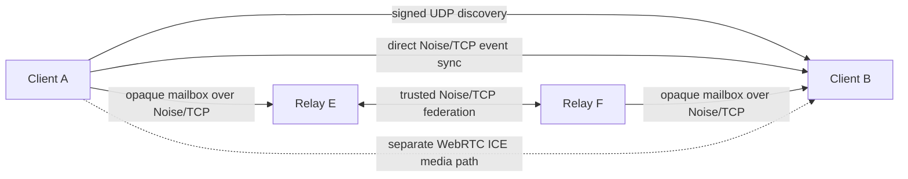
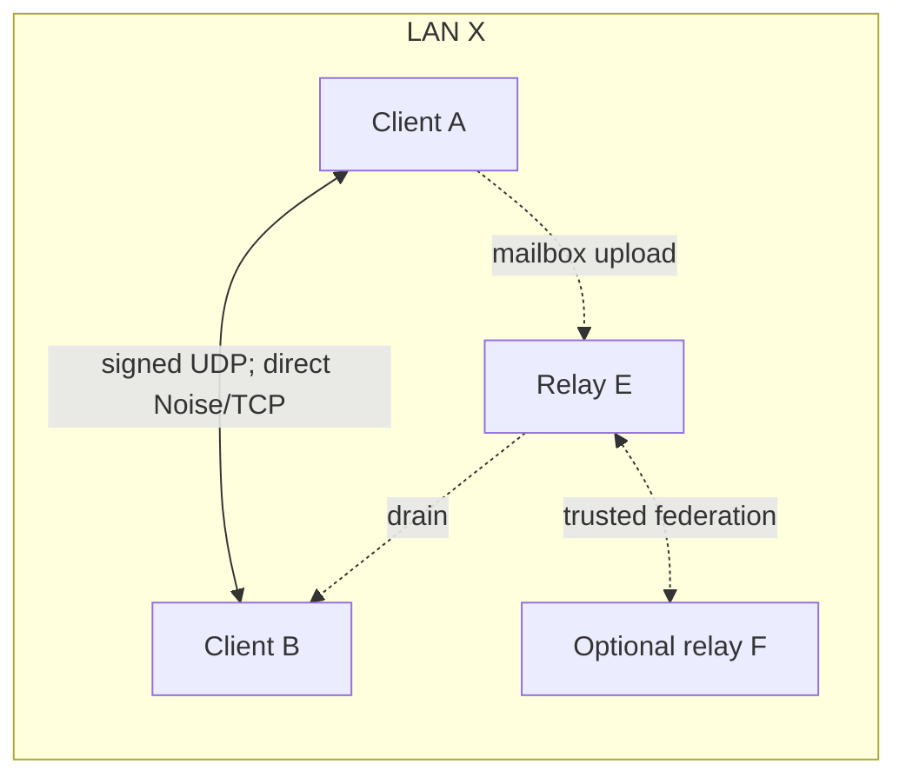
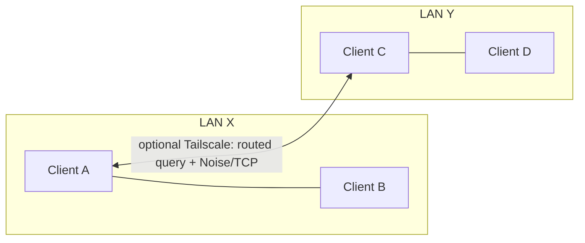
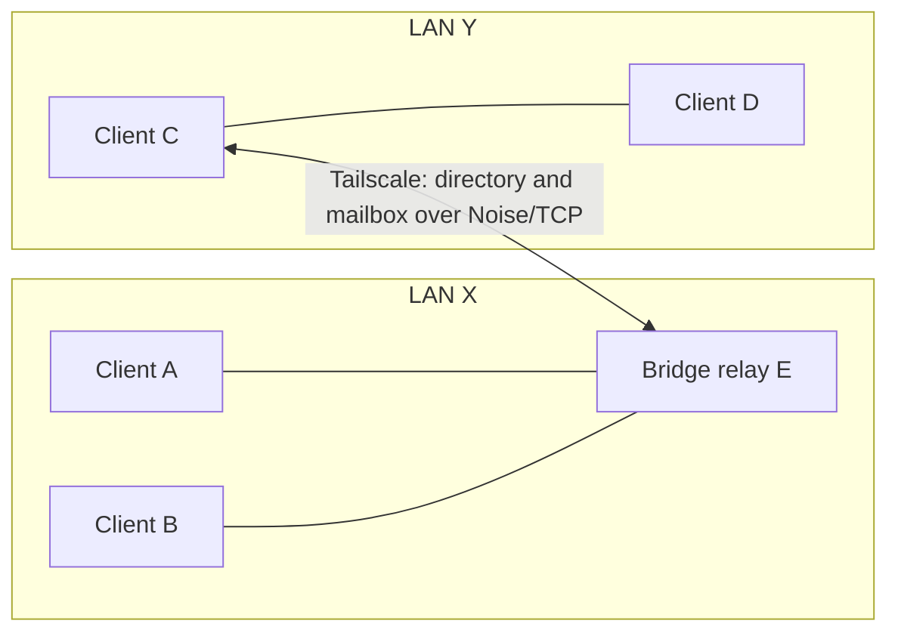
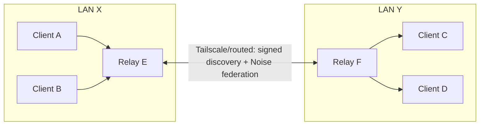
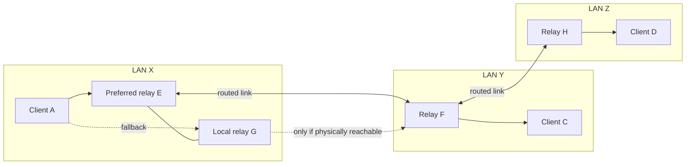
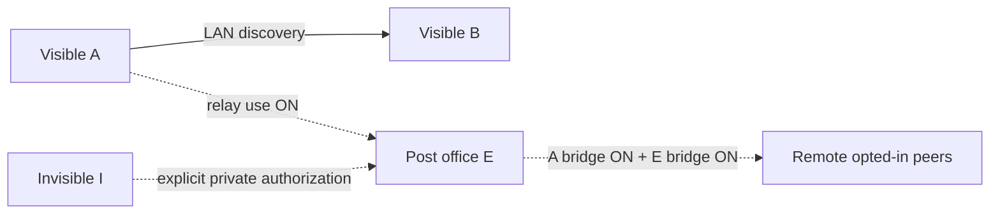

# Network topology and data-flow baseline

**Status:** review baseline for `perf/optimization-series-20261015` on 2026-10-16. This describes the current implementation and separates code behavior from physical-network evidence. It is not a claim that every combination below passed an end-to-end test.

Mesh Talk discovers **devices**, synchronizes signed events, and optionally stores recipient-encrypted events at post offices. Seeing a peer does not establish a direct route. A post office is an application relay, not an IP router, LAN multicast repeater, group member, or WebRTC media relay.

## Network and data planes

| Plane                    | How it works                                                                                                                                                                                                      | Reachability and limits                                                                                                                                    |
| ------------------------ | ----------------------------------------------------------------------------------------------------------------------------------------------------------------------------------------------------------------- | ---------------------------------------------------------------------------------------------------------------------------------------------------------- |
| LAN discovery            | Signed IPv4 announce to `224.0.0.167:47474` about every 2 s, first-sight unicast reply, and bounded local `/24` unicast fallback. A relay on a dedicated discovery port can also use `--lan-announce-port 47474`. | Same reachable LAN/application UDP scope. Mesh Talk does not forward multicast over routers or Tailscale. The fallback excludes Tailscale's overlay range. |
| Routed discovery         | Identity-free UDP query to a candidate endpoint; nonce-bound signed response. Desktop may get candidate IPs from an existing Tailscale client; manual endpoint and CLI `/probe` are alternatives.                 | Requires a known/reachable UDP endpoint. A response gives a verified device identity and TCP address, not chat permission.                                 |
| Direct data              | Noise-authenticated TCP sync reconciles signed event IDs. DMs, group events, controls, file manifests and approved chunks use event paths.                                                                        | Both devices need a TCP route and normal membership/privacy admission.                                                                                     |
| Client ↔ relay           | Noise-authenticated opt-in directory registration/query and pairwise opaque mailbox upload/drain. New opted-in public clients use relay-independent v3 mailboxes plus legacy relay-bound copies.                  | Client needs a reachable, permitted relay. A directory additionally needs client opt-in and relay `--bridge`.                                              |
| Relay ↔ relay            | Trusted LAN discovery or identity-pinned routed seed probe, then Noise-authenticated exchange of short-lived signed opt-in presence and v3 encrypted mailbox inventory/events.                                    | Both need `--post-office --bridge`, mutual trust, and an actual UDP/TCP path. No LAN subnet or plaintext is replicated.                                    |
| Calls and linked devices | Calls negotiate a separate WebRTC ICE media path. Pairing and sibling history/settings catch-up use authenticated device-to-device sync.                                                                          | DM success does not prove media or full linked-device sync across sites.                                                                                   |

“Channel” means a Mesh Talk **group conversation**, not a separate network port. A relay can carry sealed events for its members without appearing in the group's member list or changing membership.

## Switch and configuration matrix

| Control                                                                                                | Default                | When on                                                                                                                                                                                                | When off / unavailable                                                                                                                                                                                       |
| ------------------------------------------------------------------------------------------------------ | ---------------------- | ------------------------------------------------------------------------------------------------------------------------------------------------------------------------------------------------------ | ------------------------------------------------------------------------------------------------------------------------------------------------------------------------------------------------------------ |
| Client **Use post offices** (`post_office_enabled`)                                                    | On                     | Upload/drain encrypted mailboxes through known relays. Direct traffic remains possible.                                                                                                                | This client's relay upload/drain stops. Direct LAN/routed delivery remains. UI disables the bridge control while off.                                                                                        |
| Client **Discover peers through a post office** (`bridge_discovery_enabled`; CLI `--bridge-discovery`) | Off                    | Public device registers its signed presence, receives opt-in introductions and uses v3 federated mailboxes.                                                                                            | No new bridge introductions or v3 participation. Local introductions clear; remote registrations expire in about 45 s. Known-peer legacy mailboxes can still work if relay use is on.                        |
| Client **Preferred post office** (`bridge_hub_id`; CLI `--bridge-hub-id`)                              | Automatic              | A verified relay is preferred, with reachable alternatives retained. Recipient-specific directory provenance can reorder delivery candidates.                                                          | Automatic order favors a directly discovered LAN relay, then fingerprint. It is not a global hub election.                                                                                                   |
| Client **Invisible mode**                                                                              | Off                    | No public bridge registration; private explicit authorization rules apply.                                                                                                                             | Public presence follows the other controls.                                                                                                                                                                  |
| Client **Calls** (`calls_enabled`)                                                                     | Off                    | Exposes the call UI/signaling path; media still depends on WebRTC ICE reachability.                                                                                                                    | Messaging and event sync are unaffected.                                                                                                                                                                     |
| Channel **Share a copy** (`ChannelReplica`)                                                            | On per accepted member | The member can answer authorized channel and retained attachment sync requests.                                                                                                                        | The member keeps receiving pushes/history but does not serve its local channel copy to others. Mixed old/new clients can reject the versioned replica-control exchange; upgrade all members before using it. |
| Relay `--post-office`                                                                                  | Off                    | Advertises role and serves durable opaque mailboxes.                                                                                                                                                   | Ordinary device; no relay service.                                                                                                                                                                           |
| Relay `--bridge`                                                                                       | Off                    | Adds opt-in directory and allows federation.                                                                                                                                                           | Mailbox-only service for already known peers; no cross-site directory/federation.                                                                                                                            |
| Relay `--federation-peer <full-id>@<ip>:<udp-port>`                                                    | None                   | Pins a trusted identity and routed discovery seed. Use the same trusted set on all federated relays. Multiple LAN/Tailscale endpoints may name one identity; trusted local relays are also discovered. | Tailscale presence or LAN co-location alone does not authorize federation.                                                                                                                                   |
| Legacy `--bridge-peer` + `--bridge-peer-id`                                                            | Off                    | Compatibility gateway to one pinned remote relay for old clients.                                                                                                                                      | Equal-relay federation needs no gateway or elected hub.                                                                                                                                                      |

The relay flags configure a **service**; client switches govern an **individual device**. A relay's `--bridge` never opts every client on its LAN into public presence. A selected relay can fail over only to a relay the client can actually reach.

## Scenario matrix

Assume visible compatible clients, signed identities and permitted application ports unless stated otherwise. A and B are on LAN X; C and D are on LAN Y; E and F are relays. “Discover” means roster introduction, not manual safety-number verification.

| Scenario                           | Conditions                                                               | Visibility and data path                                                                                                                                 | Boundary                                                                                                         |
| ---------------------------------- | ------------------------------------------------------------------------ | -------------------------------------------------------------------------------------------------------------------------------------------------------- | ---------------------------------------------------------------------------------------------------------------- |
| 1. Same LAN, no relay              | LAN UDP/TCP works; relay use either state.                               | A↔B discover by LAN announce and sync directly; authorized group members can recover signed events from one another.                                     | No offline post-office custody.                                                                                  |
| 2. Same LAN, mailbox-only relay    | E has `--post-office`; clients' relay use on; bridge off.                | A↔B still discover directly. E can hold opaque mail for known offline identities.                                                                        | E does not introduce new peers. Custody is not recipient receipt.                                                |
| 3. Same LAN, two bridge relays     | E/F have `--post-office --bridge`, mutual trust; clients opt in.         | Clients can register with reachable relays and use either reachable mailbox. Federation reconciles v3 events. Local peers still favor direct delivery.   | Separate service listener ports may be needed on one host.                                                       |
| 4. Two LANs, no routed link        | No client or relay IP path between sites.                                | A↔B and C↔D work locally only.                                                                                                                           | Switches cannot create a physical route.                                                                         |
| 5. Two LANs, only A↔C on Tailscale | A/C have reachable overlay UDP/TCP; no relay needed.                     | A↔C can discover by routed query and sync directly; local pairs still work.                                                                              | B cannot discover C through A; A cannot discover D through C. Ordinary clients do not bridge LANs.               |
| 6. One shared bridge relay         | E on X; C reaches E over Tailscale; A/B/C opt in.                        | E introduces A/B/C. Without a direct client path, their encrypted events use E's mailbox.                                                                | D does not join through C; it needs its own E route/opt-in or a relay on Y. E is a single cross-site dependency. |
| 7. One relay per LAN               | E/F have trusted routed link; A/B/C/D opt in with reachable local relay. | Relays exchange current signed presence and v3 encrypted mailbox events. Clients discover opted-in remote peers and use local/known relays for delivery. | Neither relay creates direct A↔C TCP reachability; legacy relay-bound mailboxes do not federate.                 |
| 8. Several relays, three sites     | X has E/G; Y has F; Z has H; some routed relay links exist.              | Equal relays gossip opt-in presence and v3 mailboxes over reachable trusted edges. Client can prefer E and fall back to reachable G.                     | If G has no route beyond X when E fails, cross-site delivery waits for another routed edge.                      |
| 9. Switch-off/privacy variant      | Physical topology otherwise like 7.                                      | Bridge-off client is absent from cross-site directory; relay-use-off client stops mailbox I/O; `--bridge`-off relay supplies only mailbox service.       | Invisible mode uses separate explicit permission/private-route rules.                                            |

### 1–3. Same LAN: direct sync with optional custody

Direct delivery is attempted independently of relay custody. Group/channel events are sent to authorized members; member anti-entropy can recover missed events. E and F never become group members. With no relay, delivery waits for a later direct route or another authorized member with the event.

### 4–5. Separate LANs, with or without direct Tailscale clients

Remove the A↔C edge for scenario 4: the LANs remain isolated. Adding it gives only A and C a direct path. Tailscale provides IP reachability to its members; Mesh Talk does not route B's packets through A or forward multicast.

### 6. One relay reachable from both sites

Only opted-in A, B and C register self-signed public presence with E. D's LAN association with C is insufficient: D must contact E independently or use a local relay on Y. E can carry sealed channel events for authorized members, but cannot grant membership.

### 7. Federated relays on two LANs

1. Each opted-in client registers signed public presence with a reachable local relay. Relays exchange current proofs; registrations expire after roughly 45 s without renewal.
2. Directory introductions supply verified identities and relay routes, **not** fabricated direct remote client IPs.
3. A sender tries a real direct route if available, then uploads recipient-encrypted events to a reachable relay. E/F reconcile v3 pairwise mailbox sets. Recipients periodically drain known relays and apply the normal validation/decryption gate.
4. Only the recipient's validated delivery receipt marks a tracked message Delivered. A TCP session or relay custody alone does not.

Federation preserves the original mailbox arrival time, so copying does not reset its **30-day maximum** retention clock. Event-count/byte caps can evict whole mailboxes earlier. Local user history retention is separate.

### 8. Equal relays, fallback and physical partitions

All relays have equal protocol roles and share a trusted seed set; there is no elected global hub. If E fails, A can upload to online G. Immediate cross-site delivery needs an actual G→F link or another reachable relay chain. Otherwise ciphertext waits for reconciliation after a path returns. Preference is a hint: a relay that reported a recipient may take priority for that destination.

### 9. Off switches and invisible devices

Dotted paths require the named switches. Turning bridge discovery off clears this device's directory introductions, without disabling direct LAN discovery or every legacy mailbox. Turning post-office use off stops this device's relay upload/drain. Invisible mode does not register public bridge presence; see [privacy controls](privacy-controls.md).

## Synchronization by feature

| Feature              | Direct LAN/routed path                                                                                                 | Relay/federation path                                                                       | Do not infer                                                                                                  |
| -------------------- | ---------------------------------------------------------------------------------------------------------------------- | ------------------------------------------------------------------------------------------- | ------------------------------------------------------------------------------------------------------------- |
| 1:1 text/controls    | Noise/TCP event sync, durable retry and authenticated recipient receipts.                                              | Opaque pairwise mailboxes; v3 copies move among trusted relays for opted-in public clients. | Relay custody is not recipient receipt; a directory route is not direct TCP.                                  |
| Group/channel events | Signed membership, per-sender encryption, direct fanout and authorized member anti-entropy when replica sharing is on. | Recipient-sealed events can use relays; relays are not group members.                       | Discovery does not join a group. Invitations, acceptance, replica version and routes to members still matter. |
| Files/folders        | Manifest and consent, encrypted chunk events, integrity verification.                                                  | Mailbox events may participate, subject to consent, size and retention.                     | A DM test does not prove full large-file bytes; a card receipt is not file completion.                        |
| Linked devices       | Pairing, history and settings sync need an authenticated sibling connection.                                           | Ordinary sealed messages/introductions may be relayed.                                      | Federation does not replace full sibling sync.                                                                |
| Calls                | Signaling uses application paths; media uses WebRTC ICE.                                                               | Application reachability may help signaling.                                                | No guaranteed cross-LAN media path or TURN service.                                                           |

## Evidence and review questions

The implementation seams for a row-by-row review are [signed discovery](../crates/mesh-talk-core/src/discovery/service.rs), [client bridge registration](../crates/mesh-talk-core/src/node/bridge_client.rs), [relay selection](../crates/mesh-talk-core/src/node/postbox.rs), [opaque client mailboxes](../crates/mesh-talk-core/src/node/opaque_relay.rs), [relay federation](../crates/mesh-talk-core/src/postoffice/federation.rs), [channel delivery](../crates/mesh-talk-core/src/node/channels.rs), [retention](../crates/mesh-talk-core/src/postoffice/mod.rs), and the [desktop relay settings](../src-tauri/src/settings.rs).

The [architecture reference](ARCHITECTURE.md#4-networking--delivery-discovery-node-postoffice), [routed discovery guide](routed-network-discovery.md) and [relay metadata guide](post-office-metadata-privacy.md) give protocol details. Targeted code/tests cover signed routed discovery, bridge opt-in, relay fallback, federation presence/mailbox reconciliation, 30-day copy expiry, channel delivery and consented files. Earlier `scripts/e2e-tailnet-macos.py`, `scripts/e2e-four-machine-tailnet.py` and `scripts/e2e-four-machine-hub.py` rigs exercised direct or legacy gateway paths; they do not prove every new federation combination.

A four-machine live encrypted cross-LAN DM with Windows preferred passed after federation deployment. This does **not** prove an independent ordinary client on mac-mini's LAN, forced preferred-relay outage with an alternate cross-site path, cross-site calls, or complete file bytes. A relay and client running on mac-mini itself are not equivalent to testing a separate host there.

| Decision to confirm                                                                         | Current baseline and useful check                                                                                               |
| ------------------------------------------------------------------------------------------- | ------------------------------------------------------------------------------------------------------------------------------- |
| Must remote ordinary clients opt in to public bridge discovery?                             | Yes, per device. Test an opted-out client beside an opted-in client on LAN Y.                                                   |
| Must preferred-relay failure fall back locally?                                             | Yes for mailbox transport. Select E, stop it, and check G custody plus recipient receipt when G has a cross-site route.         |
| What happens if G has no route after E fails?                                               | Queue ciphertext and reconcile when a routed edge returns; UI must not claim recipient delivery from custody alone.             |
| Do group events, file bytes, calls and sibling sync meet the desired cross-site experience? | Test each separately with an independent client host on mac-mini's LAN. DM success is insufficient evidence.                    |
| Is a common pinned relay seed set acceptable to operate?                                    | Equal protocol roles still require trust bootstrap and routable addresses. Confirm this model before changing discovery policy. |

Use this as a discussion baseline: record a desired difference here, then compare the relevant implementation path and test it on a topology that isolates the physical networks.
